# 吴恩达《用直接偏好优化对齐LLMs｜Aligning LLMs with Direct Preference Optimization》中英字幕 - P1 - GPT中英字幕课程资源 - BV1Bu4m1M7XY

Hey everyone， my name is Dah Chan Morgan and I'm part of the community team here at Deeplearning。

aiI Today we have really special guests to talk to us about direct preference optimization and really excited to dive in for everything just for everyone's information the session will be recorded and the slides and notebooks will be available after the event for any questions please fill out the slido link we've dropped it in the chat and you can vote on the questions you would like answered the most。

For today's workshop， we'll focus on the landscape of chatbots。

 which has dramatically changed in the past year， which has been fueled by advancements of large languageage models like Chat EBT and Lama。

 while traditional supervised fine tuning has dominated the field。

 recent research highlights the potential of aligning language models with human preferences for increased helpfulness and safety This workshop delve into direct preference optimization。

 DO， a powerful technique used to trains Ze， the current state of the art for 7b parametermeter chat models for all of you attending you'll agree practical knowledge on fine tuning LLMs for chat。

 understanding the theory and application of DPO with hugging face tools and learn key metrics for evaluating chat model performance。

For our event partner today is Hugingfaceace， Huging Face is an AI company。

 I'm sure all of you know that specializing in natural language processing and machine learning and is known for its open source contributions and collaborative approach to AI research and development。

 the companies famous for developing the Transers library which offers a wide range of pre-tde models and tools for a variety of NLP tasks。

 making it easier for researchers and developers to implement state of the art AI solutions。

 Huging Face also fosters a vibrant community for AI enthusiast and professionals providing a platform for sharing models。

 data sets and research which significantly contributes to advancements of AI technology。😊。

So for today I want to introduce our first speaker hey Lewis happy to have you here Lewis Tensall is a machine learning engineer at Hagingb his work lies at the intersection of the open source and research teams he's the co-author of the bestseller NLP with Transformers book and has previously built machine learning powered applications for startups and enterprises。

 the domains of natural language processing， topological data analysis and time series he holds a PhD in theoretical physics was a 2010 Fulbright scholar and has held research positions in Australia。

 the US and Switzerland his current work focuses on building tools and recipes to align language models with human and AI preferences through techniques into reinforcement learning。

😊，Happy to have you here， Lewis。Thank you for having me Di absolutely and for our second speaker we have Ed Beching Ed has been a research scientist at Haging F for the last two years focusing on building open tooling for LLM fine tuing implementing say that our LLM alignment algorithms and building preference data sets Ed is the creator of the open LLM leader board co-author of Zephyr and a maintainer of numerous open source ML libraries his PhD was focused on deep reinforcement learning approaches for planning and navigation and robotics his current research has predominantly embodied。

😊，Learning and LLM alignment， we're so happy to have you here today， are you guys excited to dive in？

😊，Yes， come wait， absolutely well take it away。Great， thank you so much， all right。

 so we're going to talk today about this idea of alignment in LLMs with a specific lens of an algorithm called a direct preference optimization。

😊，And so for those of you who are hearing these words for the first time。

 this was a kind of big breakthrough from a set of Stanford researchers last year who showed that a lot of the complexity that goes into the kind of conventional alignment techniques that were pioneered by open AI and Anthtroic can actually be addressed in a much simpler and memory efficient way。

And as you'll see throughout this talk， there are some sort of technical details that are useful to understand and we're going to try and do our best to kind of demystify a lot of the sort of mathematics that goes into these types of algorithms and also show you some practical examples of how you actually train language models using various tools in the Hpe ecosystem。

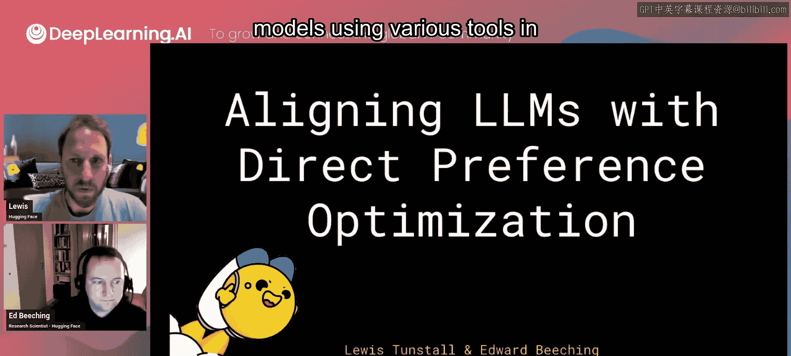

So。To get started， I thought it's maybe nice to ask ourselves like， you know。

 why would we want to align an language model in the first place and maybe ask a bit of a philosophical question。

 what is alignment？So I think most people here probably have some familiarity with language models and you know that the first step when training a language model is a process called pre training。

Where you essentially feed a transform neural network typically。

 a large amount of data from the internet， and you get the model to basically predict the next token in the sequence given the previous tokens it's seen。

And so this ends up being like a very， very powerful kind of autocomplete model。

Which you can do tricks like future prompting to generate certain answers。But as an autocompr。

 if you ask it a question that is something like information seeking like you know is pineapple on pizza or crime。

 then this base language model will just autocomplete what it thinks are the next most probable words to that and in this particular example it might say。

 well you know this is one of many questions that will be answered at the pizza party because that completion is from some sort of text that it saw during the pretraining。

So these base language models， they have their use。

 but they typically need some additional tuning in order to be able to be used as chat models。

So the second step is typically called supervised fine tuning and what you do in this step is you provide the model with you know a few thousand examples where you've got a user asking a question and either a human written response or some LLM generator response that provides an answer to that question so in this particular example maybe the human annotator really hates pineapple on their pizza and they wrote in the annotations that you know this is really bad and so。

The the model when you ask a question says， well， you know， yes。

 adding pineapple and pizza is a crime under the Gene Convention。

And so this SFT model has essentially learned from the kind of fine tuning data and also from the pretraining data that there are some biases present there。

 and those biases can kind of be expressed in this particular way。Now。

 the thing is you might be a member of a company like Domino's or Pizza Hut。

 and you actually you know， maybe your customers， they actually do like pineapple like pizza。

And so one way you can kind of sort of adjust your language model to encode those kind of preferences from your customers。

Is to essentially provide your language model with a bunch of questions。

 you can generate a few answers in this case maybe yes or no。

 and then you can get your like customers or your human labelers to annotate this and then this will give you a way of encoding some alternative preferences that are not directly present in the pre-training of the supervised data and essentially what you're trying to do is you're trying to like learn or teach the model how you can model the probability that the kind of preferred response is more likely than the disreferred one。

And you know， if you do this process correctly you'll end up now adjusting the probabilities that the model will emit an answer that is more aligned with your human preferences typically。

 so in this case you know maybe as say no， adding pineapple is not a crime it's not of personal preference or taste。

So the thing to mention here is that alignment you know。

 nowadays I think is often associated with things like censorship。

 so most people who have interacted with ChayBT at some point get a refusal like you know as a language model I can't do X。

Y， Z。😊，But it's really a broader concept， which is that as humans。

 we typically have some preferences， these are things that you know are diverse and depend on our culture and upbringing。

 but those preferences can in principlely modeled through neural networks and then we can adjust our language models to behave kind of more in accordance with what our end users may want。

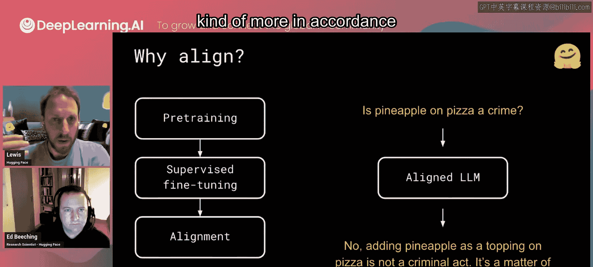

So before we dive into DPO， I think it's good to sort of show the original approach that Open AI pioneered。

 so they called it RLHF or reinforcement learning from human feedback。

And the basic idea they had was this very similar recipe， you do supervised fine tuning。

 in this case they had humans basically annotating and creating these examples。

 these high quality examples of questions and answers。

And then they fine tuned a variety of kind of GPT models on that data。

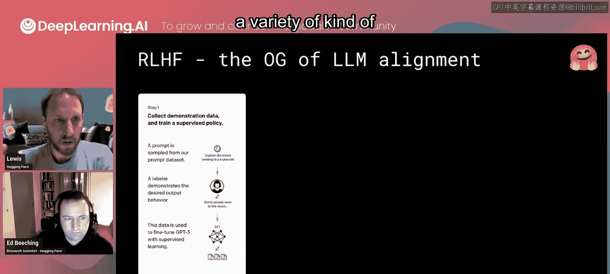

And last year， when sort of ChaGBT had just come out。

 the open source community didn't really have many high quality data sets。

That you could use for supervised fine tuning but this has really changed and so now there are some really good examples you have one called Open Hermes from Techingham or Dolphin from Eric Hufford and these are data sets that you can use today to kind of convert any sort of base language model into a chat model and these models if you train on these data sets you'll typically get a very very good chat model that you can converse with in certain ways。

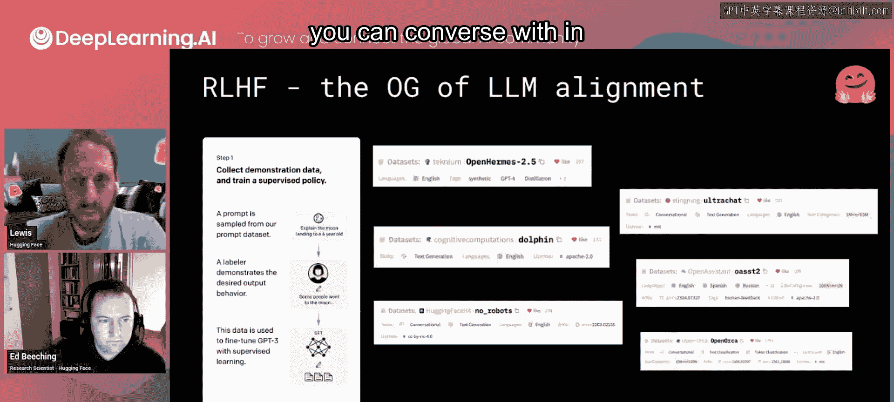

So what I did next is they said， okay， we've got this chat model。

 now we need a way to sort of model the sort of human preferences from annotators。

And so the way they did that is they basically took a collection of prompts。

 they fed it to the chat model and the chat model generates a variety of answers。

 and then those answers are rated by labelers from best to worst。

 so this gives you a kind of ranking of you know which answers are preferred over the others。

And then essentially you train a new type of model， kind a reward model。

 which essentially learns how to predict， you know， given some response from a model。

 what is like the kind of score or the preference score associated with what the human labelers gave。

And if you do this， you've now got essentially kind of like a regression model that you can use to basically rate any sort of outputs。

 and then this gives you a way of sort of mapping those human labels into the preferences model。

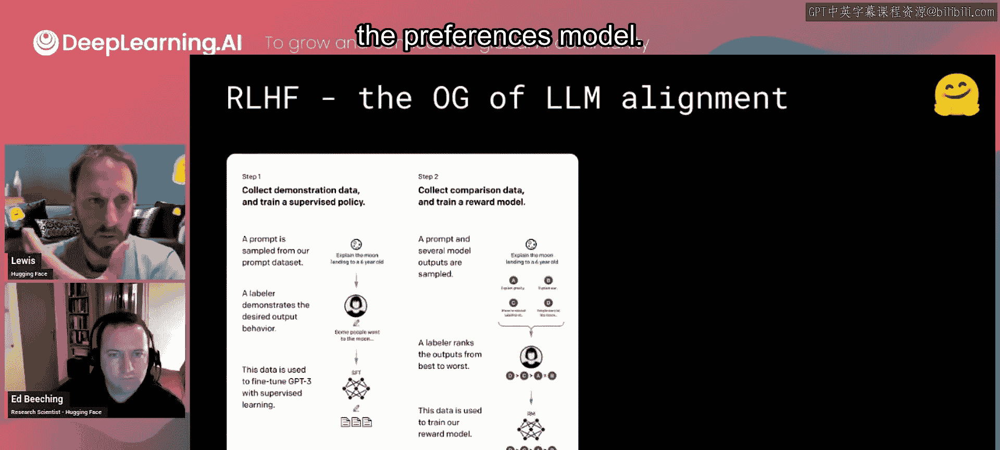

So we've got two models， we've got a chat model and a reward model。

just to mention that we have also now many public data sets that can do this。

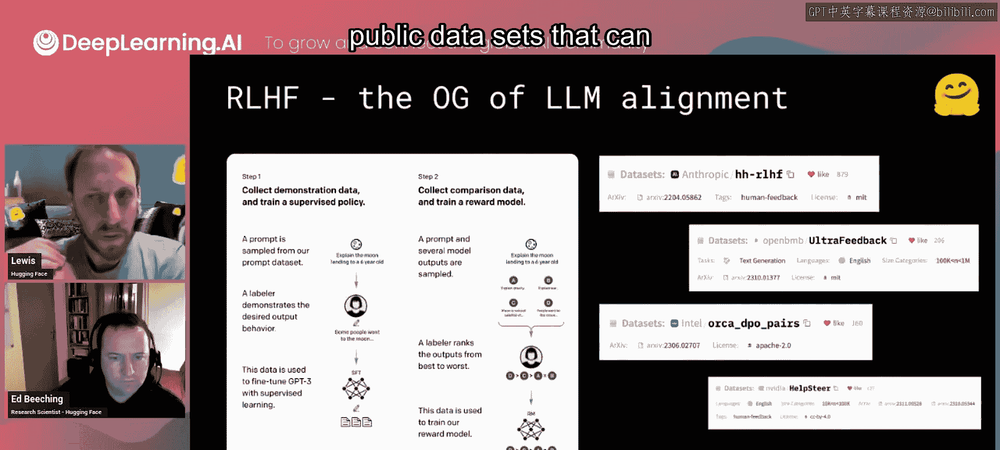

But you've got the chat model and the reward model and the final step is to somehow combine those two to create a sort of new chat model that has learned how to encode the kind of signal from that reward model。

And the way that OpenI did it and also anthropic has been using reinforcement learning。

 so the basic idea here is that you provide your chat model with a prompt。

 you will generate an output， you can then rate or score that output using your reward model。

 and then you can use that score to basically update the weights of your original chat model to be kind of more aligned or closer。

 in those preferences。And so if your human annotators are rating things in certain ways。

 that that kind of behavior or those preferences will then be essentially encoded into your updated chat model。

 and the result of this will be something that is like you know chatyBT or Clade ph Anthropic。

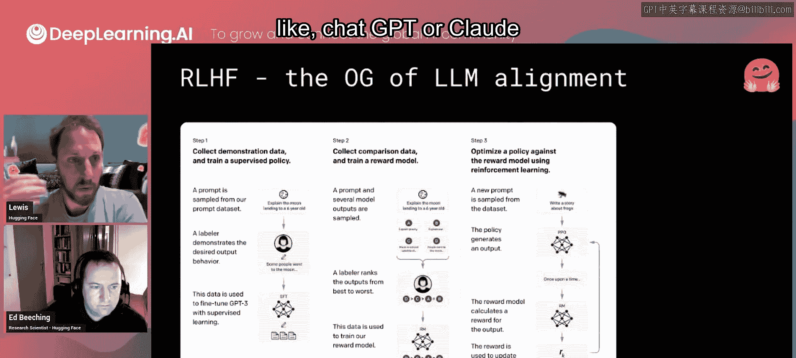

So mathematically， I don't want to make this too scary。

 but the basic idea is that you're trying to sort of maximize the rewards that the model can get。

 so you give it all these prompts， you score the outputs and you want the model to kind of get better at producing outputs that get high rewards。

But if you just only use a reward model it turns out there's a thing called reward hacking where effectively the chat model can learn that if it outputs certain words or tokens that have very high reward it can just keep doing this kind of ad nauseum and you just get a kind of garbage model that would just output you backslashes or you know emojis or something because it turns out that might be something that is rewarded highly so what opening eye introduced was an extra term which they call a Kale penalty and basically what this does is this measures kind of the distance of your original chat model versus the model that you're currently optimizing and there's a paraal beta which can kind of controls how closely you want those two models to be next to each other。

And if you take these two things together and you optimize it with a reinforcement learning algorithm like PPO。

 you get something which is typically a very performant and aligned model。

Now there are certain challenges associated with this。

 the first one is that anyone who's done reinforcement learning knows that this is typically very unstable。

 there are many hyperparameter afternoon and one of our colleagues at Hogan Place called Costa。

 he's done this heroic effort to kind of reimplement the original like RLHS pipeline from OpenI from scratch and there were crazy things like you know changing one of the parameters in the atom Opimr had a big difference on the outcome。

So that's like a very kind of， let's say， finicky beast to get right。

And the other thing that's also kind of a challenge is that you've basically got two models that you have to deal with so you've got the chat model and the model that you're trying to sort of optimize and become more alignedign and then you've got the reward model as well so you've got three large language models that you've got to juggle and you know nowadays the compute hardware is getting quite good but if you want to do anything you know at very large scales of like you know 30 billion parameters more you're going to need a lot of compute to be able to juggle this so this makes the whole process quite challenging both from an engineering perspective but also from stability perspective。

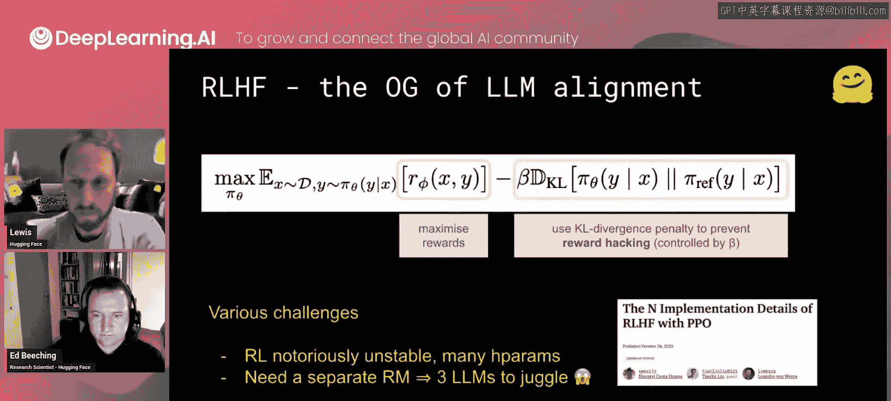

So the kind of idea behind direct preference optimization is to say， well。

 maybe we don't need reinforcement learning and the question is okay。

 if we don't use reinforcement learning， what are the alternatives？

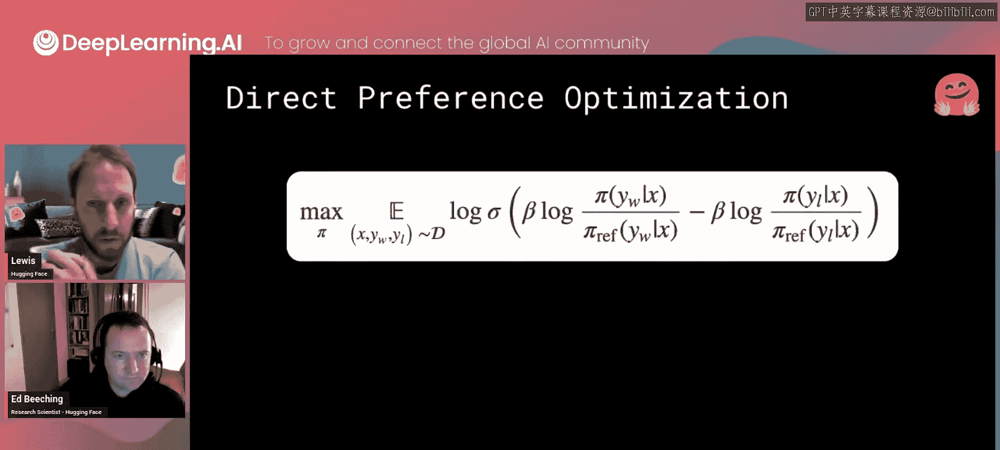

So the basic observation they made was that instead of trying to kind of maximize this combination of a reward model or a signal from a reward model with this kind of k penalty。

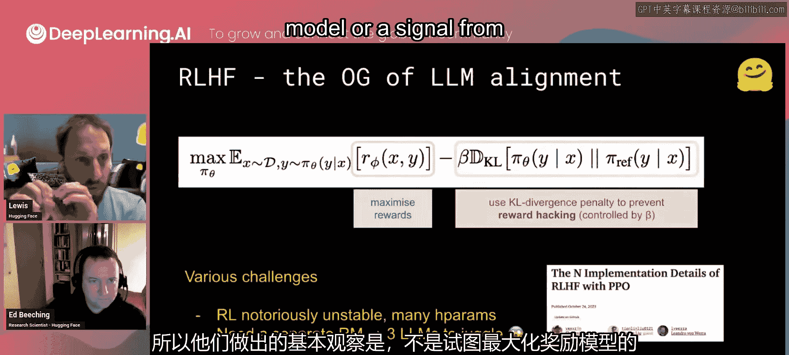

The idea was maybe we can just change the kind of objective in a certain way that directly encodes or implicitly models the kind of score that a reward model would learn。

 so you effectively don't have a reward model anymore。

 you just have your original language model but your language model through the process of this optimization learns how to model those preferences directly。

So just to go through this equation kind of kind of quickly。

 the basic idea is we're going to take a prompt and then we're going to have preferences。

 binary preferences of a good and a bad answer。So in this case。

 you might have your prompt is like is pineapple and pizza a crime and then the good response is no。

 the bad response is yes。And then what we're going to do is we're going to basically compute two things。

 we're going to try and compute basically the kind of log probabilities that the model is able to kind of correctly predict the chosen response so here what we do is we take a ratio of two terms the term on the top is the model that we're optimizing kind of throughout the optimization process。

And then we have a reference model underneath it which kind of normalizes the probabilities so that we don't drift too far away from our reference in the same way that this KL penalty worked previously。

And then we have another term， which is very similar。

 but now instead of trying to compute the log probabilities of predicting the desired response。

 we try to predict the log probabilities of the sort of undesired response。

And so if you just take these two terms and you combine bind them together。

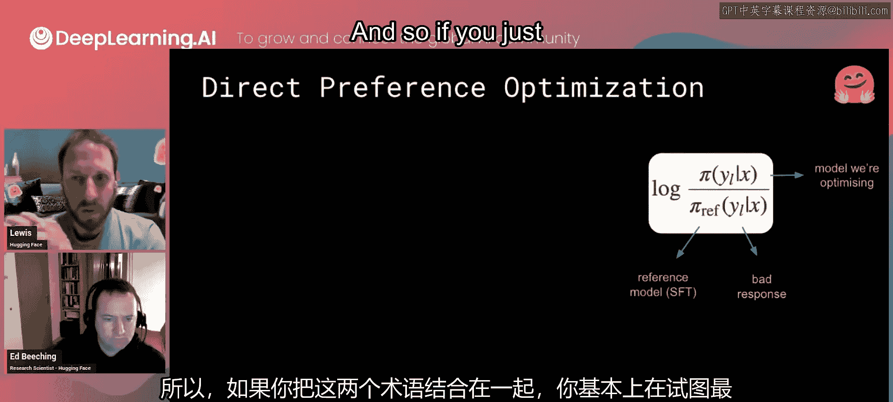

You're basically looking at trying to kind of maximize essentially the difference of two terms where one is like the chosen response。

 one is the rejected response， and you're trying to make the model get much。

 much better at predicting the chosen response， which should hopefully then align with your human preferences。

And the cool thing about this algorithm is that it's differentiable。

 which means that we can just use back propagation to optimize a model。

 and this is also why we don't need reinforcement learning because the previous objective that we showed before isn't differentiable。

So just to walk through the algorithm， you basically take your prompt。

 you have these two responses of good and bad， you feed them through two models。

 you have your reference model and the model that you're optimizing， and then you do back。

 and then that's basically it。And in terms of Pytorch code you can see here that it's。

 you know roughly， I know 10 lines of code so this this when I kind of first saw this。

 this was like first surprising that something so simple would work。

But when we actually tested it ourselves， we found that compared to our reinforcement learning pipeline。

 it was much， much faster to get models that would converge and be much better aligned than previously。

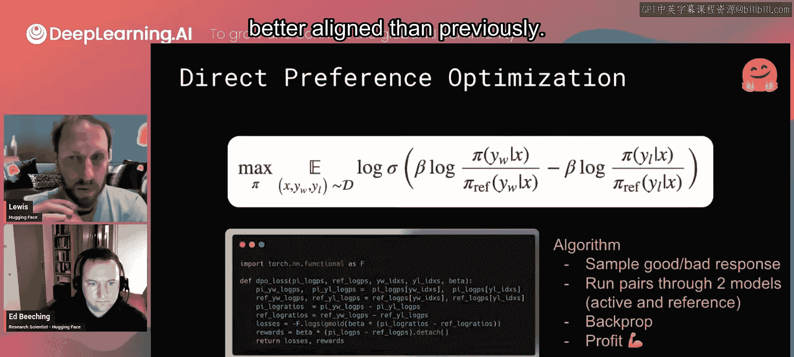

So just to sort of linger a little bit on sort of maybe the most important kind of idea here。

 there's basically this kind of parameter called Beta and this is the main hyperparameter that you need to kind of tune when you're doing DPO and Ed will tell us a little bit later about some other parameters that we found are important。

But essentially when we are computing like an update or gradient update。

 this is essentially when we're trying to take a direction in the optimization of the model。

 there's effectively kind of like three terms at play here so the first term is essentially there's a kind of weighting factor that goes over the loss and this weighting factor is basically measuring the difference between the kind of rewards or the implicit reward of getting the incorrect response versus the correct one。

And so if your model is like continually getting like the kind of incorrect answer was continually predicting the incorrect label。

 then this weighting factor will become large because it's a sigmoid so it will go up towards one。

 and then that will kind of penalize the model to basically have a higher penalty for getting the incorrect estimates。

And then you've got these other two terms， which are essentially the difference of just increasing the likelihood that your model predicts the kind of chosen answer and you're trying to decrease the likelihood of the rejected answer。

And you've got's a plot here shown of some training runs where you can see that effectively what happens as we increase the beta parameter is we're effectively kind of pushing the model to kind of train in such a way that the difference between the chosen and the rejected answers becomes larger and larger。

And so this can be important because you may have like quite noisy data that has like you know。

 kind of fuzzy labels between chosen and rejected， you know。

 maybe the quality of them is a bit mixed。And by tuning this beta parameter。

 you can kind of control how much you want model to focus on the chosen responses versus the rejected ones。

And you know typically that you have to run a couple of experiments at different values to try and find which which is the best one。

 but the basic idea is that beta fundamentally controls the kind of target margin。

 which is the difference of these kind of chosen and rejected rewards and by kind of increasing that you can get you know quite different behavior。

And you know， if math isn't your thing， then Tom Goldstein， who's a kind of grandmaster of me。

 he showed this is roughly what's going on in DPO， basically you know you just kind of do gradient desent on the good stuff and you do gradientnesscent on the bad stuff and this is why to some extent DPO has been so popular because it's a very simple algorithm and it means you can basically train models without actually having to train the reward model independently because you're modeling everything implicitly。

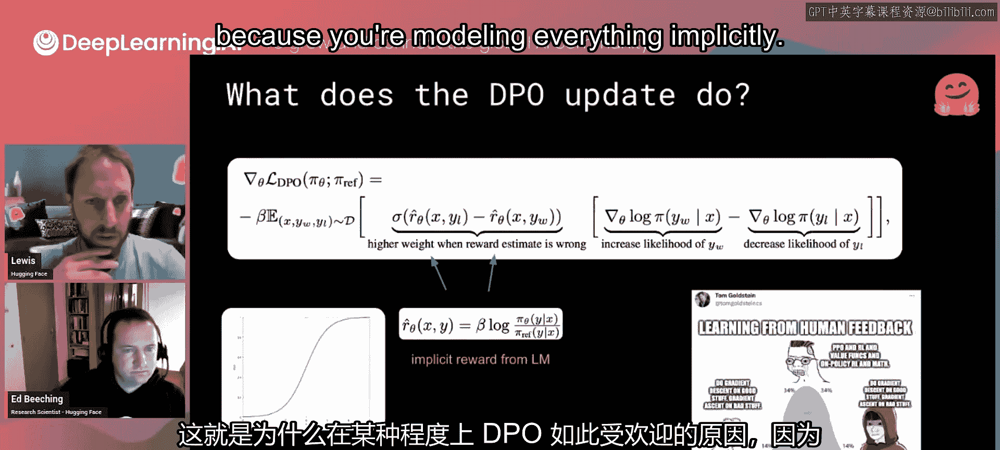

So here's a couple of examples I'll walk through， so one of the ones we trained at Hogingfacese。

 it's called Zephyer and what we were interested in looking at with Zephyer is that in the DPO paper the authors had explored comparisons of DO and PPO using kind of small models so small being like around two to 3 billion parameters。

And they had done it using kind of like academic data sets。

 and in particular they had used a data set for chat that you know wasn't really optimized for performance。

So the idea that we thought was like， well， we know there's this trend in the community to kind of create synthetic data sets that are around essentially using。

 you know， chatTPT models conversing with each other or rating each other's responses。

If we use those data sets together with DO， maybe we can get rid of human feedback kind of all and still produce a good performing model。

And so in this example， what we did is we took a popular data set for supervised function tuing called Ultracha。

And we use that to train a chat model， the initial SFT model。

And then we took another data set of synthetic feedback where you essentially have Gputy4 rating responses across a diverse number of different models。

And then we use those two data sets to basically do a DPO using the Mitri 7 B base model which had only just come out a week or two before。

And kind of one of the surprising things we found is that if you apply this process。

 you get a kind of 7b model that is like， you know relatively competitive on you know various chat benchmarks like MT benchch compared to much larger models like Lama 70B。

Now the usual caveat here is that these benchmarks they have certain biases， so for example。

 if you train models on GT4 data because GT4 is acting as the evaluator。

 it tends to kind of favour its own。Its own kind of style， but nevertheless。

 if you actually converse with a ZI model it's actually quite quite capable and so this was one of the sort of first public demonstrations that you can apply this recipe to larger models with kind of more capable data sets。

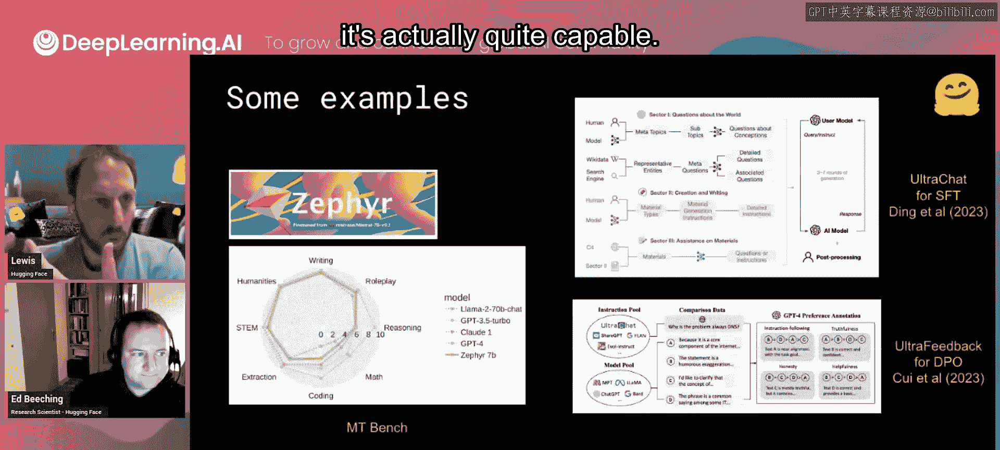

And since then the community has really taken this idea and pushed it in much further directions so for example。

 some folks at Agula they did DPO on top of the Mitri model or the mixedtri models for when it came out there's a guy with John Durbin who creates lots of very。

 very interesting DPO data sets and he uses this to fine tune the year34 B model and then of course Mitri have been using DO a lot to align their models and now Nu research and Technium have been doing this themselves。

So there's essentially， I would say DPO has become nowadays the kind of canonical alignment algorithm。

 at least in the open source community。And there's two main libraries that you can use to do this。

 so the one we have a hugging face is called TRL or Transformer reinforcement Learn。

 but there's also axolotl which is very popular alternative and Ed will show you later a little bit about how TRL works。

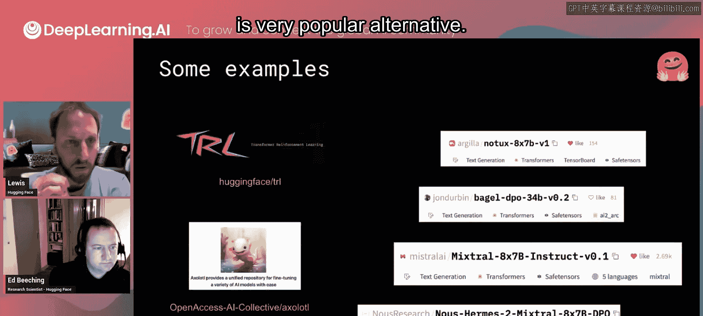

So just to sort of wrap up this kind of quick overview， generally speaking。

 what you see in like the academic literature in machine learning is once there's a very popular idea。

 many， many people would try to find ways to extend it and improve it。And DPO is no exception。

 and one of the sort of first improvements that was made was by researchers at Deepmind。

 they developed something called IPO or identity preference optimization。

And the kind of observation they made was that when you do DO。

 there's a risk that you end up overfitting basically to the chosen response in your data set。

And so if you want to prevent that from happening， you can add a regularisation term in a similar way that we would do this if we're doing any kind of light regression。

 youre basically out of weight。And they showed him there。

In their paper that this gave better results than DO。

 and we at Huging phasease also did some experiments kind of comparing the two methods and we see that they're roughly comparable。

 there's a bit of trade off depending on the parameters。And then at the other level。

 there's a lot of recent work going on around this idea of like iterative DPO or let's say online DPO。

 and there's a nice example from S snorkel where essentially what they did was they took a reward model from A AI。

 and they used essentially the prompts from U feedback to generate responses from their chat model。

 they use the reward model to basically rate and rank those prompts。

 and then they ret another DPO model and then they generate again a new prompts， rate and rank。

And then you do this a set of times and you get a model that gets progressively better and better。

And what's exciting about this is it's very close to how Lama2 was trained。

 Lama2 was trained a sequence of progressively improved models and it's also what we as far as we understand is how some of the anthropic models are trained training this kind of online fashion where you're continually improving the model with new data so I think this is quite an exciting direction。

And one of the sort of other more interesting branches that we've seen is a new algorithm called KTO or Carneman Tversesky optimization。

And this is from researchers at Stanford and contexttual AI。

 where they make the important point that if you want to collect preference data。

 you need to have essentially a prompt and two answers where one answer is the desired one and the other one is kind of the counterfactual or the one that you don't want。

And if you try to do this with human feedback， it's very expensive。

Um to collect because you need annotators to interact with with your chat model and you know pick at every step。

 what is the preferred response？But you can actually， if you're clever like they are。

 you can actually define the loss in such a way that you only need to collect basically something that is deemed as good and something that is deemed as bad and they don't have to be related to the same prompt。

And so at Hoging F we're quite excited about this algorithm we think it has a lot of promise and it's probably going to be the thing that you you can hope to see from us soon showing you know how it works at various scales the paper itself is worth reading they do a lot of great experiments。

And what seems to be missing currently is having some kind of good label data sets to run the S scale。

But this is very， very exciting。So maybe it's a good time to take some questions， Ed。

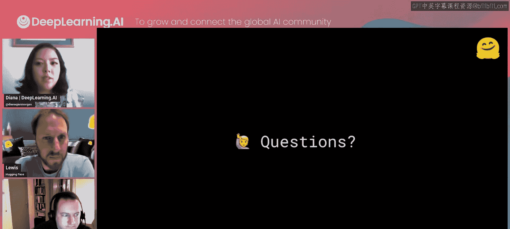

Yes， yes， absolutely。 so let's start off with the first onem just going。

How do you evaluate the quality of open source alignment data sets？

Yeah that's a really good question I would say in general it requires a bit of what we would call vibes testing so you just have to look at the data yourself and I think this is often one of the things that I always try to sort of tell people is like look at the data because there's often strange errors in the labels and probably the most popular method today is to use another language model to do the ratings so probably the most common example is using Juy for to basically judge the quality of responses。

And what typically we find is Gpy4 is quite good on many kind of， let's say creative。

Tasks or tasks that you know require maybe like high school level reasoning。

 but if you ask it to kind of judge the quality of like responses involving maybe some in mathematics or some code。

 it can kind of hallucinate and make errors in judgment and so this isn't to say G is bad it's just that like any sort of hard task even for humans it would be hard to come up the right answer but currently today this seems to be the way that you know the community is rating quality。

Absolutely， for this question， how much data is ideal for this process for the alignment？😊。

Yeah great question， so what we've seen in practice is if you're doing this kind of multistage process of SFT and then DPO。

 you probably can get by with you know a 10 to 100。

000 examples of SFT training data and then maybe around 50K examples for the DPO step。

But I have seen examples lately there's an algorithm called data where they show that they can actually use only 6000 examples for the SFT step。

 which radically reduces it so I would say roughly 10。

000 examples for SFT and maybe you know 10 to 20 for DO that would probably get you a pretty good model。

 the open question is that as far as we know like the other labs are open ion and enthropic they're using many。

 many， many more examples and presumably if you do this kind of iteratively you get much better models。

Absolutely perfect well thank you so much Lewis， I think we'll dive into the second section with Ed so I'll bring you guys up。

 take it away Ed。😊，Great thanks， so this is going to be a more sort of practical dive into how to actually run SFT on DPO on your dialogue data sets。

And one of those things is you have these day sets of conversations and how do you actually format these in order to tokenise them and feed them to a model in order to fine tune？

We've got some links in this presentation to a bunch of SFT and DPO data sets。

 so if you're interested in getting started there's a good starting point。

And then I'll go through some metrics mainly for the DPO step of how to sort of evaluate whether your DPO is training well。

 how to identify problems with your training， and then once you've actually trained your chatbot you probably want to evaluate it you might test it out yourself by chatting with it。

 but you might want some automated way to do that and so I'll suggest some ways of how we do this and some tools available in the community for doing this。

Before I get on DPO， however I'll first talk about the supervise find tuning the SFT step because it's important to do this step before DO。

 we've actually run some experiments where you kind of skip this step and you jump directly to DPO and actually it's very。

 very hard to perform the DPO step we find that the model the LLM。

Fails to learn the dialogue template is one thing that we observe。Right， so I'll get started。

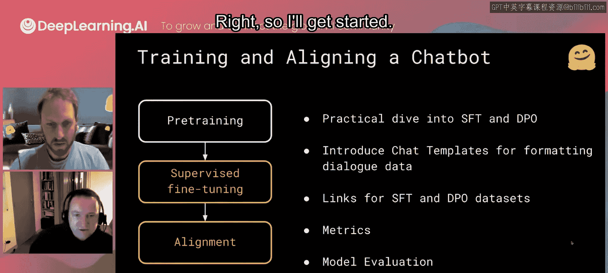

嗯。Yeah， so to accompany this presentation， we've created two annotated notebooks for SFT and DPO。

These have been written in a way that they'll run on a Google collab or GPU。

They should be what they should run initially I was thinking we could actually go through this live。

 but actually these models take many hours to a train， so it's better to sort of run them offline。😊。

We don't plan to update these notebooks so we actually have a more up to date version of our examples which is the Huging face alignment handbook and so check that out and this has examples where you know if you're like GPU poor。

 if you've got a consumer GPU with like 24 gigabgram。

 you can run some low resource examples with Laura and if you're GPU rich there's multi GPU multi node examples where we do distributed training with accelerate and deep speed and in this alignment handbook we provide configurations high parameter scripts for running these examples。

嗯。😊，I should mention that the notebooks we provide use Laura。

 which is a technique for fine tuning on like low GPU memory GPUs。And I won't really get into Laura。

 but I put some links there that sort of talk about it if you want to find out more。😊。

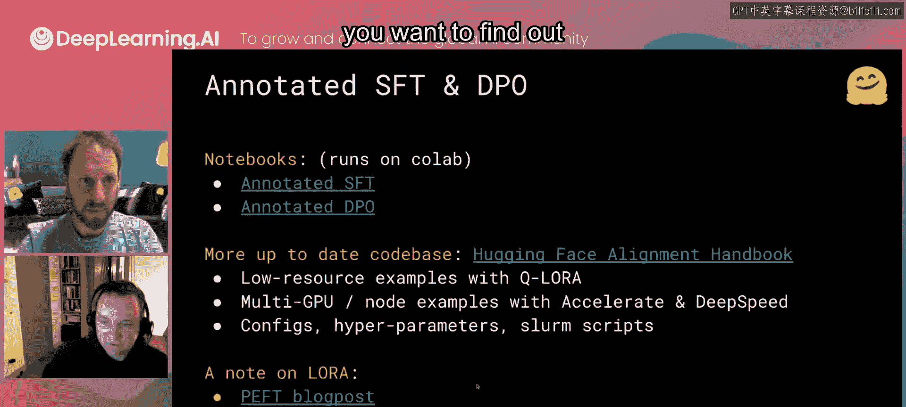

And so of course the first step when you want to go and perform SFT is to find a dataset。

 so this is the dataset set we actually use to find tune Zeffer and sort the Ultra chatt。

 a subset of the Ultra chatt data， and this dataset contains like two main keys that of interest prompts and messages。

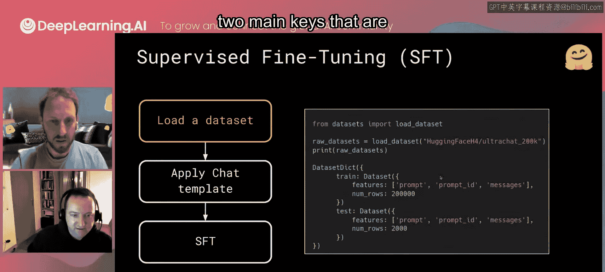

And so just to give an example of what the prompt look like they might be questions like what famous landmarks should I visit in London。

 write a program in C++ or create a YouTube tutorial on how to make a cake and it includes like the responses and they might be melt turn or singleton responses to these prompts。

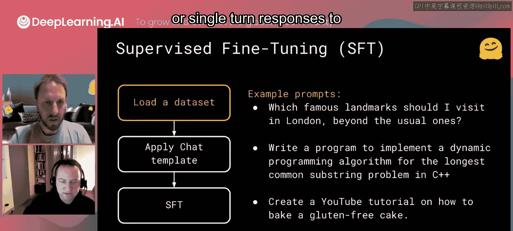

And the question is， sorry， yes， so if you're interested in data sets。

 we share like a repository of maybe 30 SFT data sets， so go and have a look at them。

 have a look at their data cards and check out if they're suitable for the task you're interested in doing and something should be a good place to get started if you're interested in starting to build the chatbot。

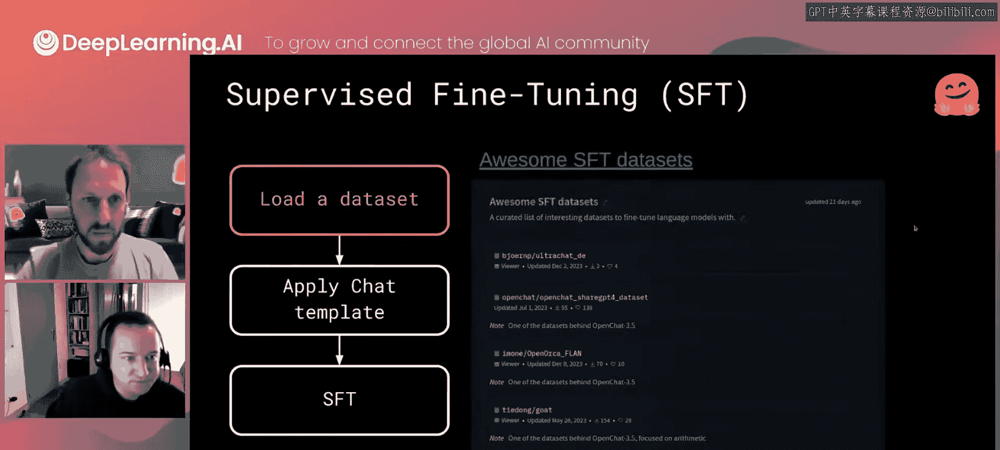

And so when you've got these messages in this dataset set you actually need to format them in a way that you can give them to model to perform your fine tuning and so in order to do this use something called a chat template and there are a number of different chat templates and so the idea of a chat template is like you have a sequence of messages so in this case they're math questions like it's a sequence of math questions that have being asked to a chatbot。

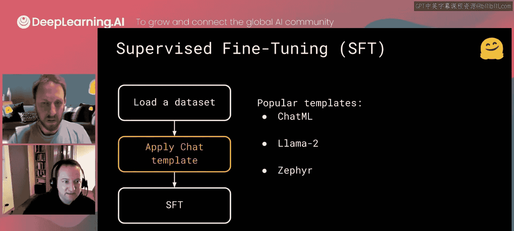

I need to format these in a way that you can feed them to the model。

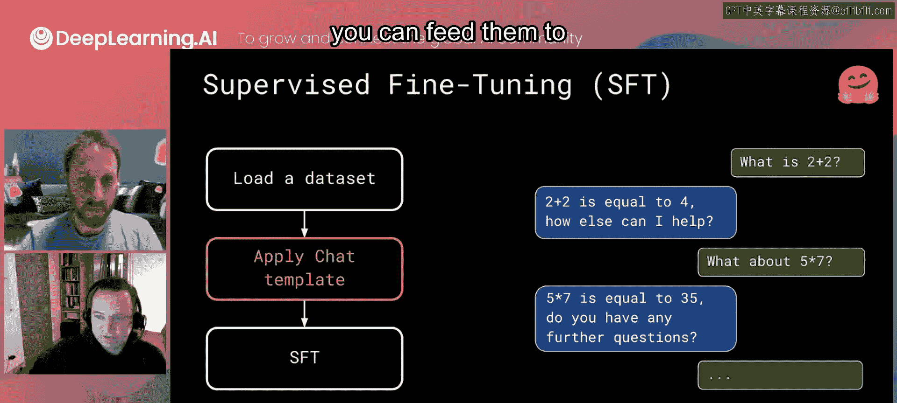

And so the idea of a chatbot template is you kind of。

Delineate different sections of these messages with different tokens and different things。

 so for example， you have a system prompt。In green here you have like okay these this part of the message is from the user and then in blue here you say okay this part is from the assistant and so on and so forth and I should mention this system prompt at the top here is just blank in this setting but in some settings you might want to give your chatbot like a personality some context of how it behaves where we have some examples on the hub of chatbots that behave like pirates for example or you might have I don't know you might want a mathbased chatbot and you could say okay you're a math teacher behave in a sort of math teacher sort of way so you can give your chatbot some personality and it might be that your datas might actually be annotated with these system prompt and sometimes that can be useful when you're training the model to give it a bit more context about why the models' responses are behaving in a certain way。

嗯。There are as I mentioned， as's a number of templates， if you had to choose one。

 we recommend the ChaL one it's the sort of most。Su2 a1 in our opinion。

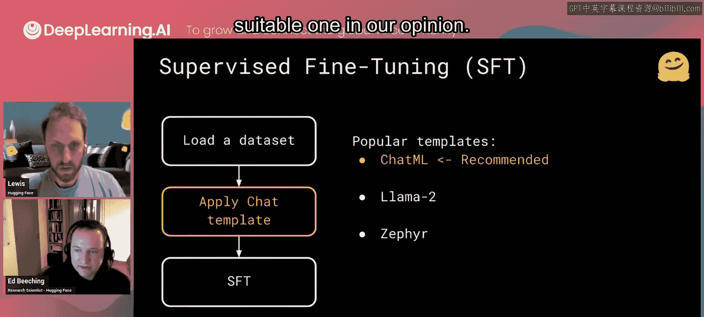

And then to apply a chat template is very， very simple in the Transformerss library。

 so recently maybe two months ago we added these sort of custom chat templates to tokens and what you can do is you can define like a Ginger string that will template your messages。

I don't expect to read all of this， but it's then very easy you just call tokenizer or apply chat templates to your messages and it will format them in this way。

 as I showed in the previous slide with assistant user sort of delineations。

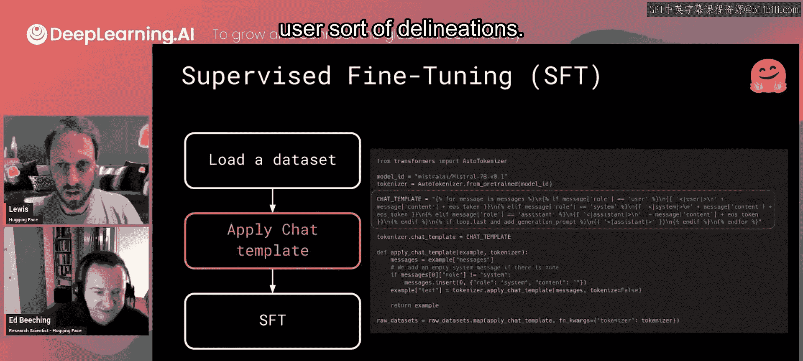

And then so once your data is now formatted in the appropriate chat template。

 it's very easy with TRL， just load at the SFT trainer in TRL， load for example。

 in this case in the notebooks we load the Mr L7B model。

 you can provide some training arguments like the learning rate， the number of number of epochs。

 patch sizes etc， and then you can provide this to the SFT trainer and call train a dot trainin and this will take a couple of hours to train your chatbot with this a particular dataset set。

In the alignment andbook， we provide a method to combine different data sets so if you find a number of data sets that are of interest。

 you can use that those examples there to combine these data sets。

In a suitable way so you can train on many different varieties of data。

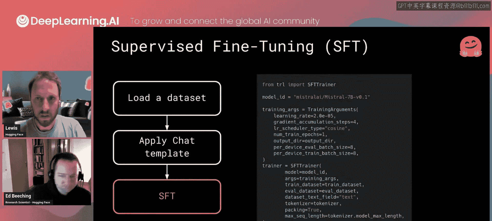

嗯。So now you've got your initial SFT chatbot， you want to now perform some sort of alignment。

To basically you know， to align it to some preferences you might have for your particular you know。

 product。And in terms of the pipeline， the steps are pretty much the same， so you load a data set。

 but in this case there are some additional keys in addition to the messages and the prompt you have chosen and rejected and so this is your kind of human chosen and rejected examples。

😊。

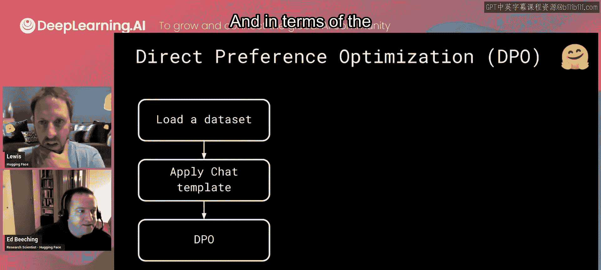

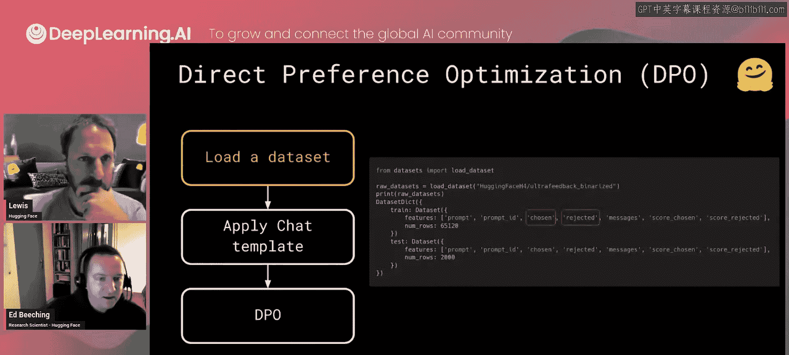

嗯。And again， we provide a number of these data sets。

 So I think there's maybe 15 examples of preference data sets on the hub there。 So again and check。

 check that link out if you want to start have a starting point。

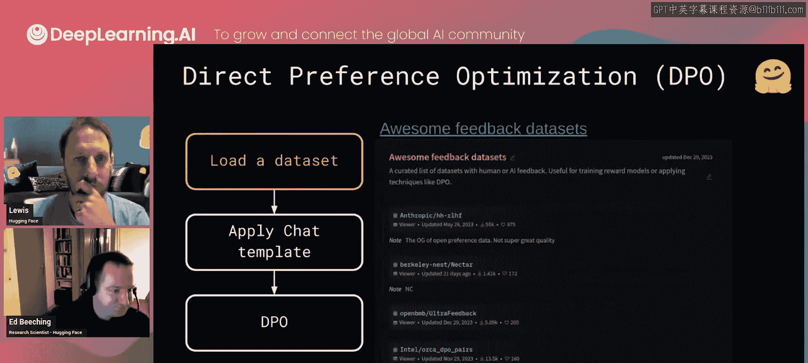

嗯。😊，And so yeah， so these data sets， they contain a prompt and they contain a chosen response and a rejected response and just sort of looking back at the loss that Lewis was。

😊，was mentioning earlier， so the X， the Y， W and the YL in this case are these kind of two pools that are being extracted from your data set。

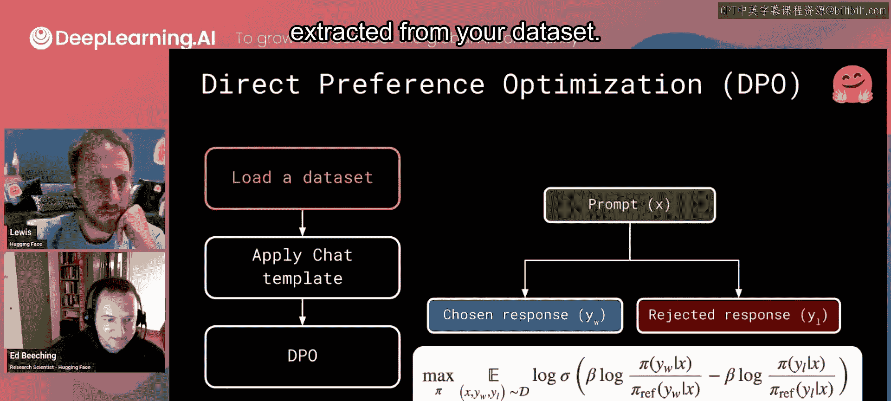

Not all data sets on the hub actually have this format of just binized or chosen and rejected。

 sometimes you can have many responses， so in this case there are four responses to a prompt。And。

The current DPO implementation in TRL only supports binized preferences and so often you find that okay the preference of one response is higher than another and how did these have ratings applied to them and so what we did in like the case of ZA。

Is that we chose like the highest rank response and then randomly selected one of the other ones and we felt that。

That was probably gives a more diverse range of data than say， always selecting the top two。

You kind of have examples where the margin is larger and smaller and that provides a more diverse range of training data for the model。

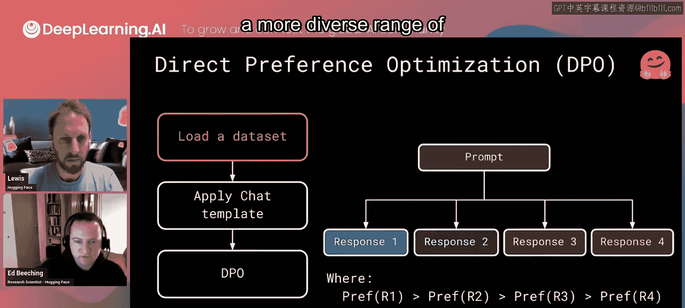

You can of course have multi turn examples， so in this case many data sets have this and typically it's the last response that is either that differs。

 so it's either chosen or rejected。There are other datas。

 for example the open Asistant dataset which is like a big tree of conversations so you can have many different combinations of chosen and rejected there。

 there are ways of proing this to do DPO but it's kind of a bit beyond this talk。

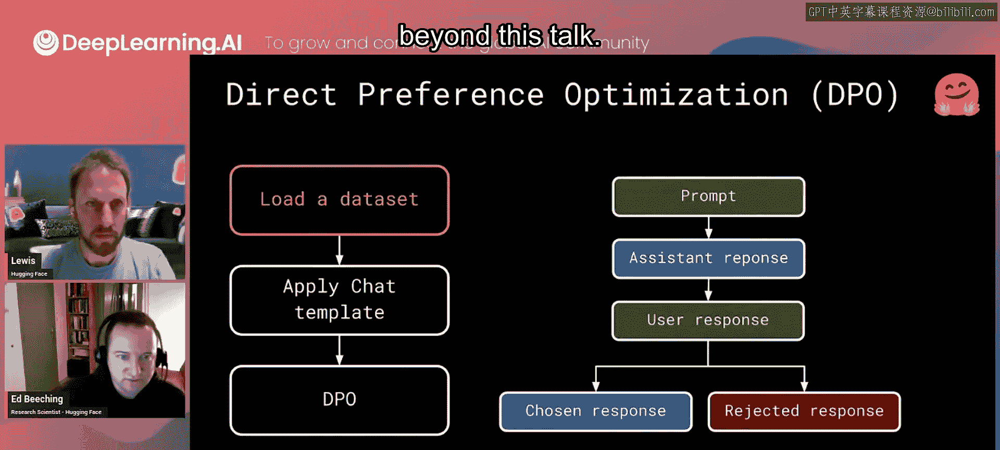

And in terms of applying the chat template， these two sets of conversations are kind of treated as independent。

 you tokenize them and independently， you do your forward path through your model and only when you calculate your lost you ever actually need to be aware of the fact that these conversations are linked together with chosen and rejected。

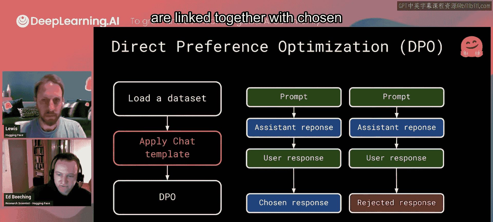

Applying the chat template is very， very similar to the SFT stage。

 you just apply it to your chosen messages， your rejected messages and your prompt。

 and the DPO trainer will deal with the intricacies of the forward pass of the chosen and the rejected。

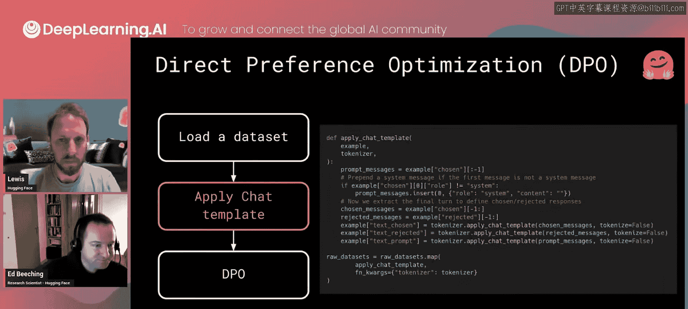

So when you want to then run your DPO， you can load from TRL， the DPO trainer。

 you can provide the model ID of your SFT model。Again。

 you can provide a number of training arguments， the learning rate， grain accumulation steps。

 number of epochs， batch size， etc。And there's two additional parameters that you provide to the DPO trainer。

One is this beta parameter and this beta parameter sort of roughly speaking。

 controls how much you can deviate from the base model， if beta is very high。

 you penalize deviating from the base model， whereas if beta is very low。

 you don't penalize it as much。AndWe recently published a blog post where we compare different beta values and also different loss types。

In DO we've implemented in the DPO trainer， we've implemented the DPO loss， the KTO loss and IPO。

 and there's a kind of newer version of KTO that also can be released that can work in an unpaired preference setting。

And yeah， so check out this blog post， it has some examples of these different algorithms with different beta values and their performance。

 as Lewis mentioned。If you choose the right hand parameters。

 they're kind of comparable in most cases。

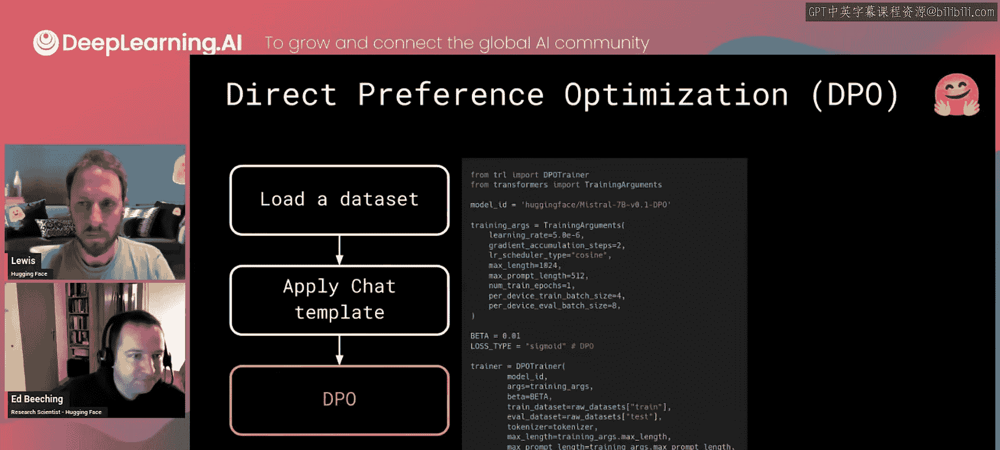

So I just wanted to sort of highlight some tips when you go and run these algorithms。

In terms of what the sort of things you should be looking for and so one is beta itself and so we typically test from 0。

01 to one。We found that kind of very small values seem to perform well。

 so if you're going to do a kind of scan， it's probably better to do not just a uniform range。

 you know， focus a bit more on the lower values。In general。

 we find that like the learning rate is much， much smaller than the SFT step。

 like 5 e minus7 is what we used， I believe， for the ZeA model。

It's a very very small learning rate seems to be the most appropriate。And typically， yeah。

 when you're doing pre training or SFT， you try and have a large the biggest match size possible that will fit in your GPU memory。

And what we found with DO is there's some sort of trade off between the global batch size and the number of epochs。

 so the global batch size is like the batch size across all GPUs。

And it's something that you need to take into account。

 it's not just as trivial as maximizing your batchche to fit in your GPU。😊，U。

Optimizer is an interesting question as well， so in the DPO paper they were using RMS prop。

 whereas we found that Adam actually seems to perform better。Scheduller。

 we found that cosine is better than linear。And a very interesting thing is you can train an SftT model。

 evaluate it on one of these kind of。Automated evaluation benchmarks。

 which I'll mention in the few slides。You take the best SFT model and then perform DPO on the data set。

And you don't always get the best DPO model from the best SFT model。

 sometimes a worse performing SFT model will produce a better DPO model on the same deck as it。

So it really makes sense to go through your whole pipeline SFT plus DPO with your different hyperpara to really be sure you're getting the best results and this was a really kind of surprising observation when we saw this。

And just to come back to Laura， we found that。呃。Some experiments with Laura appear to regularize the model during training compared to a full fine tune。

And what do I mean by that， so I've actually got an example of plot of a model that we were training。

😊。

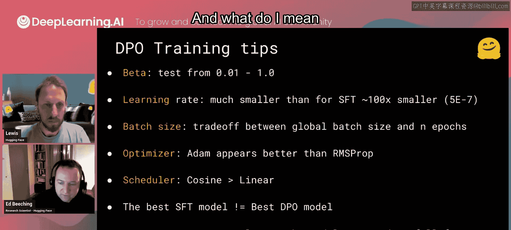

And。I apologize this is a bit pixelated， but I can just briefly introduce it so on the right here is like the DPO loss during training over three epochs on I think it's the Ultra feedback data set。

And so in green is the Laura model that we train and in pink is the full fine tune with the same hyperpara。

 it's just not using Laurara。And what's interesting is we observed that after the first epoch。

 the pink loss just kind of shoots down to zero， at least the training part of the loss。🤢。

Whereas conversely， the evaluation loss kind of peaks up。

And so clearly like we're overfitting to the training data set。😊。

Whereas the Laura model has fewer free parameters and so it's kind of regularized in a way and because it has fewer free parameters。

 you can't overfit as much to the training data set and your evaluation loss like continues to decrease or at least plateaus。

And we see the same thing on the left here I show the accuracy of DPO because your model can be used to predict a reward for a chosen and rejected example。

 you can calculate an accuracy on each example or the number of examples in the batch and we see the same effect that your full fine tune in sort of pink overfits very quickly after the first epo whereas this regularization with Laura doesn't see this problem and this actually translates to a better performance in empty bench which is we thought was really interesting it's not just these plots that demonstrate this。

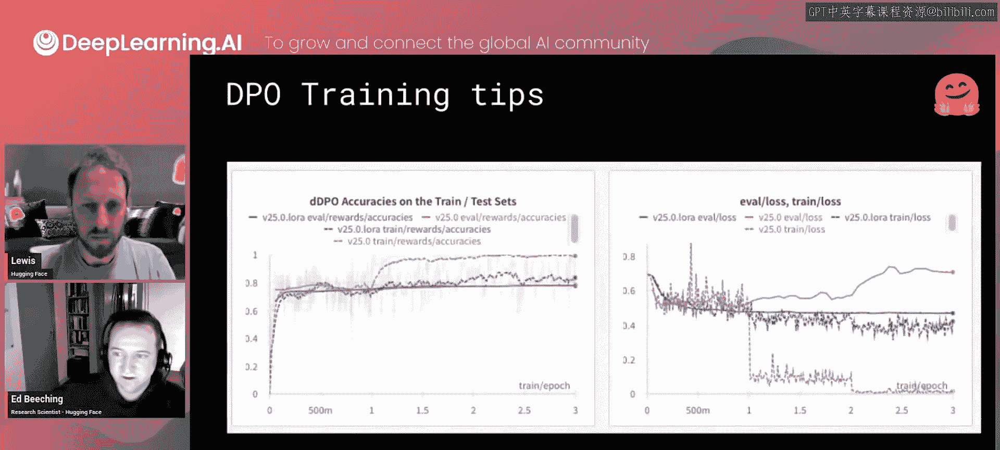

I'm talking to talk about a bit about the metrics that you look at during DPO training。😊。

So one is the accuracy， as I mentioned， you can predict the reward for your chosen and rejected example in your batches。

And then you can look at the number of times your reward for your chosen is greater than your reward for your draft and calculate the accuracy。

And so you see here for like a good normal training。

 your accuracy goes up' like 82% on the evaluation set， which is kind of reasonable。

 it's kind of what we see across many different training cases。😊。

You can also look at the rewards in your batch during training and while the rewards are interested。

 interesting， like the rewards for your chosen should be higher than your rewards for your rejected。

 which is the bottom right， what you're really interested in the margin。

 so the difference between the two and so the margin should be increasing during training it should be that identifying the chosen have higher rewards than the rejected in a batch。

And so this is what we see here and you see like the blue is the evaluation data set and we see that these margins go up between training。

Andum。Of course， not everything will go well during your DPO training。

 you'll have some runs that don't work and it's important to look at reasons why。And so in this case。

 like it's not entirely obvious from these metrics what is going wrong here and so you see that kind of your accuracy goes up。

 plateaus and then decreases。Which is a bit unusual。

The chosen rewards plateau and go down the rejected rewards plateau and go down。

 which might be okay they're rejected so they should be going down and your margins kind of。

Are above zero but only just and they're quite sort of noisy and so this run there's clearly something wrong with this run or there appears to do something wrong。

 but we weren't sure sure what。And so it's really important just to go back and look at the loss and so here it's really obvious like the loss is super high。

 it's really spiky and it turns out in this case the learning rate is just far too high。😊，It。

It is probably related to how we use the scheduler， so we train here for three epochs。

And maybe our initial learning rate was too high and if it was one epoch it would decay quick enough to like to resolve this problem。

 but because we were training for three it's high for a long time and so you kind of。

Overstep when you're optimizing and get these spikes so if you see issues like this just lower the learning rate it's kind of a classic issue in supervised learning as well。

嗯。

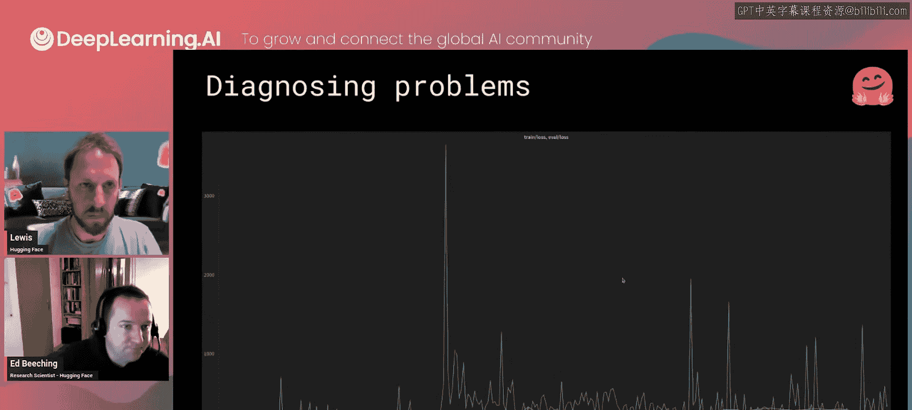

Yet so you've trained your chatbot， you've found some high parameters that kind of work。

 your loss goes down， etca， and then you want to go and actually evaluate it in a chat setting。

And there are a number of ways to do this， and so the two that we look at internally are empty bench。

 which is like a multi turn dialogue data set which tests things like reasoning math。

 other examples like summarization。Creativity， and there's a bunch of examples in that code as well。

And it gives a score basically between  zero and 10。

And you see the most data of the arm models like GPT4 are pretty good on this benchmark。

 they get like 9。4， so they're extremely good。😊，I should note that internally the empty bench evaluation tool uses GPT4 to evaluate and judge how good a model is。

 and we actually have seen some examples， particularly in code and math， where GPT4。

 the model will provide the right answer， the model you're evaluating and GPT4 will actually say they're wrong。

So we're getting to the point now in some cases where you get models that' are actually kind of producing a better result than GT4。

 which is quite interesting， it's not obviously on average it's not the case。

 but there are some examples where we see this。And here yeah we see a bunch of models kind of plotted with their empty bench score。

And the second benchmark we look at is Alpaca E。😊，And。

Basically that rates your model against a GPT4 turbo and so the best model in this case would get is GPT4 turbo。

 which would get 50 basically because it's just doing as well as itself。

And we're seeing like the win win right now for like thequin models it like 27 which is pretty good it's a bit strange this plot because the Y axis is not not is not linear。

 it's like a log scale。So even this actually looks closer than it it's only half just over halfway there。

 but it's certainly getting there。And the speed at which these models are approaching the quality of duty4 is quite astounding。

 so I think we really suffer like in September of last year， something like that。

And we were down I don't know， at 7。3 and I don't know， 15%10% and now moved far。

 far closer to the GPT4 level， so it's really kind of great that the community is building these models。

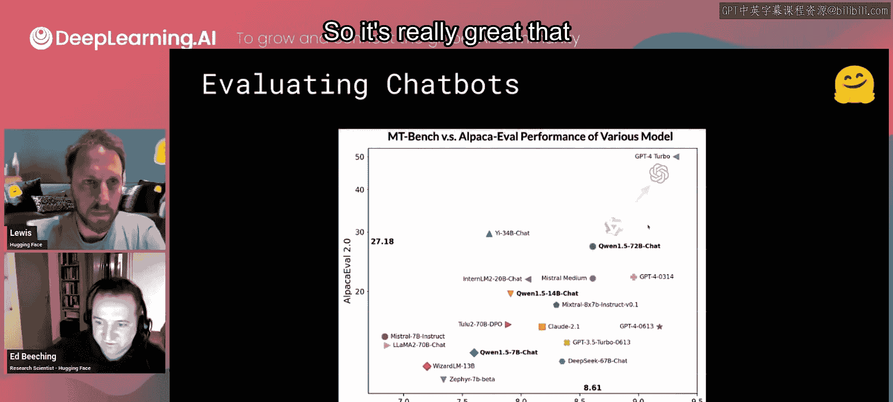

There are a few other benchmarks that I should mention and so obviously the best evaluation you want to do is human evaluation。

 if you can afford to do human evaluation that's what you're doing when you've got your final model and you're assure you you internally it's good you should go and have humans actually evaluate it and make sure you're happy with it in terms of alignment and also the quality of the models's responses。

And then also another few other。Benchmarks so there's obviously there's the openLM leader board you can use this to evaluate a chatbot and there's certainly are chatbots that up there。

 but it's not really a chatbot focused leaderboard there's a lot of questions about leakage now where people whether they meet to or not will use the data set which contains some questions from the leader board。

And there's also questions about overfitting to the leader board so this tool I think with time will get less and less useful。

But it certainly is relevant for the moment， as I mentioned。

 there's some links here to empty bench Al back at E and how to actually use these evaluation tools。

😊，There's a La index， which is more about retrieval and too French retrieval。

 this is a very good tool for evaluating models。And there's also this chatbot arena by LMCis and so I think if you want to actually have a model evaluated on this。

 you have to ask LMCs to add it to their pool of models。

 but it's certainly a model a good tool to use to evaluate your model。

There's this another plot I linked to a tweet here at the top there of the authors of this and this is a really useful tool to kind of compare different benchmarks and so here you kind of see the correlation between different benchmarks and so this kind of really useful so for example empty the top one is like the top left。

😊，Is human evaluation so you see like empty bench has a 0。9 correlation with human evaluation。

 so it's shows that it's quite quite a good tool if your has quite a good proxy for human evaluation。

嗯。And there's a bunch of other different metrics and tools in this plot。嗯。I think that's it for me。

 I'd be happy to answer any questions if there're any。😊。

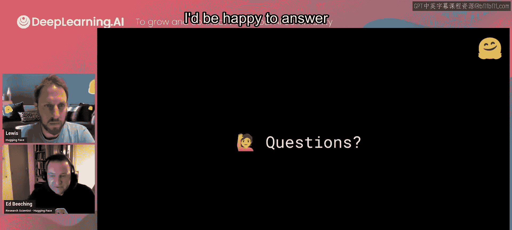

Amazing， okay， let's dive in， there are definitely quite a few questions to get into。Perfect。

 so how have you used DPO or seen the successful applications of DPO to optimize metrics in image generation diffusion models such as LPIps。

 ArcVase， Ss， etc。😊，So this isn't really my domain of expertise。

 but I know in TRL we have like a DDPO trainer which is for applying DPO to diffusion models。

 maybe you can say a few more words on that Lewis。No， I think。I know that the creator。

 one of the authors of DPO Rafaov， he published a paper just recently using DPO to create really。

 really good image generation， and I believe that implementation is currently in the works。

There should be code and models coming this year。Perfect。

How do you know if you should create your own data sets for DPO alignment versus open source？

I think my opinion on this it really depends on your product or your application。

 and so you might have a very specific application like like for example， a call center。

 I could think of that being a really useful place for having a chat box。

To either help someone who's on the call or to use as like yeah。

 by a text to speaks model that's working with the client。And in that case。

 you might want to have a specific alignment data set for that that use case。嗯。😊。

But yeah obviously it really depends on your domain of application there are a bunch of data sets out there and there'll be more and more coming in the future and we're also seeing a lot of synthetic data sets being generated so where researchers use GPT4 all these other models at Ge and I to create synthetic responses to prompts and you might be able to use this for your application as well so you might not need to go and ask a human to help make this dataset。

Perfect。Are there any open implementations of the self learning reward LLMs like meta and NYYU research specifically surrounding self rewarding language models？

Yeah， so we read this paper， it's a really interesting paper that we're doing some work internally around this。

 so as soon as we have something we'll either add it to the handbook or to TRL when we have something but yeah super interesting。

Absolutely， okay， I think the last question for now。

 any thoughts on how scaling model size will impact DPO versus RL debate， noted than paper。

 they only to DPO was 7 billion parameters？So this is a good question and we were wondering this ourselves and then there was the Tulu model which was released shortly after and that was like a 70 billion parameter model so like 10 times larger so the size yeah I think it's a Lama model or yeah so it's large it seems to work at scale there was a lot of question about whether this stuff works at scale and I would say it's probably it's much easier to get DPO working at scale than RL。

Yeah。Maybe just add a point there so there are valid applications where using reinforcement learning makes a lot of sense。

 so the most obvious one is if you want some like in the loop feedback to the thing that you're optimizing so a good example is that if I want to train a really really good code assistant。

 I want the assistant to be able to debug code in a very similar way to like how chattGBT does。

And that debugging can be done by having a kind of environment like a code environment where you provide prompts。

 it generates code， it runs the code actually on an interpreter。

 and then it gets feedback from the stack trace， and that's a great example where reinforcement learning can really help the models get better at producing correct answers for code that will compile and run and that would be kind of hard to do with DO because DPOs typically offline。

 you generate all your preference data in1 go and then you drown。

Perfect great well I think that's all the time that we have today for questions Thank you so much Lewis and Ed this has been a great session I know our community has really much enjoyed it we will send out the slides and the notebooks after the event they should be in the YouTube video description and yeah we'll see you guys next time Thanks everyone bye everyone bye。

😊。