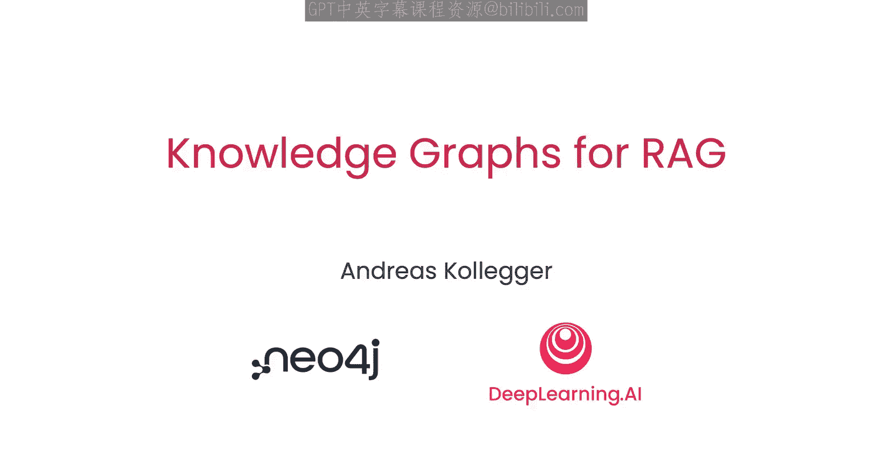
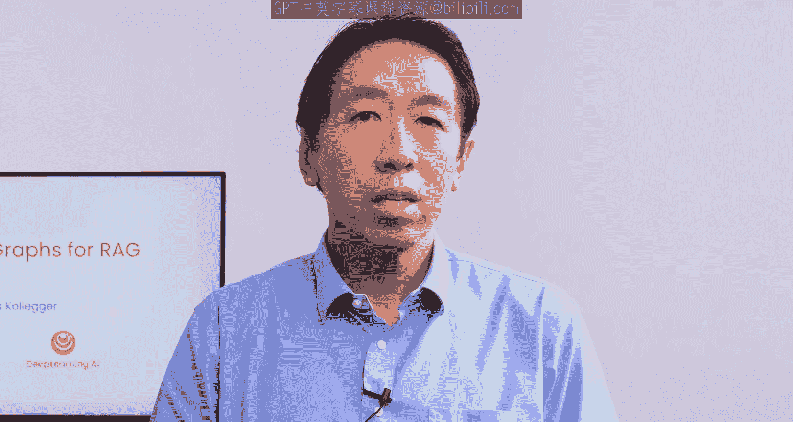
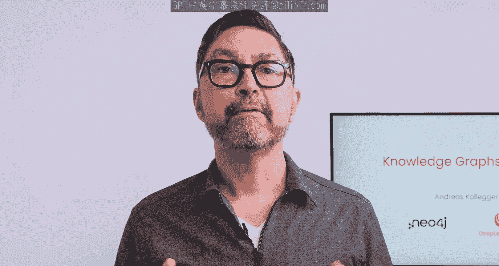
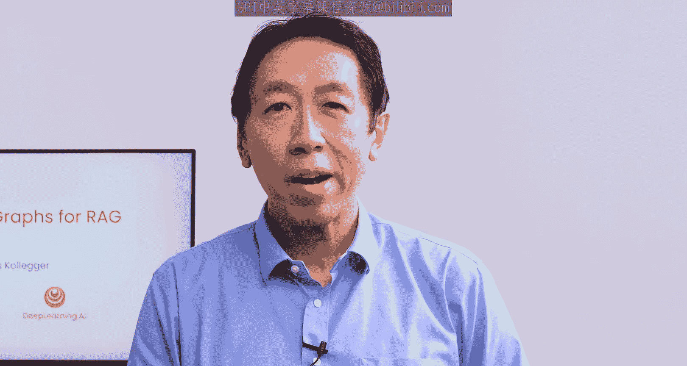
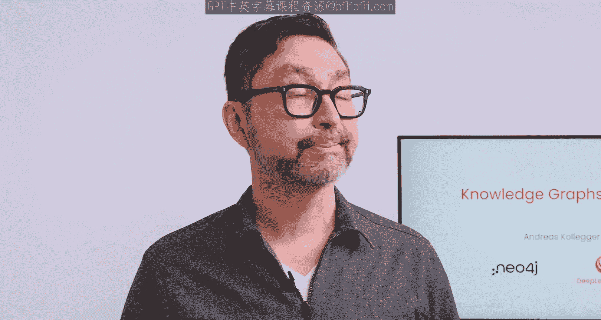
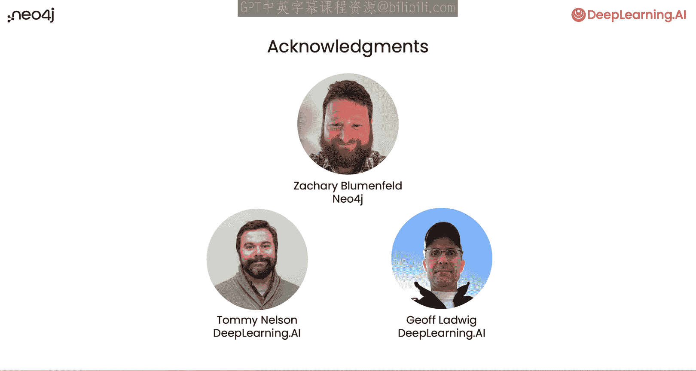

# 吴恩达《知识图谱用于RAG｜Knowledge Graphs for RAG》中英字幕 - P1：1.introduction.zh_en - GPT中英字幕课程资源 - BV1DD421E7N1

Hi and welcome to this short course， Knowledge drafts for RaG built in partnership with Neo4j。

 I'm here with the instructor Andreas Collier， a developer evangelist for generative AI at Neo4j。

 welcomecome Andreas Thanks Andrew， I'm excited to be here today and can't wait to show you how to use knowledge graphs to improve your retrieval augmented generation applications Knowledge drafts are a very powerful but also one of the more underrated tools of AI So I hope you enjoy learning about them in this course。

 Knowledge drafts provide a way to store and organize data that emphasizes the relationships between things In contrast to traditional relationshipsal databases which organize data into tables with roles and columns knowledgeledge drafts instead use a draft-based structure with node that represent things or entities like people or companies and edges that represent the connections or relationships between these entities such as an。

😊，Employer， employee relationship。So when you hear nodes， think of things or entities。

 and when you hear edges think of the relationships between the things。

 each of these nodes or edges in the graph can also store additional information about the entity in the case of the node or the relationship in the case of the edge。

For example， a person notes could store an individual's name， email and other details。

 a company note could store data like the number of employees and your revenue and so on。

 and the employer employee relationship between the company and the person would be represented by an age between these two nodes and the age could also store additional information about that employment relationship like the person's job title。

 star date and so on the graph structure of nodes and relationship is very flexible and lets you more conveniently model some parts of the world then relational databases That's right。

 Andrew Knowge graphs make it much easier to represent and search deep relationships Since the relationship itself is a component of the database。

 not just a key shared between two tables。

This enables much faster execution of queries in you to the data you need more efficiently。

 This is why web search engines and ecommerce-commerce sites that offer product search capability have found knowledge graphs a key technology for delivering relevant results。

 In fact， if you search for， say， a celebrity on Google or B the result you get back in the cards to the side。

 or retrieved using a knowledge graph。 And when you combine a knowledge graph with an embedding model。

 you have a very powerful tool for carrying out retrieval augmented generation with an L O M。😊。

That's because you can take advantage of the relationships and the metadata stored in the graph to improve the relevance of the text you retrieve and pass to the language model in a basic retrieval augmented generation or ragG system the documents you want to query or chat with might be first split into smaller sections or chunks which should then transform into vectors using an embedding model Once in this vector form you can use a similarity function like cosine similarity to search through the chunks of text to find the ones relevant to your prompt but it turns out that storing these T chunks in a knowledge draft opens up new ways to retrieve relevant data from your documents。

Rather than just similarity search using text embeddings。

 you can retrieve one chunk then traverse the graph to find other relevant chunks of text。

 which gives your LM more complete context。 You see in this course how this can review connections between text sources that similaritybased rag and this In this course。

 you'll learn how to build a knowledge graph to represent a collection of financial forms the companies are required to file with the securities and exchange Commission。

A US government agency that regulates and overseas markets and protects investors。

 You'll start with an introduction to knowledge graphs and see how you can use Nefaj's query language called cipher to explore and modify a fun graph of movie data。

Then you'll see how you can use Neo4j in combination with a text embedding model to create vector representations of text fields within the knowledge graph Next you'll build a knowledge graph to represent one set of SEC forms and use Langcha to carry out RA by retrieving text from this graph。

Lastly， you will go through the graph creation process one more time for a second set of SEC forms。

 connect the two graphs using some linking data and see how you can use more complex graph queries to carry out retrieval across multiple sets of documents。

All this together allows you to ask some really interesting questions of the SEC data Thanks Andreez this sounds like a really exciting and timely course Many people have helped with the development of this course on the Neo4j side Zachary Blumenfeld and from deep AI Tommy Nelson and Jeff Ladwig all contributed to this course it's really an exciting time to learn knowledge graphs and I am so excited to see what you are going to build using knowledge graphs This course covers a lot but you'll walk through everything step by step so that you'll understand in detail how to build knowledge graph systems yourself after finishing this course I hope you be able to use knowledge graphs to help your systems better to understand relationships between data and maybe even make some discoveries in your data that I really know the all。

😊。

