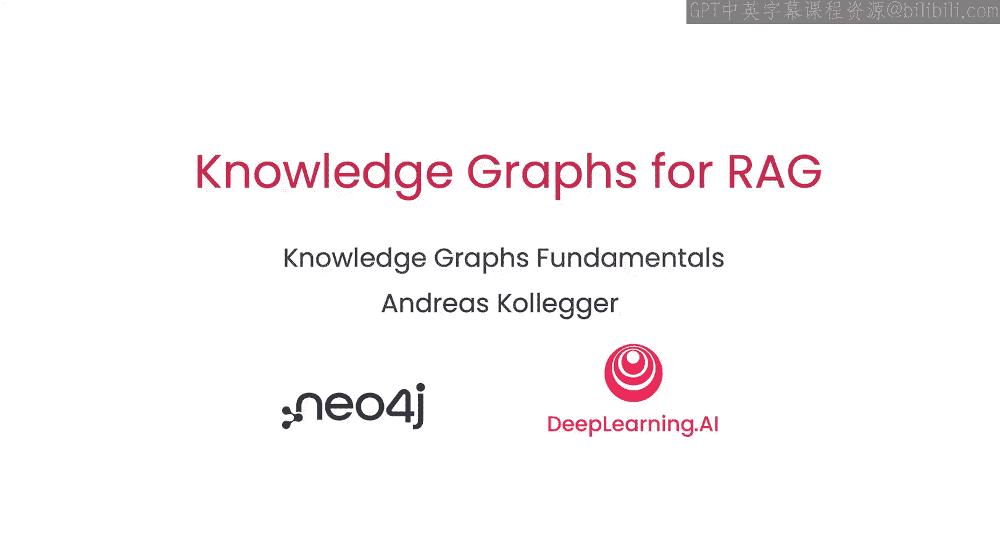
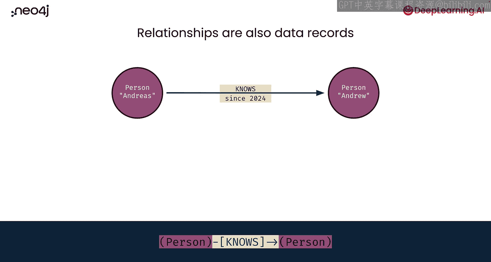
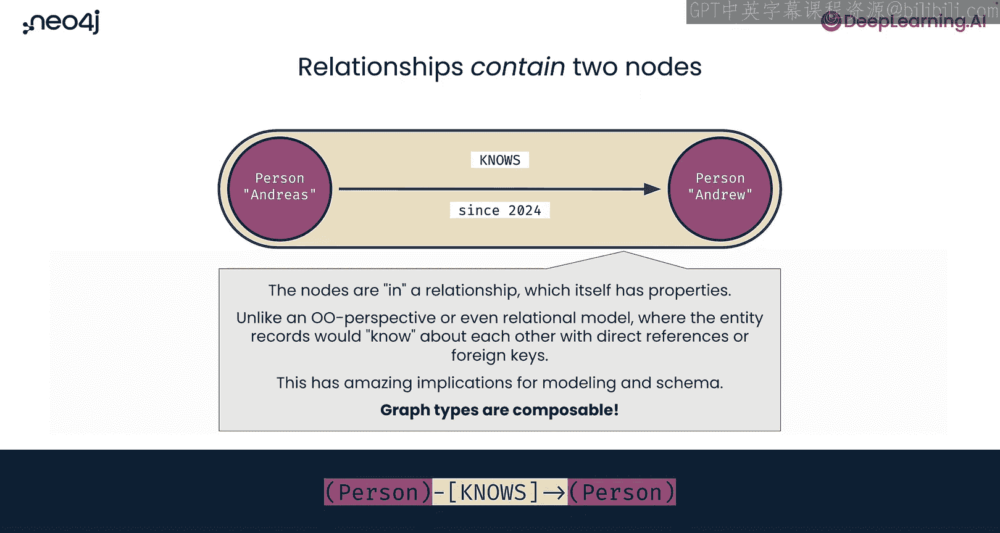
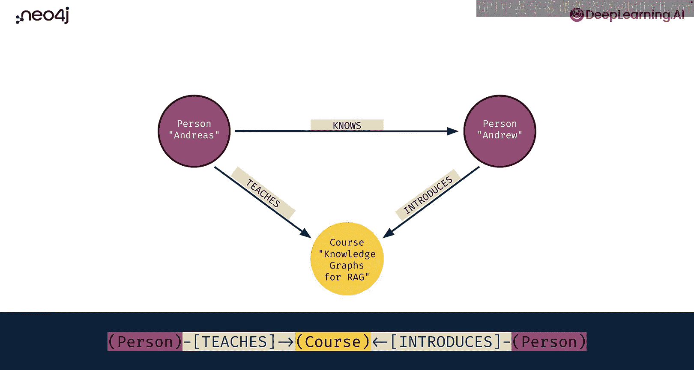
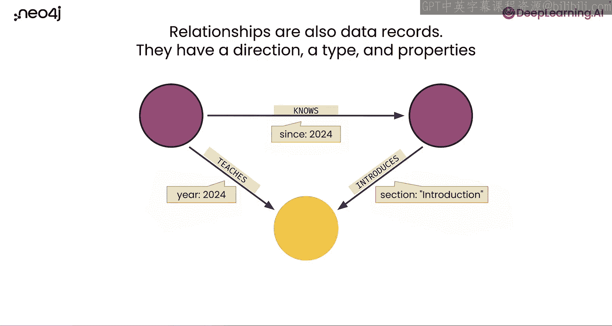
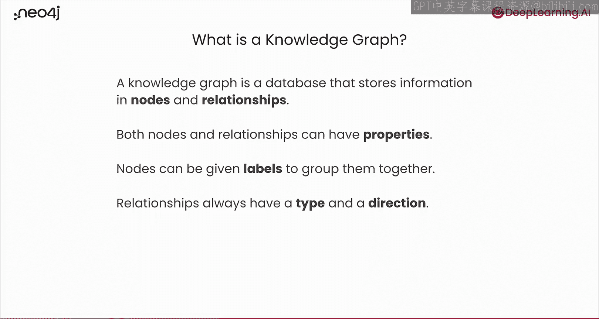

# 吴恩达《知识图谱用于RAG｜Knowledge Graphs for RAG》中英字幕 - P2：2.Knowledge Graphs fundamentals.zh_en - GPT中英字幕课程资源 - BV1DD421E7N1

You've been introduced to the idea of knowledge graphs as a data structure that stores information in nodes and in the relationships between those nodes。

 Let's start by taking a look at these concepts in more detail。 Come on， let's dive in。

So nodes are data records we're going to start exploring what that really means inside of a knowledge graph by actually just drawing what a graph might look like and talking about how the data patterns within the graph emerge here we have a very very small graph with just a single thing a person whose name is Andreas that's me of course。

And if you want to talk about this very small graph。

 you'd be tempted to look at that nice you know kind of round circle we've got there and talk about that in like a slackck channel。

 let's say you could use parentheses around the person and that would mean okay。

 we've got a node here， that's a person so we're going to pay attention to that as we kind of evolve a very small graph。

Let's add another person。 So now we have this person Andreas， another person whose name is Andrew。

 and again， sort of in a text representation of that we'll use parentheses free to those persons。

 Now we have a data pattern that is actually just person come a person。

 a data pattern of a graph that has people inside of it。To make it into a full graph， of course。

 you don't want just the thing， we want relationships between those things and these relationships are also data records。

 We have a person Andreas， a person Andrew and a relationship that person Andreas knows the person Andrew and knows since 2024。

Again， in text representation， we've got those nice parentheses around the nodes。

 and the pattern here is now not just person comma person， but that person dash knows in all caps。

 and then a little arrow， this other person， so the data pattern that we've established that there's a person who knows a person。

So if you remember back to your computer science classes or maybe some math classes you've taken and you know anything about graph theory。

 you'll remember that nodes are often also called divertices and the relationships that we have here at the data structure might be called in edge instead。

 different terms for exactly the same ideas。

Now as a data structure， the reason that we actually use the word relationship instead of E is that the relationship is really a pair of nodes and then information about that pair。

 so you can think about the idea that the relationships actually contain two nodes。

 so here there's a node relationship that contains Andreas and is directionally also containing Andrew。

To expand our small graph a little bit， we have the idea that there is a person， Andreas。

 who knows another person， Andrew。And what do they have in common， They also have this course。

 knowledge graphs for rag in common。So we'll introduce that as a new node in the small graphs。

We know that person Andreas teaches this course。So here's a new data pattern among two new kinds of nodes。

 theres the person that we already had and this new course node as well。

Andrew also has a relationship to this course， Andrew helped introduce this course。

 so we both have relationships between the people and the course。

And if you look at that in the text representation here in the bottom。

 this becomes a little bit longer of a data pattern。

 but you can still read through this and it's worth taking the time to do that you can see that there is a person who teaches a course going from left to right。

 but then on the other side you have kind of the reverse direction where you read from the outside again。

 a person that introduces that course， putting that all together in one line。

 you then have directions going from left to right， but also right to left。

 meaning in the middle at that course。A little side note here that I think is interesting when you're thinking about how to data model within a knowledge graph。

 you could say that you know this person whose Andreas is a teacher。

 you could say that this person Andrew is an introducer I suppose but instead of that we don't really need to add those extra labels to the people themselves because Andreas is a teacher because he is teaching Andrew might be an introducer because he does introductions。

 so you don't need to add extra labels to the entities themselves to the things or the people you can just use relationships for further qualifying what those people are and what the roles are within the graph。

Okay， here's a completed， very small graph with just three nodes and also three written relationships。

 A person who knows another person。 That person has taught a class or teaches a class called Know graphs for Rag。

 And Andrew introduces knowledge graphs for Ra。 That is or completed graph。 this small introduction。

Okay now formally， nodes have labels， we ready introduce the idea that we have persons and we have this course in the knowledge graph we call those labels or those nodes。

 labels are a way of grouping multiple nodes together。

 so for everybody that's going to be a person we give a person label for everything that's going to be a course it gets a course label。

Nodes， because their data records also have values， of course， and those values are properties。

 There are key value properties that are stored inside of the node。

 So we know that the person Andreas actually has a property called name where the value of that property is Andreas。

 Also for Andrew， there's a name property where the value is And。 And again， for the course。

 it has a title Knowledge graphs for Rag。Because relationships are data records。

 they have a direction， a type and also properties。

 so we realize that we have these nose relationships。

 teachers the relationships and also introduces relationships that's fantastic for each of those we can add extra information by adding properties to them that this person knows another one since 2024 the teaching relationship also has a year 2024 and the introduction is actually for what section of the course is being introduced。

So what is a knowledge graft？A knowledge graph is a database that stores information in nodes and relationships。

 Both nodes and relationships can have properties， key value pairs。

And nodes can be given labels to help group them together。

 relationships always have a type and a direction。Now you have some idea of what a knowledge graph is。

 and you've begun to build some intuition about the patterns that describe the structure of the graph。

Now let's apply these ideas in code with a real graphs of movie data To do this。

 you'll use a query language called cipher， join me in the next lesson to try this out。

