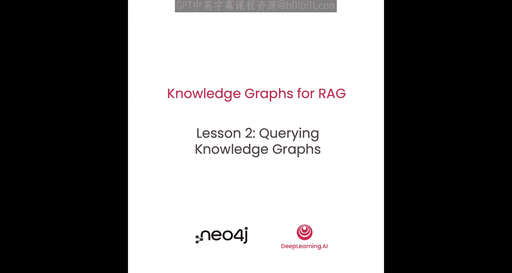
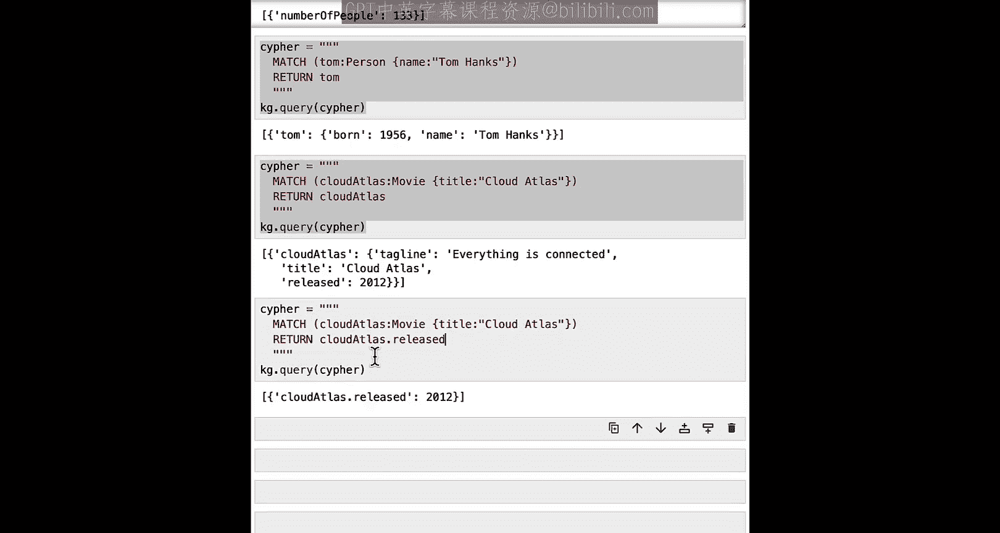
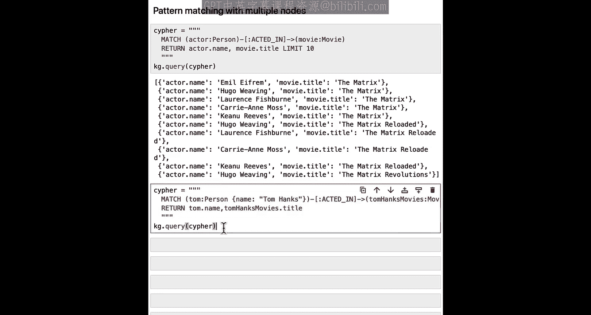
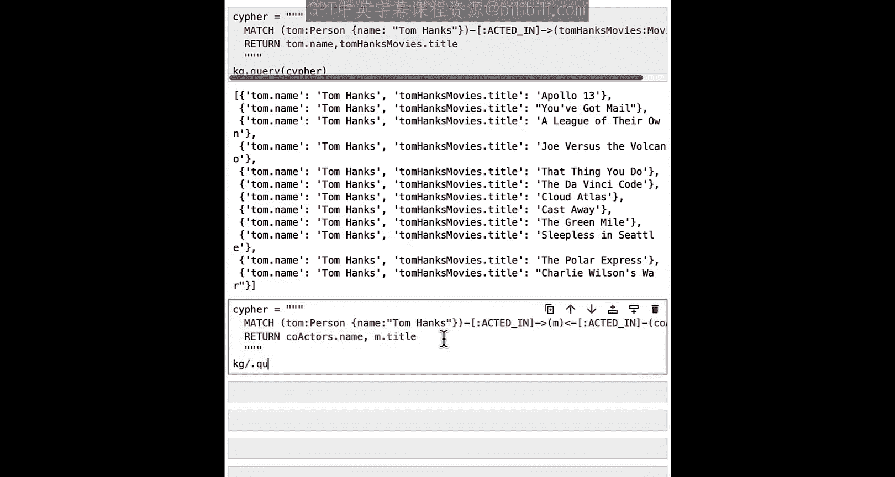
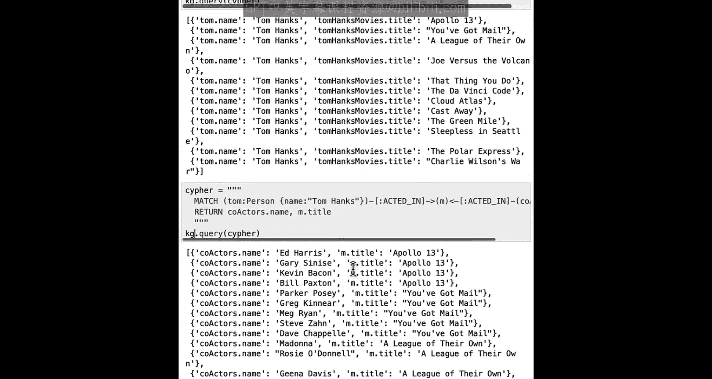
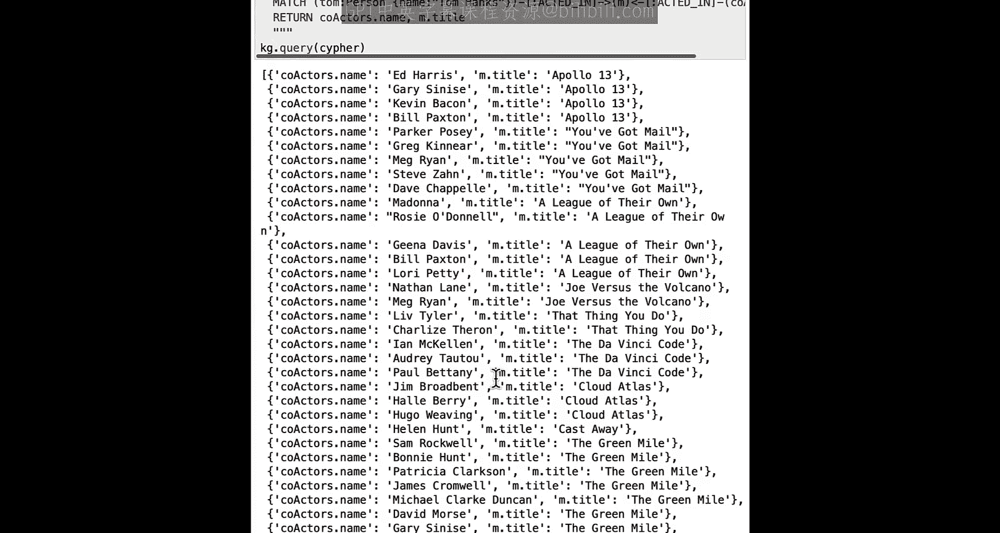
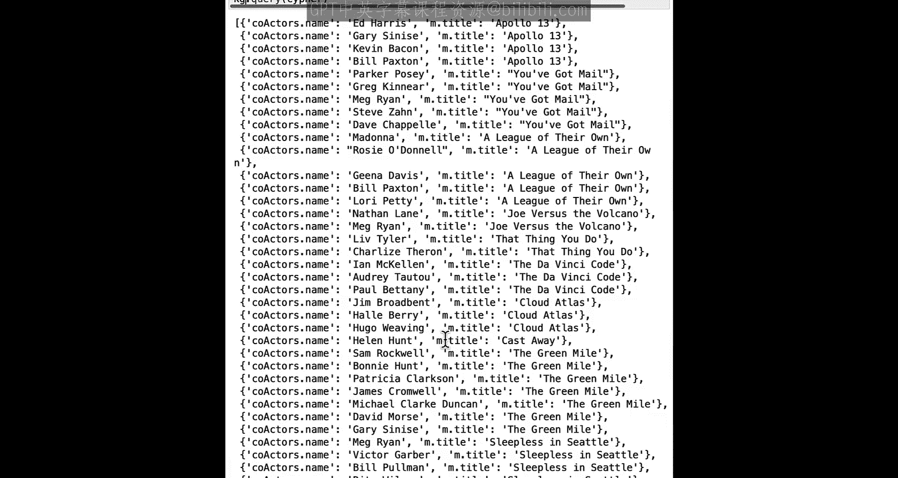
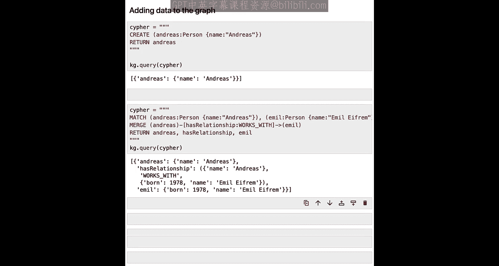

# 吴恩达《知识图谱用于RAG｜Knowledge Graphs for RAG》中英字幕 - P3：3.query_with_cypher.zh_en - GPT中英字幕课程资源 - BV1DD421E7N1

Now that you've explored the fundamental concepts of a knowledge graph。

 let's look at how they're put into practice In this lesson。

 you'll use the cipher query language to interact with a fun knowledge graph that contains data about actors and movies。

 Let's dive it。

Okay， to get this notebook started， we're going to import some packages that we need for just getting everything set up for being able to access Ne4 J and getting the environment。

Those are classic packages we're going to get from the OS and from of course， everybody's friend。end。

Also， we're going to be loading from Langcha， the Ne4j graph class itself。

 which is how we're going to be accessing Ne4j。So with those packages imported。

 we're then going to set up Ne4j itself by getting some environment variables。And of course。

 you know learning from dot ends and then setting up some variables here Now the variables that we're setting are all of course named Ne4j。

 this very first one， the new for J URI is basically the connection string for like where is Ne for J located to what port those typical kinds of things we of course need a username and a password and a room to specify which database within the DBMS we're going to be using and so let's run that as well。

Okay， now that we have our environment setup， we're going to create an instance of this Ne4j graph class that's basically going to be a driver connection to the database that we can use from within Python and because we're building a knowledge graph today。

 we'll call the Ne4j graph instance KG short for knowledgege graph of course。

 using those environment variables we just set up。Okay now the notebook is ready to start sending ci queries against this knowledge graph。

 but what is the knowledge graph that we're actually going to be using。

 let's take a look at that first we know that it's got movies and it's got people so here's an illustration of what that looks like on the left here we've got some person nodes we know that they acted in some movies right So the actor becomes an actor because they've acted in something。

If we can read that out as a sentence， of course， it's that a person acted in a movie。

 That's the fundamental pattern that we'll be looking for when we're dealing with his data set。

For both of those nodes or the persons and the movies， we know that they have properties。

 the properties that are available for the person or that they all have names。

 they also have a born value， which is just the year that they were born as nteture。

The movies have a title and tagline both as strings， and they also have a release date。

 also just an integer about the year the movie was released。And finally。

 just in the same way that I mentioned that a person acted in a movie。

 there is more relationships that a person might have with a movie。

 So here's all the different relationships between a person and a movie。

 We know that they've acted in a movie， a person might also have directed that movie。

 Sometimes for some movies， we know that a person both acted in and directed a movie， Also。

 they might have written a movie so that there's a person might have wrote that movie。

 a person might have produced that movie。 And finally， somebody might have reviewed that movie。

 That's all the different relationships between the persons and the movies within the data set。

 But then the persons themselves have a relationship with other persons。

 Here is the idea that if somebody has reviewed a movie。

 somebody else might be a follower of that reviewer。

 And so these are all the relationships at a present。

 And what's interesting about this aspect is that all we've had to say is that these nodes that are persons are persons。

 what those person's roles are the relationships around them to the movies and tweet are persons is what really determines the type of a person that they are or the job that they have or。

😊，Their know behaviors within the data set， it's worth observing， of course。

 that these are potential relationships， the actual relationships themselves for particular people on particular movies。

 and to being dynamic based on the data itself。So now you have some idea about what the graph looks like。

 We know that we have people。 We know that we have movies and the relationships between those people and those movies。

 Let's start doing some querying in the Python notebook。

 Now the query we're going to be doing is based on cipher cipher is Ne4j's query language It is using pattern matching to find things inside of the graph and it looks like this Here I'm going to take a multiline string in Python and assign that string to this variable cipher。

 the cipher itself begins with this match clause， matches pattern matching。

 and the very smallest pattern match you can look for is a single node pattern。

 here I'm going to assign the results of that pattern to variable I'm calling N and in the a text line。

 I'm going to say return account of how many those ends you have found。

 So if the result of running this query should be， how many nodes we have in this graph。

 whether those nodes are people， whether the movies or something else。

 all the node should be counted in this query right here。

So go ahead and assign that variable to run the query itself。

 we're going to take advantage of the Lng chain integration weve set up before and we've got the Kg。

 query function that's actually going to take the cipher that we defined above。

 run that cipher and return a result， and then if we will just show what the result actually looks like。

So you can see that the result is actually a list of rows basically that come back from the query of Ne4j and in that query。

 each of the rows is then a dictionary where the dictionary keys are based on what you've returned from the return clause up here in the cipher so here we've been returning count n so we've got a key for count n and the value of that is 171 so there's 171 nodes within this graph Now count n as a variable name or as a kind of key within this dictionary isn't the greatest so there's also the option of actually renaming those things using Naliaius。

So we can say count n as let's call it number。Of nodes， that's a little bit friendlier right。

 so we'll redefine that cipher and then we'll rerun the query itself。And now this looks much nicer。

 We have number of nodes， obviously the same result， it's still 171。Cool。

 now that we know that we're getting that back instead of looking at the raw result。

 we can take advantage of some nice print statements in here。And。I can run this as well。Okay。

 so with that cipher match that we just did， we looked for a pattern of all the nodes within the graph returned account of that。

 What if we don't want to find all the nodes in the graph。

 but just the movies are just the persons the movies and the persons show up as labels on nodes So all we need to do is modify that match we had before and add a label for let's say movie So let's go ahead and do that。

We'll start with the same Cypherric query we had earlier。

And the small change we have to make is instead of。This end being all by itself。

 we're going to add a colon， and then we're going to say movie。

 movie is the name of the label for all the nodes that are movies。

 we're going to return account and of number of nodes。We'll just say it's the number of movies。

Running that then of course shows uss the number of movies are 38 within this data set Pre good just enough for us to play with Okay。

 that's great。 It got the result we expected and that's really nice。

 There's one more small change we can make here to this query to improve the readability of the query we've been using this variable N to capture all of the patterns that match these nodes but we know that we're grabbing movies and movies begin with the letter M instead of n so let's go ahead and change that。

We can use M colon movie and then return account to those Ms。

And running this again gets us the same result， all we've done is change the name of the variable to help readability of the query you have account of all the movies in the graph。

 we can do the same thing with people as well， we can just modify the query we have here instead of matching for nodes with the label movie。

We'll change that to person。And we'll change the name here as well， say this people。

So we're going to match a pattern for people with a label person。

 so nodes that have the label person。We're again going to do account with those nodes。

And we'll rename the result to number of people。And this from that cool perfect so now for any set of nodes within the graph。

 you know how you can match just those nodes and then get a account of them。

 it's a nice place to start for exploring a new graph。😊，Where it' exploringing the graph。

 you can of course， add more match criteria， for instance。

 looking for a very specific value value based criteria are introduced with kind of object notation inside of curly braces。

 then the name of a property and the exact match to look against。 So for example。

 if we want to find not just all people but a very specific person we'll just make a copy of this and modify it。

So instead of just all people with a label person， let's look for comm Hans。

So we'll say we'll do match for Tom， who is a person and we'll introduce the curly breaks here。

Where we want the name of this person to be。Tom Hanks。And we don't need a count of Tom Hanks。

 so let's just go ahead and return Tom himself。So we're going to do a matcher， Tom。

 who's a person with the name Tom Hanks， and let's just return Tom。So running that query。

 we then have a list of results where theres only one result because in this movie data there aren't other people named Tom Hanks。

 we found Tom Hanks， we can see when he was born and that's all the properties we have on this particular node。

You can， of course， do the same thing if you happen to know that there's a movie that you're looking for。

 so let's copy all this over and we'll change it instead of looking for a person we're going to look for movie。

And I think the movie that should be here is an oldie but a goodie called Cloud Atlas。

And it's not a name but that has a title。Of cloud hourss。And then we'll return that movie note。

So there's cloud Atlas， we can see that it has a tagline， everything is connected。

 whys so close to my heart， of course， the title is Cloud Atlas and is released way back in 2012。

For these last couple of queries， we've been looking for specific nodes。

 maybe based on some exact match criteria， if we didn't want to return the entire node of cloud Atlas and just。

 let's say the release date， we can return just that。

 Let's make a a copy of this query and just modify the return clause。

So here cloud Atlas will be all of the nodes that have this title cloud Atlas。

 We know that they have a title and they also to have a release date。

So we're going to add release there and then run that。

 now the values that come back are just the released number itself， not all the other properties。

 you can of course， return multiple values back if you'd like to。

 so we'll make one more modification to this and we'll return two things。

In addition to the release date， we will return the tagline let' say。So cloud Atlas。Tagline。

And now we get a dictionary back in this list that has just those two fields that we were interested in。

The patterns we've been describing so far， we have been having exact matches for nodes that have particular labels and then we did exact matches for particular values within those nodes。

 which you didn't know the exact value that you're looking for， you can also do range type queries。

 so you can do conditional matching within the property matching。

So let's take a look at that let's say you want to do for these movies you know this is kind of a classic set of movies we've got here let's find all the movies that are back from the 90s in Toad the Cypher query looks like this The first part is exactly what we've done before we have a match clause here with just a single node pattern and now we're going to use a where clause to qualify that pattern match that we're doing。

So 90s is going to have all of the movies so anything that's got a movie label and then the War clauses will have a conditional matching for like what properties within that we actually care about so here we'll do a range value comparison both on the release date that is bigger than 1990 like before 2000 so all of the movies from the 90s for those movies will turn just the titles to see what those movies are。

So that's the query and we'll get that set， and as before we'll use our landing chain integration for running this against the database。

And here they are。All of these classic rape movies。From the 90s。Okay。

 there's a lot more we can do with just single node patterns themselves。

 but let's get into some more graphy things by introducing relationships。

We know we have people who acted in movies， so let's take a look at know some examples of like who the names of the actors are and the movies that they acted them we'll do that with a slightly bigger pattern the cipher queryer itself starts off very similar to what we had before we're gonna match clauses it's going to match some actors who we know have the label person and now here's the fun part of the relationships they' were introducing here it's an act in relationship with some movies that we don't know about but we know that those have the labeled movie on those nodes。

For the patterns that are matched inside of the database that have those actors in those movies。

 we're just going to turn the actor name and the movie title， and we'll limit the results to just 10。

 so KG。t query。And or Cy， right？Cool， so now we have a bunch of actors names and movies they've been in。

 of course， this is very matrix heavy because we love the matrixtri at Neo4 J。

And you probably recognize some of these names， but maybe not this first name。

 I'm not sure that's quite right。Let's come back to that later。

If there's a particular actor we care about and finding out what movies they've had。

 we can do that as well using some of the conditional matching that we looked at before So let's say we remember that there's of course Tom Hanks in this data so let's take a look at a cipher query that introduces his him back into the mix so here's what the cipher looks like and we've got a match clause we're going to say there's a person whose name is Tom Hanks and that he acted in some Tom Hanks movies let's return that person's name Tom do name and also the Tom Hanks moviesvie do titles。

So fantastic。 Now we see that we've got Tom Hanks and all the movies that he's been in that are in this database。

 So while we're dealing with Tom Hanks， it might be interesting to extend this pattern a little bit even further。

 The pattern that we have right now is from a person who acted in a movie。 We can think about， well。

 who else acted in that movie。 So the pattern now would be from a person who acted in a movie to some other people that acted in the movie。

 This gets really interesting now。 Let's take a look at what that query looks like。😊，So in Se。

 this ends up being a little bit long， but we can read through it here together。

 so the match clauses now match a Tom who's a person where the name is Tom Hanks。

Tom acted in some movies。 we're just going to call M。

 And here we're not even going to use the label for the movies。

 We know that the person who acted in something is going to end up in some movies。

 then coming in from the other direction， we also have a new relationship Also acted in。

 and that's going be assigned to some nodes that are co as。 So on this right hand side。

 we've got still， we know there are going to be people who acted in the movies where we really care about are those co actorors at the end。

 And they we're going to return the co as， their name and the title of the movies that they coed in with Tom Hanks。

 And as before。KG got queer to run this bit of cipher。

Cool， so here's all the people that had e acted with Tom Hanks in various movies。

 to's a long list of people。

Maybe not quite Kevin Bacon Long， but quite long。

You may recall that earlier we noticed an actor named Em Ephram in the Matrix movie。

Emil is not an actor in the matrix。 He's actually the founder of Neo4j。

 We can leave him in the knowledge graph because he is a person。

 but let's remove his claims to acting fame。 So before you do that。

 let's first find what other claims Emil might have made by doing similar to the query we did with Tom Hanks。

 We're going to match against a pattern where we have Emil。

 who is a person whose name is Emil Ephram， And he acted in some movies。

 Let's return Emil's name and the title of those movies。Okay。

 so he only has that one claim for being in the matrix。

Now we'll go ahead and do a very similar query， but instead of just returning some results。

 we'll remove that acted in relationship。You can take the query we just had because the matching is perfect。

 but instead of returning some data， we're going to use a new clause called deletelete。

And deletete will delete whatever we want to from the database。

 here we want to delete these acted in relationships， So we'll say delete acted in。Cool。

 we didn't return any results from this query， so the results set itself is actually empty。

Let's verify that Emil is now G and is no longer an actor in the movie。

 the Matrix by running this previous query again。Okay， now we get no results even for that match。

 because of course， the match fails to find anything within the dataset that satisfies the pattern of this person whose name is Eml that acted in some movies。

 exactlyact what we want to see。 Okay， let's take a look at creating data。

 Creating data is very similar to doing matching on single nodes， let's take a look at， for instance。

 creating a new person， I'll create just myself。 If Emil is going to be in this knowledge graph。

 I can be there too。So the Cypher query looks like this， instead of a match clause。

 we're now going to have a create clause， we're going to create an Andreas。

 we're going to give it a label person， and we're going to give Andreas a name property where the value is Andreas。

 and then we'll return the node we just created。And just like that。

 I'm part of the knowledgeledge graph too， we also want to be able to create relationships。

 we can take this one more step。Okay， now that we have me inside of the knowledgeled graph and we have Eml inside of the knowledgeled graph。

 let's add a relationship between me， Andreas and Emil。

Adding relationships is a little bit different than adding nodes because of relationships in ta two nodes。

 So the first step is to have a cipher query where you're going to find the nodes you want to create a relationship between。

 So this pattern is a little bit different than we had before。

 And let's take a look at it more closely。 We're going to match an Andreas who has a label person and a name Andreas。

 And then we're going to use a comma instead of a relationship here because a relationship doesn't exist yet。

 We're also then going to find an eml who also is labeled with a person where the name is eml Ephram。

Having found those two nodes will then merge a new relationship in merge is very similar to the createate except that if the relationship already exists。

 it won't be created again， So merge actually combines a match with a create clause and does the right thing depending on whether or not the data exists so we will merge Andreas say that he has a relationship where the type of the relationship is works with and works with Eml let's return that Andreas the relationship and eml。

Great， so we can see there is the Andreas node， there is the relationship has a relationship where it's a workswith relationship type。

 and then the Ml Ephram node as well。 Eml happens to have a few more properties that we didn't add Andreas。

 but that's totally cool inside of the knowledge graph。 So in this lesson。

 you learn the fundamentals of querying the knowledge graph using the cipher language。

 You're working towards building a rag application。 And this requires text embeddings of some sort。

 In the next lesson， you'll see how to transform any text fields in your graph into vector embeddings and add those to the graph to enable vector similarity search。

 Let's move on to the next video to get started。😊。

