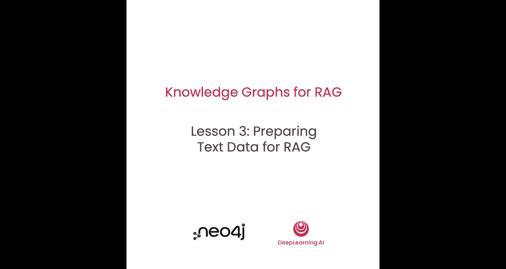
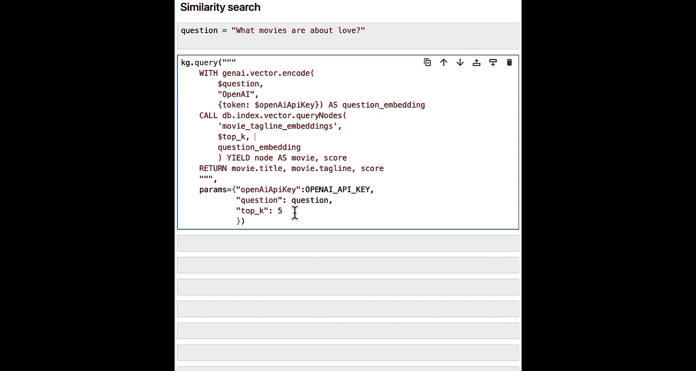
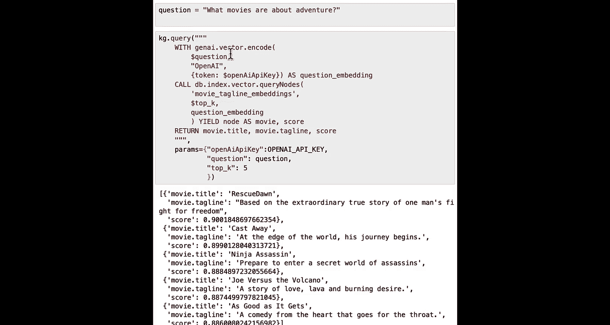

# 吴恩达《知识图谱用于RAG｜Knowledge Graphs for RAG》中英字幕 - P4：4.prep_text_for_RAG.zh_en - GPT中英字幕课程资源 - BV1DD421E7N1

RG systems start by using vector representations of text to match your prompt to relevant sections within the unstructured data。

So in order to be able to find relevant text in a knowledge graph in the same way。

 you'll need to create embeddings of the text fields in your graph。

 let's take a look at how to do this。

So to get started， you'll import some packages， as we did in the last notebook and we'll also set up near Fj。

You'll load the same environment variables that we have in the previous notebook。

 but now including a new variable called Open AI API key。

 which we'll use for calling the Open AI embeddings model。And finally， as before。

 we'll use the new for graph class for creating a connection to the knowledgeled graph so we can send it some queries。

The first step for enabling vector search is to create a vector index。Okay， in this very first line。

 we're creating a vector index， we're going to give it a name movie tagline embeddings。

 and we're going to add that we should create this index only if it doesn't already exist。

 We're going to create the index for nodes that we're going to call M that have the label movie and on those nodes for the tagline property of the movies。

 We're going to create embeddings and store those。 We have some options while we're setting up the index as well that we're passing in as this index config objects right here。

 There's two things， of course， that are important。

 It's how big are the vectors themselves for the dimensions of the vectors here it's 1536。

 which is the default size for Open AI's embedding model and openiI also recommends using cosine similarity So we're specifying that here as the similarity function。

Now to verify that the index has been created， you can ask Neo4j to literally show vector indexes。

Any。That Cypherque is nice and straightforward。 Look like this。

We can see that there's the name that we specified before。

 we can see that it's ready to go and that it's a vector index， so fantastic。

Now that you have a vector index， you can populate it with data。

 We'll do that in a three step query In this first line， we've got our familiar match clause。

 We're going to match movies that have the label movie。 and where the movie dot tagline is not null。

 So we only want to find movies that have tagline in this next line。

 we're going to take the movie and also calculate an embedding for the tagline。

 We're going to do that by calling this function that's called gen Ai that vector dot encode code。

 Now in this function。're going to do a couple of things。 We're passing in the parameter。

 which is the value we want to encode here that's movie do tagline。

 We're going to specify what embedding model we want to use。 That's openaiI。

 And because openaiI requires a key， we're also going to pass in a little bit of configuration here。

 says here's the token for open AI。 it's going to be this open AI API key。 Now。

 this is some notation here using this dollar sign。

 This value here is what we call a query parameter。

 So query parameter can be used in place of literal hard coded values anywhere in a cpherpress statement。

 So looking back at。😊，Here with populating the vector index。

 you can see this last part of calling Kg。 query， we're passing in the dictionary parameterss。

 and we're specifying a key called openaiI API key。

 and we're setting the value of that to the environment variable that we had set earlier。

 which is also called open AI API key， that then ends up being replaced in this query before its front right there so that the API key is passed into the call out to openaiI so let's run this query。

This query may take a few seconds to run because it calls out to the open AI API to calculate the vector embeddings for each movie in the dataset set。

 Now， you can take a look at the tag lines， along with the calculated text embeddings to see what has happened with that query that we've ran。

So let's pull out from that result， just the tagline itself can see what that is。

Since we only have one movie that we did at the tagline， it's welcome to the real world super。

 and let's also take a look at what the embedding looks like。

 I'm not going to show the entire embedding。 we'll just get the first 10 values out of it。Okay。

 great。 That looks like a good meing to me。And for our last step in like verifying what we've got for embeddings。

 we'll make sure that those embeddings are at the right size。 we're expecting them to be 1536。

So we're going to actually take that result and calculate how long they are。 Great。

 The vector size is 1536， just as we expected。 So you looked at just one movie that has a tagline and a tagline embedding。

 but that query we ran before counted an embedding for every movie in the database。

 So now we can actually query the database into vector similarly search on those movies。

We'll start by specifying what the question is we want to ask and find similar movies that might match that question。

 So a question like， what movies are about love。 And remember。

 we've done vector indexing on the tagline。 So this will do a similarity search against those tagline。

Here we're going to start with a call towards calculating an embedding using that same function we had before。

 and we're going to do that by saying with this function call to AI vector encode and a parameter for the question that will pass in want to calculate an embedding using the open AI model and the open AI of course。

 needs an API key。 So we're going to pass that in as well。 The result of that function call。

 we're going assign to something we call question embedding。

 we're then going to call another function for actually doing the vector similarity search itself。

 So we're going to call an Db index vector query nodes。

 we want to query the movie tagline embeddings。 That's the name of the index that we created earlier。

 and this is another parameter that is interesting。 We just want the top K results。

 So instead of returning all results we want similarity for just the top K that we specify as well later。

 And then， of course， we're going to pass in the embedding that we just So the similar search is going to say for within this index of all the tagline you have。

 Here's the embedding that we calculate it for the question。 do the similarity。

And actually give us those results。 Now， from the results。

 we want to be able to yield the nodes that we found， and we will rename those as movies。

 and also what the similarity score was with that， we're going to return movie title。

 the movie tagline and the score。 We're passing in some query parameters for the open AI API key itself。

 The question that we asked。 that's going to be calculated into an embedding。 And here。

 the top case says 5。 So we only want the five closest in nets。

Cool， so we've got movie titles like Jove versus。 the Volcano， which is the story of love， lava。

 and Burn desire。You can see through all of these taglines that's a pretty good match for movies that are about loves。

So now that we've built up a query that can do the vector similarity search and we've got a question that we've asked。

 this is a great time to kind of explore the movie dataset by asking different questions about what other movies it might be here。

 For instance， let's try about movies that are about adventure。😊。

We'll save that question and we'll run this query again。Oh， yeah。

Cast away ninja assassinate sins like something adventurous。 Jove versus the volcano。 Apparently。

 it's about love and adventure。 Maybe that's a good one to have on your Netflix list。

 This is a good point to actually pause the video and try just changing that question to explore the movie dataset set yourself。

 asking for different movies with different qualities and seeing what kind of results you get。😊。

So that's how to create text embeddings and add them to a knowledge graph。 Now。

 in all the examples so far， you've been working with an existing database。

 but to build your own ragg applications， you'll need to build one up from scratch to represent and store your data。

 Let's take a look at how to do that in the next lesson。

