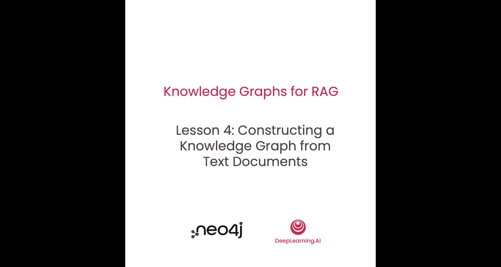
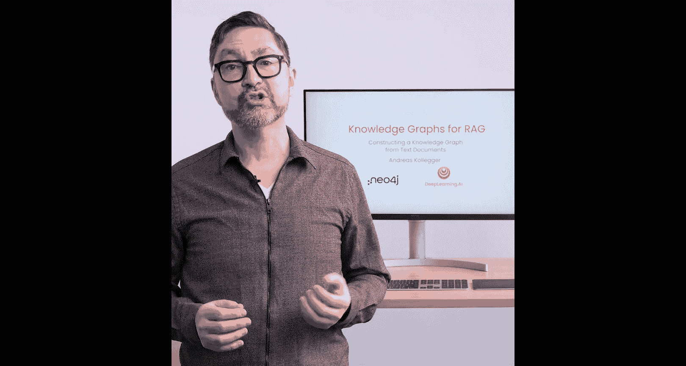
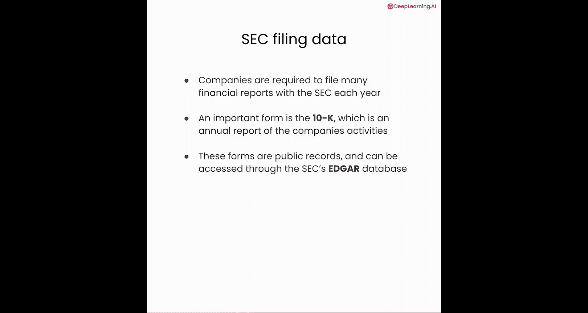
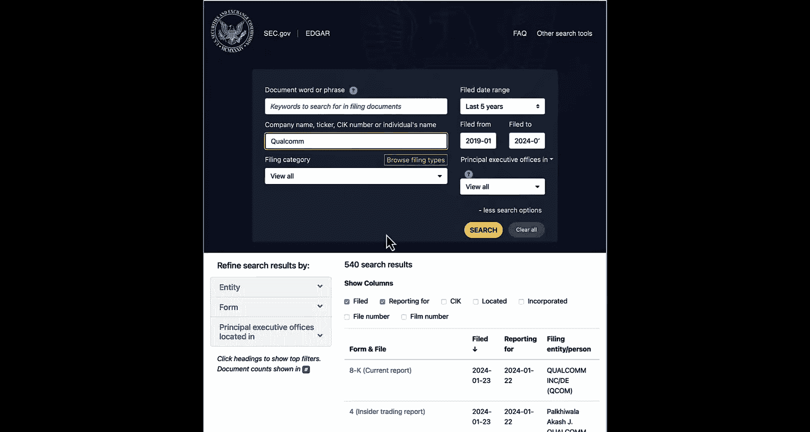
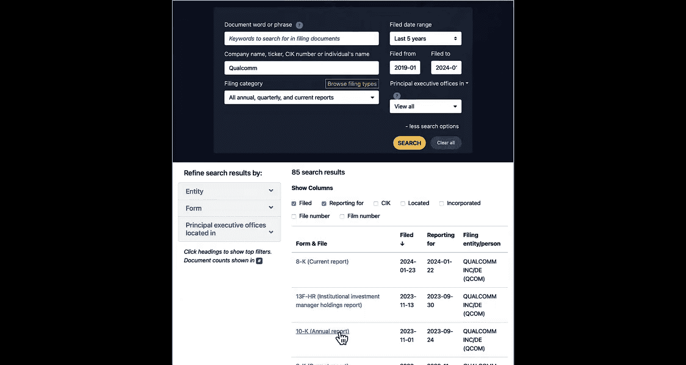
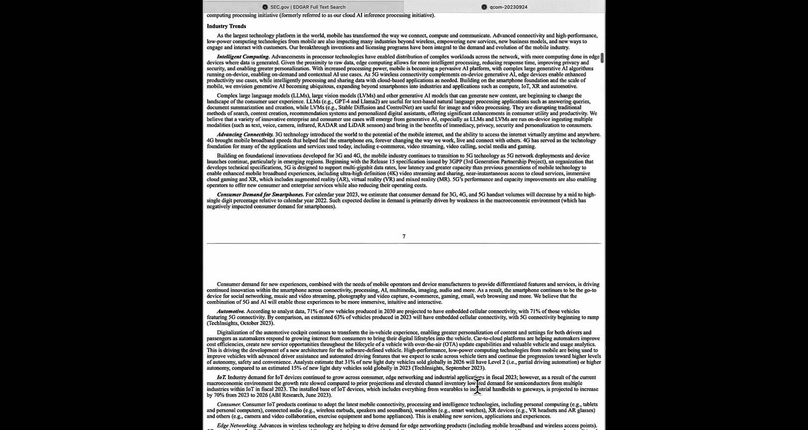
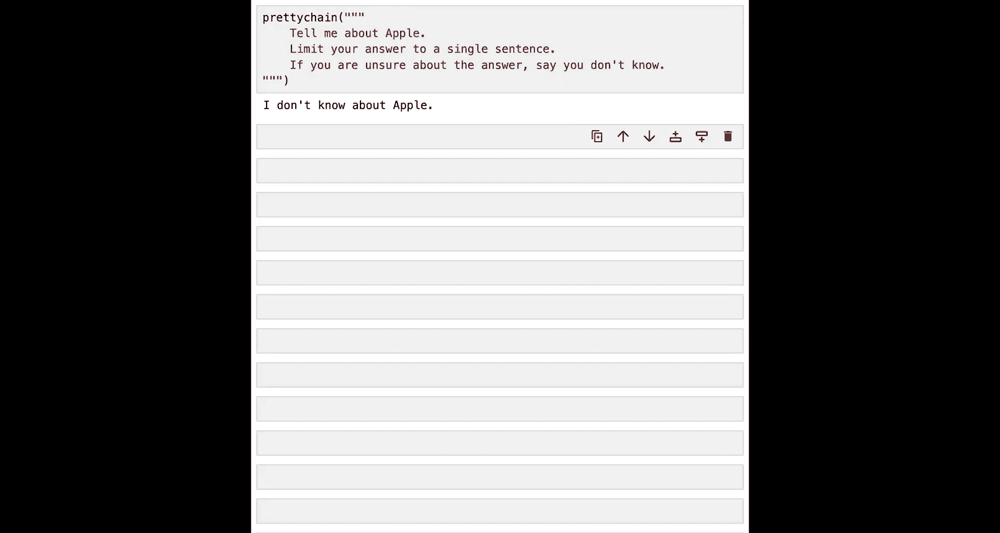

# 吴恩达《知识图谱用于RAG｜Knowledge Graphs for RAG》中英字幕 - P5：5.construct_kg_from_text.zh_en - GPT中英字幕课程资源 - BV1DD421E7N1

In this lesson， you'll use what you've learned so far to start building a knowledge graph of some financial documents that companies have to file with the Securities and Exchange Commission。

 Let's dive in。

So what are these financial documents， Companies are required to file many financial reports with the Sec each year。

 An important form is the form 10 K， which is an annual report of the company's activities。

 These forms are public records and can be accessed to the Sec's Edgar database。

 Let's take a look at one。

So here we are at Se。gov and the end database of all these financial forms we can look for a company like let's say。

 Qualcomm。

And then filter down for just their annual reports。So there's Quallcoms Form 10k。

 we can click on that to open it and open document to see a bigger review of it。

As you can see， there's time of sections to look at lots and lots of text。

 lots of interesting information in these forms。Industry trends。

A technology overview， this is great， so this is the kind of data that we'll pull into the knowledge graph so that we can then have a little bit of a chat with this financial information。

These forms are available for download and when you've downloaded them。

 they actually come as XML files and so before you can really start doing import with that。

 you've got to parse through the XML files and pull out the data that you actually want to work with so the way that we approach that is we started with just doing bit of reex cleanup going through the XML trying to find the chunks that we actually want and then we used beautiful soup for turning some of that XML into's a nice Python data structures and from that we then also extracted key things like an identifier called a CK which is a central index key which is how companies are identified within the SEC。

And for the big text chunks， we then looked at items 1，1 a 7 and 7， A。

 Those are the large bodies of text that we're going to do chat with。

 If you want to take a look in the data directory of this notebook。

 you'll see some of the resulting files after doing all this cleanup。 After doing all this work。

 we turn them into Json。 So then it's easy to import and start creating the knowledge graph from that。

Okay， we're almost ready to get back to the notebook。 But before we do。

 let's think about what our plan of attack is going to be。

 We saw that each of the forms have different sections of text that we're going to split up into chunks。

 We're going to use Lang chain for that。 And then once we've got all of those chunks set up。

 Each of those chunks will become a node in the graph。 The node will have that original text。

 plus the metadata as properties。 Once that's in place， we'll create a vector index。

 And then in that vector index， we'll calculate text embeddings to populate the index for each of the chunk texts。

 Finally， with all that done， we'll be able to do similarity search。

 So let's head back over to the notebook and we can get started with the work。😊，So to start。

 we'll load some useful Python packages， including some great stuff from Langchain。

 we'll also load some global variables from the environment。

And set some constants that we want to use later on during the nuge graph creation part。

In this lesson， you'll be working with a single 10K document in practice you may have hundreds or thousands of documents。

The steps you'll take here would need to be repeated for all of your documents。

 let's start by setting the file name and then loading just the one JSON file First。

 let's just grab the name of the file we're going to use and we'll call it first file name。

And then with first file name， we'll load that JSON and store it as a variable in Python。

We can take a look at that to make sure that it looks like a proper dictionary。

Okay the type is dictionary in Python that's perfect let's take a look at the keys that are available I'm just going to copy over a Ford loop that willll go through the dictionary printing out the keys and the types of values in the object。

 so you can see these are the familiar fields from the form 10K。

 the different sections called item1 item 1A and so on， and then also the special identifiers。

 the names of the company and the original source which is the link to the source at the SEC where we got the file。

Let's take a look at item1 to see what the text is like。

Let's describe item one from the object and because I know there's a lot of text there。

 we're just going to look at a little bit of it。So let's just look at you know。

 the first 1500 characters。Because the text is so big， this is the whole purpose of doing chunking。

 We're not going to take the entire text and store that in a single record。

 We're going to use a text splitter from Lang chain to actually break it down。

 So I'm going to use something called the recursive character text splitter。

And this text splitter is set up with a chunk size of 2000 characters。

 we're going to have an overlap of 200 characters， so we're going to run that and store the result as item1 text chunks。

And as before， we'll take a look at what the type of that is。Okay。

 we can see that to list and it should be a list of strings。Okay。

 let's also see how long that list is。Okay， so there's 254 chunks from the original text。Finally。

 let's actually take a look at one of the chunks to see what the text is there。

And that looks a lot like what we saw before， which is perfect。So with the text splitder ready to go。

 we can set up a helper function that can go through a file and go through each of the sections in the file and create chunks out of them and then turn those all into objects that we can use for loading data into the graph itself。

Okay， this is kind of a big function， so let's walk through it one step at a time。

 The function is called split form 10 K data from file， So of course it takes in a file。

 The first thing we'll do is that we'll go ahead and set aside a list where we'll accumulate all of the chunks that we create。

And then we'll go ahead and load the file， opening up the JSON and storing that into a variable Now within that file。

 we know that we have different sections that we want to pull out so we're going to loop through each of the section names。

Item1， item 1 A， and so forth。For each of those items。

 we're going to pull out the item text from the object so we just have that as a variable by itself with the item text。

 we'll use the text splitter that you just saw to go ahead and chunk that up Now that we have text chunks。

 we'll go ahead and loop through all those chunks and create data records for each one we're going to pull out the last part of the file name and use that as the ID of the form。

And then for the data record with the metadata， we're going to pull out different information。 First。

 there's the text itself pulled straight from the chunk。

 There's the current item that we're working on。There's the chunk sequence ID that will be looping。

And then there's metadata as well that we will be adding that form ID that we just created。

 the chunk ID that will also go ahead and construct from the form ID plus the sequence。

 and finally some metadata about the names and the special identifiers from the SEC。

All that will go into one data record and then be appended to our collection of chunks with metadata。

Now we can just call the helper function on the file。You can see that it processed item 1。

 an item 1A and so forth， well take the output from that call and sort it in first file chunks。

 which will be a list of records each record represents a chunk plus its metadata。

Let's take a look at the first record in that list。You can see the original text as we expected and。

There's all the metadata， as well， perfect。You will use a cipher query to merge the chunks into the graph。

 Let's take a look at the cipher query itself。 This is a merge statement。

 So remember that emerge first as a match， and then if the match fails。

 it'll do a create to create a new node。 So in the oncre set clause。

 It's the sub clauseuse of the merge query。 We'll go ahead and set some properties on the merge chunk that was just created。

 We'll pull those values from the parameter that was passed in。😊。

The parameter itself is called chunk Para， and it has names that match across right so with names will be added to the chunk parameter names。

 the formID property will be pulled from the chunk parameter， formID and so forth。To run this query。

 we'll need the new VGG integration from Bangcha that uses the parameters wed saved earlier。

 the location of the database， the username password and so forth。

 we'll store that as KG for easy reference later now to actually run it， we'll go ahead and call kg。

 queryry and pass in this query。Now， when we run this query。

It's going to pass in the string of the query itself， which we remember was parameterized。

And for passing in the parameters we have an extra argument which is called per。

 which is a dictionary of keys and then values the key chunk per here will be available inside of the query as this dollar sign chunk per。

 and we're going to give it the value of from that list of chunks we're going to grab the very first chunk so the very first chunk record will become chunk per Ram inside of the query。

So fantastic， you can see that the result of running that query is that we've created a new node and here's the contents of that node。

 it's the metadata that we set before， and then there's the text that we've always seen this is perfect。

Before calling the helper function to create a knowledge graph。

 we will take one extra step to make sure we don't duplicate the data In the previous lesson。

 you created a vector index here we'll create a uniqueness constraint that is also an index。

 It job is to ensure that a particular property is unique for all nodes that chair a common label。

 So if you look at the query here it says create constraint。

We're going to call it unique chunk if it doesn't already exist。

 and that constraint will apply to nodes that have a chunk label。

 and we're going to require that the chunk ID is unique for all nodes。Let's go ahead and run that。

Okay， and show indexes。Great， we see these two token lookup indexes that's built into Ne4j for doing relationship and node lookups。

 and here's our new unique chunk index。Now we're ready to loop through all of the chunks and for each of those chunks。

 we'll go ahead and run that merge query and passing in parameters that is the chunk parameter with that chunk。

Let's scroll down to see the end of this。Okay， great， it's created 23 nodes， perfect。

Just to standard check that we actually have 23 nodes， we'll run another query。

Here we're going to do a simple match for all nodes in the database and we'll just return count of those as the node count we expect this to be 23 nodes。

 let's see。Fantastic。Now we'll create another index this time of vector index。

 and this one is going to be for the chunks where we're going to create text embeddings。

 The index will be called form 10 K chunks and will store embeddings for nodes labeled as chunk in a property called text embedding。

The embeddings will match the recommended configuration for the Open AI default embeddings model。

We can check that that index has been created by looking at all of the indexes， Great。

 we can see that we've got this form 10k chunks available， it's online， which means it's ready to go。

 it's a vector index， and it's on the chunks for text embeddings just as we asked。

You can now use a single query to match all chunks and then with the chunk call Open AI to get the embedding and finally set the embedding on each of the nodes This may take a minute to run depending on network traffic。

And this is now what the graph looks like， we know that we've got chunks with text embeddings as a list。

 and we don't yet have any relationships。Now that we have a knowledge graph with chunks of texts that have text embeddings。

 you can create a helper function to perform vector search using Neo4j。

This is exactly like what we did in the previous lesson where we called Ne4j for actually doing the encoding。

 which would call back out to open AI， then using that embedding。

 we would actually store the value inside of the property called text embedding inside of the node。

You may recall that the form we've turned into a knowledge graph is from a company called NeApp。

 we picked just one form it happened to be this company NeApp。

 you can try out our new vector search helpper function to ask about NeApp and see what we get。

The Ne4j vector search helper function returns a list of results。

Here we're looking at result zero and we can see that you've got a score for how similar this text was and then the text itself that we asked for So we asked for you know tell me about NeApp and you can see that this document here is about a company Ne app Incor noticeice that we only performed vector search if we want to create a chatbot that provides actual answers to a question we can build a rag system using Langchain Let's take a look at how youll do that。

The easiest way to start using Ne4j with Lng chain is with the Ne4j vector interface。

 This makes Ne4j look like a vector store under the hood。

 It will use the cipher language for performing vector similarity searches。

 The configuration specifies a few important things。

 These are using the global variables that we set at the top of this lesson。

We'll convert the vector store into a retriever using this easy call as retriever。

The L chain framework comes with lots of different ways of having chat applications。

Here we're going to be using the retrieval QA with sources chain。

 which is a specific chain that they've built for doing question and answer type interactions。

 If you want to find more about the kinds of things that Lcha has available。

 I totally encourage you to go out to their website and check it out。 it's pretty great。

 So for this chain， we're going to say that we're using the chat open AI which means we're going to be using open AI for actually doing the LLM part of it the chain type that we're using here is stuff which means that it's using prompt stuffing so it's going to combine things together into one prompt that passes to the LLM and it's going to be using the retriever that we defined above which uses the Ne4j vector store。

😊，I also have a nice helper function here calledPtty chain， which just accepts a question。

 it then calls the chain with that question and just pulls out the answer field itself and prints that in a nice way formatted for the screen。

Okay， with all that work done， we can finally get to the fun stuff and ask some questions。

Since we know we have NetApp here， let's go ahead and ask， what is NetApp's primary business？

We'll use Pretty chain to pass that question in and just immediately show the response。Okay。

 we can see that BedApp's primary business is enterprise storage and data management。

 cloud storage and cloud operations。You can see that we have an actual answer to the question。

 rather just some raw text that might have that answer。 This is exactly what you want the LLM for。

Let's try another question to see what we get。 Let's see if we can tell where NeApp has headquarters。

Headquartered in San Jose， California， that is correct。Now that we have the LLM in the loop。

 we can ask all kinds of interesting questions and we can even give some instructions to the LLM。

 so instead of asking about NetApp's primary business， we can say in a single sentence。

 tell me about NetApp。Let's see what we get。Okay， I guess that is technically a single sentence。

 it is a bit rambly， but good job following our instructions。

So I want to show you something interesting here， we're going to ask about a different company that kind of sounds similar to NetApp。

 there's AppleO， the computer company right， so let's ask the same question。

 but instead of tell me about NetApp， tell me about Apple， let's see what we get for a response。H。😊。

The description of Apple seems a lot like the description of NetApp， this is classic hallucination。

Let's try to fix this with a little bit more prompt engineering。If you are unsure。About the answer？

Say， you don't。没有。Okay。Much better answer， much more honest from the L L M。

 Perfect prompt engineering for the victory。In this lesson。

 you've been using the E4j as a vector store， but not really as a knowledge graph。

Let's move on to the next lesson where you'll add relationships to the nodes to add more graphy power to the chat application。

