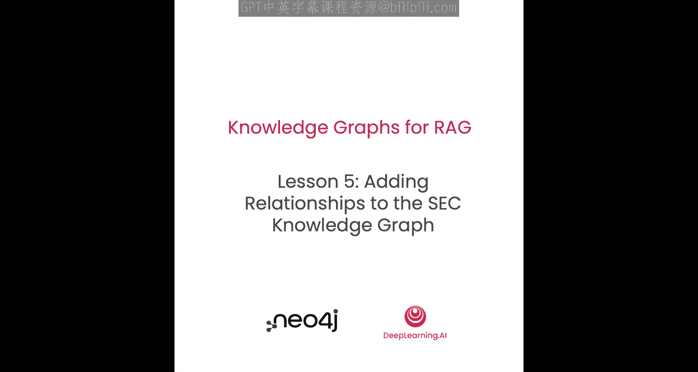
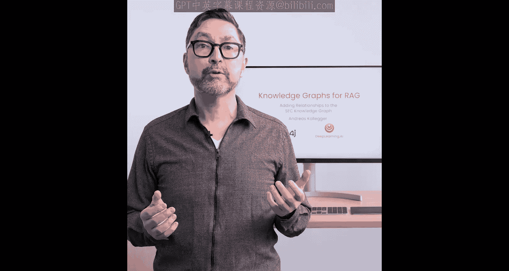
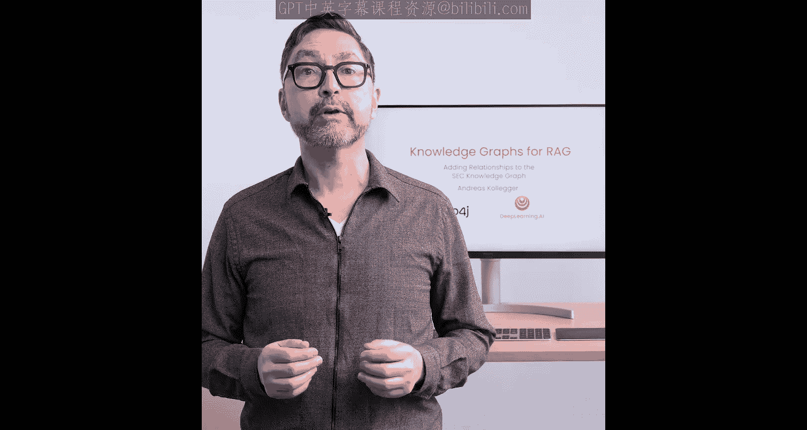
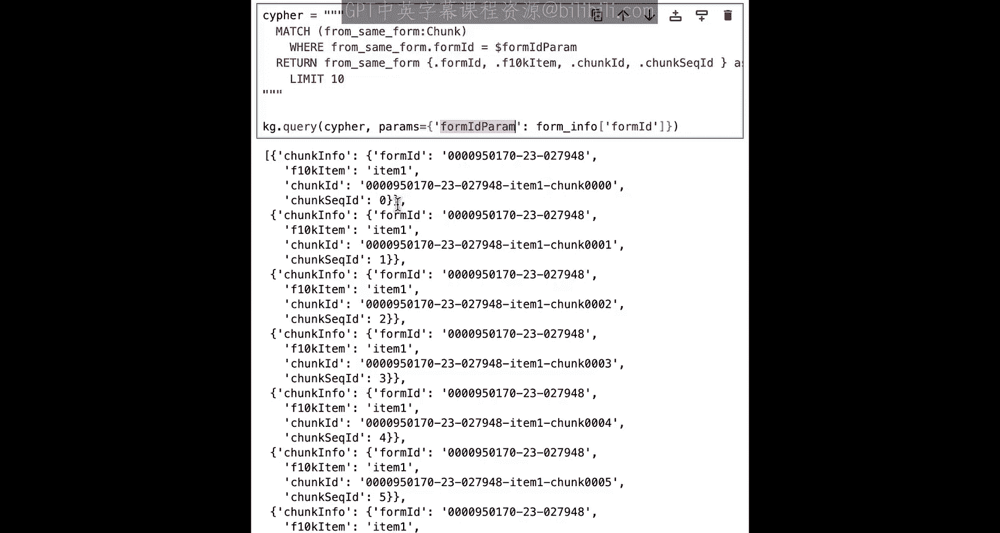
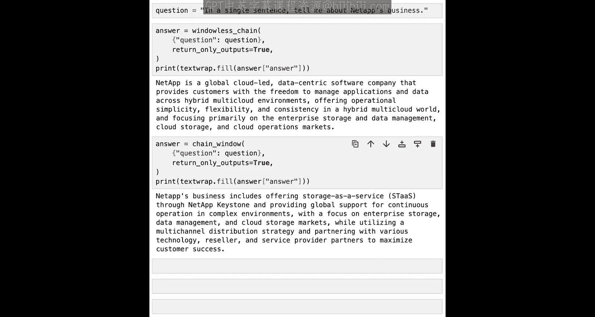

# 吴恩达《知识图谱用于RAG｜Knowledge Graphs for RAG》中英字幕 - P6：6.add_relationships_to_kg.zh_en - GPT中英字幕课程资源 - BV1DD421E7N1

Now that you've built the nodes of your graph， each of which contains a chunk of text from an SEC form。

 the next step is to add relationships to the graph that preserve the original structure of those documents。

 let's get started。

Here in the notebook， the first step as usual is to import some packages for Python。

And then setting up some global variables that we will use in the notebook。

And for all the queries that we want to send to Ne4j we'll again use the Lang chain integration called Ne4j graphraph。

Youll already have chunk nodes。 Youll want to create a new node to represent the 10 K form itself。

 This 10k form node will have a form label and the following properties。 It'll have a form ID。

 which is a unique identifier for the form。It'll have a source property which will be a link back to the original 10k document from the SEC。

 There's also a CIK number， which is the central index key from the SEC and also a QSP6 code。

 Now in this notebook we're going to be using some new cipher features。

 So first let's take a look at those。Each of the chunks has the information we need to create the form node so you can match for any chunk and with that chunk。

 just return one of those nodes and then we'll use a special notation to pull specific keys from the properties of the any chunk node。

You can see that we have all the information that we need here when you create the form node。

 it'll be with a parameterized query and if you remember that parameterized query can take in a dictionary as one of the parameters。

 So here we've got the perfect dictionary that we need for creating the form node。

 let's save that into just a Python variable。Perfect。

We'll now use that dictionary to create a form node。

You can see it down here when we're calling the query， we' going pass in some parameters。

 this form info parameter， and we're going to pass in the dictionary。

 that dictionary under the name form In program will be available inside of the query。

So we're going to merge in a new form using information from that form info， and when we create it。

 we'll set the names， the source in the S and also the Cuo bys based on the pastin parameter。

As always， we'll do some sanity checking to make sure that we did the right thing。

 We'll go ahead and do a match for all forms and return account to those forms。

 We're expecting there to be only one。Form count is one just as we want it， perfect。

Now you can start to connect everything together。Our goal is to add relationships to improve the context around each chunk。

 You will connect chunks to each other and to that newly created form node。

 The result will reflect the original structure of the document。

 You can start by creating a linked list of nodes for each section。First。

 let's just find all the chunks that belong together。

 so we'll match all the chunks where they come from the same form ID D。

 and we're going to pass in the form I D as a parameter。Here you only have one form。

 but I'm showing you a query that will work。 even if you had chunks from multiple forms。

 The form I Ds passed in as a query parameter。 It is then used in the where clauses to check that the chunks have the same form I D。

 Looking at the result， you can see that each of these come from the same form I D。

 They have different chunk Is and different sequences。 So that looks pretty good。

In particular， notice that we're returning the chunk sequence ID and that seems to be incrementing 0。

1， 2，3， and 4 that looks good。We're going to be using that to make sure that we have all the chunks in the right order。

 Let's change this query to make sure that we actually have them all in order。

So this is the same query， but now we've added two extra clauses to it here in the return clause。

 we're saying we want to order all of these chunks that we're returning by the chunk sequence ID and have that be ascending and then limit that to just 10 again just to check our work。

Okay， looking at the results， they're still all from the same form， that's good。

And if we look at the sequence I D to make sure it's in order， we see 0， and then another 0。

 Okay so that's not good。 Why is that Looking more closely。

 we can see that we've got chunks from different sections of the form。 Here。

 This is from section 7 A， and this is from section 7。 They both have a chunk with a sequence I D 0。

 That's not what we want。 We just want a sequence of chunks from the same section。

 So now let's refine this a little bit more。So we've added one new part to the query here。

 we've already had the check for the form ID matching the parameter。

 we've also added a new query parameter called F10K item parameter and that's the name of the section that we want the chunks to be from so that gets passed in and then gets added to the where clauses using the and function。

Okay， checking the results again。Everything from the same form that's good or also from the same form item。

 item 1， item1， item 1， and we've got the sequence we want0，1，2，3 incrementing。Perfect。😊，Okay。

 now that we know that we can get chunks from the same section， from the same form。

The next step we want to do is actually click those into a list。

 so there's a new line here and this here at the end， this slash slash。

 that's just a way of having a comment at the end of a line。So in this new line here。

 we've got a return which is going to collect all of those chunks into a list。

 so the result of this will be the same as what we had before， rather than individual rows。

 one per chunk， all the chunks will be in a list so we should have just one row。Cool。

 so you can see that we have one row where row has a list of chunks inside of it。

 and those chunks are just what we want from the same form and in order by their sequence ID。

Now that you have a list of chunks， we can take the next step and actually create relationships in the graph。

 so this is the same query we had before that effectively just gets a list of chunks in order。

And we're going to save that into a new variable called section chunk list。

 and instead of just returning that list， we're going to call a procedure called apoch donodes。link。

Now， this procedure will take a list of nodes and then a relationship type that you want to have。

 So here we're going to say next， and it'll create a linked list。

 So for every node between each node pairs， itll create a new relationship called Next。

 The sector parameter avoid duplicate says if we run this multiple times。

 it will create many next in between each pair。We can check the graph schema to see that there's a new relationship type。

We see that we have nodes with properties， and the relationships are the following。

 We have chunks that are connected by next relationship to other chunks。Perfect。

Now that you can create a linked list for a single section。

 we can do all of the sections by just having a Python loop that goes through the different section names and calling the query。

 passing into those different section names。Because we have avoid duplicates true。

 even if we try to do item1 again， we're not going to create a new linked list because that'll avoid the duplicates。

Next， you can connect the chunks to the form they're part of。

Match a chunk and a form where they have the same for my D。

 Then merge a new part of relationship between them。You can see we've created 23 new relationships。

As a reminder， we're working with a small collection of chunks here to keep the notebook running smoothly in the full sample 10 K form。

 there are several hundred chunks。You can add one more of a relationship to the graph。

 connecting the form to the first chunk of each section。This is similar to the previous query。

 but also checks that the chunk is sequence ID 0。 the section relationship that connects the form to the first chunk will also get an F 10 K item property。

 It will take the value of that from the chunk。You can see that happening in the merge here。

 This is a kindness for humans looking at the knowledge graph。

 enabling them to easily navigate from a form to the beginning of a particular section。😊。

We've got four sections， so of course we created four section relationships。

We can now try some example cipher queries to explore the graph。 For example。

 you can get the first chunk of a section using a pattern match from a form to the chunk connected by section relationship。

 You'll use the where clauses to make sure that the form has got the form I we want and that the relationship is for the section we want。

 We're going to pass those in as query parameters。So there's the chunk ID from the chunk that is the first one in the section and then the text that looks by this point pretty familiar。

With information about the first chunk， you could then get the next chunk in the section by following the next relationship。

And you can see that this section continues to talk about our favorite company， that app。

To standardity check， the work that we've been doing。

 we'll take a look and make sure that we actually do have two chunks that are in sequence。

So you can see here that all the form stuff is the same， and then this is a chunk 000。

 and this one is chunk 0，001， perfect。To find a window of chunks。

 you can use a pattern match using the next relationships between three nodes。

You only need to specify the chunk ID of one of the chunks because of the relationships。

 you know you will get all three chunks back here we provide the chunk ID of the middle node which is the center of the window。

You can see that we've got chunks， C1， C2 and C3， and that they've got chunk IDs 00，0，01 and 02。

This is great， you're starting to see the advantage of having a graph。

Once you have a place to start in the graph， you can easily get to connected information with a RA application you might discover a node using semantic search Now you can add extra context to that node by using a pattern match in the graph。

With a graph， information is stored in nodes and relationships。

There is also information in the structure of the graph。

You just matched a pattern with three nodes and two relationships。

The thing you found is called a path。 Pas are powerful features of a graph。

 famous in algorithms like finding the shortest path between two nodes。

You can capture the entire matching path as a variable by assigning it at the beginning of the pattern like this here we're going to call this path window paths are measured by the number of relationships in the path。

For three node path， we'd expect that the length is going to be two。Let's take a look。Perfect。

You'll be using passs in the next couple of queries， it's going to be a lot of fun。

Notice that the chunk window pattern is around the second chunk in the list taken from the next chunk info。

 What happens to the pattern match if we look for a window around the first chunk instead， let's see。

Change next chunk info into first chunk info。And then let's run。So the pattern didn't match anything。

 that's because the first chunk info doesn't have a previous chunk as required by the pattern。

We can change the pattern to look for what's called a variable length path with a variable length path。

 you can specify a range of relationships to match。You can see the notation here。

When we specify the relationship type。Its colon relationship type。

 then an asterisk and then the range， the first number is the minimum number of relationships。

 the second number is the maximum number of relationships to match。

By using a variable length both in the beginning and at the end of this pattern。

We can match the boundary conditions of a linked list。

 whether you're looking at the very first item in the linked list or the very end of the linked list。

 Not when we ran the query that two patterns actually were matched。 The first has a length of 0。

 and the second has a length of one， meaning that it has two nodes and one relationship。

If we're going to look for a window of chunks around a node， we want the longest possible path。

 let's see how to do that。This is like the query that we just did。

 but now we're going to take what we're calling the window， which is the path that match there。

And we're going to look for the longest chunk window by ordering all of those paths。

 according to how long they are， descending and limit that to just one that should be the longest path that matches the pattern。

As we would have hoped， the lungs path is one， so that looks correct。

This is a pretty good time to actually pause the video and try out variations on this query for example。

 you might want to try looking for two chunks to either side。

 try different variations and see what you get。😊，You can now create a question and answer chain。

 If you look at this cipher query here， This is an extension of the vector search cipher。

 What you see at the beginning is that there are two variables I could pass in node and score。

 Those come from the vector similarity search itself。

 We're taking that and then just taking a literal string and saying that's going to be called extra text。

 We're going to return that extra text prepened to whatever the text was of the node or the chunk。

 And we're going to call that text， return the score。 And then also some metadata about the result。

Now this is the basic pattern of a cipher query that extends the built in vector search query of the Neph4j vector class。

 so it's mandatory that you output a variable called text。

 something called score and something called metadata。

 but that can be whatever you want to so you can run any kind of cipher at the beginning。

 this is the smallest bit of cipher that we can run that will illustrate what happens。

Let's go ahead and build a Lng chain workflow that uses this query。

The new part that I'll highlight here is that we're passing in a parameter called retrieval query。

 and for that parameter， we're going to pass in that cipher query that we just defined above。

 That's what's going to do the extension of the vector search with whatever extra bit of querying we want to do。

So we'll call the chain and we know we have to pass it a question。

So let's see what it knows about Andreas。Okay， well apparently I know about a lot of things not only do I know about cipher。

 I also know about natural disasters and catastrophes。

 but we know this isn't the case right so it's gotten a little extra here that is not true we might be able to do a little bit of change to the and question maybe what single topic。

Does Andreas know about。Okay， now it only thinks I know about cipher。

So you can tinker with this entire cell here。Change the retrieval query itself。

 the information that you're passing in， change the questions that you ask。

 I think this is a great thing to kind of explore， to really get a feeling for like how you can expand the context just by adding extra text to whatever you find inside of a chunk。

Okay。You now know how to customize the results of a vector search by extending it with cipher。

 You could use this capability to expand the context around a chunk with a chunk window query。

 Let's try this out and compare the results both with the extra window and without it just the chunk that the vector finds。

First， create a chain that uses the default cipher query included with Neo4j vector。

 call it windowless chain。Now， create another chain that uses the chunk window query。

 your goal here is to expand the context with adjacent chunks。

 which may be relevant to providing a complete answer。To do that， use the chunk window query。

 then pull out text from each chunk that is in the window。Finally。

 all that text will be concatenated together to provide a complete context for the LLM。

With that query in hand， we can now create another vector store and notice as we create this vector store。

 we'll be passing it in as the retrieval query right so that the initial vector search will be expanded by our window。

 all that's combined together and then that's the context to give to the LOM with a creative retriever out of that and then pass that into the Lang chain Q&A chain itself。

Okay， let's give that a try and compare both having the chunk window and without the chunk window。

So here's the question that we're going to ask where we'll say in a single sentence。

 tell me about Ad's business。When we've run both of these chains。

 we'll do a little extra formatting to kind of provide a nice nicely formatted answer。

 remember this windowerless chain is going to match just a single chunk by the vector search and use that for providing its answer。

That seems like a pretty good summary， Okay， not bad， let's try with the chunk window。

Okay you can see that these two answers are pretty similar。

 the one difference that I can spot is that with the expanded context it actually highlighted NeApp's Keystone。

 which is their premier product， so if you're going to write a kind of highlight summary of NeApp you'd want to you know not only say what the company does but mentioning some of their products as well as a nice touch。

You can pause here to try out variations of the chunk window query Also try asking different questions to see what you get when you're ready。

 join me in the next lesson where you will expand the context with data from an additional Se form that contains information about NeApp investors。

