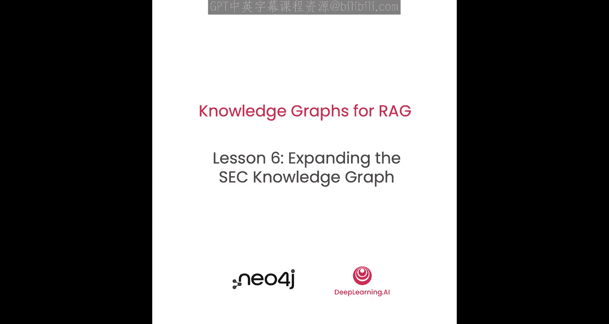
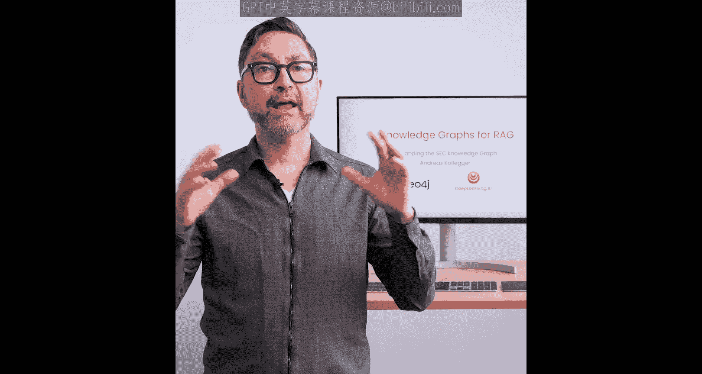
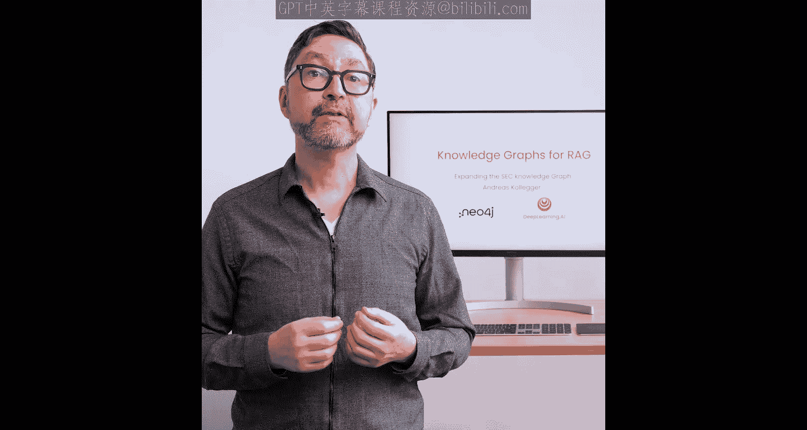
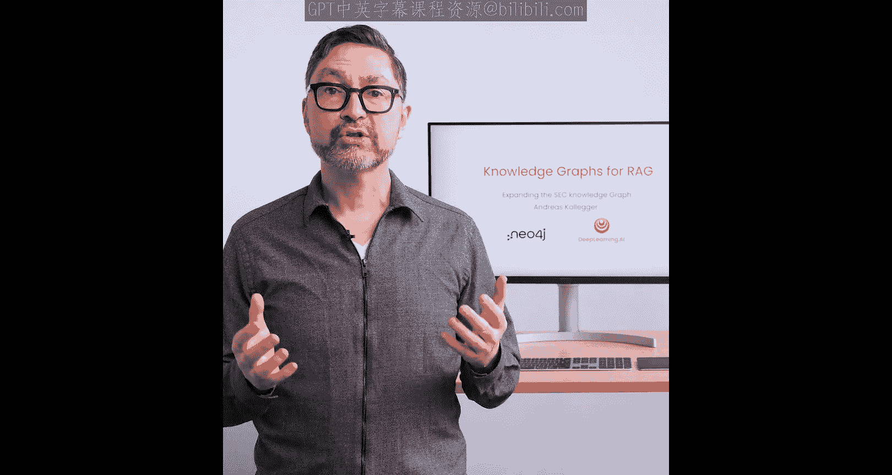
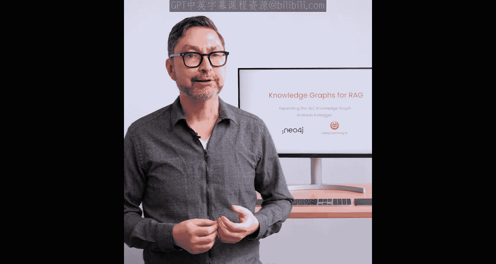
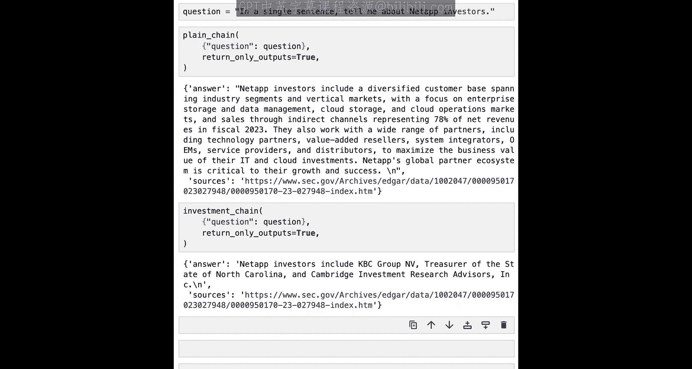

# 吴恩达《知识图谱用于RAG｜Knowledge Graphs for RAG》中英字幕 - P7：7.expand_the_kg.zh_en - GPT中英字幕课程资源 - BV1DD421E7N1

In this lesson， you will bring in a second SEC data set to expand the context of the original filing forms。

This second set of formss provides information about institutional investment managers and the interests they hold in companies。

By adding this data to the graph， youll be able to ask more complex questions of the combined data sets that help you understand market dynamics Let's take a look。

You will start in the usual way by importing some libraries。Then to find some global variables。

And of course， we need a Ne4j graph instance to connect to the Neu4j database。

SCC Form 13 is filed by institutional investment management firms to report what public companies they have invested in。

 The forms are available as XML files During data preparation。

 particular fields are pulled out of the XML and added as a row in a CSv file to begin。

 you can read the CSv file in using a CSV do diic reader。

 which will parse each row and turn it into a dictionary using the CSV header row for keys。

Let's take a quick look at what the rows look like， though， maybe just the first five。Okay。

 you can see that each of these firms have invested in the same company。

 if you kind of take a look here at company name， there's NetApp。There's company named NeApp again。

All of these management companies have different names， but they're all investors in Ne app。

 you can see that there are details about the firm itself， things like the manager name。

 the address of the manager and also this central index key or CK key There's also about the particular information about the investment that they've made So what is this reporting calendar what was the values the number of shares that makes sense here the value is a monetary value。

 So this is dollars。 you also see some metadata about the company that they invested in both the QSP6 code and the QIP code。

Let's see how many rows there are。We'll just check the length。Okay， there's 561 rows。

 we'll expect 561 companies to be created。Now from each row， you will create two nodes。

 one for the management company and one for the company that they invested in The management company nodes will have a manager label。

 They'll be unique based on the central index key from the Se。

 and they'll also have a manager name property。 The company nodes will have a company label。

 They will be unique based on the QS6 identifier。 The company nodes will also get a company name and a full QI6 property from the form 13 data。

 Let's start by creating the company nodes。 merge in the company nodes with a company label that is unique by the QS6 identifier。

We see that on creation， weness of the company name and then the QIP number itself。

Quick bit of sanity checking， we're going to expect that the company which is created is NeApp。

Of course， that app is there， perfect。You already have a form 10K form for Ne app in the knowledge graph。

 you can match the newly created company node to the related form 10K by finding the pair based on the QCP6 identifier。

 so that's what we're doing here。 we're just matching a pair of nodes。

 a company and a form where the QC6 is the same in both of those。

 and then we're going to just return those two nodes。You can run that match again。

 but now because we've noticed that if you take a look here， the form names。

 the names of the company from the form show not only that it's Ne ink。

 but also some variations on the name。We can take those values and pull them over to the company node to enrich it。

So we'll do the same match based on the QI6， and then once we've got that。

 we'll set the company dot names to the form dot names。And we'll take one more step。

With that same pairing from company to forum， we're actually now going to create a relationship so that we know this company filed this form。

The investment manager nodes will have a manager label let's create those next we've got you know a manager with a manager label we want it to be unique based on the manager CIK number when we're creating that we're going to set the manager name and the manager address as before we'll pass in a dictionary to the manager parameter that'll be the query parameter that is used inside of this query to create these nodes。

We're going to do this first just for the first form of 13。

Then a quick sanity check to make sure we've done the right thing。And there' is the manager node。

 we've got the name Royal Bank of Canada， their address。Looks good。嗯。

There will be many management companies up to 561， right。

 so let's create a uniqueness constraint to avoid creating duplicates accidentally。Also。

 we can create a full text index on the manager nodes。

The full text index is useful for keyword search。If you think about a vector index that allows you doing searching based on similar concepts。

 a full text index allows searching based on similar looking strings。

You can try out directly querying the full text index the same way that you can directly query the vector index here we're going to look for Royal Bank that query will return a node and a score very much like what happens with a vector search if that matches we'll find the node manager name and then also the score。

So both Royal and Bank ended up been finding some good matches here， but the top match。

 the best match of course， was a Royal Bank of Canada。

Now you're ready to create nodes for all management firms that appeared in the CSV file。

 just use Python to loop through all the rows， so here in Params we've got manager PRm set to whatever form 13 is。

 we know that's a dictionary because all form 13s is a list of dictionaries。Again。

 sanity checking is always a good idea， so we'll just go ahead and match for all managers and return account of those managers。

 We're expecting 561。Perfect。You can now find pairs of manager nodes and company nodes using information from the form 13 CSV you can see in this query they we're going to pass in a query parameter called investment parameter。

And in the match， we're going to match for the investment parameter manager CK。

 and then to find the company in that same real， we're going to find the investment parameter QS6。

So this match will find based on those two values， a manager and a company that match that row。Cool。

 if you remember our first real， it was Royal Bank of Canada， of course they invested in Ne app。

 so this all looks correct。You can find a manager node and the company they invested in。

 That's great。 You can now connect those nodes together。

This is something you've done before in the course， but the query will get a little long。

 so let's go through it one line at a time。So we're going to create some cipher。

 so let's say cipher equals triple quotes。And the first line we want is the exact same match we had before。

 So now we have a manager and the related company that they've invested in。

And so we want to create a relationship between them。 So we're going to use merge。

It will emerge from that manager。Through a own stocking。Relationship。Over to the company。

And we want the own stockend to be unique in case they've had multiple investments。

 and if you recall looking back at that C fee file。

 some of the rows had a report calendar or quarter value。

 let's use that as unique property on the own stockend relationship we're about to create。

The property will be called report calendar or quarter。

 and we're going to grab that from the query parameter。Okay。And now you've seen this before。

This is on create。So when the relationship is created。

 we're also going to create these extra values and then finally we're going to return。

A couple of properties from both the manager， that relationship that was created and the name of the company。

Okay， let's close that out。And when we call this with KG query。

 the parameter that's going to get past in is called Os Para， that's what we've used throughout here。

And we could use just form 13 for now the first form 13。Okay before we've run this。

 it looks like I've missed one thing here on the relationship that nearly merged in。

 we're setting the value in the shares， but we're using this Os variable。

 but we haven to actually use that up here to set the variable。When it's created。

 we want this to be the Os。 Okay， I think this looks right now， let's give it a go。Or a good friend。

 Royal Bank of Canada and Ne app， awesome。So we'll just run a quick query to Sananity check again。

 make sure that the relationship actually exists。We'll grab the relationship here in the pattern and then look from the O's relationship。

 let's return the shares and the value。Cool。Having done that once。

 you can now loop through all the rows of the CSV file to create an own stock and relationship between a management company and the company they invested in。

 of course that company will be Ne app Now this is the same which you've done before we're just looping through creating all the merge statements to create relationships。

Another quick check to make sure that we did the right thing。

 we're expecting that we have 561 relationships created。Perfect。

We have changed the knowledge graph quite a bit from when we first started。

 we started with just chunks of the form 10 Ks， then we connected those chunks and we created a form that the chunks would be connected to。

 and now we've created companies and managers， all that's been connected let's take a look at the scheme of the knowledge graph to get an idea like what all of our work has produced。

We can do that by refreshing the schema on the knowledge graph and then just printing out that schema。

 we'll take advantage of Tt here to try to get some good formatting。Okay， first。

 the nodes that we've got inside of the knowledge graph。

 you can see that we've got chunk node with its properties。And over here。

 there is the form node properties for that。There's the manager that we created。

The company we created and all those properties。 That's awesome。The bottom half is relationships。

 And we can go down to here and see we've got from the chunk is a part of a form。 That's correct。

 We know that chunks have a next to other chunks。 That's the linked list of chunks。 That's awesome。

 And then also， you can go from the form through a section to a chunk。

 That's how we found the beginning of the linked list， right。😊，Finally。

 we've got that manager on stock in the company and that the company has filed a form。

All that together ends up being the knowledge graph we just created。

What I love about graphs is that they are awesome for exploration。

 Let's have some fun looking around to see what we can find。To begin。

 find a random chunk to use in later queries。 So we're just going to match for chunks and return the first chunk I as chunk I and limit it to one。

 This is whatever chunk happens to be the first one that we find。 So when we run this query。

 you will save that in chunk rows and print out chunk rows。Cool， there is our trunk I D。 Well。

 let's store that so we can use it later。 You can see that's a list with the dictionary inside。

 So first， let's grab things out of the list。😊，So now we have just the dictionary inside from that trunk first row。

 we'll grab the chunk ID and store that in rough chunk ID for later queries。

So we'll start to build up a path from the chunk that we know about back through a form to other things that we can discover one step at a time to see what's possible。

 So the first part， of course， is we're going to go from that chunk that we know that the chunk idea of and then go through the part of relationship to the form that it's a part of and return that form source。

Okay， that's good。We'll take one more step here。 And in this pattern。

 we're going actually break it up into two lines。 So it's a chunk that is a part of a form where that form was filed by a company。

 If you read that second part backwards。And we're going to return the company name。As you'd expect。

 it's our good friend Ne app。Okay， we're going to extend that yet one more step。

Here we're going to go from the chunk that's a part of a form where a company filed that F form。

 and then there is a manager or management investment company that owns stock in that comm， Okay。

 comm is the company here， All these variables have to match up。

 This is one big pattern broke up into three sections。

 We'll return the company name an account of how many managers as we'll call it the number of investors invested in that company。

This is great validation。 Okay， of course， the companys Ne app。 And we know， as expected。

 there's 561 investors in that company。 We've done good work。

 You're starting to see some of the fun things that are possible with the knowledge graph。

 Fun and actually useful。 This is information that wouldn't be possible with just a vector search。😊。

That pattern you just created from a chunk all the way to an investor is useful information。

You can use that information for expanding the context provided to an LLM， for example。

 you can find investors for a company， then create sentences that contain details about each investment to further extend the information provided to the LLM。

 you'll use the same match you had before the same pattern and then instead of just returning data from that。

 we'll take some of that data and then turn it into a string sentence。Here at the bottom。

 you can notice two extra things。This is just concatenating strings together。

 but then here we're taking the value and we want to have that be nicely formatted。

 we know that that represents dollars， so we're going to turn that into an integer and then to format that integer using apoch number format。

 that's going to add some commas to improve readability。

Let's save that into results and see if we can pull out the sentences so you can read them a bit better。

Okay， looking at just the first sentence we created。

You can see that this funnamed company owns a lot of shares of Ne app and at a value of， well gosh。

 quite a lot as well you see the kinds of things you can do with pattern matching and turning the values from those patterns into sentences Let's put that to work inside of a rag workflow We'll set up two different Lang chain chains As we did before one would be just a regular vector lookup and then we'll do another one that's going to have a retrieval query to grab extra information We'll test them both out on some questions。

The first chain that we'll call plane chain， this will be the one that doesn't have anything other than the district vector search。

And then we're going to define a cipher query that we want to extend a vector search with。

 so we're going to call it the investment retrieval query。

This pattern should look familiar at this point from a particular node。

 remember this will come from the vector search， it'll give us a node that it found that is similar to the question that was asked。

We're gonna go from that node， know that it's part of a form from the form。

 We know that it was filed by some company。 There is a manager who owns stock in that company。

 The arrows are pointing the other directions。 You got to read those backwards this time。 Okay。

 from the original node， we're also going to take the score， the manager。

 the owns relationship and then the company。 We're going to order all of that by the investment shares descend sending and just limited to 10。

 then we're going to basically create one giant text out of all that。

 collecting everything together into some statements。

 and then preending that to the text we will return from the vector search。As in previous lessons。

 we'll create a new vector store， but now using that extended query。

 here the retrieval query is going to be the investment retrieval query we just defined。

 we'll create a retriever from that and then a chain we'll call it investment chain。

Now we're ready to try a couple different questions。

Let's start with an obvious one since we know this is all about NeApp。

So let's have a question that says， okay， in a single sentence， tell me about NeApp。

So we'll use the plane chain that we just defined， which is the one that just does the vector search。

 we'll run that first， you can see that here NetApp is a global led cloud company。

 yeah this all make sense。Let's try the same thing with the investment chain。

Let's see if that extra context changes his summary about what NeApp does。

So that actually looks pretty similar， which isn't unexpected。

The LOM ignored the extra information about investments because we didn't really ask about that。

So what if we did ask it about the investors？In a single sentence， tell me about Neap investors。

Again， we'll go ahead and start with plain chain。That's only we going to do the your search and see what answer we get。

Okay， think that the investors are diversified customer base。 Okay。

 just kind of putting things together here， trying to come up with some kind of an answer。

 So now we'll try that same question。 but with the investment chain and see what we get。Okay。

 this is a bit more realistic， now we can see that the investors include KPC Group， some Tr。

 Cambridge investments， this is great。This is actually a great place to start tinkering around a little bit。

You can change a couple of different things， you can change the sentences that we're creating out of the investments。

 see how that impacts what things you get， change the question that you're asking here at the end and see how different prompts actually adjust what you get out of the LLM There's a bit of an art still involved in getting the LLM to understand the information you're giving it and how that relates to questions that actually can be answered and how they can be answered We'll explore a lot more of that in lesson seven so let's go to that next。

