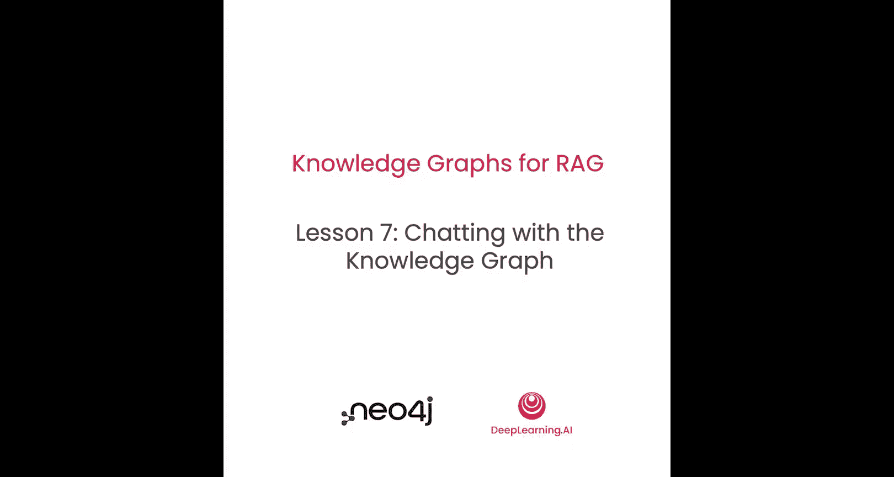
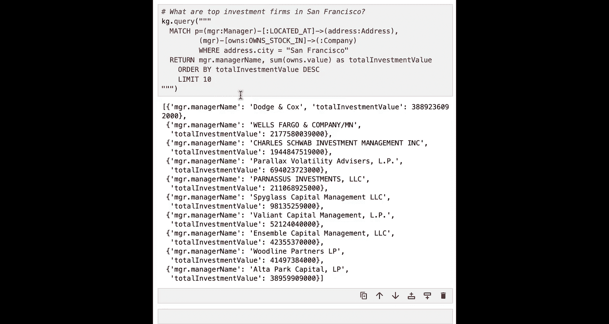
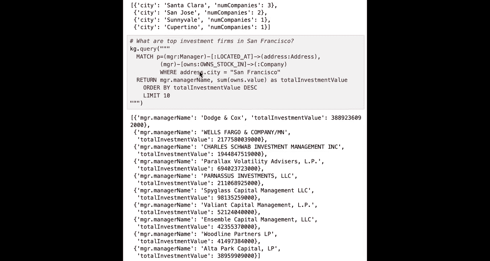
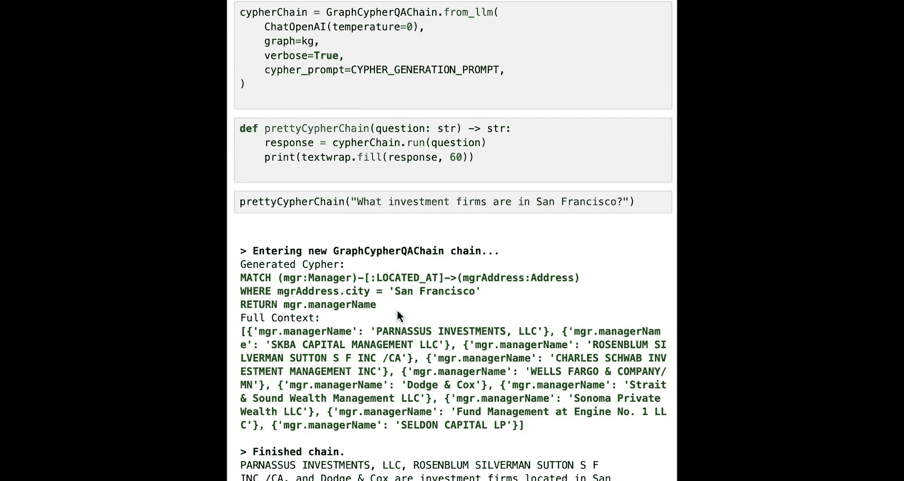
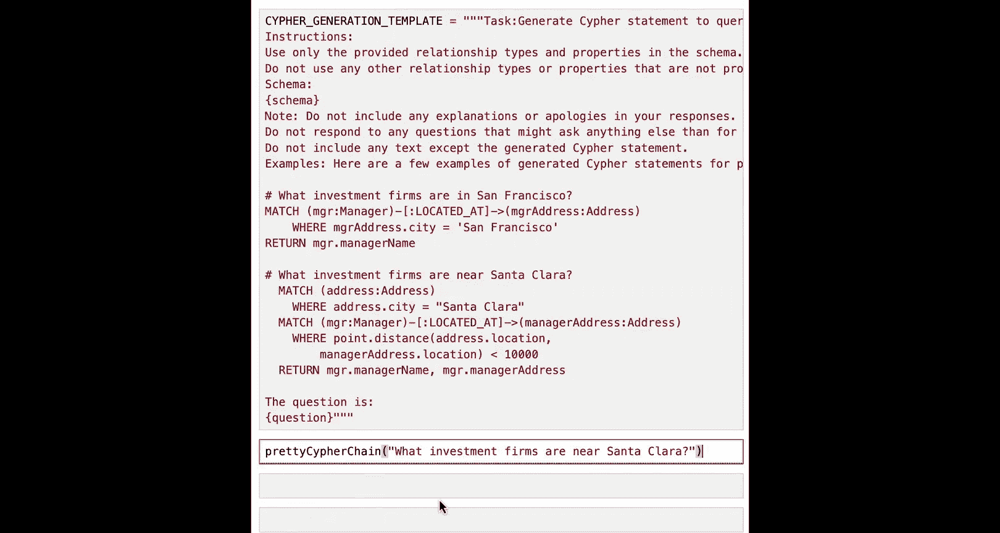
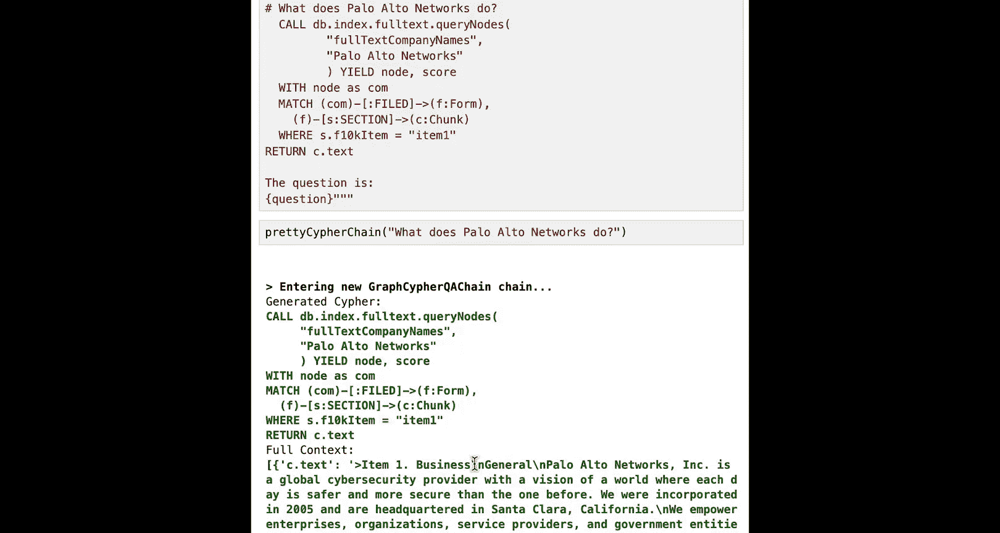
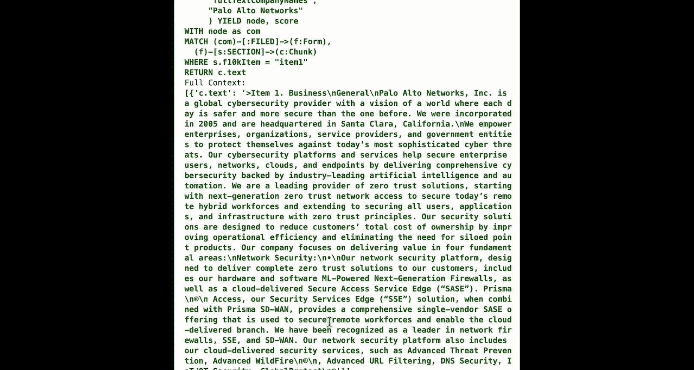
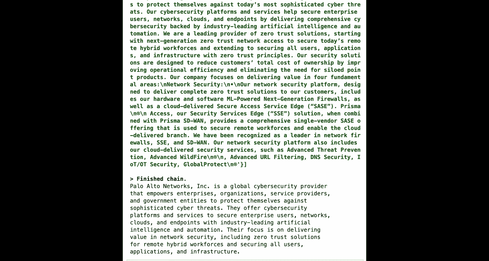

# 吴恩达《知识图谱用于RAG｜Knowledge Graphs for RAG》中英字幕 - P8：8.chatting-with-the-knowledge-graph.zh_en - GPT中英字幕课程资源 - BV1DD421E7N1

Okay。So now that you have your completed graph， you can get to the fun part。

 chatting with the SEC documents， let's dive in and ask some questions。

So let's step back for a second and just think about what you've created。

 you've created a knowledge graph and how did you do that？

You started with what I would call the minimum viable graph of just a very small graph that actually has the data inside of the knowledge graph that's good。

And then there's kind of a pattern that we went through together where we extracted some data from the graph or from another data source。

 we enhanced that data in some way， and then we expanded around that data to grow the graph a little bit at a time。

We're extracting， I mean， like finding interesting bits of information that we want to pull out of the data that we have into separate nodes。

 enhancing， meaning supercharging the data somehow。

 whether that's with a vector bedding or something else。 And then expanding。

 I really just mean connecting the data to the graph that you already have。

 Think back to the beginning of the course。 When you had some form 10 K data。

 And you were importing that。 You had the raw data。 We split it into some text。

 We just did the chunking right。 Then you created nodes for each of those chunks。😊。

You added some embeddings。 and finally， you connected those nodes。

 That's exactly the pattern I'm talking about。 You extracted some information from the original source data。

 you enhanced that with the embedding， and then you expanded it into the graph itself。

Throughout the rest of the lessons， you continued to that same pattern。

 whether it was starting with the text nodes and creating chunks out of those or then creating some forms from the chunks themselves。

 or then from some new data， the form 13 CSv creating the companies and then the managers at each step。

 you found some interesting information。 you create a data out of that。

 you enhance that data with something like an index。 and then you connected it to the graph。

 you went from chunk to next chunk chunk that's a part of a form， a company that filed that form。

 And finally， a manager who owns stock in that company。

 You could keep doing this as much as you'd like as much as is relevant for the kinds of questions you want to be able to answer。

 For example， you could crosslink the companies themselves。

 Each of these filings mentioned other companies that they're involved with。

 whether it's suppliers or maybe be partners you could find those and then actually link the companies。

 you could extract out the people， the places in the topics that are interesting。

 that becomes another part of the graph that you can have to do queries and actually enhance the context of questions that you're asking or。

😊，Also add external data sources as we did with the form 13 CSsV and finally。

 you can take another step which is really great for making this a great user experience。

 add users into the graph so that users can provide feedback about the answers that they're seeing。

 whether it's good or bad， you can keep track of their interactions and actually learn from those interactions to improve the overall quality of the graph and the quality of the experience as they go along the more they engage。

 the better their engagement becomes for less than7。

 the data that you've got to work with has really been expanded a little bit。

Both the companies and the managers have address strings。

 So one of the fields in the manager nodes and in the company nodes is called address。

 And we just took that address， did some geocoding， and then pulled that out into separate nodes。

 That lets you do interesting new queries， because as soon as you have a separate node for these addresses。

 you can do something like added geospatial index， which lets you do distance based queries like what's near me are is this company near another company。

 The resulting graph looks like this。 It's what we soon before。

 managers that own stock in companies who filed some forms that have been chunked up。 Now。

 if both the managers and companies are also connected to addresses。

With those addresses in the graph， you can ask interesting questions like what companies are near each other just by following pointers in the graph。

 Some company that's located an address can go back to another company that was attached to that address。

 You can do the same thing for companies across to managers and so forth。

 It's actually kind of fun to think about。So this is the schema of the graph you will be working with in this notebook。

 you will be exploring the knowledge graph just a little bit more first with some cipher queries to directly explore the graph and then using Langngchain to create a question and answer chat Finally。

 you will use the LLM to combine both of those techniques in a fun new way。As usual。

 you'll start by importing some libraries。And also defining some global variables that we use throughout the queries。

We'll create an instance of Ne4j graph。Now， you're ready to do some exploration with cipher。

 Start with something simple。 Let's find just any random manager。

So we'll justmatch a pattern from a manager who is located at some address and will return the manager and the address and we'll limit that to one。

 so whatever comes up first。You can see we've got Kaian Capital Management here who's in New York City。

That's perfect。 So we have both the manager whose ad address and then what that address is。

 Notice here the actual part that we've added not just the sitting state to the address node。

 but also something called location where we've stored what's called a point。

 That's just the latitude and longitude stored as a data value。

 This is what lets you do things like geospatial search and also nearness search。

So that was a random manager， what if you want to find somebody specific。

 so in this data set there's somebody called Royal Bank。

 we can do a full text search for that and then return that manager。Great， there's the manager name。

 It's actually Royal Bank of Canada。 Notice we also got a score here。

 That's the score from doing the full text search， which is a different value range than you get out of the vector search。

 but it's the same idea。 Higher scores are a better match。

You can of course then combine those two queries， looking for the Royal Bank and then finding out where they are located。

 first find the bank with a full text， and then from that manager where they're located at to an address and return those values。

No shock， the Royal Bank of Canada is in Canada。So we can start to do some more exploration here to find out what kinds of information we know about。

 For example， you could ask which state has the most investment firms。

 You start with a pattern match of a manager who is located at an address。

And then you return results that include the name of the state and then counting number of times that state appears by doing an aggregation account of that state and saying that that's going to be the number of managers。

Return that limited by 10。 That should be the top 10 managers per state。Okay， no surprise there。

 see lots of people in New York， lots of management firms in California as well。

And then a couple throughout the rest of the states。You can ask the same kind of question。

 but now about the public companies instead， it's the same idea。

 you have the pattern match from a company to an address， list the states from the address。

 and then do an aggregation on the address state and get that as the number of companies。Okay。

 so it seems between management investment firms and the companies that we have。

 at least in the sample data set， most of them end up being in California。

 that's where the density is。 so let's drill down into California a little bit more。You might ask。

 what are the cities in California with the most investment firms。

 We can continue with the same approach， find the pattern that matters from the managers who are located at an address。

And then we're going to constrain the address to being state， California and the same idea。

 return what the city is， count the cities， the number of times the city appears and return that limited by 10。

So there's a bit of Northern California， Southern California rivalry going on here。

 very heavy in the north， very heavy in the south， and then kind of a mix everywhere else。

Continuing our same line of questioning， we asked that about the managers will ask the same thing about the companies where most of these companies in California located in terms of city。

OkayNow this is a very different list now we know there's only 10 companies in this sample data set there in Santa Claus。

 San Jose， Sunnyvae and Cupertino， I don't remember those names showing up in the management list。

 let's take a look back a little bit。So it looks like the public companies and the managers are in different cities entirely。

 that's interesting。You notice there are a lot of investment firms in San Francisco。

 we can now drill down to San Francisco itself， of course， and say， okay within San Francisco。

 what are the top management firms，' the same pattern we had before from a manager who's located at an address So we're going to say that the city must be San Francisco。

 in addition to the manager name， whatever that company has invested in。

 take the sum of all the value property of those relationships and call that the total investment value and then return that limited to 10 descending。

 So this will be the top 10 management firms in San Francisco。Okay。

Some of these names you might recognize some of these are pretty unique， at least to me。

But the numbers are pretty impressive。

So those are the top investment firms in San Francisco。 we look back here at the companies。

For this sample set， we had most of them in Santa Clara， let's figure out who those companies are。

This is pretty straightforward we're going to match from the company that they're located an address where the address to city is Santa Clara。

 Give me those company names。Paallo Alto Networks， Seagate Technology and atlashing Corporation。

So far， you've been exploring the graph using explicit relationships。

You can also find things based on their location coordinates。 Remember we added a geospatial index。

 this gets pretty interesting。It's a lot like doing vector search。

 but within a two dimensional space and using Cartesian distance rather than cosine similarity。

You can ask what companies are near Santa Clara， which is similar to companies that are in Santa Clara。

But we don't want them in Santa Cla， but simply nearby。 How do you approach doing that First。

 match and address， we'll call it SC。And where we want SC City to be Santa Clara， okay。

 that gets us Santa Clara。And then we want companies that are located at some company address。

And this is the interesting part。 It's this line here。

 Our aware statement is going to say take point do distance。

 which is a distance function that we have built into the cipher。

Point out distance from two different locations。 the S C location， which is where Santa Clara is。

 And then whatever the column address location is， that's the location of this company。

 And we want that to be less than 10000。 And it's 10000 Mters。 Okay。

 all the distances here are measured in meters。 Whatever satisfies that。

 then will return the company name and the company address as listed in full text within the company note itself。

You can see Palo Alto networks which is in Santa Clara is of course near Santa Clara that's good。

 you also have Sunny Vale， Santa Clara appears again and then Cupertino appears down here for Apple。

But this is great， so now we're doing things two different ways。

 either you know exactly what you want and people in Santa Clara or things near Santa Clara。

 and that's a distance function。Recall from the updated schema that we have these new nodes labeled as address。

 these are address nodes that only have city， state and country。

 both the company and the management firms connected to these through are located at relationship。

Of course， we could ask the same thing about the management firms。So let's leave those results there。

And just try the same query， we're going to match the address。

 and then for the address that's at Santa Clara， match manager who's located at some address。

 and then do the point at distance calculation。You I'll put this onto two lines。

 you can see it a little bit better。 same limitation within this looks like 10，000 meters so 10 k。

Looks like there's only one management firm nearby and they're in Campbell， California。

You could play around with this a little bit to see if you go a little bit further。

 what else do you get。 Yeah， as you would expect the further you go out the more management firms you find。

As you have done before， you can take these individual queries and combine them to do even more interesting things。

For example， you could ask， rather than investment firms near some location。

 let me find investment firms that are near some company you know about。

You might recall seeing Palo Alto networks Here， I've even misspelled it。 That's fine。

 We'll go ahead and run a query that takes even that misspelling， finds the company。

 then finds what management firms are near that company in terms of distance。

So we start with a full text query， we're going to look through the full text company names for the misbillled Palo Alto networks。

 we're going to get that node that comes out of the query plus the scoring of that node。

Here we're just going to rename it to comm because we know that represents a company。

Then a pattern match that goes from the company that's located at some company address。Similarly。

 find a manager that's located at some manager address and here notice these two patterns don't have any connection where you have a wear clause that says find that point dot distance between the comm address location and the manager address location again willll look within 10 K and then return the manager and can convert the distance into kilometers。

ok。So even with the misspelling， we found Palo Alta networks。

 we found out who the management company is， and they are calledM and  Arrow Wealth creationre and Management LLLC。

You've been reading a lot of cipher in this lesson。This can be a lot to take in at once。

A good thing to try is pausing the video and making some small changes to the queries that you have in the notebook。

Try different distances， company names and cities to see what you get。

 There are lots of resources online for helping you learn cipher。 You can， of course。

 visit Neofrj dot com to read the docs and explore the learning material there。

 But this is the age of generative AI。😊，It turns out that Open AI's GP 3。

5 model is pretty good at writing cipher。Let's try that next。To ask an LLM to write cipher。

 you can use a technique called few shot learning with few shot learning。

 you provide examples in your prompt that tell the LLM how to complete a particular task。

 Then you ask the LLM to perform that task。 For example。

 Let's look at a prompt that you will use to teach the LLM about knowledge graphs and writing cipher。

 It starts pretty easily。The task is generate cipher statements to query a graph database。

 Here are the instructions， use only the provided relationship types and properties in the schema。

Do not use any other relationship types for properties that are not provided。 Basically。

 we're asking the other them， please just follow our instructions， don't go off the rails。Next。

 we provide the actual schema。 We say here's the schema Col。

 and here with the curly braces inside of that， the schema for the knowledge graph will get passed in to the LLMs prompt。

 All that will get packaged up。As a standard practice on creating a prompt include lots and lots of guidance to the LLM。

 say， please do not include explanations or apologies。 Just write the cipher。

 Don't respond to questions that are not about the cipher writing statement。

 Don't create anything else other than what we're asking you to do。

You finally then provide some examples。 And here we're going to provide it with just one。

 So we'll say here's the example we have of generated cipher for a particular question。

 We've got a hash symbol and then the question itself in natural language。

 So you've seen this before when you were doing the cipher， right？

 So what investment firms are in San Francisco。 And then here's the cipher pattern that should be written。

It's the manager located at an address。 And then with a wear clause。

 And here it's a string literal for San Francisco rather than passing in a query variable。

 And then just return the manager names。 That's enough to get the yellow M going。Finally。

 you closed off the prompt with where the question itself ends up being， this is， hey。

 perform the task， here's the task I want to ask you about。

So if somebody passes in a question that is what investment firms are in Santa Clara or any other city。

 the LLM should have learned from this one example， what the pattern looks like。

 what the cipher generated should look like， and it should replace San Francisco with Santa Clara depending on the question that was asked。

To create a workflow around this， we're going to use Langchains integration。

 which is pretty convenient。To start willll take the Cypher generation template and will turn it into a Cypher generation prompt with this prompt template class。

 the details don't matter for our purposes today。Next。

 we'll create a new kind of chain before we had question to answer chains。 This is a different one。

 This is a graph cipher Q A question and answer chain from an LM。 we are going to use chat open AI。

 The graph is going to be our knowledge graph that we've been using for directly querying near4 J。

 And we want it to be verbo。 So tell us what's going on as you're doing stuff。

 And the cipher prompt to use is what we've created up above the cipher generation prompt。😊。

I'll then add a small utility class just to keep things looking nice。

 This is similar to what we've done before。 I'm just going to use text wrap for making things nice and tidy。

Naturally， we should try things out by asking exactly what we told the L M about。

 We had a question about what investment firms are in San Francisco。 We told it how to solve that。

 Let's see if we can actually solve that。This is so cool。

 you see the cipher that was generated and if you scroll back up at the notebook。

 you see it's very much exactly like what we asked for and also what we've said directly to Ne for J ourselves。

Okay， let's try the same query， but with a different city。Fantastic。

You can see that the weare clause was changed to look for string literal of Menlo Park I got the right answer。

 here's the management firms that are there， and then of course。

 just statement and divided it at the end result。Let's try something that it hasn't been taught how to do yet。

 We taught it how to do investment firms。 What about companies。

 Let's find companies that are in Santa Clara。 We know that there should be answers for this。O。

 we didn't even teach specifically how to solve this。

 But with that one example and knowing the schema of the graph。

 the L O M was able to generate a cipher query that found a pattern match from a company that's located in the address where this address。

 city is Santa Clara， just like we asked for。 And then we got the result in Santa Clara。

 There's Palo Alto networks， Seagate and atlashian。Okay。

 so that was a variation about companies instead of investment firms。

 Let's try a different variation。 If you recall before。

 instead of finding things that are in a particular city。

 we want to find things near a city by doing a distance calculation。

 Will that be something the yellow them can figure out how to write， Let's see。No。

 all that we've taught it how to do is how to do the pattern matching。

 how to do a aware clause and then return values from that。

 So it needs to be taught a little bit more in order to be able to answer a question like this。

 We can do that by just changing the prompt and giving it a few more examples of the different things that it can do。

Here， it didn't know that it was possible to do a distance query。 Let's add that to the prompt。

Looking back to the notebook， we already have an example of asking this question。

There is a sell about what investment firms are near Santa Clara。Let's just paste that in place。

And we'll get rid of the extra parts that we don't need。Conveniently， we already have the question。

 what investment firms are near Santa Clara？We'll get rid of this part here。

 which is making the call to give for J through the KG， the knowledge graph interface。

And maybe the white space is okay， but we'll clean it up a little bit。So you can see it all online。

 Okay， so this is the new example we're adding to the few examples we have for the LLM。Now。

 once you've changed this Cypher generation template。

 we also have to update all of the other things that were built from this。

 so we'll go back and do that first and we'll return to here。

So the Cy generation prompt should be updated。And then because the cpher chain uses that。

 we'll run that again。And pretty chain willll be just fine。So with those updates。

 we'll ask this question again and see what the yellow limb produces。

Let's scroll up to see the complete result。Okay。We taught at Haddzu to do the query with a point at distance calculation in the wear clause。

 Let's take a closer look to see if this is correct。 We wanted investment firms near Santa Clara。

So it matching for the address with the address City Santa Clara， great。

 that's the place we went to have something near。Then the pattern match for a manager located at some address。

And now the distance calculation is from the address location。

 That's Santa Clara right and the manager address location。 That's good。 That's for the manager。

 That has to be less than 10000。 It got the right query， and it looks like it got the right result。

 Great job， L M。😊，Okay， I think this is really cool。GPT 3。5 has seen enough cipher。

 even just with two examples， to do a pretty good job of generating it。 This is actually kind of fun。

You can provide one more example here that connects from the companies down to the SEC filings that we started with。

We know that the first chunks that we have are from item 1。

 and item 1 talks about what does the business actually do。

 So let's ask a question that's about that。 We were playing with Palo Alto networks。 So， for example。

 we could say， let's teach the L M to answer the question， what does Palo Alto networks do。

You could then ask this question about any of the other companies。

The Cypher example that will provide to the LLM is going to use a full text search to find the name of the company。

 so here it's exactly spelled correctly Palo Alto networks。

And then we're going to do a match from that company。

 We've renamed the No to come calm from the company that filed some form， and then continuing that F。

 the F， which is a form through a section to a chunk。 Now。

 the section is important that section of relationship is what we're using for the beginning of a section of chunks。

 right the head of the linked list。So we want that section to be where the F10k item of that section is called item 1。

 Father get us to the first chunk of the section of chunks that are part of item 1。

 return the text from that chunk and that's going to be what we provide to the LLM to actually answer the question itself。

Save that， recreate the chain， and then we'll ask a question about what does Palo AltoDworks do？

Now let's ask the question and see if we get a Cypher query that looks like the one above。

Let's take a look at that。So it's doing the full text。

 it's doing the pattern match just as we wanted。It's got the F item one for the section。

And then here's all the answers that came back。 It's the full text of the chunk。

And then using that full text from the chunk， it's produced a final answer。

 which is a shorter paragraph about Palo Alto networks。

The global cybersecurity provider。Here at the end of this lesson。 Before moving on， pause the video。

 and experiment with the prompt， the cipher queries that are given as examples to the prompt and asking different questions。

 See whether the LM can generate cipher that is appropriate for those questions。

 And when it can't just showed a few more examples。

 look through the notebook and find an example that's relevant， add that to the original template。

 update all the chains and then run the question again to see what you get。 when you're done。

 Jo me in the final video to wrap up。😊。

