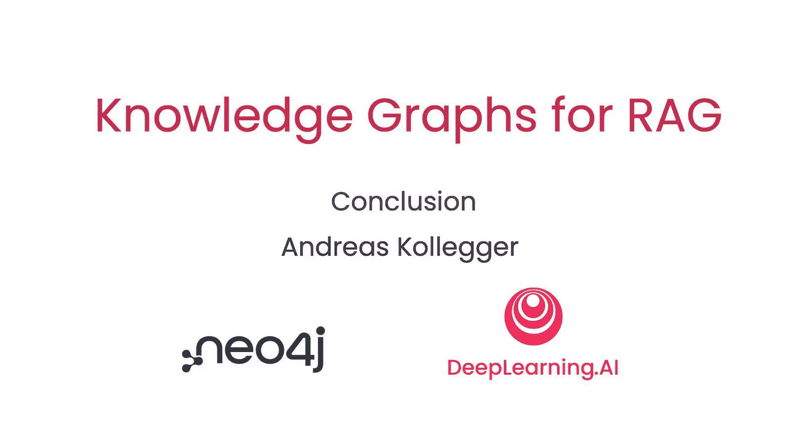

# 吴恩达《知识图谱用于RAG｜Knowledge Graphs for RAG》中英字幕 - P9：9.conclusion.zh_en - GPT中英字幕课程资源 - BV1DD421E7N1

Congratulations on making it to the end of the course。

 I hope you enjoyed building a knowledge graph powered rag system and exploring the details of Se financial documents。

😊，Public records like these are definitely more fun to analyze when you can chat directly with them。

The SEC example you worked through in this course is representative of the kinds of applications that companies are building with knowledge graphs and generative AI I hope the course has inspired you to build your own knowledge graphs。

If you'd like to continue your learning， there are a lot of resources on the Ne4j website there you can sign up for a free cloudhosed Near4j account and learn about other tools that can help you craft your own knowledge graphs。

Thank you for sticking with me to the end of the course， and I can't wait to see what you build。

