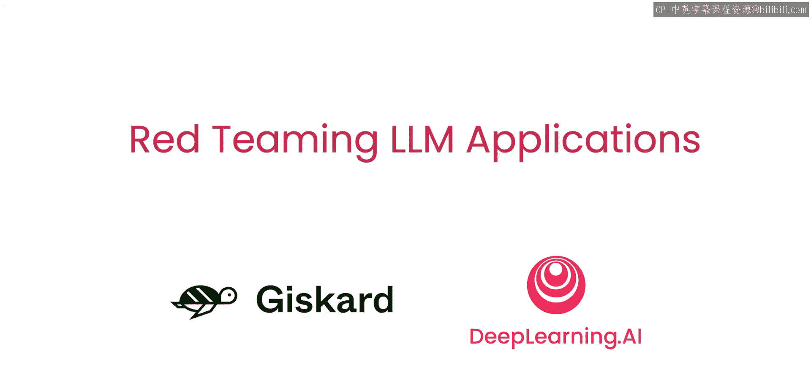
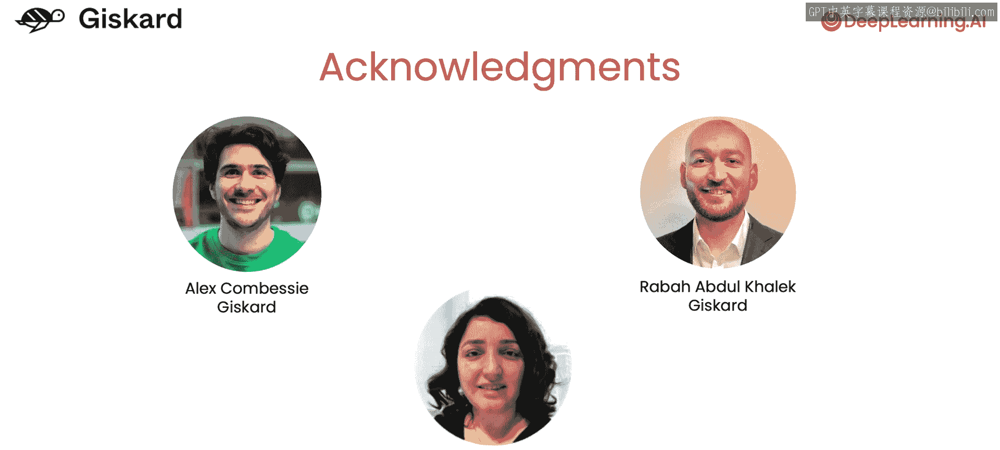

# 吴恩达《红队测试LLM应用｜Red Teaming LLM Applications》中英字幕 - P1：1.introduction.zh - GPT中英字幕课程资源 - BV1Cq421w7AK

Welcome to Red teaming LM applicationss built in partnershiping with Gco， I'm joined by Mateo Dora。

 who is lead LM safetyfe researcher Discscott and Lucka Marshall， who is product lead at Gscott。

 who are both instructors of this course Thanks Andrew， I'm excited to be here with Lucca。

 we can't wait to teach this course。😊，We're now seeing more LMs used in rowver applications like building chat boxs or Q&A systems。

 but often their risks and performance aren't rigorously checked before they are deployed and used by maybe even millions of people。

 this has led to sometimes sensational dis reportss in the media on problems that these deployments。

 say about some saying something inappropriate， like offering to sell a car for $1 dollar or reaching valuable IP such as your system message。

And they can be a real well impact to businesses when an owner misfirees like this。 In this course。

 you learn about red teaming。 Orig， red teaming referred to a strategy in cybersecur and military training where a group called the red team plays a role of an adversary and tries to attack a system for the purpose of discoverying and fixing vulnerabilities。

Red teaming and penetration testing also called pen testing are now widely accepted practices in security and improving how to red team and AI will also reduce vulnerabilities in our AI systems It this course you deep dive into red teaming own applications usinging the skills you learn here ethically and responsibly will help you to attack your own applications to detect the fixed vulnerabilities before moving them into production。

In this course， you learn about the difference between benchmarking foundation models and testing LLM applications。

 you will explore the fundamental LLM application vulnerabilities and all fact real war deployments。

 and you will learn about the concept of red teaming and its relevance in identifying vulnerabilities in LLM applications。

 you'll also get to try both manual and automated LLM red teaming methods and get a glimpse of what a four red teaming assessment looks like。

 applying the concepts and techniques covered throughout the course Laier Lucca will go through red teaming techniques step by step。

 and you will also using an open source Pythhen library by discco to help auto to make this tests。

Gurative AI is just made to the list of major threat categories which cybersecurity folks are having to deal with。

A unique aspect of this threat is that the underlying technology is from a new field and every person involved in the development and deployment of these applications from ML engineers to security architects are wrestling with novel and complex of risk。

 a unique aspect of this threat is that the underlying technology is from a new field and every person involved in the development and the deployment of these applications from ML engineers to security architects are wrestling with novel and complex concepts of risk At Guisard we've been seeing an explosion of interest from organizations to redteam their LLM applications。

By making the fundamental techniques and tools required for conducting different versions of these assessments available to all developers。

 we can all make LOM applications better and safer。

We're excited to present this course to you and share some of our experience leading red team attacks。

 as well as methodologies needed for red team and Glom applications。

 Many people have worked to create this course。 I'd like to thank from Discard Alice Conbasi Ed Raba Abdul Hali from Delear AI Dialla Ezein has also contributed to this course。

😊。

The first lesson will introduce fundamental LLM application vulnerabilities and the important difference between foundation model benchmarks and LLM application testing。

 given how new and how important the field of red teaming LOEs is。

 this is an Nixon type to be learning these techniques which are really at the forefront of LM application safety and security。

 let's go into the NIC video and get started。