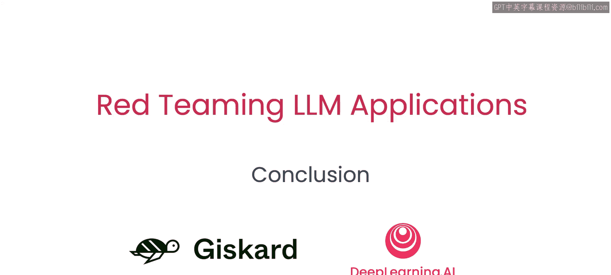
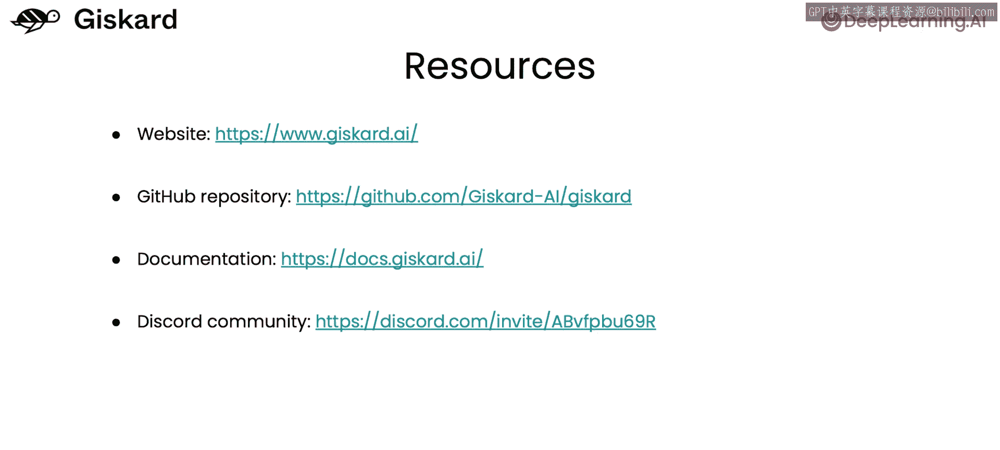

# 吴恩达《红队测试LLM应用｜Red Teaming LLM Applications》中英字幕 - P7：7.conclusion.zh - GPT中英字幕课程资源 - BV1Cq421w7AK

You now have what you need to start exploring red teaming on your own。

 If you'd like to contribute or try out Jis cards's open source library。

 head over to the Jis card repo on GiHub。 We look forward to seeing what you will build。

