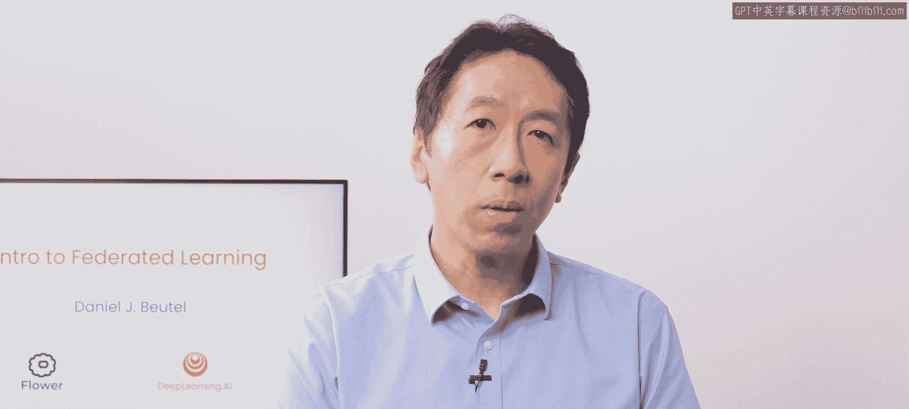
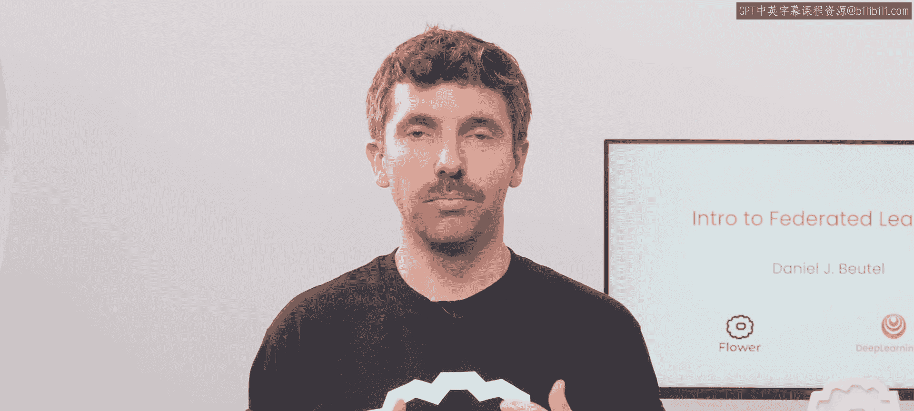
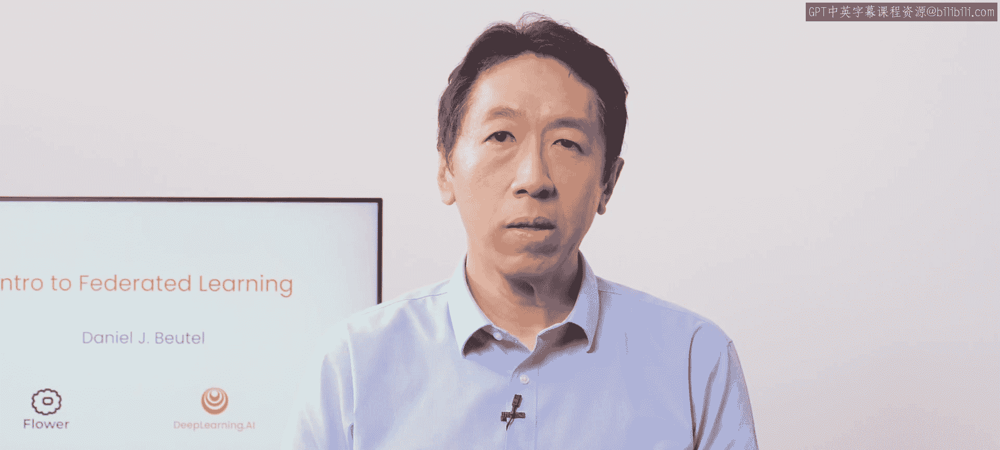
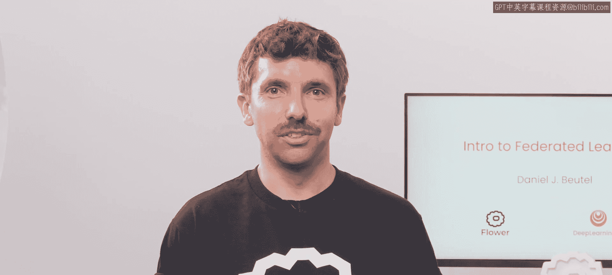
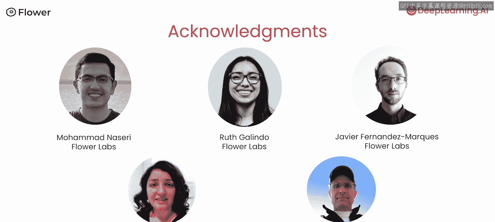

# 吴恩达《联邦学习｜Federated Learning》中英字幕（豆包翻译） - P1：1.intro.zh - GPT中英字幕课程资源 - BV1Eb4217768

Welcome to Intro to Federated Learning builtt in partnership with Fl Labs。

I'm delighted to introduce the instructor for this course， Daniel Boyitto。

 who is one of the creators of the open source FA frameworkra。Thanks， Andrew。

 I'm excited to be here In this course， you'll explore federated learning using FAR。

 a popular open source framework with a large community of AI researchers and developers F will enable you to build a federated learning system and run distributed machine learning training jobs in a privacy enhancing way。

😊，Let's say you want to train a model on medical images。

 but those images are distributed across different hospitals， due to privacy and regulations。

 maybe there's no way to centrally collect all of those images in one place where federated learning you can train on distributed data sources without having to collect all the data centrally。

Instead of moving the data to the training， you can move the training to the data specifically by running distributed training jobs in all the hospitals and only after that centralizing the model parameters。

 but not the raw data itself And through this you can end up with a model that benefits from all the data across all the hospitals but without ever needing the raw data to leave any hospital in this course you explore this using the Ms digits data where you have a data that has some of the digits missing and others have different data sets with different digits missing with federated learning your train a model on the handwritten digit data you have while others train on their own data then everyone sends the updated model parameters to central server and the server aggregates updates from all sources improving a global model but without accessing the individual data sources This improved global model can be。

Sha with everyone。 That's what really excites me about Feerated learning。 It lets us build powerful。

 accurate models while keeping data under the control of the users and organizations that own it。😊。

By training models locally on individual devices or servers。

 we can use a wide range of data without needing to share the actual data centrally。

This approach is great for fields like healthcare and finance。

 where data is sensitive and needs to be protected Feerated learning enables us to train models for tasks that previously didn't have sufficient amounts or sufficient diversity of training data Hopefully some of the examples will go through will inspire you to try federated learning in your own projects and bring the advances of AI to more domains In this course you'll learn how the federated training process works and how the tune the federated learning system。

You also learn how to think about data privacy in fedderated learning and how to consider bandwidth usage in a federated learning process You will also learn about differential privacy。

 often referred to asP a technique that protects individual data points like messages or images in this course will describe a technique where you add a little noise to the model weights so as to obscure any potentially private sensitive details that might have been in the training set。

 but which can still allow the model to learn you will get an overview of the different components in federated learning systems you will learn how to customize and tune them and how to orchestrate the training process to build better models get ready to dive into federated learning with flowerlower Many people have worked to create this course。

 I'd like to thank Mohammed Nassri Ruth Galino， Javier Ferandez Maqui from flower Labs as well as Dila Eadin and Jeff Ladray from deep learning AI。

In the first lesson you will start with the motivation behind using federated learning。

 you'll explore the challenges of traditional centralized machine learning where data has to be collected in one place and you see how Feerated learning solves this by distributing the training。

That sounds great， let's go to the next video and get started。😊。

