# 吴恩达《联邦学习｜Federated Learning》中英字幕（豆包翻译） - P2：2.Lesson 1 Why Federated Learning.zh - GPT中英字幕课程资源 - BV1Eb4217768

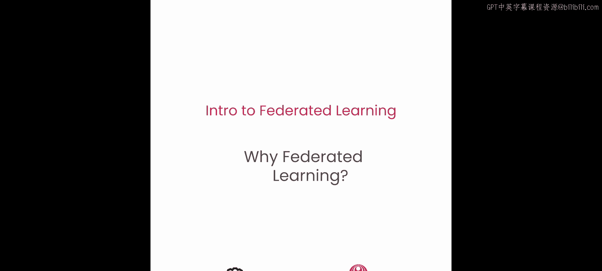

In this lesson， you'll learn why federated learning is key to unlocking large amounts of currently inaccessible training data。

You'll see how important training data is for training good models。

 but also how limiting traditional training approaches are。

 you'll see examples of how fedated learning is used to train models on data that is distributed across different organizations or even hundreds of millions of user devices。

 Let's go。

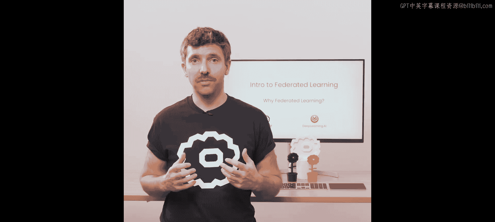

Let's start with a very recent example， Lama 3， only nine months of the Lama 2。

 Lama3 was announced with a big jump in performance over Lama2。

 one of the most impressive details of this launch was that the smallest version of Lama 3 Lama 38B outperformed the largest version of Lama 2 Lama 270 B in a major way。

 how is it possible， one of the most notable changes between Lama 2 and Lama 3 is that Lama 3 was trained on substantially more data to quote from the announcement block post our training data set is seven times larger than that used for Lama2 and it includes four times more code Lama 2 was trained on roughly 2 trillion tokens and Lama 3 increased that to 15 trillion tokens This demonstrates the importance of high volumee high quality training data。

At the same time， there's a discussion about whether LLMs are running out of training data。

 The amounts of available data in the world are difficult to estimate the educating silicon block has a fairly recent estimate of the amount of LLM training data that exists in the world。

 their estimate is that and I'm quoting at 15 trillion tokens。

 current LLM training sets seem close to using all available highqu English text。

 We might be able to forax that amount of data， but they estimate that to be the upper limit on publicly available training data。

 Of course， and for the sake of completeness， we had to ask an LLM as it turns out。

 even LLMs think that LLMs are running out of training data。

 and that this problem is going to get worse over time。

 One important aspect that is less often discussed is public data versus private data。

 compared to the 15 trillion tokens in Fineweb and the 18。

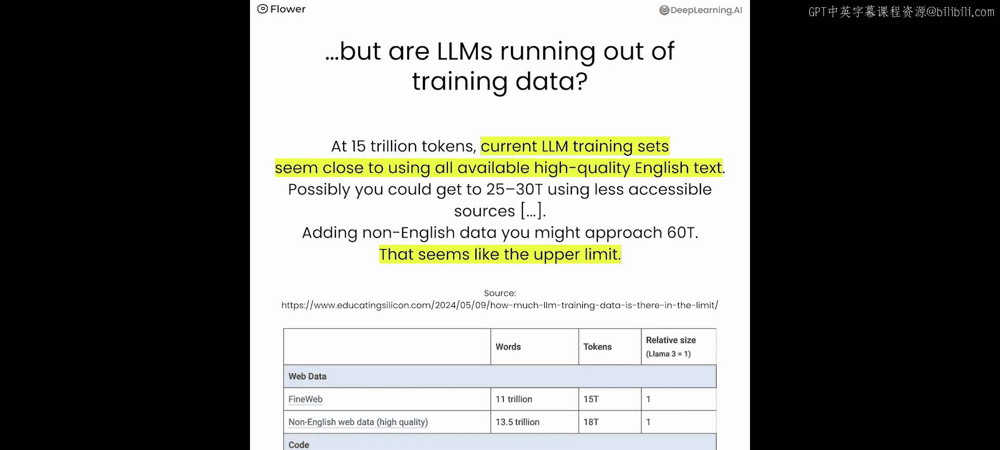

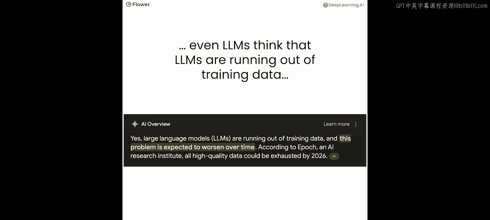

Trillion tokens in nonenglish data。 There are an estimated 650 trillion tokens in privately stored instant messages alone and even 1200 trillion tokens in all stored emails。

 Now， this is not to suggest that this data should be included in LLM training。

 It is just to be taken as a data point to compare the amount of public data to the amount of sensitive private data in the world。

 But isn't this interesting， We know how important data is for training a good model。

 It seems like we are running out of training data。 but at the same time。

 there are huge amounts of data that are not being used。

 We will go into federated LLM fine tuning on private data in course 2。 In this course。

 we set the stage by introducing federated learning。

 Let's dive deeper into the topic of sensitive data。Data is naturally distributed。

 It's distributed across organizations and user devices in healthcare， for example。

 it's distributed across different hospitals in government。

 it's distributed across different governmental agencies in finance。

 it's distributed across different regulatory regions and in manufacturing it's distributed across different factories。

 when looking at user devices， we have sensitive data on phones and laptops。

 but also on other types of smart devices like cars or even robot vacuum cleaners at home。

 Tra training assumes centralized data it only operates on a single one of these data sets All the other data sets are ignored。

And the result of this。It's that very valuable data does not get used for training， actually。

 most of the world's data is not readily available for model training。

The common way to work around this is to try to collect more data in one place to increase the size of a single one of these data sets。

 but in way too many cases， collecting data simply does not work。 Data needs to move。

 but that's often not possible for a number of reasons data might be sensitive。

 The volume of data might be too high user privacy might prevent us from being able to collect the data。

 regulations might force data to stay in a certain region。 and sometimes it's just not practical。

 you might wonder how big of a problem is this actually What happens if I have data but it's not evenly distributed to understand that you're going to build three datas。

 Each data will be different。 They are all going to be based on MNist。

 but they will have different digits missing。 For example， data1 will have no examples for digits 1。

3 and 7。 Data 2 will have no examples for digits2。5 and 8 and data set3 will have no examples for digits 4。

6 and9 using these data sets， you will train three simple models。

 one on each data all three models have the same architecture you will then evaluate these models to see what the impact of missing data is on the final trained model Let's jump into the lab。

Let's start with importing a few utility functions。

One of the things we imported from uils is AmnesIS。

You start by downloading the MNIS dataset using the Torchvision datasets。 MNist function。

 the dataset gets downloaded to the specified MNist underscore data directory。

 and then by setting train equals true， you get the full MN training set last。

Transform applies transformations that normalize the data。

 You split the data to simulate data distributed across three partitions。This could represent。

 for example， the data of three different organizations or personal data on three different user devices to do that。

 you get the total length of the training set。The dataset set is then split into three parts， part1。

 part2 and part 3， using the random split function from Torch。 u data。

 Each part is approximately of equal size。 You calculate that size by dividing the total length of the data set by3。

 The splits are stored in separate variables for photo processing。

Note that we manually set a random seat to be able to use the exact same three parts in lesson two。

 where we are going to train one federated model across all three parts。In the real world。

 we have different data sets。For example， one hospital might have more radiology images of fractured grips whereas another hospital might have more radiology images of fractured fingers another example is one user who has a dog will probably have more images of a dog saved on their phone but another user who's a big fan of cars will probably have more images of cars to simulate this we change the data distribution in each of the three data sets by excluding specific digits For part one。

 we exclude digits 1，3 and 7 part two excludes digits 2。

5 and8 and part3 excludes digits4 or6 and9 This creates different data distributions in each of the three parts the plot distribution function outputs of visualization of the distribution of digits in each part This helps us to better understand the data we are working with As we can see。

 for example， in part one we only have。

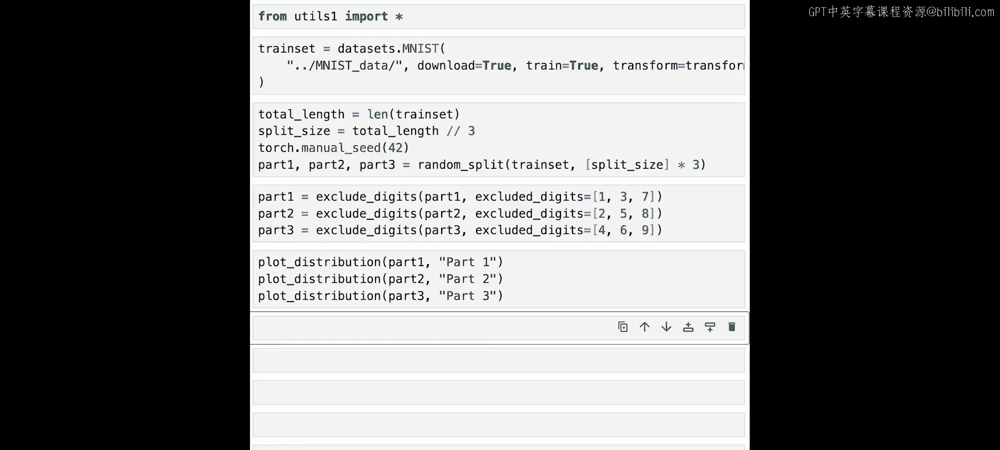

It's0，2，4，5，6，8， and nine。Represented， but digits 1，3， and 7 are missing In part 2。

 we only have digits 0，1，3，4，6，7， and 9， but digits 2，5 and 8 are missing。

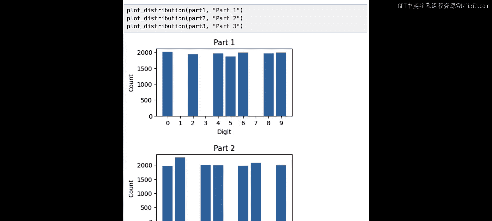

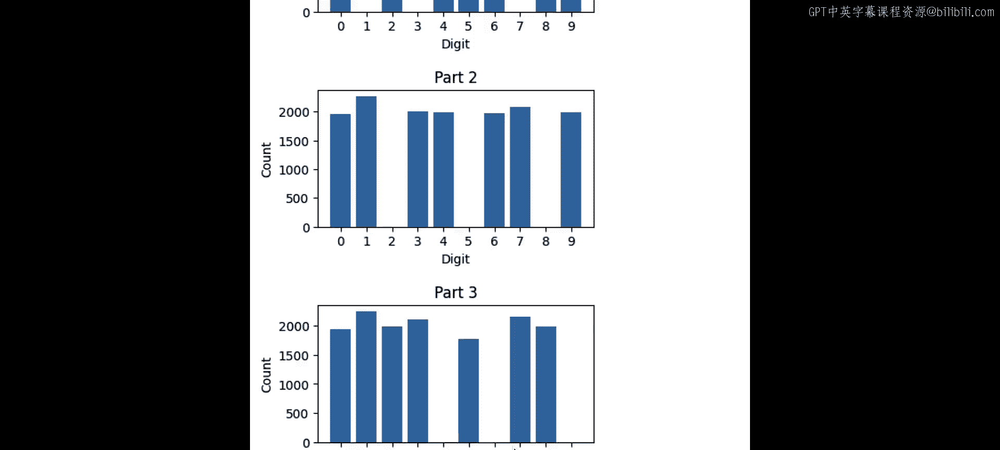

Similar in part 3。Now you train three individual models。

 one on each of the three dataset sets for that you use the train model function imported from us from Us。

 we also imported a definition of a simple model which is a neural network implemented in Pytorch with just two fully connected layers。

 note that the choice of model does not really matter here。

 you could use many kinds of different classification models that work with the M data。

We can see that the loss is gradually going down。We trained the model for 10 epochs and the loss going down indicates that their model is learning something。

The training of Model1 is complete。Now the training of model 2 starts。

It does the same thing for another 10 epochs。Now the training of Model 3 is。Running。

This will take a minute to execute。And now the training of all three models is complete。

Let's see how the three models you try to perform。To test the models。

 you load the MN test dataset using the same MN function you used before to indicate that we want to load the test set。

 not a train set， we must set train equals falses。 The dataset is downloaded to the specified directory again。

 MN underscore data and then the same transformation that was used to normalize the training dataset is also applied to the test dataset。

 remember that you excluded certain digits from each of the training dataset sets before。

To evaluate how individual models perform on data examples that were not represented in a training set。

 you again create three subsets。 This time， you only include the specific digits that each of the individual models has not seen during training。

Test set 1，3，7 only includes digits 1，3 and 7。 Test set 2，5，8， only includes digits 2，5 and 8。

 and test set 4，6，9 only includes digits 4，6 and 9。 similar to train model。

 we also imported a function called evaluate model from us。

 evaluateval model takes the model instance and a data as input and returns to accuracy of the model on that dataset。

 The evaluate model function is called to evaluate each model。

 Model 1 Model 2 and Model 3 on two data sets。 First， the entire Mnes test dataset。 And second。

 the custom data that only includes the specific digits missing during training。 Last。

 we print a test acuracies for each model on the entire Ms test dataset。 and a specific subsets。

 We can see that each model gets an accuracy of roughly 65 to 70%。

 This is roughly what we would expect， given that three digits were missing from。

Each of the training dataset sets it means that overall the Myrdle has learned something the accuracy is better than random chance。

 which would be 10%， but what you can also see is that on the specific subset the accuracy is 0% One additional step you can take to understand this better is to look at the confusion matrix。

A confusion matrix provides insights into the performance of each model by showing the number of correct and incorrect classifications for each class you use the compute Con matrix function to compute to Con matrix for each of the trained models。

 Model 1， Model 2 and Model 3。You do this on the full MNIS test set to see how each model performs on each of the 10 digits。

 not just on the excluded ones。

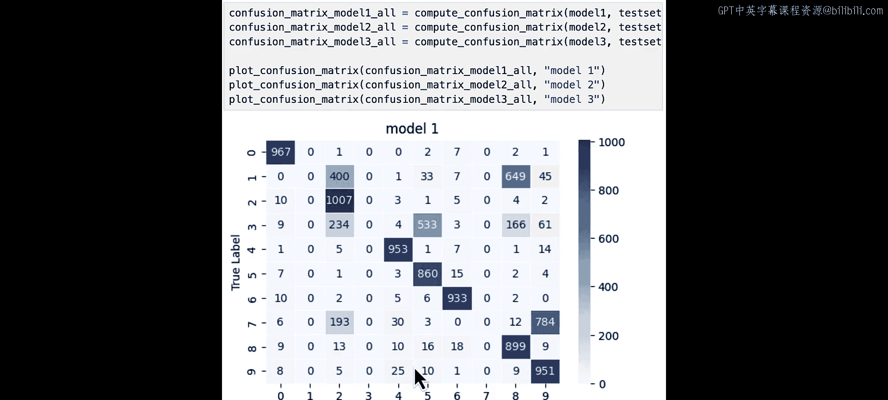

So what can you see here on the vertical axis， you see the true label and then on the horizontal axis。

 you see the predicted label。 So for example， where the true label is0， the model in 967 cases。

Actually rightfully predicted label zero， but what you can see is that because labels1。

3 and7 were missing were absent from the original training data。

 the model actually learned to never predict these cases。

 even if the true label is one of these labels。Now what we can also see is that for those labels that were absent from the original training data。

 the model learns to predict something else， some other label that is close to the original label So for example label1 it was absent from obtaining data。

 the model learned to actually never predict label 1 but in many cases it predicts either label2 or label8 So this shows the significance of training data and of missing training data because if the training data is missing the model actually learns to predict the wrong thing So now you've seen the problem with centralized training and how it can break down when your data misses certain data points Now what does fedated learning enable you to do and how does it help with this situation in an ideal world we could train models across all of the available。

Dataets everyone would retain control over their own data Or could keep their data private users could keep their data private。

 but collaboration on training would be possible to train models in critical areas like healthcare Feerated learning is a major component to enable such a future The key idea is to move the model training to the data and leave the data where it is data can remain in organizational silos or on user devices Or and users retain full control over their data The model training happens wherever the data sits on the GPU cluster of a company in the cloud account where an organization keeps their data or even on a user device Feerated learning orchestrates the training process across those different data sets and devices This enables federated learning to access more data and more compute。

Sensitive and distributed data in organizational silos and data on user devices in the next lesson you'll learn exactly how this works but first let's look at a few real worldld examples of federated learning in industry The first example where this is deployed is finance in finance data is heavily regulated U customer transactions need to be stored in the US。

E customer transactions need to be stored in Europe。

 The customer transactions are valuable for training。 For example。

 and money laundering models that help to detect or prevent financial crime with federated learning。

 It's possible to keep the data stored in different regions around the world。

 but still enable training a model across those different distributed datas。

 Our second example is on the other extreme of federated learning。

 It's the Google keyboard on Android。 Instead of two data sets as in the previous example。

 This system is deployed across hundreds of millions of user devices。

 When you use the Google keyboard to type a sentence。

 The keyboard tries to predict the next word you're about to type。

 It also tries to complete the sentence you're about to write。 This is called smart compose。

 This features are powered by language models。 The user data that goes intotrain is sensitive enough that it cannot be collected。

 Google was actually the first。

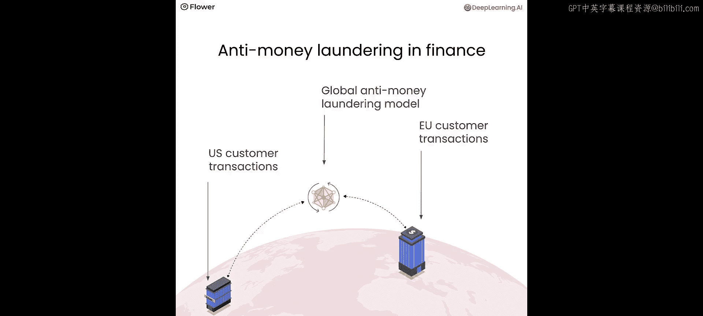

To propose and pioneer federated learning to enable these models to be trained on user devices without having to collect such data。

 The system has evolved in many ways since then， but it's still an impressive example of large-scale federated learning on user devices in the previous two examples we saw cases where a single organization has distributed data distributed across different regions in finance or distributed across hundreds of millions of mobile devices。

 Whats special about the3 example is that there are multiple organizations collaborating with each other in healthcare data is often distributed across many hospitals。

 the flower framework that you'll use in the next lesson was used by the National health service of the United Kingdom on the data of 130。

000 patients in collaboration with the Oxford University an early COVID screener based on blood and vital science was trained。

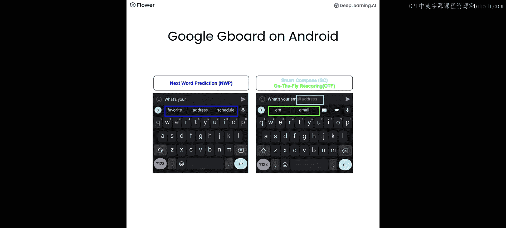

This is an exciting project because it allows different hospitals to collaboratively train models。

 This approach is a key enabler to rolling out AI in healthcare。

 where individual organizations almost never have enough data to train modern data hungry model architectures。

😊，Let's review lesson one。We've seen that data volume and diversity are critical for training good models and at the same time we're in this interesting situation where we seem to be running out of training data but we also have large amounts of unused data so why is that data is often distributed traditional training approaches assume centralized data and it's often difficult or next to impossible to centralized data you've seen that federalated learning operates on distributed data fedated learning is deployed across many different industries and it runs across distributed devices or distributed organizational silos。

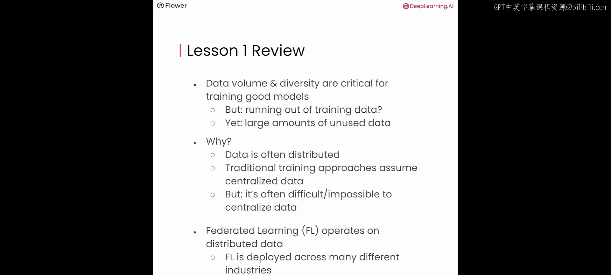