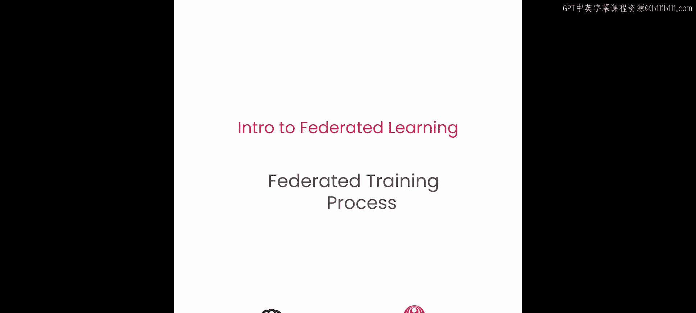
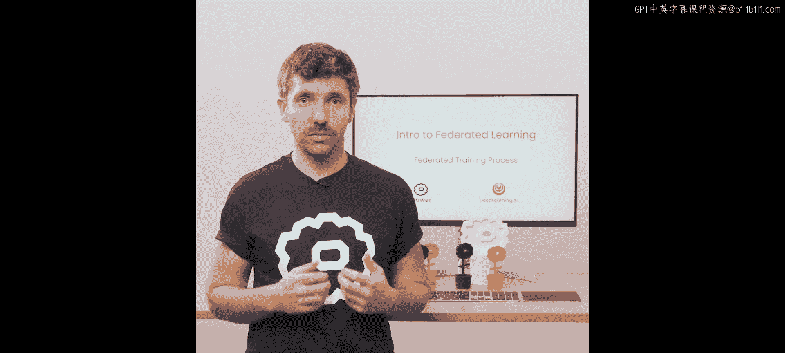
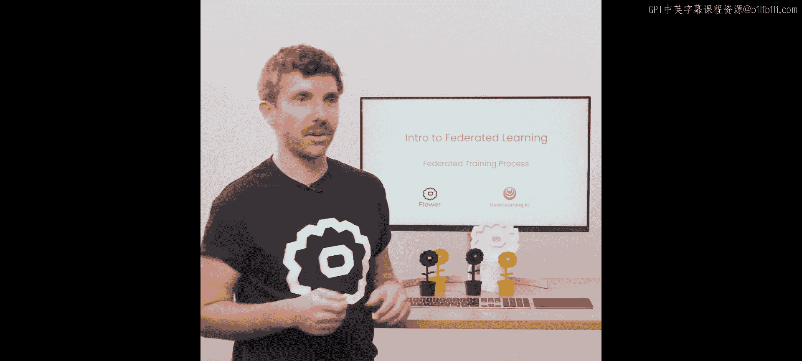
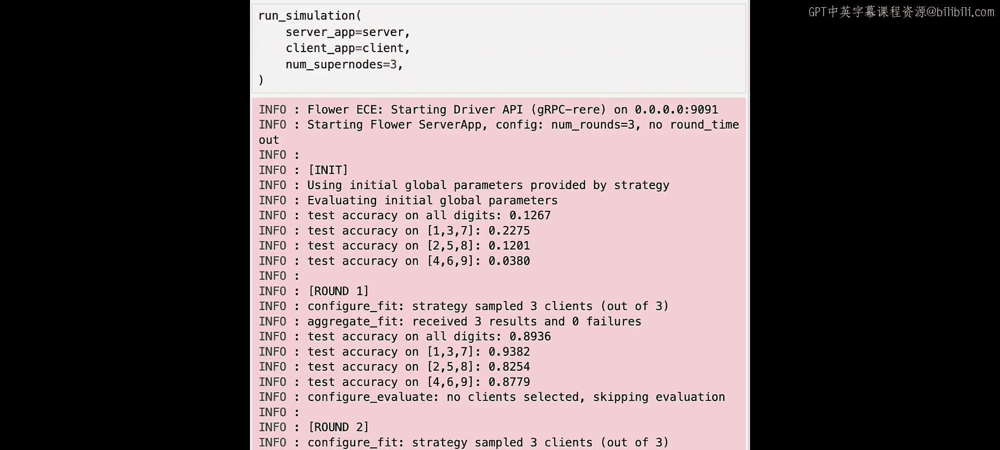
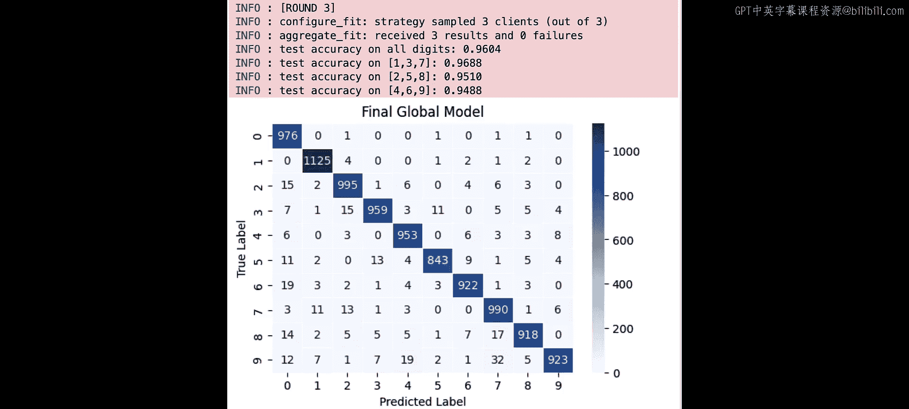
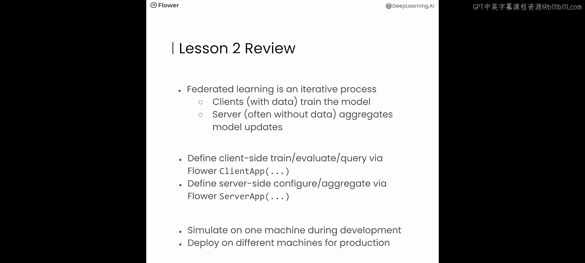

# 吴恩达《联邦学习｜Federated Learning》中英字幕（豆包翻译） - P3：3.Lesson 2 Federated Training Process.zh - GPT中英字幕课程资源 - BV1Eb4217768

In this lesson， you will build your first Feerated learning project with flower and Pytorrch。

 you will learn how federated learning enables you to train AI on distributed data。

The model and data you are going to use are just an example to showcase federated learning in action。

 but remember this can be extended to most other models and datas and even different frameworks like TensorFlow。

 JX， Huging F transformformers and Apples MLX。 Allright， let's build something。

In a basic federated learning system， you have a server and you have clients。

The server often does not have any data itself。 It can have some data used to evaluate the global model。

But in vanillail federated learning， it doesn't have any training data。

 The clients are the ones that have the actual training data。

 If you have a system where five hospitals collaborate on model training。

 you would have five clients， one for every hospital。

 each of those clients would run in one of the hospital environments。

 and it would have access to the data of that particular hospital。

 if you have a system where 100 million user devices hold data， you would have100 million clients。

 one client on each of the user devices。 The role of the server is to coordinate the training across those clients。

 the role of the clients is to do the actual training on their respective local data Both the server and the clients have their own copies of the model the model on the server is often called a global model the models on the clients are often called the local models。

 So how does the training work across multiple clients。

The whole process starts by the server initializing the global model parameters。

 The server sends the parameters of the global model to the clients In the example here。

 we have five clients， a tablet， a desktop， mobile phone， a laptop and a server。

 those five clients then train the model on their local data。

 they train a model only for a little while so not until full conversiongs。

 Often they train for just a single epoch on their local dataset After the local training。

 the client center their improved models back to the server the server now has five improved models all of them with slightly different weights。

 but what you want is one model， not five models to get to one model。

 the server aggregates those five models。 their different ways to aggregate models。

 but one of the most common ones is to just average the weights After the first aggregation you end up with a slightly improved version of the global model with this new version of the global model。

 you're going to repeat the steps described before。Sent a new model to the clients。

 clients train on their local training data， they sent back to improved models and the server aggregates those models。

Federated learning is an iterative process， it repeats those so called rounds over and over again until convergence。

Here's a slightly more formal description of the Feerated learning algorithm。

 we start with initialization。The server initializes the global model next is communication round for each communication round。

 the server sends the global model to the participating clients and each client receives the global model client training and model update mean that each participating client。

 the client trains to receive model on its local dataset set。And after that finishes。

 the client sends its locally updated model back to the server Step4 is model aggregation。

 The server aggregates the updated models received from all clients using an aggregation algorithm。

 for instance this can be fedated averaging， which just as a weighted average over all the model updates received from the clients weighted by the number of training examples that went into training on each particular client step 5 is convergence check If convergence criteria are met。

 we enter the fererated learning process If not we proceed to the next communication round which was described in step 2。

You're now going to build your first Ferated learning project。

In the previous lesson you built three independent datas and trained three independent models on them in this lesson you're going to connect those individual models with the goal of training one collaborative model across three distributed data sets let's jump into the lab。

As before， you will start with some imports。In this lesson。

 you will use the Flow Feerated learning framework to federate the previously used training pipeline。

So apart from utilitiess， you also have some flower related imports， for example。

 you have client app， you have serverver app， and you have Fed Aage。

 which is the federated averaging strategy。The first step is for you to recreate the three data sets used in the previous lesson for training on the MIS data。

Dmness training dataset is loaded with the same transformations as before to normalize the dataset。

 The dataset is then split into three parts， Part1。

 part2 and part 3 with the same sizes as in the previous lesson The same random seat is used to ensure reproducibility digits 1。

3 and7 are excluded from part1 Dits 2，5 and8 are excluded from part2 and digits 4。

6 and9 are excluded from part3 for later use you also put all three training datasets in a list called train underscore sets。

The full Mnes test dataset set is loaded with the same transformation。

 and you also create the same three subsets of the test dataset set test set 1，3，7， test set 2，5，8。

 and test set 4，6，9 as in lesson 1。In fed learning you need to exchange model parameters between server and clients when the client receives model parameters from the server。

 it needs to update the local model with those new parameters received from the server When the client finishes training it needs to send the latest version of the local model parameters back to the server to enable this we need two functions。

 set weights and get weights。Gways takes one argument， a reference to our simple Pytorch model。

 it then iterates over the items in state Dt， converts each one into a Ny andD array and returns the list containing all of those ND arrays。

You use get weights after the local model training has finished to get the model's updated weights and send them back to the server Se weights goes the other direction。

 It takes two arguments， a reference to our simple Pytorch model and a list of N arrays it then uses this list of N arrays to update all the items in the model state died you use set weights before the local model training to update a model's weights using the new weights received from the server note that both functions or model specific。

 If you use a different model， you might need to adjust set weights and get weights accordingly。

To connect your existing training and evaluation pipeline。

 you write a flowerral client F client uses existing functions like train model and evaluate model to enable the flower framework to orchestrate federated training over a set of participating clients the flower client class is defined as a subclass of nu client you pass three arguments to the constructor to initialize a flowerral client object net our simple neural net model implemented in Pytorch train set。

 the training data set of one particular client test set。

 the test dataset of one particular client flower client typically defines two methods。

 the fit method trains the neural net using the provided parameters and the local training data。

 the evaluate method evaluates the performance of the neuralNe using the provided parameters and the local test dataset。

To enable the flower framework to create client objects when necessary。

 we need to implement a function called client function that creates a flower client instance on demand。

 this is necessary to optimize resource utilization。

Federated training can easily span hundreds of clients。

 but when building such systems you want to simulate them efficiently on a single machine Flower calls client function whenever it needs an instance of one particular client to call fit or evaluate。

 this enableables the framework to discard those objects and free up resources when a particular client object isn't needed Last we create an instance of client app by passing at the previously defined client function client app is the entry point to everything happening on the client side and you will learn about additional client app features in an upcoming lesson。

Now that you have a client app that can perform local training and evaluation。

You need a serverside counterpart to aggregate the updated models received from the clients。

 Of course， you want to see how the global model performs。For that。

 you start by creating an evaluation function called evaluatevalate。

 evaluateval takes three arguments， the current server round。

The latest version of the global model parameters is a list of Nai ND arrays。And a convict。

 similar to floweroc clientde。evalate， it updates the model with the latest parameters using set weights。

It evaluates the model's performance on multiple test data sets。In our case， test set test set 13，7。

 test set 258 and test set 46，9， to assess its accuracy on the full Ms test set。

 but also on the different subsets of digits It prints the evaluation results。

 including accuracy on all digits and on the specific subsets，13，7，258 and 46。

9 for each server round so we can see how the accuracy evolves over multiple rounds of fedated learning If the current server round is the final round which is indicated by server underscore round equals 3 it computes and plots the confusion matrix for the model's predictions on the entire test data set。

 This will allow you to understand how the fedated model performs compared to the three individual models in lesson 1 to create a server app。

 you need to decide which strategy you want to use。

A strategy is an abstraction that implements a serverside federated learning algorithm。

We covered federated averaging before， but there are also many other algorithms like fat atom。

 fat median and Q fat averaging。 many of them available as built in strategies in flower。

 Let's start with plain federated averaging to initialize F average you need to pass fraction fit The fraction of available clients selected for training。

Fractione diraction of available clients selected for evaluation， initial parameters。

 the initial model weights and evaluate function， the function to use for serverside model evaluation Now that you have a strategy you can create an instance of server app with client app and server app you can finally start the training a real note federated learning system would be distributed across a number of servers or user devices in this notebook environment you simulates such a system by running everything on a single machine For that。

 you use a function called run simulation that takes three arguments。

 The server app the client app and nu super nodees The number of clients that run simulation should simulate flowerer calls clients super nodes to emphasize the importance of those nodes in the federated learning process compared to a traditional client server setup with a powerful server and thin clients in fedated learning clients are the real stars of the。

They have the valuable data and the computer to perform training。 Let's run it。

You can see that run simulation starts the Flower Ser app using a configuration that performs three rounds of federated learning。

In it tells us that it's using the initial global model parameters provided by the strategy。

It then continues to evaluate those initial global model parameters using the evaluation function that you defined earlier。

 this means it evaluates the test accuracy on all digits but also on the three different subsets that you defined earlier it then continues to go into round one of federated learning the strategy samples three clients out of a total of three available clients it samples those clients sends the global model parameters to those three clients and asks those clients to perform the training on their local data set。

This will take a minute to finish you can now see that the server received three results and zero failures all the three clients submitted their results back to the server the server then continues to call the evaluation function again to see how the newly aggregated global model performs on the test set on the full test set but also on the three different test sets that you defined earlier。

The Serroan proceeds to round two， it again samples three clients out of a total of three available clients。

You can see that again， the server received three results and zero failures。It continues to again。

 call the evaluation function to evaluate the newly aggregated global model。

And then proceeds to round three。For round3， it again samples three clients out of three available clients。

This will again take a minute to complete on the client side。

When the three clients finish their local training， they sent their updated model back to the server。

 You can see that the server receives three results and zero failures。

 It then continues to call evaluate to evaluate the final global model on the full Mnes test set but also on the three specific sets you built earlier remember that in lesson1 when you train three individual models those models achieved an accuracy of roughly in between 65 and 70% here with federated learning。

 you can see a big jump in accuracy to 96% This means that the global model is much better than any of the individual models trained in lesson1 perhaps even more interesting you can see that on those specific subsets the global model sees a jump in accuracy from previously 0% to in between 94。

And 96% looking at the confusion matrix， we see a very different picture compared to the confusion matrix of the individual models trained in lesson one。

 The model learns how to classify all digits， even if those digits are missing in one of the data sets。

 so we don't see any columns that only have zeros in them anymore。

Let's review lesson two。Falerated learning is an iterative process。

 clientsient with data train the model and the server often without data aggregates model updates you define client side training evaluation or analytics via theflow client app and you define serverside configuration or aggregation via the flower server app during development you usually simulate those systems on a single machine。

 but then for a production setting you deploy it on those different machines that have the individual data sets。

