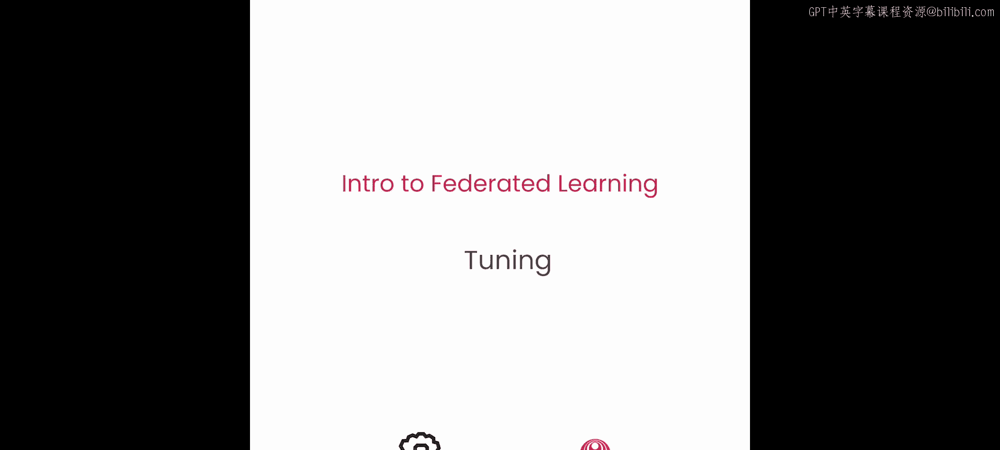
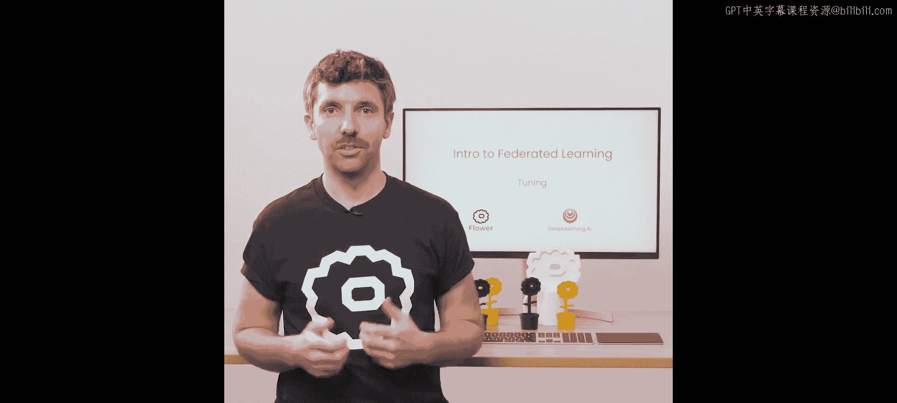
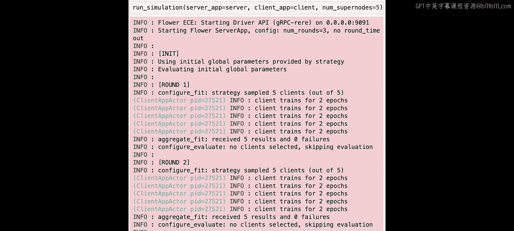
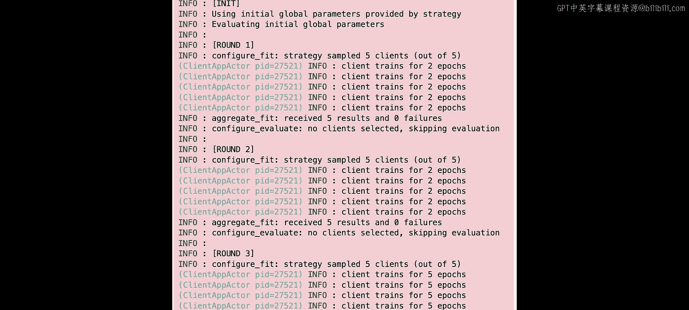
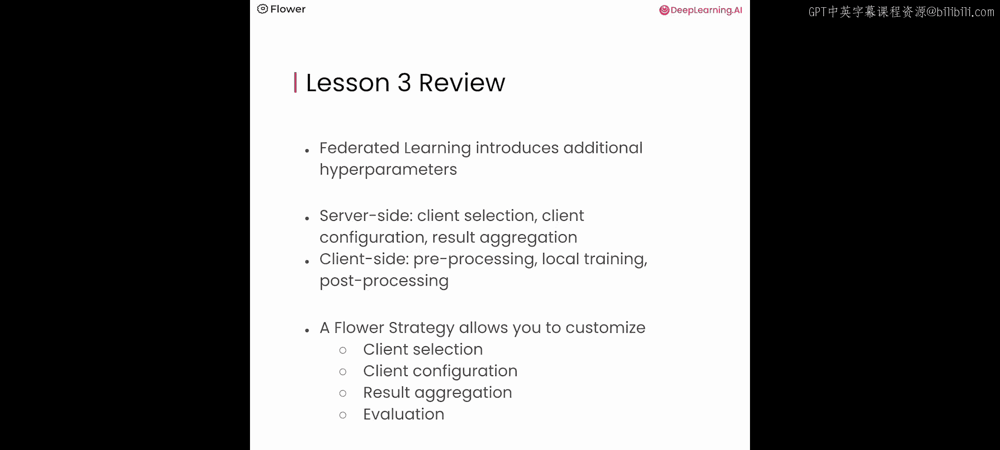

# 吴恩达《联邦学习｜Federated Learning》中英字幕（豆包翻译） - P4：4.Lesson 3 Tuning.zh - GPT中英字幕课程资源 - BV1Eb4217768

In this lesson， you are going to customize and tune the flower project you build in lesson2 you will learn about many aspects of federated systems that you may often want to tune and you'll implement a custom training schedule in this lesson。

 Allright， let's dive in。

Compared to traditional centralized training， Fative learning introduces some additional concepts。

 some additional components in the training process that can be customized in tunes One important factor is how do you select the clients that participate in each round in this diagram you see five clients so instead of sending the global model to all five clients you could send a model to just three clients in the first round the three clients would participate as usual then in the next round you could select three other clients。

In a setting where there are only a few clients， the answer is often just select all clients in each round If you have just five clients as in this diagram。

 you would probably select all of them in each round of federated learning but then in settings where you have large numbers of clients you would typically not do this In fact it has been shown that selecting more and more clients as diminishing returns what you would do instead is you would select just a subset of available clients in a mobile setting with millions of clients you would often just select a few hundred clients in any single round or at most a few thousand depending on the task there are different strategies for selecting those clients。

A very common one is to just select them randomly， there are also approaches that are strictly speaking。

 not federal Ed learning， but that can be very useful。

One example is pcyclic training where you would send the model to one client。

 have that client train it， send it back to the server， and then send it to the next client。

 and you would do that for one client after another Another factor is client configuration。

Once you selected clients， you need to decide how to configure them What do you want the client to do。

 How long should a train the model， What hyperparmeters should it use。

 Are there any other things the client needs to know to execute the training or evaluate in the right way。

 You can see the small model icons on the client highlighted This is to indicate the client configuration that the client uses to execute a task A third example for something that is commonly customized or tuned is aggregation In fedated learning。

 they are very different approaches for aggregating model parameters。

You've seen and used federated averaging in the previous lesson。

 There are many other approaches like Q fat averaging or Fed Adamom that provide certain improvements over vanilla Feerated aaging。

 The flower framework you used in the previous lesson。

 has many of them built in as so called strategies。

 Let's jump into the lab to see how the server can configure client side training。 As usual。

 you start with some imports。In lesson 1 and2， you manually partitioned MNIST to simulate multiple dataset sets distributed across multiple user devices or multiple organizations。

 instead of manually partitioning data among the participants。

 you can use a library called Fed datas。Flowor datas provides us with a class called Feerated dataset。

 this abstraction will partition many existing dataset sets like MNT。

And it allows you to generate small training and test sets for each client。

The load data function loads and prepares the data for federated learning。

 It takes a partition ideas input， which specifies the partition of the dataset set to load The dataset set used here is MIS。

 and it is partitioned into 10 partitions。 The loaded partition is then split into training and testing subsets with an 80 to 20 ratio。

 This is done using the train test split function。 A custom transformation is applied to normalize the data。

Data loaders are created for the training and testing subsets respectively。

 using a Pytorch data loader。Along with model parametersters。

 you often want to send configuration values to clients Conguration values can be used for various purposes。

 let's say you want a server to control the number of local epochs performed by each client so the number of times the local client iterates over the local dataset set during training to do that you define a function called fit underscore config that takes only one argument。

 the current server round， and it returns a configuration dictionary。In the con。

 you put a key called local underscore epochs with an integer value that tells the client how many local epochs to train for in this example you can see how you can vary that number depending on the current server around。

Here we send two in the first two rounds and then five for round three and later the client can use this value to dynamically change the number of local epochs it trains on the local data set It means that the client will train for two epochs initially and then increase the number of local epochs during later rounds Next we initialize the federated averaging strategy as usual we set fraction evaluate to zero as we don't intend to perform any client side evaluation and we pass initial model parameters to a strategy Now to make the strategy use our new fit underscore config function We simply pass it to fed aaging during initialization using the parameter onfit config fN passing an unfit config function to federated aaging well make the federated aaging strategy called this function every single round the return convict d will be included in the message that is sent to each client。

It calls the function every time to enable you to send different configuration values to the client every single round。

Last， we define an instance of server app。 You also create a flower client class as usual。

 The only difference is that you want to use the local and underscore epochs value from the convict。

 The fit method in flower client class is responsible for training。 It takes two main arguments。

Parameterters， the model parameters from the server and config。

 the configuration parameters for training。 As usual。

 the method begins by setting the parameters of the model using the provided parameters from the server。

 The number of local epochs local underscore epochs is extracted from the config dictionary to determine the number of epochs for local training here。

 you lock this value and then call the train underscore model function。

 The train underscore model function is called to train the model using the client's local training data。

 This is stored in self thetrain loader。 This time。

 we pass the number of local epochs as an additional argument。

 We then create the client function and client app as usual。

 Let's run server app and client app and see what happens。

You can see that the Flower server app starts and it performs three rounds of federated learning it initializes the global parameters that are provided by the strategy and then it proceeds to the first round of federated learning the strategy samples five clients out of five available clients so it samples all of the available clients。

And then it sends the cont dictionary along with the model parameters to all the participating clients。

 so to all of our five clients， you can see that the first client logs that it trains for two epochs so does the second one and so do all the other ones after the training finishes。

The aggregation function receives five results and zero failures。

 You can also see that there's a lock that says no client selected skipping evaluation。

 This is because earlier on when initializing the F averaging strategy we said fraction underscore evaluated to zero so no evaluation is performed on the client side in round two we see pretty much the same thing we can see that all of our clients。

 all of our five clients are selected and you can see that each of those clients transfer to epochs。

Now， looking at round three， you can see that again， five clients out of five are selected。

 but then you can see that suddenly the clients instead of training for just two epochs their training for five epochs and this is caused by the configuration dictionary that those clients are receiving from the server。

 so the number of local epochs is controlled by the server and the clients react to whatever configuration value they receive from the server and they perform the appropriate number of a local epochs。

 the configuration dictionary is a pretty flexible concept。

 you can put many different kinds of keys and values in that dictionary and it's a perfect thing to experiment with。

 you could experiment with different hyperparameter schedules， for example。

 you can use it to send the learning rate from the server to the clients and control the learning rate that each client is supposed to use and you can use it。

ToCon many different aspects of the client side training process。

Feel free to play with this and experiment and let us know how it goes Let's review lesson3 Fer to learning introduces additional hyperparameters it introduces additional concepts concepts that are important to control the training process on the server side we can customize and tune things like client selection client configuration and result aggregation on the client side we can configure things like the preprocessing the local training and any kind of postprocess want to do on the weights before sending them back to the server aflow strategy allows you to customize all of those things that we talked about on the client side it allows you to customize client selection client configuration result aggregation and server side evaluation。

