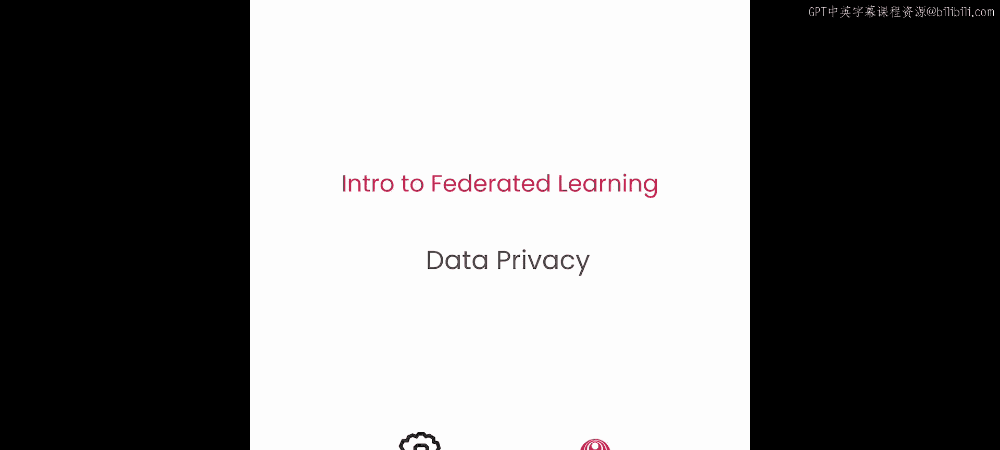
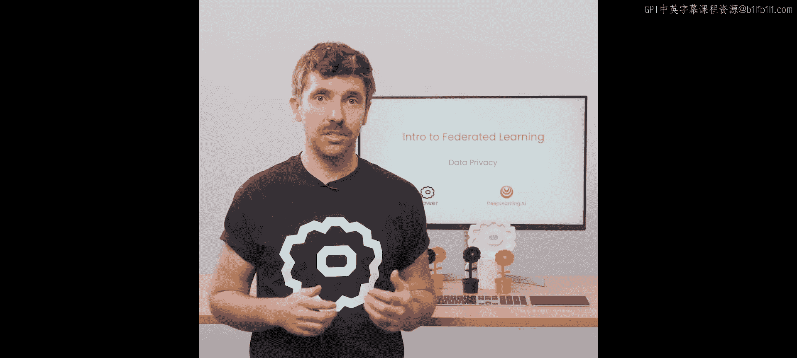
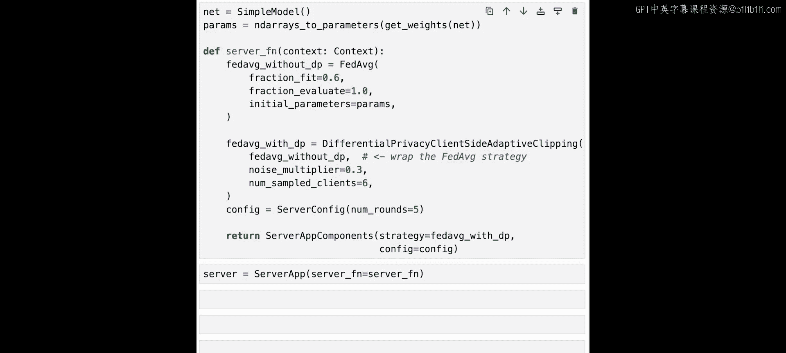
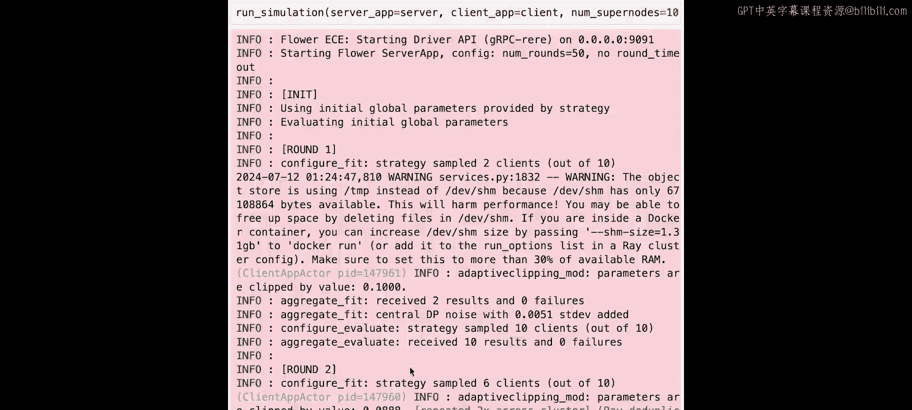
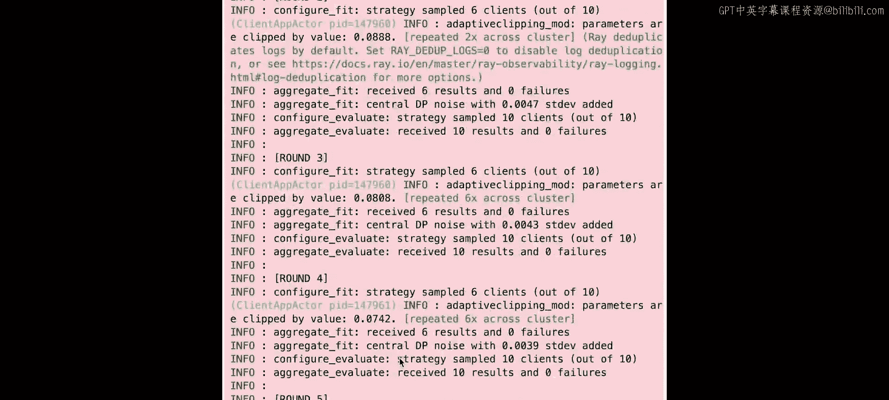
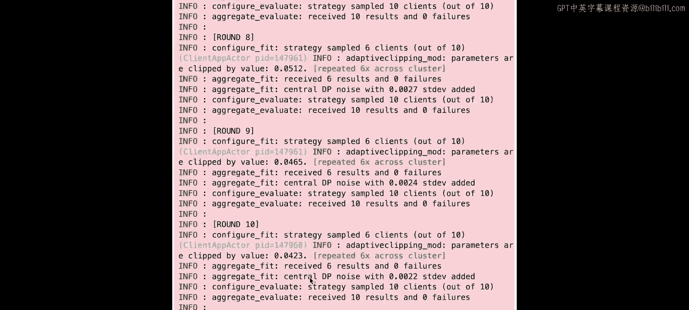
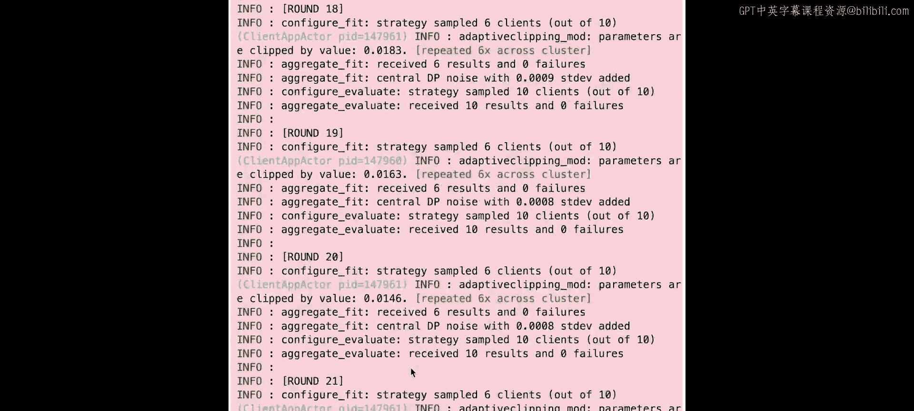
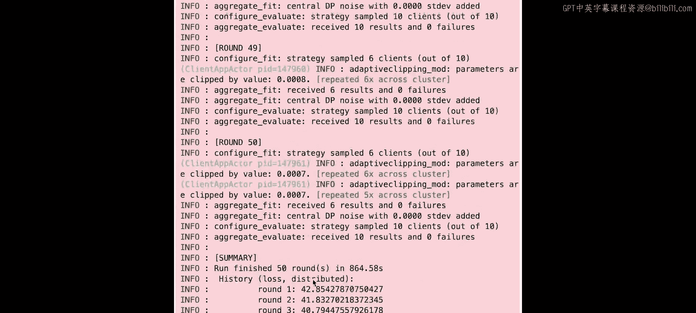
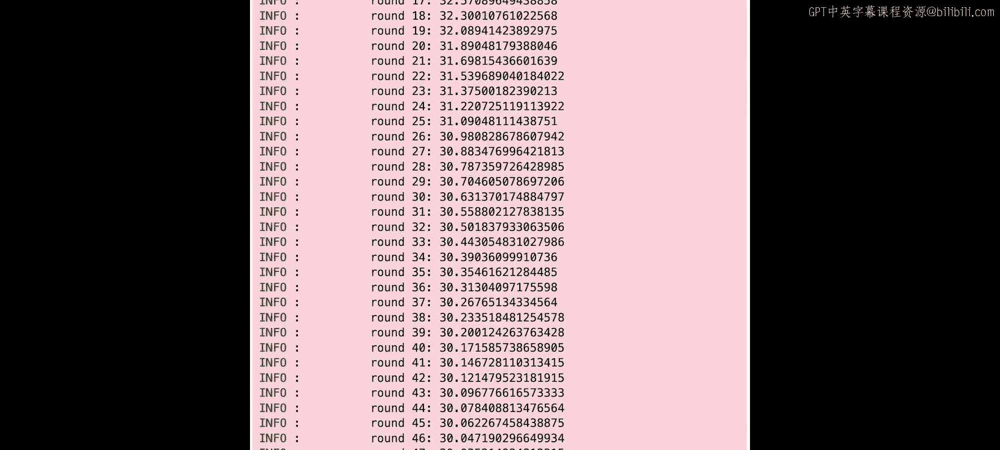
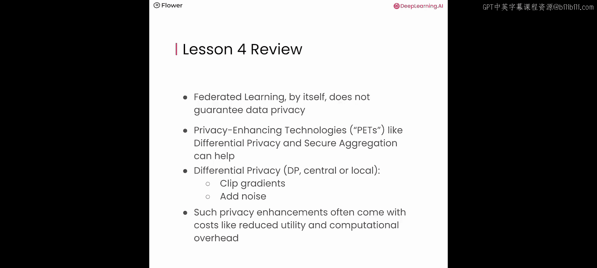

# 吴恩达《联邦学习｜Federated Learning》中英字幕（豆包翻译） - P5：5.Lesson 4 Data Privacy.zh - GPT中英字幕课程资源 - BV1Eb4217768

This lesson is all about data privacy and privacy enhancing technologies or pets for short。

 you'll gain some intuition， learn how to think about pets in the context of federated learning and dive into differential privacy as an example。

 Let's get to it。

When we look at federated learning through the lens of privacy。

 we can say that federated learning itself serves as a data minimization solution by preventing direct access to data。

However， the model updates exchanged between clients and server can still potentially lead to privacy leaks there are different possible attacks that need to be considered depending on the attack model and the adversary's role in federated learning。

 various privacy attacks can be constructed， the adversary can be the client it can be the server or it can be a third party let's look at three examples。

A membership inference attack aims to infer the participation of data samples。

 an attribute inference attack aims at inferring unseen attributes of the training data。

 and a reconstruction attack aims to infer specific training data samples。For example。

 researchers have shown in a paper how in one particular setting a malicious server was able to reconstruct training data samples of a specific client and fedated learning you can see that the reconstructed images are not the exact same images but also that the quality of reconstructed images is surprisingly close to the original dataDifferent privacy is a prominent solution to enhance privacy for individuals during a data analysis it obscures individual data by adding calibrated noise to query results which ensures that the presence or absence of any single data point does not significantly impact the outcome of the analysis This ensures accurate analysis without compromising sensitive information。

 so let's say you have two data sets D and DR that differ in only one data point。LS in this example。

 differential privacy guarantees that any analysis M like calculating the average income。

 for example。Willll produce nearly identical results for both data sets。

O and O prime would be similar in this case。Different privacy and machine learning would provide us with the guarantee that if we train a model M1 on dataset set D and then add or remove a data point such as A's data in this example and we train a second model M2 the resulting models M1 and M2 will be indistinguishable to a certain degree this degree of indistinguishability is quantified by the level of privacy protection we aim to achieve When we look at differential privacy or DP for short in the context of federated learning。

 we see that it can be applied at various stages of the process including during model training aggregation of model updates and communication between clients and the server depending on its application DP provides us with different levels of privacy in this lesson you will learn about two variants of differential privacy。

 central DP and local DP。There are two important topics regarding DP。One is clipping。

 which bounces the sensitivity and mitigates the impact of outliers。

 sensitivity in this context means the maximum amount that the output can change when a single data point is added or removed from the data and the other topic is noising。

 which adds calibrated noise to make the output statistically indistinguishable。

In central differential privacy， the central server is responsible for adding noise to the globally aggregated parameters。

 It should be noted that trust in the server is required。

 The overall approach is to clip the model updates sent by the clients。

And then add some amount of noise to the aggregated model in local differential privacy。

 each client is responsible for performing DP Local DP avoids the need for a fully trusted aggregator。

Each client is responsible for performing clipping and noising locally before sending the updated model to the server。

 let's jump into the lab。As usual， we start by importing utility functions and classes。

We also import both a serverside differential privacy strategy called differential privacy Clside adaptive clipping。

And a clientside adaptive clipping mode called adaptive clipping_ mode。

We'll go into what these components do in a minute。Like in the previous lesson。

 we load the MNIS data and partition it into 10 parts using flower datas。

We also defined a flower client like in previous lessons。

We defined a client underscore FN function that initializes train loader。

 test loader and flower client When defining the client app， we use a new feature called flower mods。

Mods also known as modifiers， allow you to perform operations before and after a task is processed in Dec app。

 you can useBuild in mods or even define your own custom mods here you use the adaptive clipping mod that performs the adaptive clipping of model updates before sending them back to the server。

On the server side， you start by creating the federated averaging strategy as usual。

 this time we'll give it a different name， we'll call it fed averaging without DP。

Instead of passing our federated averaging strategy object directly to server app wrapped a strategy in a Reper strategy called differential privacy clientside adaptive clipping to do that you create an instance of differential privacy clientside adaptive clipping and you pass it the previously created strategy object along with2 Dp specific arguments The noise multiplier and a number of sample clients The differential privacy clientside adaptive clipping strategy wrapper is a strategy itself It wraps other strategy and is responsible for applying Dp on the server side This means it receives model updates it forwards them to the inner strategy for aggregation and then adds noise to the aggregated model The last step is to create server app as usual you now have a matching server app and client app that can perform central Dp with client side adapt。

Tiff clipping。

Let's run it。 You now have a matching server app and client app that together can perform central DP with clientside adaptive clipping with both our serverside Dp strategy and our client side clipping mod configured we can see how the Ferate training runs with DP after the local training a client side mod clips the parameters and send the clip model updates to the server The inner strategy then aggregates those model updates and the Dp wrap strategy adds noise to the aggregated model you can run this experiment as usual via run simulation This time you run the simulation with 10 simulationd clients and you select six of those clients in every single round this is what fraction fit equals 0。

6 results in the logs are a bit more noisy now but what you can see is that on the client side the mod clips the parameters。

You can see some logs starting with adaptive clipping underscore mods and it says parameters are clipped by a certain value。

 you can see that in some of the logs that start with aggregate underscore fit。

 central DP noise with a certain standard deviation is added because of the clipping and noing。

 DP often leads to slower convergence。

This is why for this experiment， we use a small noise multiplier which results in less privacy and we run federated training for 50 rounds and preferably more with regard to this desired privacy and utility Let's review lesson form Feerated learning by itself does not guarantee data privacy privacy enhancing technologies often refer to as pets for short。

 like differential privacy and secure aggregation can helpDifferent privacy。

 either central or local works by clipping gradients and adding noise such privacy enhancements often come with costs like reduced utility and computational overhead。

