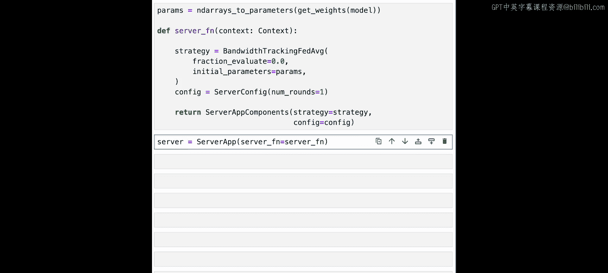
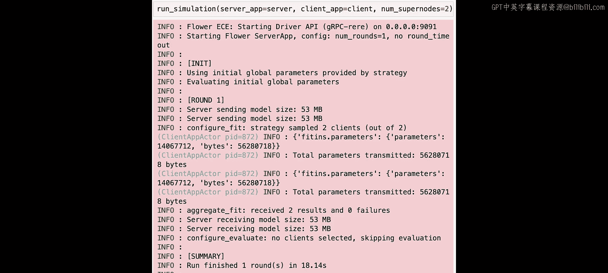
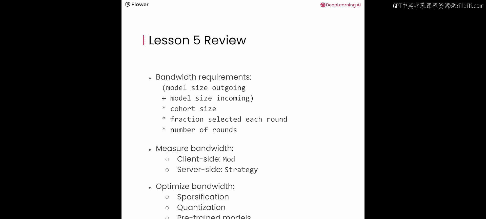

# 吴恩达《联邦学习｜Federated Learning》中英字幕（豆包翻译） - P6：6.Lesson 5 Bandwidth.zh - GPT中英字幕课程资源 - BV1Eb4217768

In this lesson， you'll dive deep into the bandwidth requirements for training a model using federated learning。

You'll understand how to reason about bandwidth usage of federated systems in theory and how to measure bandwidth consumption using flour and practice。

 Let's have some fun。 Let's revisit this animation from lesson 2。

 As you can see there are many models going back and forth between the server and declines in the context of LLMs where models get larger and larger。

 It's important to understand the bandwidth implications of this。

 Well now walk through a formula that helps you to calculate the rough bandwidth requirements of a federated learning setup。

 to better understand the bandwidth usage of a federated learning system。

 We'll slowly walk through a formula that helps us to calculate approximate bandwidth usage of running such a system。

We start by looking at the size of an individual model that we send to an individual client to the size of the model that goes out that we send out to that individual client。

 we add the size of the model that we receive back from the client In some scenarios。

 those two sizes are not the same。 Sometimes we send out full model parameters to a client。

 but then the client returns compressed gradients back。

 so the size of the update that we receive back from the client is smaller than the size of the model we send out。

Adding up the size of the model we send out to the client and the size of the model update we receive back from the client gives us the bandwidth requirements for sending one model to one client and receiving the update back from that client。

 We multiply that by the cohort size。 The total number of clients we have in our system in some of the previous lessons we had a diagram that showed five different clients。

In that case， we would multiply that number by5。 We often don't select all of those clients during a single round。

 so we need to multiply it by the fraction of clients we select during each round。

 If we have100 clients， but we only select 20% of those clients， we would multiply it by 0。2。

 Last we multiply that number by the number of rounds we perform。

 So all of the previous steps gave us the bandwidth requirements for a single round of federated learning and then we used that to and multipied it by the total number of rounds we are about to perform。

 If the size of the model we sent out and the size of the model we receive back from a client is the same we can just take the model size times 2。

 This is the simplified formula for calculating bandwidth requirements in federated learning。

Let's walk through an example。In course2， NickC will cover federated LLM fine tuning on private data。

The language model that will be used in course 2 is Iluuththers Pythia 14 m model。

 a language model with 14 million parameters。 The size of this model is 53 mebys following our simplified formula。

 we multiply this by two to get the bandwidth usage of sending the model to one client and then receiving the model back from that client If we train this model across two clients。

 we multiply that number by two and because we have two clients we'll select both of them during a single round。

If we had， for example， a cohort size of 100， it would be reasonable to select only 50 of them during a single round of federated learning。

 In that case， we would set fractions selected to 0。5 instead of 1。

0 Last we multiply by the number of rounds of federated learning we do in the lab to not waste time we'll only do a single round。

 So we set this to one。 This gives us a total bandwidth usage of 212 meby for a single round of federated learning。

 Let's jump into the lab to see if we're right。As usual。

 you start by importing utility functions and classes。

You also import a client side mod called parametersmeter size mod。

You'll use that mod to track on the client side the size of parameters transmitted You first initialize a language model for causal language model using the eluther AI Pythia model with a size of 14 million parameters。

This is indicated by the Pythia-14 m string， The cache geoparmeter specifies the directory where the downloaded model weights will be cached。

 The static method retrieves the model's parameters as a dictionary of tensors。

 and you call dot values to get the actual values。The total size bytes variable calculates the total size of the model in bytes by summing the element sizes in bytes multiplied by the number of elements in each parameter tensor。

 The total size in bytes is then converted to megabys and rounded down to the nearest integer。

 This gives us the model size of 53 MBby we also used in the calculation example earlier。

The flower client is defined as in previous lessons One difference is that we skip the actual training and evaluation parts as we only want to compute the bandwidth on the server side you can track the size of models sent and received by creating a custom strategy Our custom strategy is called bandwidth tracking fed aaging It extends the federated aaging strategy you used in earlier lessons in the aggregate fit method for each client's result。

 it calculates the size of the received model update in megabytes and locks it The model size is alsoendit to the bandwidth underscore sizes list in configure fit it calculates the size of the model that is going to be sent out to the client in megabytes and locks it The size of the model update with respect to the number of available clients is aended to the bandwidth sizes list。

 Last you create a server app the strategy sets fraction evaluate to0 to disable client side evaluation。

The number of rounds is set to one， it's sufficient to run this forground round because in this setup。

 the bandwidth requirements do not change over consecutive rounds。

Let's start your simulation as always。

In the logs， you can see that the size of the model to be sent is 53 MBby due to the clientside mod。

 you can also see the number of bytes that were transmitted， which is roughly equal to 53 MBby。

 You also see that the server receives two models of size 53 MBby。 Last。

 we locked the total bandwidth used by summing up all the elements in bandwidth underscore sizes。

 You see that in total，212 MBby of bandwidth were used。

 This is exactly what you calculated when using the formula。 Good job。

In the lab we've seen that even performing just a single round of federated learning can quickly eat up a lot of bandwidth。

 There are many ways to reduce bandwidth usage in federated learning two categories of improvements are reducing the size of an individual update and also just communicating less to reduce the size of an update you can use。

 for example specificification and quantization with topk specificification if the gradients to be communicated are below a certain threshold then instead of communicating them they would be communicated as zero This can often be skipped and it therefore saves in communication costs this is highly likely towards the end of the training where more elements in the gradients will be small in magnitude one other thing that you can do to reduce the size of an update is to apply quantization there are many forms of quantization and they reduce the number of bits to represent scrs which in turn。

reduceuces the size of updates exchange between client and server。

 You can also leverage pretrained models In many settings。

 it's realistic to assume that a pretrained model can be found that's useful for your particular application Feerated learning can then continue the training In such cases。

 we might not need to train every single layer and only communicate the layers that are modified by the federated training。

 One other approach is to simply train longer locally before exchanging updates with the server instead of training just one local epoch you could train five epochs before sending the updated model back to the server be aware that this could also prevent convergence。

 If the local model trains too many epochs， they diverge more and more which can cause the aggregated model to become worse instead of better Let's review lesson 5。

 we can calculate bandwidth requirements by summing up the size of the model that is outgoing under the model that is incoming。

And we multiply that by the cohort size and the fraction of clients selected in each round。

 we also multiply that by the number of rounds to get the total bandwidth requirements for a single federated learning run in a real world implementation。

 we can measure bandwidth by using client side mods in flower and serverside strategies to measure the server side and the client side bandwidth requirements。

 we can also optimize bandwidth utilization by applying techniques such as specificrsification or quantization and by using pretrained models。

 not communicating all of the layers or simply by applying more local training before exchanging model updates with the server。

