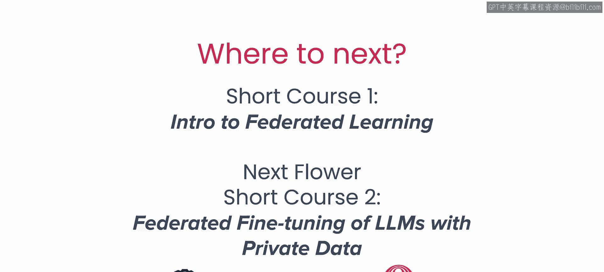
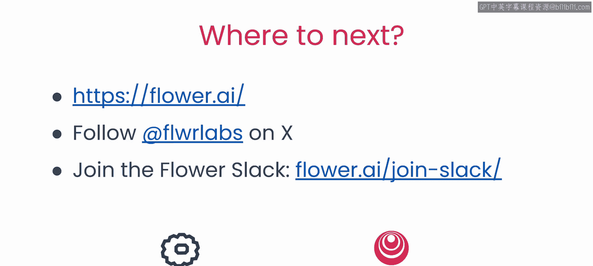

# 吴恩达《联邦学习｜Federated Learning》中英字幕（豆包翻译） - P7：7.conclusion.zh - GPT中英字幕课程资源 - BV1Eb4217768

In this course， you learn about federated learning and the important role it plays in unlocking large amounts of currently unused distributed training data。

Using the flowerlow Feerated learning framework you built different versions of federated training pipelines。

 you learned how to tune different aspects of federated systems， how to think about data privacy。

 and how to calculate and measure the bandwidth usage of federated systems using flour。

 so what's next？This is course one of a two course series。

 The next course will introduce federated LLM fine tuning on private data。

 I also want to encourage you to start your own explorations。

 We'd love to hear from you on flower AI or at FLwr labs on X do com。 Jo the flower communityity Sck。

 There are thousands of likeminded AI researchers and developers exchanging ideas。

 Thank you to the incredible flower community。 It's a real inspiration to see so many projects pushing the boundaries。

 I'm looking forward to seeing what you have built on your own。😊。

