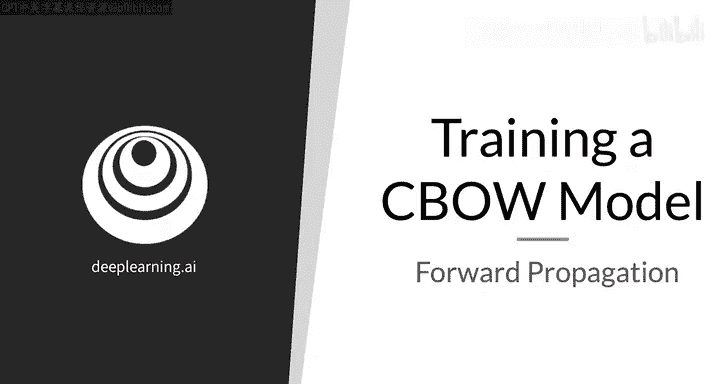
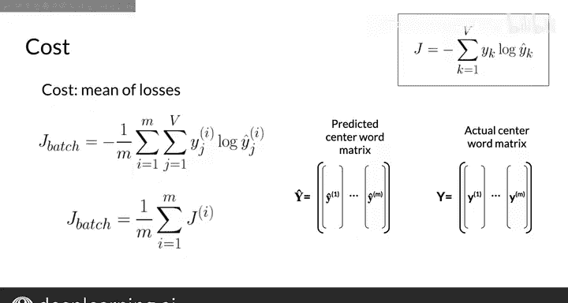

# 吴恩达《自然语言处理｜natural language processing》中英字幕 - P100：50_训练CBOW模型前向传播.zh_en - GPT中英字幕课程资源 - BV1Hc5ezDEWQ

I will walk you through the forward propagation of the CB model。

We will see what happens to your inputs as it goes through the activation layers until it finally becomes a prediction。

 Let's dive in Earl， you learned about the crossenttropy loss function and how it can be used to measure the error made by the neural network of a continuous bag of words model when making a single prediction。

 Now， you'll train the neural net using batches of examples。 First。

 you will propagate these examples forward into the network。

 If you don't remember what forward propagation is。 No worries。 I'll cover this in the video。

 Youll then calculate the cost。 which is an extension of the loss to support a batch of training examples。

 Finally， you will use back propagation and gradient descent to optimize the parameters of the network and improve its predictive performance。

 I'll be describing these soon a quick refresher on forward propagation。

 It involves taking input values。 passing them forward through the neural network from input to output through each successive layer。

😊。

And calculating the values of the layers as you do so， starting with a batch of examples。

 represented as x A V by M matrix where v is the vocabulary size and M is the batch size。

 You will first propagate x forward into the neural network and get the output matrix Y hat。

 which is a V by M matrix， remember that the output matrix simply stack the M output column vectors corresponding to the M input vectors representing each of training examples。

 Now let's revisit the formulas for forward propagation。To calculate the loss for a single example。

 you use the cross entropy loss function when you're working with batches of examples。

 you will calculate the cost， which has the same purpose as the loss and is actually based on the loss function in practice the terms loss and cost are often used interchangeably but in this course we will refer to loss for a single example and cost to refer to a batch of examples the cross entropy cost for a batch of examples is simply the mean of the cross entropy losses of each of the M individual examples Forly the formula for the cross entropy cost for a batch of training examples is J batch equals minus1 over M times the sum over all the examples so I from1 to M of the sum over all the rows that each represents a word in the vocabulary which is J from1 to V of y。

Subscripts J superscript I times the logarithm of Y hat Subscript J superscript I。

 You can rewrite this formula as J batch equals1 over M times the sum over all the examples of J superscript I。

 where J superscript I is the loss for example I by doing it this way。

 you can visualize the cost as the average of individual losses up next。

 youll use the cost function to adjust the parameters of the neural net to improve its predictions。

 You have seen the cross entropy cost function and why it is helpful in predicting one of the possible words in the next video。

 you're going to learn how to train your word vectors using this cost function。

