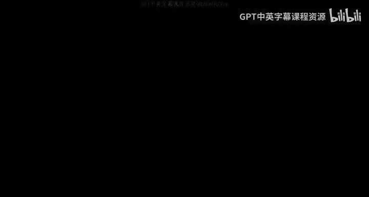
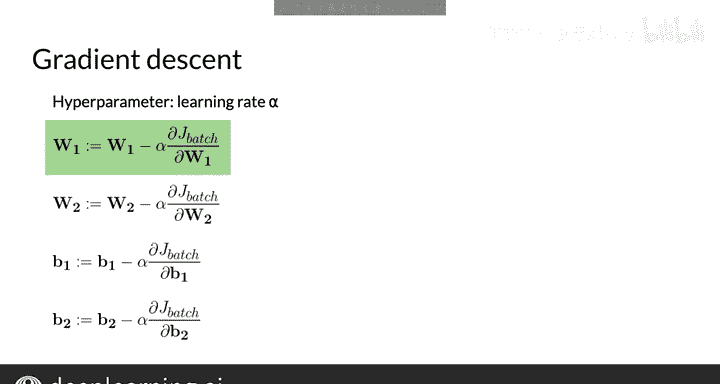

# 吴恩达《自然语言处理｜natural language processing》中英字幕 - P101：51_训练CBOW模型反向传播与梯度下降.zh_en - GPT中英字幕课程资源 - BV1Hc5ezDEWQ

I will show you how you can find the weights for your linear layer and for your word embeddings to minimize these two matrices or weight vectors。

 you'll have to minimize the cost and to minimize the cost you will use two techniques。

 The first one is back propagation back propagation is in algorithm that calculate the partial derivatives or gradient of the cost with respect to the weights and biases of the neural network。

 Remember that the cost J batch is a function of the weights and biases。

 The back in back propagation comes from the way the formulas for the derivatives are obtained using the chain rule for derivatives without going into too much detail。

 using the chain rule involves starting from the output layer and then working your way back through the layers using derivatives that you have calculated previously。

 By the way， back propagation is a prime example of dynamic programming。

 which you learned about during the first week of this course。😊。

The second technique you will use is gradient descent。

 which adjusts the weights and biases of the neural network， using the gradient to minimize the cost。

 I won't go into the mathematical details of back propagation or gradient descent。

 But if you're interested in learning more， check out a course on neural networks to understand how the various formulas are derived。

 First， let's use back propagation to calculate the partial derivatives of the cost function that youll need to perform gradient descent。

 You need the partial derivatives of the cost function with respect to the parameters of the neural network。

 which are， in this case， W1 W2。 B1 and B2。 The calculations are long winded。 and in practice。

 you will use machine learning libraries to handle back propagation for you。

So I'll just give you the formulas， which you'll get to implement in this week's assignment。

 The derivative of the cost function with respect to the weighting matrix。 W1 is as follows。

This is the formula for the partial derivative of the cost function with respect to W2。

 Here is the formula for the bias vector B1。 Let me pause here for a second。 In this formula。

 Ive introduced the1 underscore M vector， which is a row vector with M elements that are all ones if you are multiplying a matrix a that has m rows by the1 m vector transposed you'll get the column vector where each element is equal to the sum of the elements in the corresponding row of a。

 Having said that the1 m vector is introduced for mostly formal purposes to be able to write the mathematical formulas。

 In practice， when you implement this m Python， the easiest way to calculate the sum of the columns is to use nu pi sum function without using the1 m vector in the sum function。

 you need to specify that you want to get the sum of the columns where the parameter axis equal1。

And you will also need to set the keep themm parameter to true so that the result can be broadcast into a matrix of whatever size is necessary later in the calculations。

 Finally， here is the formula for Bele， which also uses the1 m vector。 Now。

 for the purposes of this course。 you don't have to understand how these formulas were derived。

 you can just use them。Okay， so now that you have these gradients。

 you can use gradient descent to update the weight matrices and bias vectors。

 The calculations include a learning rate alpha， which is a hyperparmeter of your model。

 and here are the formulas to update the weights and biases。

 The idea is to take the original parameters and then subtract alpha times their gradient。

 Since alpha is chosen to be a small positive number that is less than one。

 The effect of multiplying by alpha， is to reduce the amount by which each variable is updated at each step。

 a smaller alpha allows for more gradual update to the weights and biases。

 whereas a larger number allows for a faster update of the weights。 So， for instance。

 the new weighting matrix W1 would be equal to the original W1 minus alpha times the partial derivative of the cost with respect to W1。

 which you calculated during the back propagation step。😊。

You now know everything you need to train a continuous bag of words model in the next video。

 you'll learn how to extract word embedding vectors from a trained continuous bag of words model。

Gradient descent allows you to calculate the partial derivatives with respect to the weights and biases。

 Once you calculate these partial derivatives， you can update your weights。

 Alpha tells you how much of a step to take when updating。

