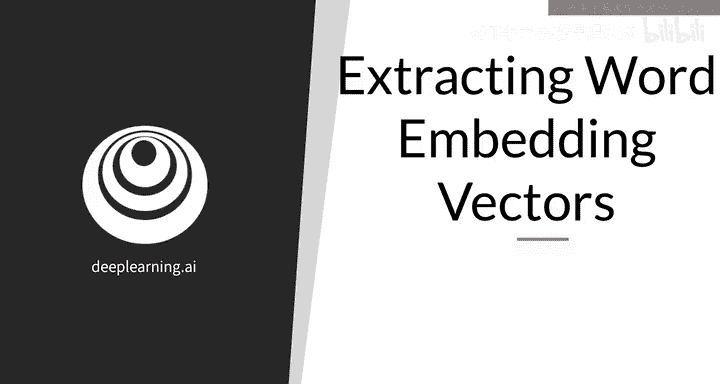
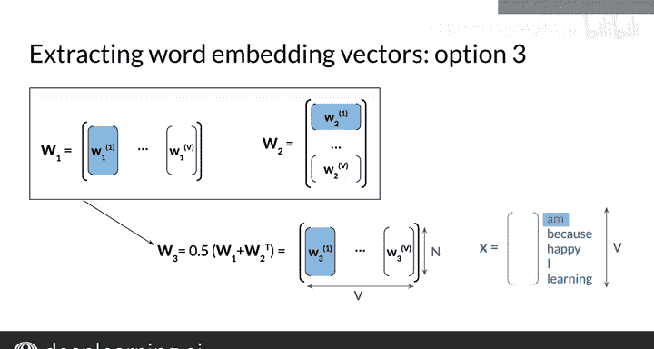

# 吴恩达《自然语言处理｜natural language processing》中英字幕 - P102：52_提取词嵌入向量.zh_en - GPT中英字幕课程资源 - BV1Hc5ezDEWQ

Once you are done training your model and have optimized the cost function。

 you still need to actually get the word embeddings In this video。

 I will show you several methods to extract the word embeddings from the weights learned by your model。

You have already implemented forward propagation， back propagation and gradient descent to train the neural network of a continuous bag of words model。

 But how do you get the word embeddings out of your trained neural net。 As you may remember。

 word embeddings are not directly output by the training process。

 They are a byproduct of the process。 I'll now explain how you can extract word embeddings from a trained neural net。

 Remember， these are vectors that carried the meaning of the words of the vocabulary based on the context words in the corpus。

 Once you've trained your neural network after iterating through all of your training data。

 possibly several times， you can extract three alternative word embedding representations。

 The first possibility is to consider each column of W1。

 as the column vector embedding vector of a word of the vocabulary。

 recall that matrix W1 has V number of columns。 So it has one column for each word in the vocabulary。

😊。

apping between columns of W1 and words uses the same order as the input rows。 For example。

 with the corpus， I am happy because I am learning if the five rows of the input vector or matrix corresponds to M。

 because happy I and learning。😊，Then in W1， the first column will be the word embedding column vector for M。

 The second for because and so forth， the second option to extract word embeddings is to use each row of W2 as the word embedding row vector for the corresponding word matrix W2 has V rows。

1 row for each word in the vocabulary。 again， the order is the same as the input vector or matrix。

 So with our sample corpus and input， the first row would be the word embedding row vector for M。

 the second for because and so on。 the third and final option is to take the average of the two previous representations。

So if you want word embedding column vectors， you would average W1 and a transpose of W2 to obtain W3 in U N by v matrix。

 you can then extract the word embedding vectors from each column of W3。

 as you did previously so with our visual example， the word embedding for M would be the first column of W3。

 which would be the average of the values of the first column of W1， and of the first row of W2。

In this week's assignment， you'll be averaging W1 transposed and W2 to extract the word embeddings as row vectors。

 Now that you know how to train these word vectors in next week's video。

 youll learn how to test them。 Specifically， you will learn about two types of evaluation metrics。

 The first type is intrinsic evaluation。 And the second type is extrinsic evaluation。😊。

