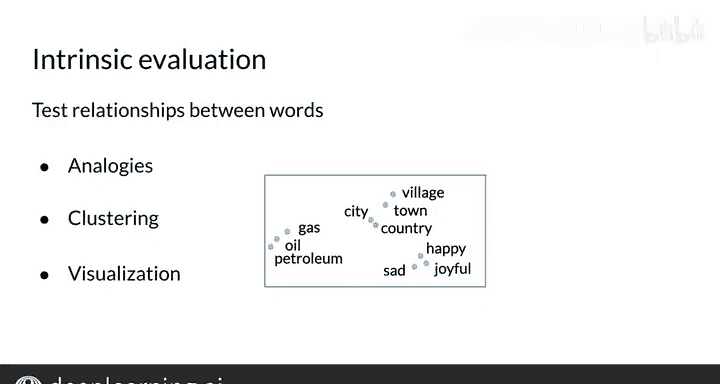

# 吴恩达《自然语言处理｜natural language processing》中英字幕 - P103：53_评估词嵌入内在评估.zh_en - GPT中英字幕课程资源 - BV1Hc5ezDEWQ

The two types of evaluation metrics are intrinsic evaluation and extrinsic evaluation。

 depending on the task you're trying to optimize for， you can choose one of them， so let's dive in。

Allow me to introduce intrinsic evaluation。Intrinsic evaluation methods assess how well the word embeddings inherently capture the semantic or syntactic relationships between the words。

 semantics refers to the meaning of words， whereas as syntax refers to the grammar。

You could do this by testing the word embeddings on analogies。You could test semantic analogies。

 as in finding the missing word in France is to Paris， as Italy is too blank。

You could also evaluate the embeddings on syntactic analogies， such as plurals。

 tenses and comparatives。As in sin is too so， as being is too。

One consideration you should be aware of for this approach is that there could be several possible correct answers。

As in Wolf is2 pack， as B is2 blank， where the collective noun and missing word could， for instance。

 be swarm or colony。 Here's an example from the original wordtuva research publication with the word embeddings created from a huge training set。

I should mention that the word embeddings were created by a continuous skipgram model and not a continuous bag of words model。

But the evaluation principle is the same。 Note that the analogies are not perfect。 For example。

 the word embeddings fail to completely capture the relationship between chemical elements and their symbols。

The symbol for copper is C U。 The symbol for zinc is the N。The symbol for gold is A U。

The symbol for uranium is U。But the word two vacuum em bedding outputs。

 the word plutonium instead of you。You could also perform intrinsic evaluation by using a clustering algorithm to group similar word embedding vectors and determining if the clusters capture related words。

 This could be automated using a human made reference such as as source。

 Here is a visualization of clusters taken from a paper。 on the evaluation of word embeddings。

 If you look at the word cluster。 you can see that the words fight and agitate。

 are close to each other。 Similarlyly， the word hair care and hairdress are also close to each other。

Interesting， right。In this week's assignment， youll visualize the word embedding vectors。

 which qualifies as a basic intrinsic evaluation of the vectors that rely on human judgment to assess the quality of the embeddings。

But first， I'll show you one more approach to evaluate the quality of word embeddings。

 extrinsic evaluation。

So here is a recap of what you have learned intrinsics evaluation allows you to test relationships between words you can use for clustering analogies and visualization In the next video。

 you'll learn about something slightly different known as extrinsic evaluation。

