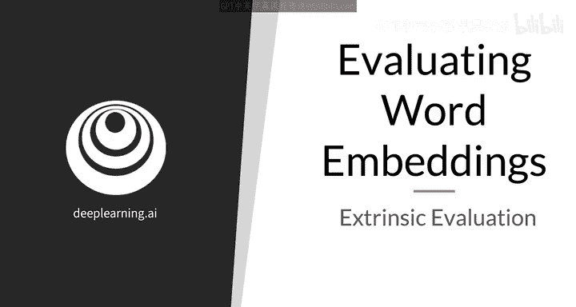
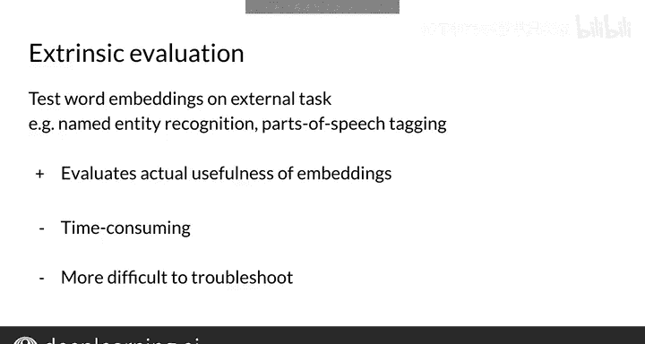

# 吴恩达《自然语言处理｜natural language processing》中英字幕 - P104：54_评估词嵌入外在评估.zh_en - GPT中英字幕课程资源 - BV1Hc5ezDEWQ

So to test your word embedding evaluation on external tasks。

 you will probably resort to extrinsic evaluation For example。

 if you build a system that does speech recognition。

 then the only way to know if it works is to actually test the system as a whole on a task this might be more effective than intrinsic evaluation。

 let's get started。By now， you have used intrinsic evaluation。

 your first method for evaluating word embeddings based on how well they capture the semantic ortactic relationships between the words to evaluate word embeddings with extrinsic evaluation。

 you use the word embeddings to perform an external task。

 which is typically the real world task that you initially needed the word embeddings for。

Then use the performance metric of this task as a proxy for the quality of the word embeddings。

 Exles of useful word level tasks include named entity recognition or parts of speech tagging。

A named entity， something this can be referred to by a proper name。 For example， in the sentence。

 Andrew works at deep learning do AI， the word Andrew is a named entity。

And is categorized as a person。 The word deep learningning that A I is another named entity。

And is categorized as an organization。A useful task may be to train a model that can help you identify and categorize named entities in a sentence。

You could then evaluate this classifier on a test set with some selected evaluation metric。

 such as accuracy or the Fone score。 The classifier's performance on the evaluation metric represents the combined performance of both the embedding and classification tasks。

 Extrinsic evaluation methods are the ultimate test to ensure that word embeddings are actually useful。

 However， their main drawbacks are that the evaluation will be more time consuming than an intrinsic evaluation。

 and that if the performance is poor， then the performance metrics provides no information as to which specific parts of the end to end process is responsible。

 The word embeddings themselves or the external task used to test them。 So far。

 you've evaluated word embeddings using intrinsic and extrinsic evaluation methods。 That's very nice。

 If you want to dive deeper into this topic， I've included the reference to a comprehensive and very readable paper。

😊，On evaluating word embeddings， you've just acquired quite a few new skills。

 It's a good time to review。 So that's up next。

Before moving on to the next video， here is a short summary of what you learned。

 Extrinsic evaluation evaluates actual usefulness of the word embedding。 However。

 it is more difficult to troubleshoot and is more time consuming。😊。

