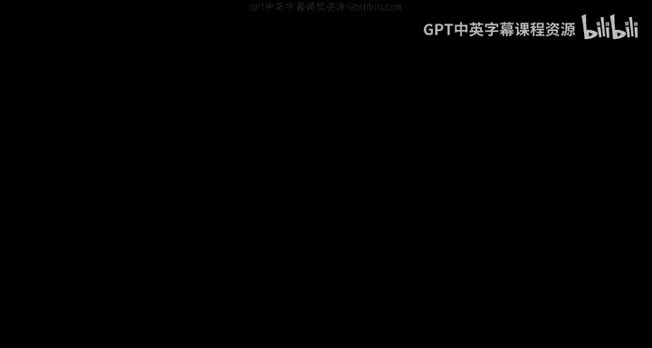
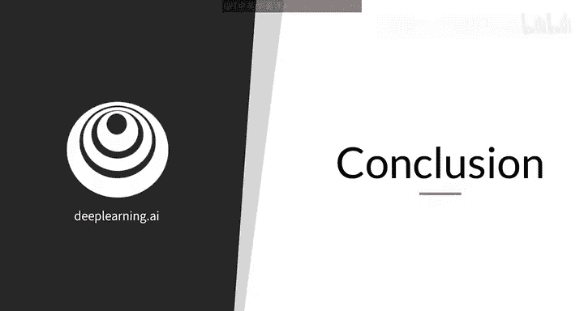
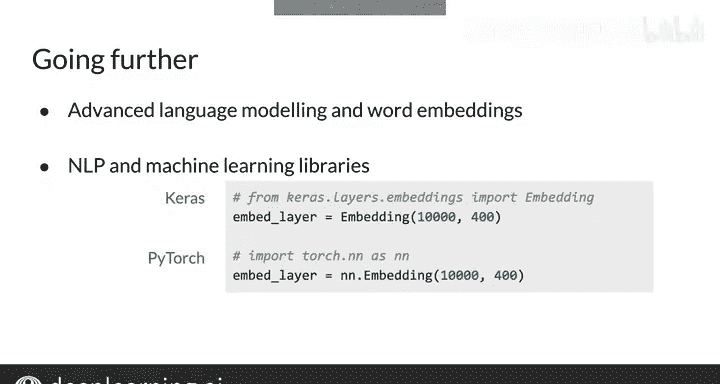

# 吴恩达《自然语言处理｜natural language processing》中英字幕 - P105：55_结论.zh_en - GPT中英字幕课程资源 - BV1Hc5ezDEWQ

Congratulations on finishing this week， you now not only know how to use word vectors。

 but you also know how to drain them from scratch。 This is a useful skill to have。

This week was all about word embeddings， which capture the meaning of words in vectors that you can use for both simple and advanced N LP applications。

 You've covered a lot of ground this week。 Let's reinforce your new skills with some review and get excited for the assignment。

In the final assignment， you'll get to practice all your new skills this week。

 including preparing data， you will read and tokenize a corpus to build a vocabulary。

 creating word representations， mapping words to indices and back and converting these indices to one hot vectors。

 Learn word embeddings by creating a continuous bag of words model。

 you will build a neural network for the model， train it and extracts the resulting word embedding vectors。

 visualizing the word embedding vectors as a form of intrinsic evaluation。

 After completing the assignment， youll then be well equipped to move on to more advanced language modeling and word embedding approaches。

 these sophisticated approaches supports out of vocabulary words and are better at capturing the multiple possible meanings of words。

 these capabilities are essential for real worldord applications of NLP。 Finally。

 you should know that even though you are implementing everything from scratch for this assignment in the real world。

You will often use NLP and machine learning libraries to do all the heavy lifting。

 Take some time to explore these libraries。 It's time well spent。

 specifically for word embedding thecaras and Pytorch libraries enable you to add an embedding layer in a neural network using a single line of code。

 Other libraries like tracks also allow you to do so。

Congratulations on finishing this week， you now not only know how to use word vectors。

 but you also know how to train them from scratch This is a really useful skill to have。

