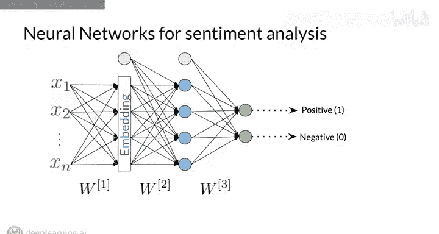
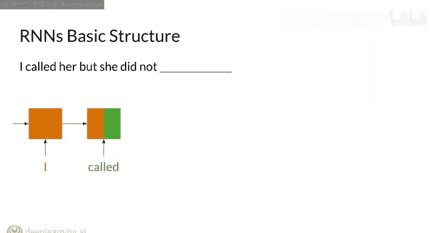
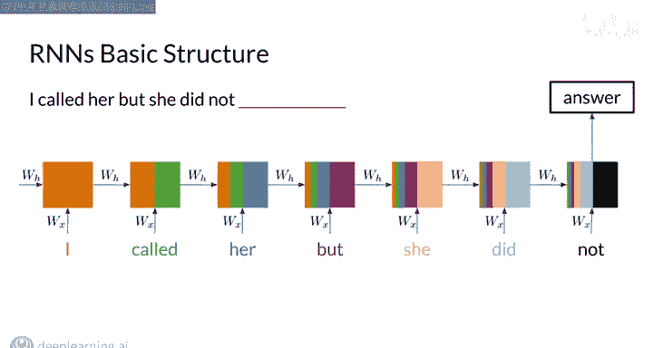
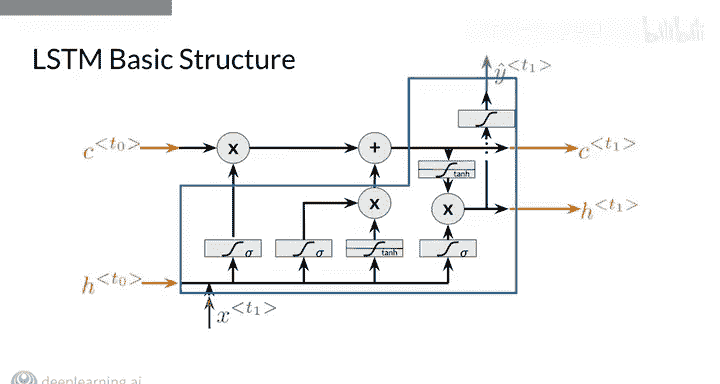
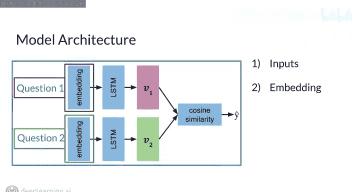
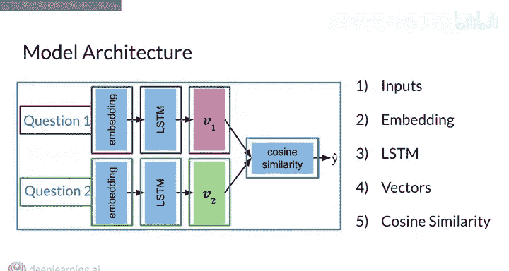
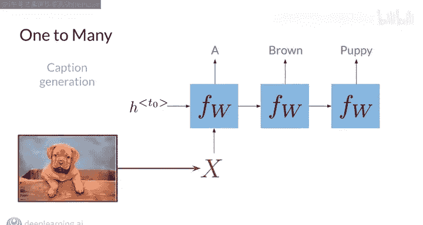
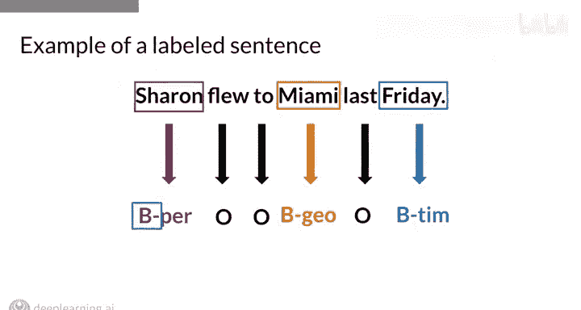
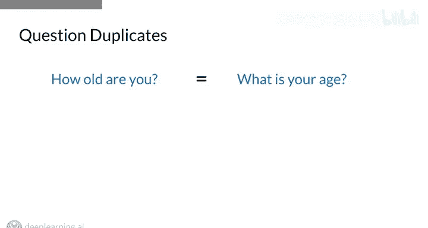

# 吴恩达《自然语言处理｜natural language processing》中英字幕 - P107：0_课程3介绍.zh_en - GPT中英字幕课程资源 - BV1Hc5ezDEWQ

Welcome to the third course of this specialization This course is called natural Lagu Pro with sequence models In this course here are some things you get to build first you take sentiment analysis to the next level with deep neural networks you also build a language generator using RNN or recurrent neural networks you apply LTM units LTM stands for long short termm memory。

 you apply LTM units to the problem of named entity recognition。

And finally， you use Siamese's networks to identify duplicate questions like say if there's an online discussion forum and different people are asking questions。

 can you figure out if two different people ask essentially the same question but with different wording With the skills you develop in this course youd be able to build powerful NLP systems to solve problems across a wide range of industries It is my pleasure to welcome Lucas and Eice as your instructors for this course and they are thrilled to dive into these topics with you Eice perhaps you could say a bit more about the applications that learners will build in this course Sure thing。

 thanks Andrew。

Well， I'd like to start by saying that in the first two courses of this specialization。

 you build a powerful foundation that will provide you with both the context and the fundamental skills you need to tackle this course。

 For example， you've already done sentiment analysis in course 1 with a simple naive based classifier。

 But now you will leverage the power of deep neural networks to build a much more robust sentiment analysis classifier。

 You've also seen how to do things like predict the next word in a sequence。

 using relatively simple and gram language models in course2。😊。

In this course you'll create an advanced model using recurrent neural networks to generate text you can think of this course as taking the step from foundational skills into building real world NLP applications Very cool Eice。

 I think that's a great way to think about it。Lucas。

 maybe you could say a bit more about the applications learners will get to build。Sure， thank you。

 Andrew。Well， as you saw in the first course， the problem of sentiment analysis is a really tricky one。

 but in many applications， you want to determine the sentiment of a sentence。

 so it's a really good problem to work on as well。 with language modeling the problems you can solve are almost infinite from translation to auto acomp to generating text from scratch in week two of this course。

 you'll work on name entity recognition， which is the problem of separating named entitiesities in sentences like people and places。

 This is a building block of many important NP systems。 Finally， in week three of this course。

 you will tackle the problem of identifying duplicates。

 The question whether two pieces of text or duplicates of each other might not sound very interesting at first。

 but as you will see， it's actually core buildingding block of things like online forms and search engines and we'll show you how to solve it。

 So we are really excited to show you these applications and bring your skills to the next level。

 Thank you Lucas and thank you Eunice This is great。😊。

An exciting course， So let's get started。 Good luck， have fun。

