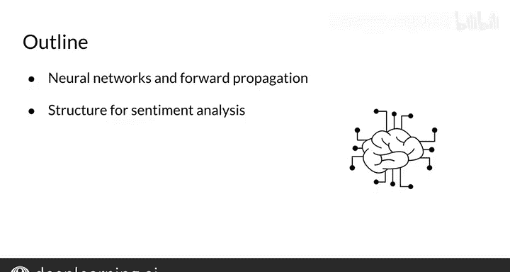
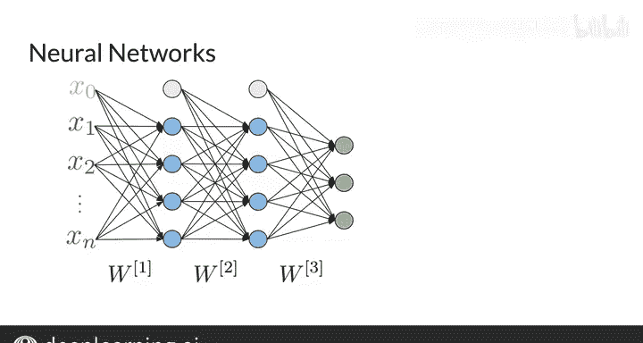
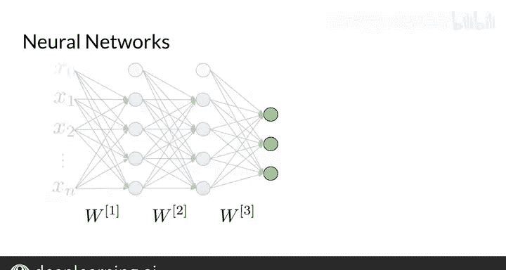
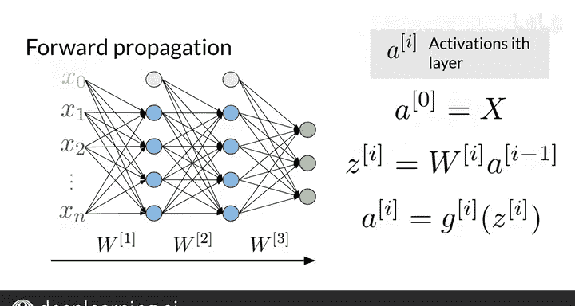
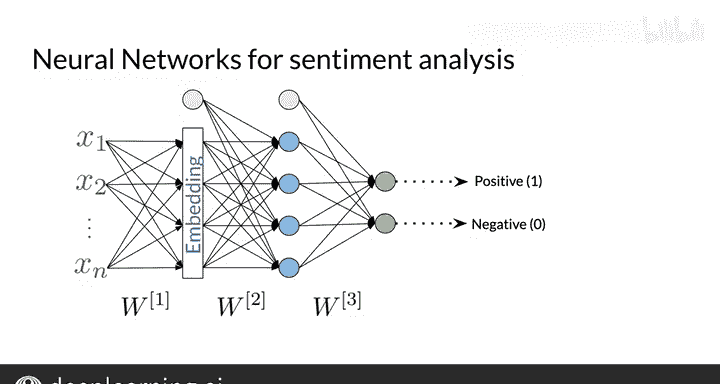
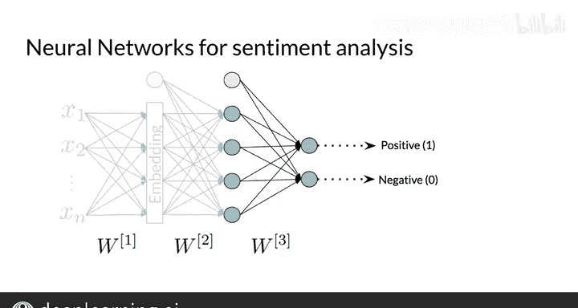
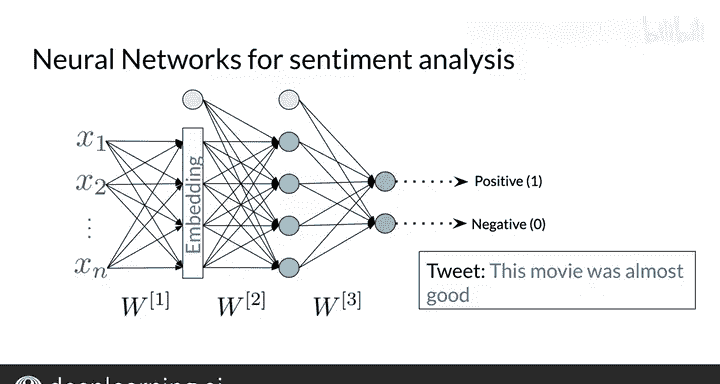
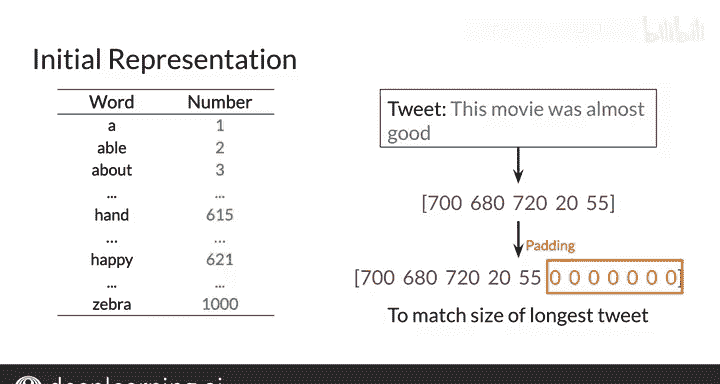
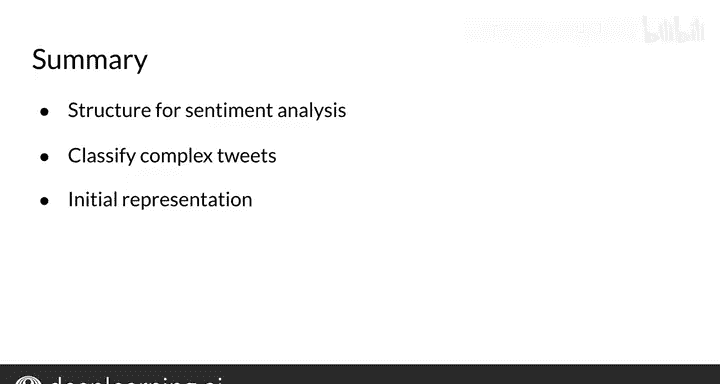

# 吴恩达《自然语言处理｜natural language processing》中英字幕 - P109：2_用于情感分析的神经网络.zh_en - GPT中英字幕课程资源 - BV1Hc5ezDEWQ

First， you'll revisit the general structure of neural networks and how they make predictions。

 and I'll show you the structure you'll be using to perform sentiment analysis。

Neural networks are computational structures that in a very simplistic way。

 attempt to mimic the way the human brain recognizes patterns。

They are used in many applications of artificial intelligence and have proven very effective on a variety of tasks。

 including those in NLP。Have a look at this example of a simple neural network with n input parameters。

 two hidden layers， and three output units。

As input， this neural network receives a data representation X with n features。

Then performs computations in its hidden layers。 And finally， it delivers an output。

 which in this case has size 3。Let's take a look at how it works mathematically。

 I'll denote every activation layer as a superscript I where I is the layers number First。

 define a superscript 0 to be the input vector x to get the values for each layers activations a you have to compute the value for z superscript I。

 which depends on both the weights matrix for that layer and the activations a from the previous layer。

Finally， you get the values for each layer by applying an activation function G to the value of Z。

 As you can see， this computation moves forward from the left of the neural network towards the right。

 And that's why this process is called forward propagation。😊。

For this modules assignment， you're going to implement a neural network that looks like this。

As input， it will receive a simple vector representation of your tweets。

 It will have an embedding layer that will transform your representation into an optimal one for this task。

 And finally， it will have a hidden layer with a re activation function and an output layer with a softmax function that will give you the probabilities for whether a tweet has a positive or negative sentiment。

This neural network will allow you to predict sentiments for complex suites。

Such as a tweet like this one that says this movie was almost good。

That you wouldn't have been able to classify correctly using simpler methods such as naive basease。

 because they missed important information。

The initial representation X that you will use for this neural network will be a vector of integers。

 similar to your previous work with sentiment analysis。

 You will first need to list all of your words from your vocabulary。 and next for this application。

 you will assign an integer index to each of them。 Then for each word in your tweet。

 add the index from your vocabulary to construct a vector like this one for every tweet。

After you have all the vector representations of your tweets。

 you will need to identify the maximum vector size and fill every vector with zeros to match that size。

 This process is called padding and assures that all of your vectors have the same size。

 even if your tweets don't。

Let's do a quick recap。 At this point， you're familiar with the general structure of the neural network that you will be using to classify sentiments for a set of complex nuanced tweets。

You also reviewed the integer representation that's going to be used in this module In this video。

 you have seen an overview of how to use sentiment analysis using neural networks you have seen how to use padding and how to represent a tweet In the next video we will dive deeper into sentiment analysis。

