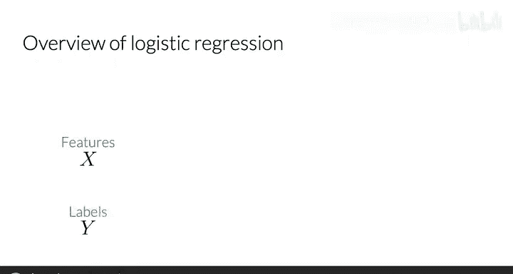
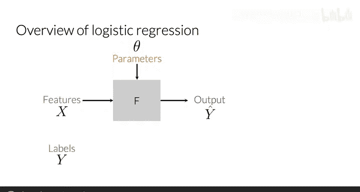
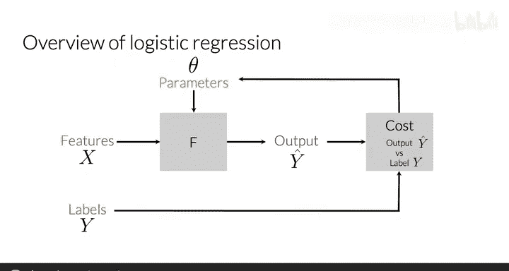
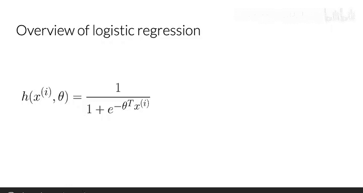
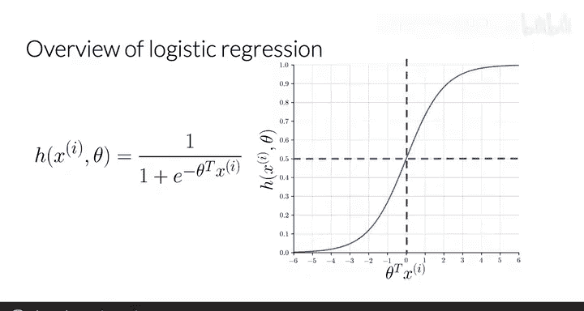
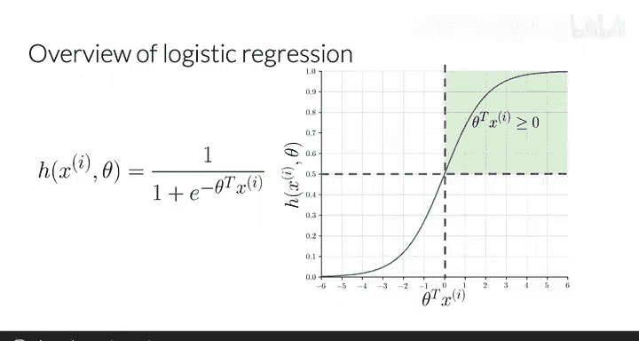
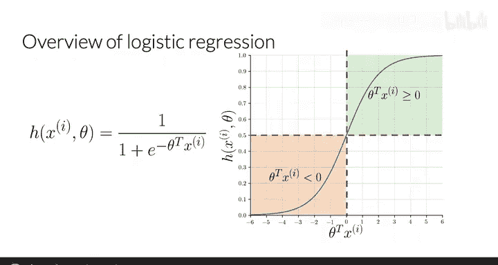
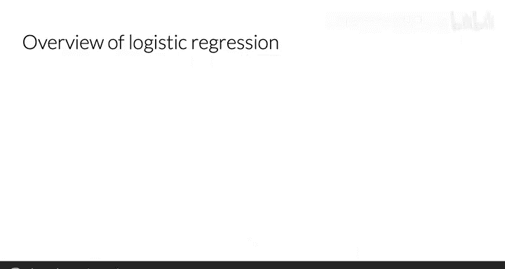
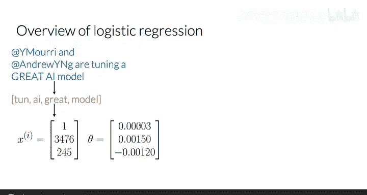

# 吴恩达《自然语言处理｜natural language processing》中英字幕 - P10：9_逻辑回归概述.zh_en - GPT中英字幕课程资源 - BV1Hc5ezDEWQ

You will now get an overview of logistic regressionPrevious， you learn to extract features。

 and now you will use those extracted features to predict whether a tweet has a positive sentiment or a negative sentiment。

 Log regression makes use of a sigmoid function， which outputs a probability between 0 and one。

 Let's take a look at the overview of logistic regression。

Just a quick recap in supervised machine learning， you have input features and a set of labels to make predictions based on your data。

 you use a function with some parameters to map your features to output labels。

 to get an optimum mapping from your features to labels。

 you minimize a cost function which works by comparing how closely your outputs Y hat is to the true labels Y from your data after which the parameters are updated and you repeat the process until your cost is minimized。

For logistic regression， this function， F is equal to the sigmoid function。

The function used to classify in logistic regression H is the sigmoid function。

And it depends on the parameter theta， and in the features vector x superscript I。

 where I is used to den the e observation or data point in the context of tweets。

 just the Ih tweet Vily， the sigmoid function has this form。

And its approaches 0 as the dot product of theta transpose x over here， approaches minus infinity。

And one， as it approaches infinity。For classification， a threshold is needed。

 Usually it is set to be 0。5， and this value corresponds to a dot product between theta transpose and x equal to 0。

 So whenever the dot product is greater or equal than 0， the prediction is positive。

And whenever the do product is less than zero， the prediction is negative。

So let's look at an example in the now familiar context of tweets and sentiment analysis。

 Look at the following tweet。 After pre processing， you should end up with a list like this。

 Note that handles are deleted。 Everything is in lowercase and the word tuning is reduced to its stem to。

 Then you would be able to extract features given a frequencies dictionary and arrive at a vector similar to the following。

With a bias unit over here and two features that are the sum of positive and negative frequencies of all the words in your process tweet。

 Now， assuming that you already have an optimum set of parameterss， theta。

You would be able to get the value of the sigmoid function in this case， equal to 4。92 and finally。

 predict a positive sentiment。 Now that you know the notation for logistic regression。

 you can use it to train a weight factor theum in the next video。

 you will learn about the mechanics behind training such a logistic regression classifier。

