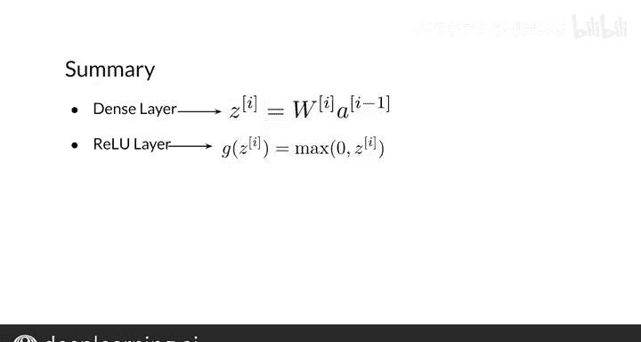

# 吴恩达《自然语言处理｜natural language processing》中英字幕 - P110：3_全连接层与ReLU.zh_en - GPT中英字幕课程资源 - BV1Hc5ezDEWQ

There are two main layers that are very commonly used in most neural networks。

 There is a dense layer which allows you to go from one layer to another inside the network。

 And then there is a re layer that keeps your network stable。 Let's explore them in more detail。

First， I'll revisit the dense layer that I already mentioned in the previous videos。

 and then I'll show you how the Re layer works。Recall that within a hidden unit J。

 two computations are happening sequentially。First。

 it does product between the weights associated with that hidden unit and the activations from the previous layer。

And then a nonlinear function is applied to the results of that dot product。

So looking at a hidden layer eye。From even Latin neural network。

You will have multiple units where the first computation is a dust product， Z superscript I sub J。

The dense layer computes all of these dust products at once by multiplying the weight matrix， W。

 superscript， I。With the activations from the previous layer， a superscript I minus1。

Where the weight matrix contains a set of parameterss that can be learned during the training process。

After a dense layer， a nonlinear function G is typically applied to the z values in each hidden unit。

The Re function is a typical choice for this task， It maps any negative values to0 before sending them onto the next layer。

 it computes a function that returns a value of 0 for negative values of z subj。

And does nothing to the Z Sub Js that are positive。

 This is equivalent into taking the maximum between 0 and z for each hidden units。

Rallo stands for rectified linear unit， which makes sense when you are taking a look at the graph where the negative parts of the function has been rectified to match the horizontal axis。

As you can see， over here。You've now seen the dense layer in more detail。

 and I showed you how the re layer works。 Next， I'll discuss how to put a model together。

You are now familiar with two main components of any common neural network。

