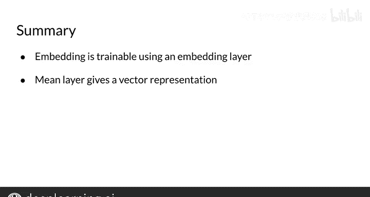

# 吴恩达《自然语言处理｜natural language processing》中英字幕 - P111：4_嵌入与均值层.zh_en - GPT中英字幕课程资源 - BV1Hc5ezDEWQ

Previously， I spoke about dense and re layers。 There are two other layers I want to introduce you to。

 embedding and mean layers。 These will come in handy。 So let's dive in。😊。

Going forward， I will introduce embedding layers and explain why you will need to include layers such as the mean layer in serial models directly after your embedding layer。

Let's now dive into the embedding layer。In NLP， you usually have a set of unique words called the vocabulary。

An embedding layer takes an index assigned to each word from your vocabulary and maps it to a representation of that word with a determined dimension in this example。

 embedding of size equal to 2。For instance， the embedding layer in this example will return a vector equal to 0。

020 and 0。006 for the word I add negative 。009 and 0。050 for the word NlP。

 every value from this parts of the table is trainable。

 So when using an embedding layer in your model you will learn the representation that gives the best performance for your NLP task。

For the embedding layer in your model， you'd have to learn a matrix of weights of size equal to your vocabulary times the dimension of the embedding。

 The size of the embedding could be treated as a hyperparmeter in your model with this layer。

 your model can learn or improve the word embeddings for your NLP task Like it improves the weight matrices on each layer。

The embedding layer is able to map words to embeddings。

 So if you had a series of words like a tweet that says I am happy。

 The embedding layer will map each of those words to their corresponding embedding。

 and return a matrix of word embeddings If you had padded vectors representing your tweets。

 you could unroll this matrix and feed its values to the next layer on the neural network。

 But in doing this， you might end up with a loss of parameters to train。😊，As an alternative。

 you could just take the mean of each feature from the embedding。

 And that's exactly what the mean layer does。 So after the mean layer。

 you will have the same number of features as your embedding site。

 even for sequences of text that are very long。 Not that this layer doesn't have any trainable parameters。

 because it's only computing the mean of the word embeddings。At this point。

 you are familiar with what embedding layers and mean layers are and how they work。

 An important takeaway here is that using an embedding layer in your model allows you to learn a good representation of your vocabulary for the specific task you are working on。

And as the mean layer takes a matrix of embeddings and returns a vector representation for a set of words。

 like tweets。

You have four layers in your toolkits， thence， Reello and Benning and Min。

These are more than enough to lay the foundations for you to start building your own neural network。

