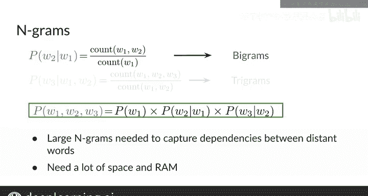

# 吴恩达《自然语言处理｜natural language processing》中英字幕 - P113：6_传统语言模型.zh_en - GPT中英字幕课程资源 - BV1Hc5ezDEWQ

Welcome back。You have previously learned about Ngram language models。 and specifically。

 we used it to compute the probability of a sequence of wordsts。 Now， in this video。

 you're going to identify the limitations of that model。

 and you will see that it requires a lot of space and memory。 So with that said， let's dive in。😊。

Suppose you have to translate the sentence。 Gevle much defoot from French to English。

 If you had several similar sentence candidates like I saw the game of soccer。 I saw the soccer game。

I saw the soccer match and saw I the game of soccer。For an accurate translation。

 you could compute the probabilities of each sentence using a language model like the Ngram。

And end up selecting the sequence of words with the highest probability。 In this case， that would be。

 I saw the soccer game。You may have encountered the Ngram model before。

 but let's go ahead and review it quickly。 recall that in order to build an Ngram language model。

 you have to compute conditional probabilities。For bigrams。

 you have to compute conditional probabilities using one previous word for trigrams。

 you could compute it using two previous words。 So for an ngram model。

 you use conditional probabilities using n minus-1 words。At the end。

 you will get the probability of a whole sentence by multiplying the probabilities of each word in the sentence using its previous and minus one words。

So in the case of a bigram， to get the probability of a three word sentence。

 you would multiply the probability of the first word by the probability of the second word。

 given the first word， and then by the probability of the third word， given the second one。

These models have many limitations。 One of them is that in order to capture dependencies between words far away from each other。

 your model would have to account for conditional probabilities in very long sequences of words。

This could be difficult to estimate with us correspondingly large corporal。

Even in the case of large corporal， your model would need a lots of space and REM to store the probabilities of all the possible combinations。

You can see how quickly this approach becomes impractical。 Up next。

 I'll introduce you to recurrent neural networks and gated recurrent units。

 Two models that are much more efficient than Ngrams for NLP tasks like machine translation。

 you have now seen that traditional Ngram language models require a lot of space and a lot of memory。

 So if a user is downloading an app， for example， on their phone。

 Then they might not have enough space there。 And as a result。

 the developers might not want to use traditional Ngramm language models there。

 And they might want to use a different approach。 which is known as recurrent neural networks。

 In this video， I'll introduce you to RNs or recurrent neural networks。😊。

