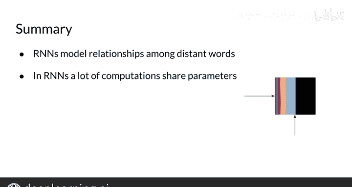

# 吴恩达《自然语言处理｜natural language processing》中英字幕 - P114：7_循环神经网络.zh_en - GPT中英字幕课程资源 - BV1Hc5ezDEWQ

You will now see some advantages of recurrent neural networks， also known as RN。

 and you'll see that using them， you can capture some dependencies that you could not have otherwise captured with your traditional and gram language model。

 So let's dive in。You've already got the general idea behind completion。

 So let's look at the following example。Nor was supposed to study with me。 I called her。

 but she did not blank。If you used a traditional language model like a trigram to try and complete the sentence。

 you would compare different word probabilities and then select the word with the highest chance of following the words did not。

 For instance， your model might choose the word have。

 because it is highly probable to see that sequence of three words in a typical text corpus。However。

 the use of have in this sentence doesn't make any sense as a better alternative。

 R and Ns aren't limited to looking at just the previous n words。

 They propagate information from the beginning of the sentence to the end。

So if you trained an R N for this task， you'd get a better prediction。 The word answer。

 even though that word is less probable。If you wanted to have a Ngram capable of completing sentences like this one。

 you would have to account for six word long sequences， which is pretty impractical。

To see how recurrent neural networks work， take the second sentence from the last example。

I called her， but she did not blank。A plain R N propagates information from the beginning of the sentence through to the end。

 starting with the first word of the sequence， the hidden value at the far left。

And the first values are computed here。Then it propagates some of the computed information。

 takes the second word in the sequence and gets new values。You can see that process illustrated here。

 The orange area denotes the first computed values， and the green denotes the second word。

The second values are computed using the older values in orange and a new word in green。After that。

 it takes the third word and the propagated values from the first and second words and computes another set of values from both of those and so on。

Each of the boxes in this diagram represents the computations made at each step。

And the colors represent the information that is used for every computation。As you can see。

 the computations made at the last step have information from all the words in the sentence。

 At the final step， the recurrent neural network is able to predict the word answer。

The magic of required neural networks is that the information from every word in the sequence is multiplied by the same weight。

 W subscripts of x。And the information propagated from the beginning to the end is multiplied by W Subscript H。

In other words， this block is repeated for every word in the sequence。

 so the only learnable parameters are the ones in W， Subscript X， W， Subscript H and W。

 the weights used to make the final prediction。That's why they are called recurrent neural networks。

 They compute values that are fed over and over again to themselves until a prediction is made。

The principal advantage of RNs is that they propagate information within sequences。

And the computations share most of the parameters here。

 you saw an example of an R and that propagated information from the beginning to the end of a word sequence to make a single prediction at the end。

Next， you'll see different types of orins， the math behind simple architectures and the way to implement them。

You now know when you would like to use an RNN in the next video。

 I'll show you different types of RNN architectures and also show you when to use which。

