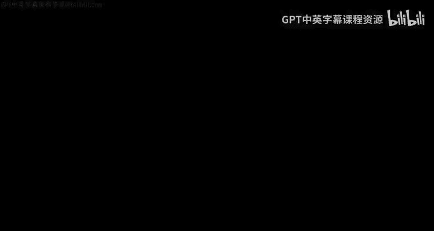
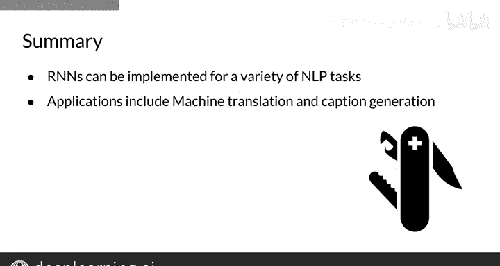

# 吴恩达《自然语言处理｜natural language processing》中英字幕 - P115：8_RNN的应用.zh_en - GPT中英字幕课程资源 - BV1Hc5ezDEWQ

There are many types of R and and architectures。 Sometimes you're trying to build the sentiment classifier of a tweet。

 In that case， you might want to use one type of model。 Another time。

 you might want to generate a caption for an image。

 And then you might want to use a different architecture。

 So there are many different types of architectures。 And in this video。

 we will show you all the different types。

There are many different types of tasks in AI here。

 I'll group them according to the nature of their input and output。 For instance。

 a one to one task takes as input a set of low or non correlated features。

 X and returns a single outputs。 Y。 say you had a list of scores from your favorite team in the European soccer tournament。

 Ladi Ga Santane。As inputs， you could have a recurrent neural network that predicted the position of your team on the leader board。

 However， notice that this recurrent neural network isn't much different from a conventional neural network。

It only has an additional hidden state H， superscript T subscript0。So for this type of task。

 RNNs aren't all that useful。But if you want a neural network that takes an arbitrary image and generates a caption describing the content of that image in English。

 In this case， a brown popuppy， you can build an R N N。

 This type of task is known as one too many because your R N N takes a single image and generates multiple words to describe it。

Another type of task is many to one。 You may already be familiar with one practical example of this type sentiment analysis。

In that instance， if you have a sequence of words like this tweet that says I am very happy as input。

 and your model should output whether the tweet has a negative or positive sentiment。😊。

Your R&N would take every word from the sequence as inputs in different steps。

 propagate information from the beginning to the end and outputs the sentiment。Finally。

 many too many tasks involve multiple inputs and multiple outputs。For example。

 in machine translation， you have a sequence of words in French。

You want to get its equivalent in another language， such as English。

An R and N would do well for this task because they propagate information from the beginning to end。

 And this is what makes them able to capture the general meaning of four sequences。

This particular architecture， encoder， decoder， is very popular for machine translation。

The first parts of this neural network doesn't return any outputs Y hat and is called an encoder because it encode sequences afford any single representation that captures the overall meaning of the sentence。

That is decoded later to a sequence of words in the other language。RNNs are powerful architectures。

 This can be used to solve a lot of interesting problems in NLP。

 there are multiple applications where current neural networks are useful。

 such as machine translation and caption generation。

You can think of R NNs as versatile tools thus can be shaped according to the situation。

 depending on the task you're trying to solve， you can choose one of these architectures in the next video。

 I'll talk about a simple recurrent neural network。

 and then you can apply it to all these architectures。

