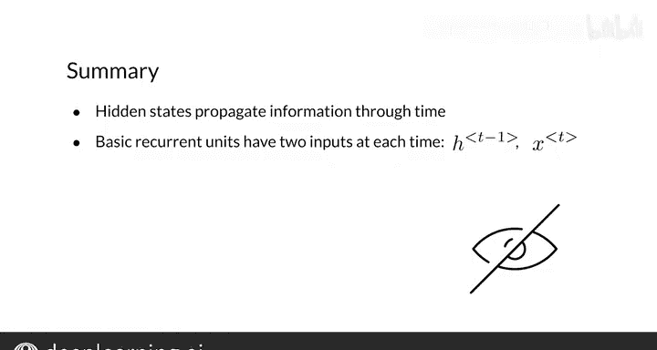

# 吴恩达《自然语言处理｜natural language processing》中英字幕 - P116：9_简单RNN中的数学.zh_en - GPT中英字幕课程资源 - BV1Hc5ezDEWQ

You saw the advantages and the basic idea behind your current neural networks RNNs might seem like complicated structures。

 but as you will see， their computations are actually pretty straightforward。

I'll show you how plain RNN propagates information through time within a sequence of variables。

 as well as how they make sequential predictions。You' will get familiar with the math behind basic recurrenrence units to prepare you to implement forward propagations in RNN。

Take a look at this plane or vanilla R anN。 It has too many architecture。 So at each sign step。

 it takes an x， a hidden state H and makes a prediction Y hat。 Additionally。

 it propagates a new hidden state to the next time step。

The hidden state at every time T is computed with an activation function G with arguments equal to the product between a parameter matrix W subscript H。

 and the previous hidden state， H superscript t minus1。

These are concateated with the inputs variable x superscript T。Bless a bias term。

The complete equation looks like this， where x superscript t and H superscript t minus1 are multiplied by different parameters。

 and the resulting vectors are summed up element twice。After computing the hidden states at time T。

 it's possible to get the prediction Y hat by using an activation function G with argument equal to the product between the hidden state and some parameters W plus a bias term。

These two equations together represent all of the math behind a simple rN。

But let's take a detailed look at the order in which computations are made。

Let's focus on the first cell from the RN。It takes as input the previous hidden state and the current variable x。

 which might be the first word in a sentence。To get the current hidden state。

 first you have to get the product of x and H superscript t sub0 with their respective parameters。

 and then sum the vectors element twice。Next， pass the resulting vector through an excavation function。

With the resulting value， you can compute the current Y hats。

Now by multiplying the current hidden state with a set of learnable parameterss， W subscripts， YH。

 and going through another activation function。In the literature related to R ends。

 you'll find similar diagrams to what you see here。

 which show the order of computation and how information is propagated within a recurrent unit。

It is important for you to take away that hidden states are the variables that allow RNs to propagate information through time。

 or in other words， through different positions within a sequence。As you saw at every step。

 recurrent units have two inputs。 You now know the fit forward equations and the cost function for an R N N。

 In the next video， I'll show you how the cost function for the R N N works。

