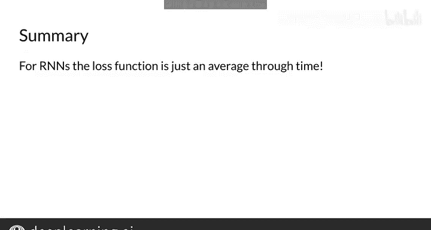

# 吴恩达《自然语言处理｜natural language processing》中英字幕 - P117：10_RNN的成本函数.zh_en - GPT中英字幕课程资源 - BV1Hc5ezDEWQ

We will now look at the cost function for RNNs。 We will go over the cross entropy loss again and see how we can adapt it so we can account for all the time steps。

 Let's get started。

Take a look at the sequential model here you have an input vector， X in magenta。

 multiple hidden units in blue and three output units in green。

 Suppose that this model outputs the probability of whether an observation belongs to each of three different classes。

Looking at a single X Y pair， you can get the loss using the cross entropy function where K is the number of categories or classes and every label Y Sub J is equal to either one or 0。

 So to get the loss for a single observation。 you have to look at every outputs probability in y hat and compare them with the true Y values。

0 or one。Vanilla RnNs have an architecture similar to this one， wherefore every time step T。

 the network outputs a vector Y hat by computing these two formulas at every step the cross enuls in this case is shown in this equation where the only difference from the equation that I showed earlier is the summation over time T and a division by the total number of steps capital T。

This is just the average of the cross entropy loss function over time。

To get the cost of your whole model， as always， you would have to sum over every example in the training development or test set。

 Now， you know that to capture an individual loss in your model。

 you only have to take the average with respect to time for your recurrent neural network。Next。

 I'll share with you some implementation notes and more complex R&N architectures。

You have seen how we change the cost function by summing over all the K classes and all the T time steps。

 we then divide by the total number of steps to get the average costs in each step。

We will further explore how to implement these models in the next video。

