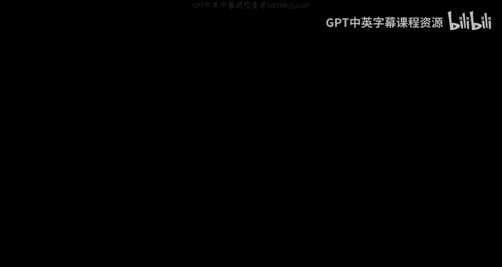
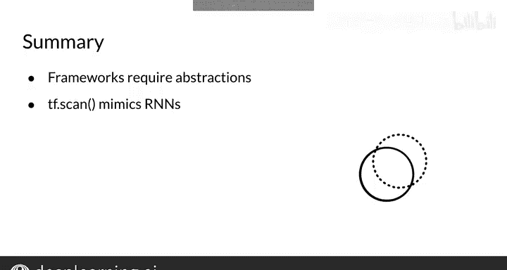

# 吴恩达《自然语言处理｜natural language processing》中英字幕 - P118：11_实现注意事项.zh_en - GPT中英字幕课程资源 - BV1Hc5ezDEWQ

I will now show you how to implement RNANNs， I'll be talking about scan functions。

 which are just like abstract RNAs， and they allow for faster computation。

So what's are scan functions and how do you implement them？To do this。

 I will show you how the functions scan is implemented in Tensorflow for computing the forward path in RnNs。

The scan function is designed to take a function FN and apply it to all of the elements from the beginning to the end in the list Ls。

Initializer is an optional variable that could be used in the first computation of FN。Now。

 take this R and N where FN is equivalent to F W。LMSs is the list with all the input X superscriptee。

 and the initializer is the hidden state H superscriptee Subscript 0。

Dis scan function first initializes the hidden state as H superscript T subscript 0 and sets the whites。

Which store the prediction values as an empty list。 Then for every x in the list of elements。

 F N is called with X and the value of the last hidden states as arguments。

 So this for loop computes every time step of the Rn N and stores the values of the prediction in hidden states。

 Finally， the function returns the list of predictions and the last hidden states。

You might think this function is unnecessary because it is essentially a for loop through every time step of the RNN。

 however， frameworks like Tensorflowlow need this type of abstraction in order to perform parallel computations and run on GPUs。

I showed you how the scan function is defined in Tensorflow to mimic how R andNs work。

 It is important to know that these types of abstractions are needed for deep learning frameworks because they allow them to use GPUus and compute in parallel。

