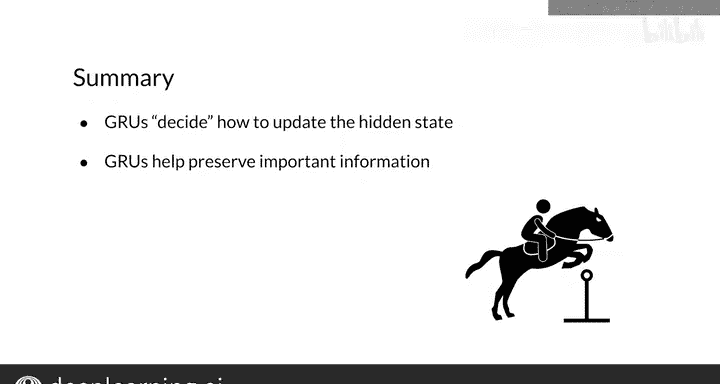

# 吴恩达《自然语言处理｜natural language processing》中英字幕 - P119：12_门控循环单元.zh_en - GPT中英字幕课程资源 - BV1Hc5ezDEWQ

At this point， you have become familiar with vanilla RNs， which are powerful architectures。

 but they are limited in the sense that for long sequences of words， the information tends to vanish。

However， there are more complex models that you can use to handle long sequences like the gated recurrent units Here。

 I'm going to introduce you to gated recurrent units。

 G R used for short with a comparison to vanilla Rronance。

One important difference is that GRUs work in a way that allow relevant information to be kept in the hidden states。

 even over long sequences。For example， with a GRU， you will be able to train a model that takes the sentence。

 ans are really interesting， blank are everywhere， and easily predict the word they to fill in the blank because the GRU will learn to keep the information about the subject。

 in this case， whether it is plural or singular in the hidden state。

GRUs accomplish this by computing relevance and updates gates， which I'll show you next。

You can think of GRUs as vanilla RNNs with additional computations。

They take two inputs as every time step， the variable x at time T and the hidden states H。

 which is passed from the previous unit。The first two computations made in AGRU are the relevance gates。

Gamma Subscript R and the updates G Gamma Sub 2。These gates compute the sigmoid activation function。

 so their result is a vector of values which have been squeezed to fit between 0 and 1。

The updates and relevance gates in GRUs are the most important computations。

 their outputs help determine which information from the previous hidden state is relevant。

 in which value should be updated with current information after the relevance gate is computed。

 a candidate's H prime for the hidden state is found。

Its computation takes as parameters the previous hidden state times the relevance gate and the variable x for the current time。

This value stores all the candidates for information that could override the one contained in the previous hidden states。

After that， a new value for the hidden states is calculated using the information from the previous hidden states。

The guide hidden date and the update gate。The update gate determines how much of the information from the previous hidden state will be overwritten。

Finally， a prediction Y hat is computed using the current hidden states。

Let's compare GRUs with vanilla rN。Remember that a vanilla RNN such as this one computes an activation function with the previous hidden states and current variable axis parameterss to get the current hidden states。

With the current hidden state， another activation function is confusedd to get the current prediction Y hat。

This architecture is updating the hidden states at every time step， so for long sequences。

 the information tends to vanish。This is one cause of the so calledled vanished ingredients problem。

On the other hand， GRUs compute significantly more operations。

 which can cause longer processing times and memory usage。

 The relevance and update gates determine which information from the previous hidden state is relevant and what information should be updated。

The hidden States candidates stores the information that could be used to override the one passed from the previous hidden states。

And then the current hidden state is computed and updates some of the information from the last hidden states。

And a prediction why hat is made with the updated hidden state。

 All of these computations allow the network to learn what type of information to keep and when to overwrite it。

I just demonstrated how GRUs decide which of the information in the hidden state to override at each time step。

The relevance and updates gates in GRUs allow models to keep some values in the hidden state for longer word sequences。

This is very useful to many NLP tasks GRUs are simplified versions of the popular LSTMs。

 which you will be encountering a little later in the specialization。

So now you know that GRUs are very similar to a simple RNN。

 except that they have two gates that allow you to update the information in your state and tell you how relevant each input is in the next video。

 we will talk about bidirectional and deep RNNs。