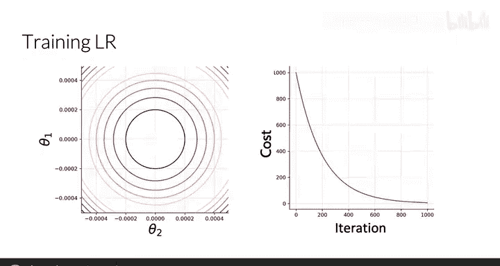
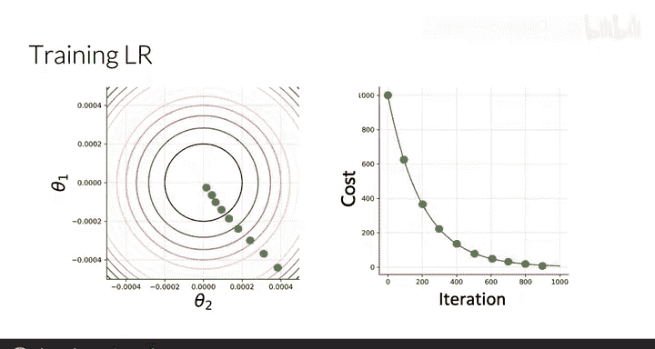
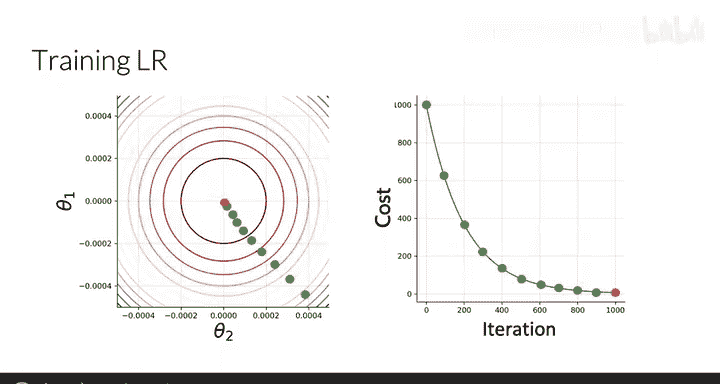
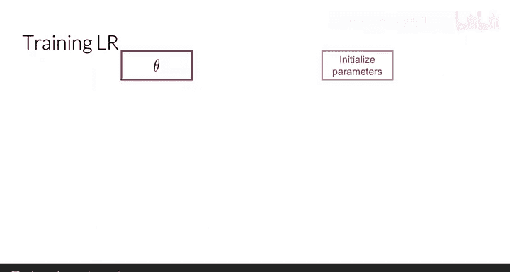
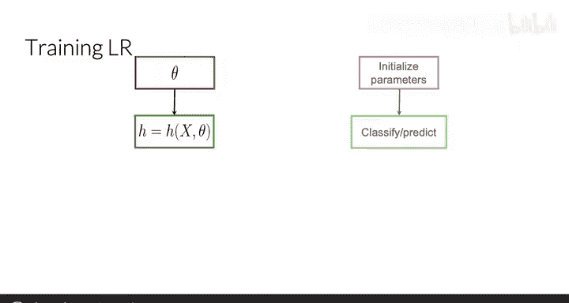
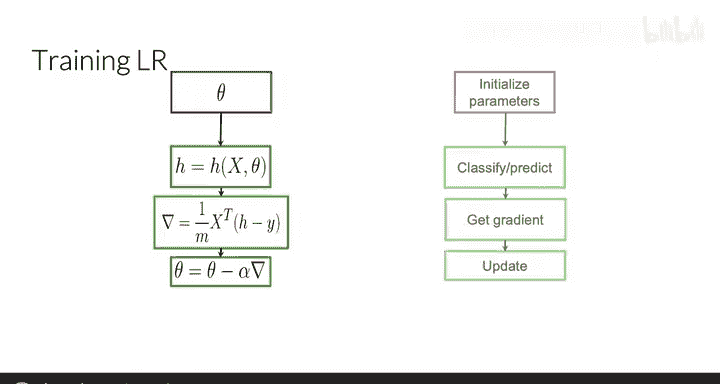
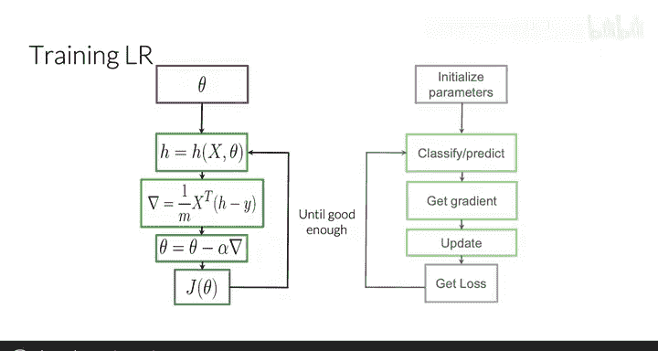

# 吴恩达《自然语言处理｜natural language processing》中英字幕 - P11：10_逻辑回归训练.zh_en - GPT中英字幕课程资源 - BV1Hc5ezDEWQ

In the previous video， you learn how to classify whether a tweet has a positive sentiment or a negative sentiment using a theta that I have given you in this video。

 you will learn your own theta from scratch， and specifically I'll walk you through an algorithm that allows you to get your theta variable。

 Let's see how you can do this。😊，To train your logistic regression classifier。

 iterates until you find a set of parameters theta that minimizes your cost function。

 Let us suppose that your loss only depends on the parameters theta 1 and theta 2。

 you would have a cost function that looks like this contour plot on the left。

On the right， you can see the evolution of the cost function as you iterate。 First。

 you would have to initialize your parameters theta。

Then you will update your data in the direction of the gradient of your cost function after 100 iterations。

 you would be at this point。After 200 here。And so on。

After many iterations， you derive to a point near your optimum cost。

And you and your training here。Let's look at this process in more detail。

First， you would have to initialize your parameters vector the。

Then you'd use the logistic function to get values for each of your observations。

After that， you'd be able to calculate the gradient of your cost function。And update your parameters。

 Finally， you'd be able to compute your cost， J。

And determine if more iterations are needed according to a top parameter or maximum number of iterations。

 As you might have seen in the other courses， this algorithm is known as gradient descent。

Now that you have your theta variable， you want to evaluate your datata。

 meaning you want to evaluate your classifier once you put in your datata into your syigmoid function。

 do you get a good classifier or do you get a bad classifier in the next video we will show you how you can do this。

