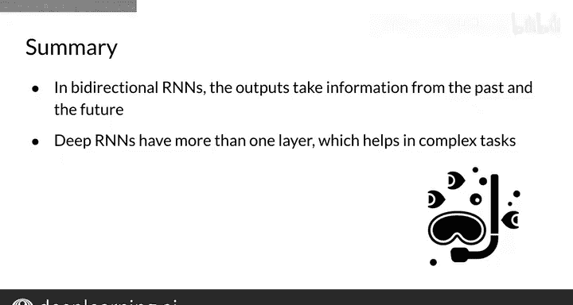

# 吴恩达《自然语言处理｜natural language processing》中英字幕 - P120：13_深度与双向RNN.zh_en - GPT中英字幕课程资源 - BV1Hc5ezDEWQ

Deep recurrent neural networks are useful because they allow you to capture dependencies that you could not have otherwise captured using shallow RnNs In this video。

 you will understand the equations used when implementing these deep RnNs。

 and I'll show you how that factors in into the cost function。 So let's dive in。

I will show you how bidirectional neural networks work and how stacking R N Ns together can produce a deep neural network to illustrate the importance of bidirectional R N Ns。

 Take the following example。 I was trying really hard to get a hold of blank。

 Louise finally answered when I was about to give up。As a clever human。

 you would be able to fill in the blank without having to think very hard。

 An R and N that propagates information from the beginning to the end of sequences would be able to make a prediction。

 Too。 It would take the words before the blank as input and do its best to predict the missing word。

😊，However， because Louise doesn't appear until the beginning of the next sentence。

 it would have to guess between her， him and them。Bydirectional RNNs work in much the same way that simple RNNs do。

They take an input sequence X and make the predictions Y hat in the Rn Ns I showed you earlier。

 the information flows from the beginning to the end of the sequence。 However。

 you could have another architecture where the information flowed from the end to the beginning。

 Just imagine going from the future to the present instead。When information flows in both directions。

 that's a bidirectional r in it。It is important for you to know that this is an acyclic graph。

 which means that the information flows independently in both directions。

 so the computations from left to right are completely independent of the computations from right to left to get the predictions y hat in a bidirectional RN。

 you have to start propagating information from both directions。

When you have computed both of the hidden states for a time step。

 you can get the prediction Y hats for that time。Using this formula。

 which is the same one used for unidirectional or vanilla。R N ends。

 but appending both hidden states this time。After you compute all the hidden states for both directions。

 you can get all of the remaining predictions。Deep RNs are similar to regular， deep neural networks。

Deep INs have a layer which seeks the input sequence x。And multiple additional hidden layers。

 as you can see， the RNs are just RNs stacked together。

 The intermediate connections pass information through the values of activations。

 just as in conventional deep neural networks。 But for every time step。For vanilla deep RnNs。

 you have the following two equations。They are the same as the ones that you have seen before。

 But let's see how information flows in this case。First。

 you compute the hidden states for the current layer。

 Then you get the activations and pass those values to the next hidden layer and repeat this process。

 In other words， At first， you propagate information through time。

 Then you go deeper in the network and repeat the process for each layer until you get your predictions。

Now， you've become familiar with the two interesting and useful varieties of RnNs bidirectional RnNs propagate information through time from the future and from the past。

 Deep RnNs can help you solve more complex tasks than are possible， with shallow neural networks。

 Both architectures are relatively simple compositions derived from the vanilla RnN model that you've already seen。

 So it isn't such a big conceptual leap to understand their math。

Congratulations on completing this week。 you have learned about RnNs， gated recurrence units。

 bidirectional and D RNNs In the assignments， you will get to play with RNNs and learn how they are actually being implemented。

 Good luck。😊。