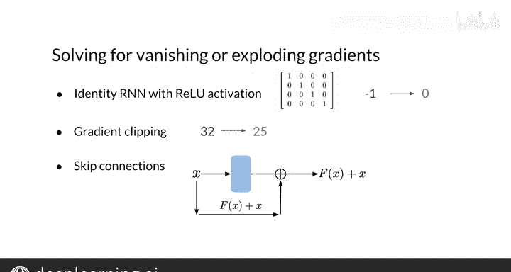

# 吴恩达《自然语言处理｜natural language processing》中英字幕 - P123：16_RNN与梯度消失.zh_en - GPT中英字幕课程资源 - BV1Hc5ezDEWQ

Welcome， this week， I will talk about long short term memory cells。

 which we call LSTMs to understand why their important。

 let me explain the vanishing and exploding ingredients problems faced by conventional RNAs。

 So let's dive in。😊，First， I'll talk about back propagation through time。

 then I'll introduce you to vanishing and exploding gradients， a problem common to RNs。

And I'll show you a few ways to handle them。Let's begin with a discussion of some of the pros and cons of using the recurrent neural network。

For one， the way plane or vanilla RNN's model sequences work is by recalling information from the immediate past allowing you to capture dependencies to a certain degree。

They are also relatively lightweight compared to the other engram models。

 taking up less space and RAM。But there are downsides。

 The Ar's architecture can struggle to capture long term dependencies。

And RNs are prone to vanishing and expd ingredients。

 both of which can cause your model training to fail。

Vanishing and exploding gradients are a problem that can arise due to the fact that R andN propagates information from the beginning of the sequence to the end。

 starting with the first word of the sequence， the hidden value at the far left。

The first values are computed here。Then as propagate some of the computed information。

 take the second word in the sequence and get the new values。

 you can see that process illustrated here， the orange area denotes the first computed values and the green denotes the second word。

The second values are computed using the older values in orange， and a new word in green。After that。

 it takes the third word and the propagated values from the first and second words and computes another set of values from both of those。

 and it continues in a similar way from there。 at the final step。

 the computations contain information from all the words in the sequence and the RnN is able to predict the next word。

 which in this example， is goal。 know that in an Rnn。

 the information from the first step doesn't have much influence on the output。

This is why you can see the orange portion from the first step decreasing with each new step。

Correspondingly， the computations made at the first step don't have much influence on the cost function either。

 the gradient are calculated using back propagation through time。

 which sounds way more scary than what it really is。As with simple back propagation。

 you just have to apply the chain rule multiple times。Recall that the weights。

 W Subscript H and W Subscript x are the same for each step。And let's focus on the weights。

 W Subscript H， noting that everything that I'll present to you also applies to W Subscript X。

 with the loss being computed at the T step of the sequence。

 the gradient with respect to W Subscript H would depend on the computations that are made as every step。

In fact， it is proportional to the sum of products of hidden state partial derivatives。

 This relationship can be found by applying the chain rule and the use of a couple of tricks。

 but you don't need to worry about the derivation as much as the implications behind this formula。

Let's take a closer look at it。The term inside the sum。

 the product of partial derivatives is the contribution of hidden states k to the gradient and the length of the product sequence for each K is proportional to how far the step K is from the place where the loss is computed in this step T。

So as you look at hidden states that are further away from the place where your loss is computed。

 the partial derivative products start to become longer and longer。For instance。

 the contribution to the gradient of a hidden state that is 10 steps away from step T。

 you would have to compute a product of  ten0 terms； therefore。

 if the partial derivatives are lower than1， the contribution of the hidden state to the gradient approaches 0。

 as you move further away from the place where the loss is computed。Conversely。

 if the partial derivatives are greater than one， the contribution to the gradient goes to infinity。

The first case is known as the vanished ingredient and it causes the RNN to ignore the values computed at early steps of a sequence。

 while the second case is known as explode ingredients。

 which causes convergence problems during training。

Now that you are terrified of vanishing and exploding gradient， let's discuss some solutions。

I won't spend a whole lot of time on this since this week focuses on a model approach that was designed to mitigate this problem。

You can deal with vanished gradients by initializing your weights to the identity matrix。

 which carries values of 1 along the main diagonal and0 everywhere else， and using are activation。

 what this essentially does is copy the previous hidden states。

 add information from the current inputs， and replace any negative values with zero。

This has the effects of encouraging your network to stay close to the values in the identity matrix。

 which act like ones during a matrix multiplication。This method is referred to unsurprisingly。

 as an identity RN。The identity R&N approach only works for vanish ingredients， though。

As the derivative of Frelu is equal to one for all values greater than 0。

So accounts for values growing exponentially， you can perform gradient clipping。

To clip your gradient， simply choose a relevant value that you will clip the gradients to， take 25。

Using this technique， any value greater than 25 will be clipped to 25。

This serves to limit the magnitude of the gradient。Finally。

 S connections provide a direct connection to the earlier layers。

This effectively skips over the activation functions and adds the value from your initial inputs。

 x to your output or F of x plus x。This way， activation from early layers have more influence over the costs。

Now you understand how RNN can have a problem with vanish ingredients Next， I'll show you a solution。

 the LSCN， let's go to the next video。