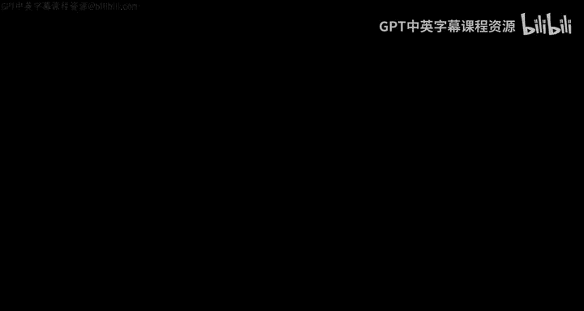
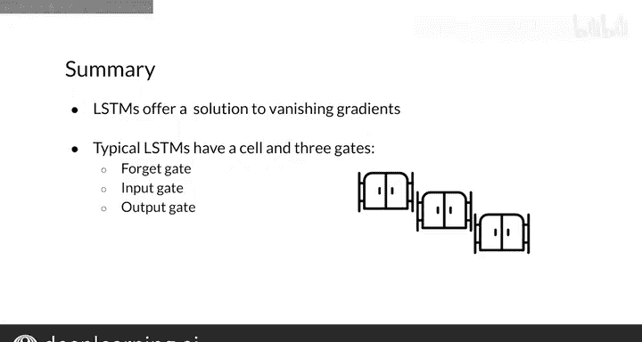

# 吴恩达《自然语言处理｜natural language processing》中英字幕 - P124：17_LSTM介绍.zh_en - GPT中英字幕课程资源 - BV1Hc5ezDEWQ

LSCNs， as I've mentioned before， are the best known solution to the vanish ingredients problem。

Let me tell you about it。Now I'll give you a high level view into the LSCM model。

 what its architecture looks like， along with a few examples of what they are used for in the real world。

The LSTM is a special variety of RNN that was designed to handle entire sequences of data by learning when to remember and when to forget。

 which is similar to what is done in the GRU。An LSTM is essentially composed of a cell state。

 which you can think of as its memory in a hidden state where computations are performed during training to decide on what changes to make。

 and an LSTM has multiple gates that transform the states in the network。

The cell state travels through these gates， that track inputs as it arrives。

 Each one plays a part in deciding how much information to pass along and how much to leave behind。

 The series of gates allows the gradients to flow， avoiding the risk of vanishing or expd ingredients。

I second moment to re this concept to something you might find a bit more familiar。

Imagine receiving a phone call from your best friend。At the time your phone rings。

 you might be thinking of any number of things unrelated to your friend。When you answer the call。

 you put aside those unrelated thoughts while retaining anything that concerns the both of you。

 as your friend gives you some more information on why he is calling。

 you'll be thinking of what else might be relevant to talk about。

With the input from your friend and whatever relevant information you had in mind。

 youll start the conversation with him。 You'll then continue to evolve the conversation in this way until you hang up。

At the end of the call， you will have a memory with the most relevant information from your conversation。

That's how LSCM works， It updates the cell and hidden states constantly using multiple gates so that relevant information is passed along the network and used to produce outputs。

Let's take a look at the basic anatomy of a typical LSCM unit and what each part does。

An LSTM stores information in the cell and hidden states， which are denoted by C and H。

And as with the vanilla RnNs， you have inputs x and outputs y。On a LSTM。

 there are multiple computations performed within a single unit here。

 the information flows through three different gates first。

You have the cell state goes through for Gagate in this step。

 the input and the previous hidden states are used to decide which information from the cell state is no longer important and throws it away。

Then the input gate is used to decide which information from the input and previous hidden state is relevant。

 so it is added to the cell state。And finally， the outputs gate determines the information from the cell state that is stored in the hidden state and used to construct an output at the given time step。

Before diving deeper into the math， let's discuss some of the many applications of LSTMs。

As you might have guessed， it is very handy for building language models。

 spanning use cases from predicting the next character of your email。

To building chatbots capable of remembering longer conversations。

Music composition can be done with LSTMs， and this approach makes a lot of sense。

 considering that music is built using long sequences of notes。

 much like text uses long sequences of words。Other cool applications are automatic image captioning and speech recognition。

In overcoming the problems of a traditional R&N， the LSTM has become an incredibly popular tool with a wide range of uses。

And has helped evolve NLP in some exciting ways that I'll discuss in more detail towards the end of this week。

In summary， LSTMs are a solution to the vanished ingredients problem。

 and that typical STMs have cell and hidden states and three gates， which are the fergate gates。

 inputs gates， and outputs gates。

Now you understand LSTMs on the high level， but what exactly is the math behind the LSTM computation？

I'll show you this in the next video。