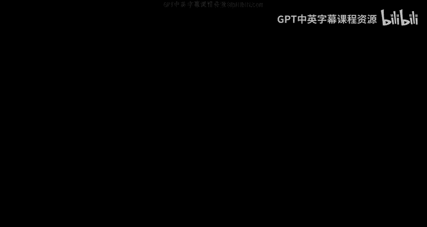
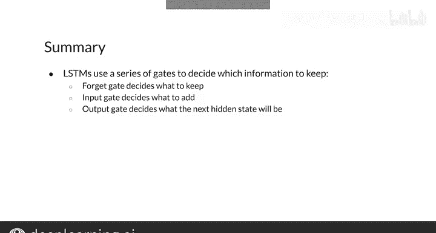

# 吴恩达《自然语言处理｜natural language processing》中英字幕 - P125：18_LSTM架构.zh_en - GPT中英字幕课程资源 - BV1Hc5ezDEWQ

In this video， I will show you in more detail the architecture of a LSCM and the computations that are made inside a single cell。

As you might recall from earlier。In a typical LSTM， you have a Excel state， a hidden state。

 inputs x and outputs y。You can think of the cell states as the memory of your network and gets modified using information from the inputs and the previous hidden states。

The gates and an LSTM decide what information is kept or added。And selects the output at every step。

You will typically have three gates， if forget gates used to decide which information is kept and which is discarded from the previous cell state。

The input gate that selects the relevant information from the input in previous hidden states。

And the output gate that determines which information from the cell state is used as output and stored in the hidden state。

 sigmoid activation functions with different trainable parameters are applied to the input and previous state for the three gates。

The use of the sigmoid ensures that the values for the gates are between 0 and 1。In practice。

 the values encountered in the vectors corresponding to each gate are very close to either 0 or 1。

 with a value of 0， the gate is closed so information doesn't get through while a value of 1 would let information flow freely。

Another significant computation made inside an LSTM is the candidate cell state。To get it。

 you have to transform the information from the previous hidden states and the current inputs。

A hyperbolic tangent activation function is typically used in different implementations。

It shrinks the information from the previous hidden states and the current inputs to be between negative one and1。

This nonlinear transformation has been used in the past because it improves training performance。

However， you could try other activations and test their behavior。

With the forgotten input gates and the candidate cell date， you can update the cell date。

To get the new cell state， you add the information from the candidate cell state that passes through the input gate to the cell state information this passes through the forgetgate gates。

Finally， you can compute the new hidden states used to produce outputs at a given step。

To get the new hidden state， you pass transformed information from the new cell state through the output gates。

Note that here the new cell states first passes through a hyperbolic tangent activation。Nevertheless。

 some LSTM architectures ignore this information and pass the new South state directly through the output gates。

Let's recap everything I discovered。An LSTM has three gates to decide what information is passed along the network。

The For gate decides what to keep。 the inputs gate decides what to add from the previous hidden step and current inputs。

And the output gate determines the next hidden state and the outputs at the given step。

You now understand the intuition behind LSTMs in deco codingding exercise for this week。

 you'll implement LSTMs on your own in the next video。

 I will show you how to use LSTMs to solve a real NLP task Let's go to the next video。

