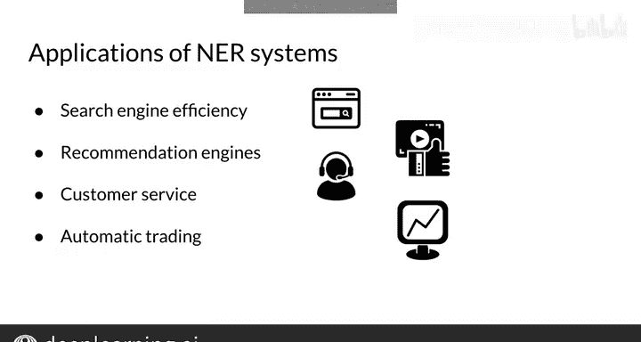

# 吴恩达《自然语言处理｜natural language processing》中英字幕 - P126：19_命名实体识别介绍.zh_en - GPT中英字幕课程资源 - BV1Hc5ezDEWQ

In this video， I will tell you about named entity recognition。 Any E R for shorts。

It's an important problem， and many NLP systems make use of NER components。

 Let me tell you what it is。Named entity recognition is a fast and efficient way to scant text for certain kinds of information。

 N E R systems locate and extract named entities from text。

Named entities can be anything from a place to an organization， to a person's name。

They can even be times and dates。Let's discuss labels used by NER systems in a little more detail as they relate to your programming assignments this week。

Some possible classes you might run across include geographical entities like Thailand。

Organizations like Google or geopolitical entities like Indian。

A few more classes you might encounter include time indicators like the month of December。

 Artacts like this ancient Egyptian statue or a person such as Barack Obama。 As you can see。

 named entities can capture and identify all kinds of things。 sayy you have the following sentence。

Charron flew to Miami last Friday， and named entity recognition system would extract and classify Sharon as a personal name。

 Miami， as a geographical entity。And Friday， as a time indicator。You'll notice that here。

 B dash the not an entity of some kind。And all the other words are classified。 Oh， for filler word。

 You can probably already see how useful this is for content classification。😊。

In a scenario where you need to search large amounts of text for certain words。

 say Manhattan and Brooklyn or Toyota and Subaru， this becomes handy very quickly。

Here are some real world applications of named entity recognition systems。

I mentioned their ability to scan documents for certain things quickly。

 so just imagine how N Es can optimize search engine efficiency。In this case。

 the NER models scans millions of websites once and stores the entities is identified in the process。

Then the tags from your search query are simply matched against the website tags。

The same concept extends to making recommendations where the tags might instead be extracted from your history and compared to similar user histories in order to recommend things you might want to check out。

This also applies to matching customers to an appropriate customer service agent。

This works similarly to a phone tree where you would be prompted to provide some information about your request。

If you are using an app to communicate with your car insurance company。

 you might provide some spoken or typed information， such as I need to add another vehicle。

 or my car was destroyed by a giant flying squirrel。 You then be matched to the appropriate agent。

 accordingly。Another interesting use case is automatic trading。 For example。

 you could imagine building a webcraper to get news articles of the names of certain CEOos。

 stocks or cryptocurrencies， then feeding those articles into a sentiment classification system and making your trades accordingly。

😊，N E R systems have many applications in the field of deep learning。

 I just give you one potential money make for free。 Now， you know what named entity recognition is。

 I think it's really interesting to see the many places where it is used in the next video。

 you will implement your own N E R system。😊。

