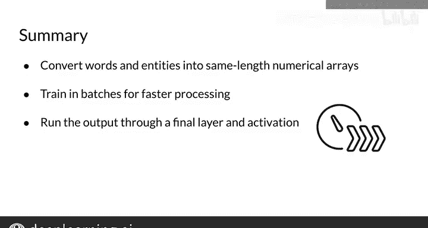

# 吴恩达《自然语言处理｜natural language processing》中英字幕 - P127：20_NER训练数据处理.zh_en - GPT中英字幕课程资源 - BV1Hc5ezDEWQ

To train a NER system， you have to follow several steps for converting text to numbers all the way to making the prediction in this video we will explore all these steps。

 let's dive in。I'll show you how to convert entity classes and label data into arrays of numbers that correspond to one another and how to create a data generator to process your data in batches。

 saving you time and resources， so let's begin。First。

 you will assign each entity class a unique number， so for example， a personal name might be one。

 geographical location might be2。At the time indicator might be3。Next。

 assign each word a number that corresponds to its assigned entity class。

 So given a sentence like Sharon flew to Miami last Friday。

 youll get a corresponding tokenized sentence， where 4282。

 corresponds to the index of Sharon 853 corresponds to flu  hundred and87 corresponds with2 and so forth。

 The O corresponds to the O class， which denotes a filler or unreconized word。

Note also that the numbers you see here are random and are assigned when you process your data。

From this point， each sequence is then transformed into an array of numbers where each number corresponds to the index of the labeled word。

So from a labeled sentence that looks like this， you'll be transforming it into a numerical array。

When processing the dataset， you need to represent each word in the vocabulary as a number。

 as you just saw。This gives you a numerical arrays， but if the arrays are different sizes。

 youll need to handle that to assist with this， you can set the length of your sequences to a certain number。

And add a generic pad token to fill all the empty spaces。

 You will be implementing this in the assignment。But don't worry about it。

It's a relatively simple process， and I'll show you exactly how to do it。

In order to train this named entity recognition system。

 youll first create a tensor for each input and its corresponding label as you saw before。

Then create a data generator to outputput them in batches。The batch size can be anything you want。

 but normally youd want a batch size that is in a power of2， so something like 64，128， 256。

 512 and so forth。Doing this will speed up your processing time considerably。

If you felt alarmed by the words， creates a data generator， don't worry about it。

There will be more on this to come。After the batches are generated， feed them into an LSTM unit。

You will run the outputs from this through a dense or fully connected layer。

Then predict using a log softftmax over K possible classes where K corresponds to the number of possible outputs using log softftmax instead of softftmax is important here。

 because log Softmax gives better numerical performance and gradient optimization。

Let's take a look at a visual of this process。Here are the inputs which include the arrays you created when processing the data。

You will feed them through an LSTM layer with a series of activations and element wise operations。

Run the outputs of that through a final dense layer。

 which is a linear operation on the input vectors。And then you compute a logsmax to get the corresponding outputs。

Here is what the layers might look like when you're implementing them in this week's assignment for your dense layer。

 you'll want to pass in the dimensions of the tag arrays you just created。Now。

 you are ready to accomplish some mighty tasks like numerical array conversion with token padding。

 training in batches for faster processing and running your model through its final dense layer and activation function。

You've come a long way since the beginning of this course， just a bit more to go。

You finally know how to train a NER system from scratch in the next video。

 I will show you how to evaluate your system。