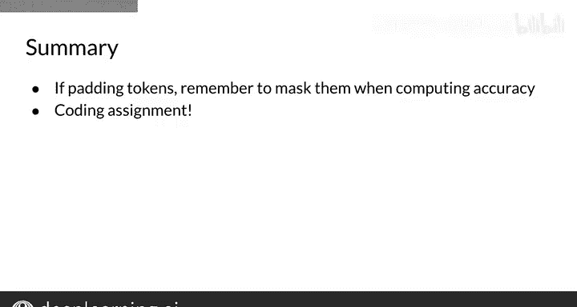

# 吴恩达《自然语言处理｜natural language processing》中英字幕 - P128：21_计算准确率.zh_en - GPT中英字幕课程资源 - BV1Hc5ezDEWQ

Now that you have trained your N ER system， you need to find a way to evaluate it in this video。

 I'll show you how to do that。To evaluate your model。

 you will want to start by passingss the test sets through it to get your predictions。

Then compute the argm or the points where your function reaches its maximum across the pre dictionary。

You will also need to make sure your arrays are padded using the pad token。

 which makes your arrays the same length。At last， compare the outputs against your test labels to see how accurate your model is。

This is how those operations might look in Python。 Know that the Argonmax function takes an axis parameter to indicate this accurately。

 you will need to consider the dimensions of your array。

 The mask variable is where you'll identify any token Is you need to skip over during evaluation。

 One token you might want to skip is your path token。Think about how you might write this quickly。

 and simply。Finally， the accuracy metric is computed by taking the sum of all your test labels and dividing it by the sum of all your mask tokens。

 Nice， youve now reached the conclusion of this week。 Congratulations。 And remember。

 when you pad your tokens， you should mask them before computing accuracy。😊。

Now you're able to process your data， generate it in batches and test it for accuracy。

You should have everything you need for the coding assignments。 best of luck with the assignments。

 and remember to have fun to recap， you have to predict on the test set， guess the arg maxs。

 mask the padded tokens， and then compare with the true labels。 Now。

 you are ready to implement this in the assignment。😊。

