# 吴恩达《自然语言处理｜natural language processing》中英字幕 - P12：11_逻辑回归测试.zh_en - GPT中英字幕课程资源 - BV1Hc5ezDEWQ

Now that you have your data， you will use this datata to predict on new data points。 for example。

 given a new tweet， you will use this data to say whether this tweet is positive or negative In doing so you want to analyze whether your model generalizes well or not in this video we will show you whether your model generalizes well or not and specifically we will show you how to compute the accuracy of your model let's take a look at how you can do this。

For this， you will need XV and Y Val data that was set aside during trainings。

 also known as the validation sets， and The， the sets of optimum parameters that you got from training on your data。

First， you will compute the sigmoid function for x v with parameters theta。

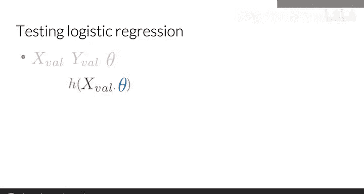

Then you will evaluate if each value of h of theta is greater than or equal to a threshold value。

 often set to 0。5。

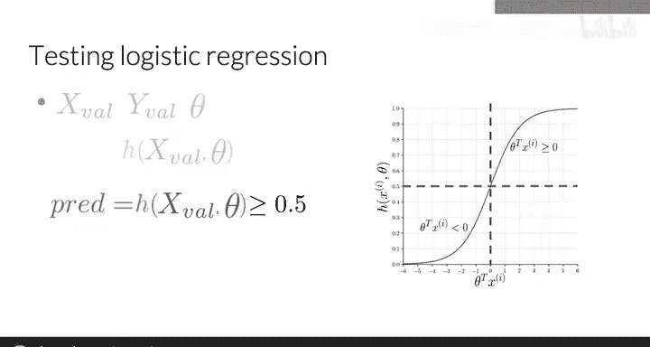

For example， if your Hx theta is equal to the following vector， 0。3，0。8， 0。5， etctera。

 up to the number of examples from your validation set。

 you're going to assert if each of its components is greater than or equal to 0。5。

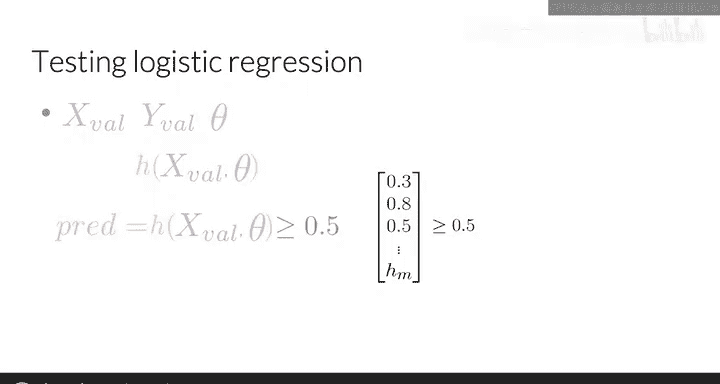

So is 0。3 greater than or equal to 0。5。No， so our first prediction is equal to 0。Is 0。

8 greater than or equal to 0。5？Yes， so our prediction for the second example is one。Is 0。

5 greater than or equal to 0。5。Yes， so our third prediction is equal to one and so on。At the end。

 you'll have a vector populated with zeros and ones indicating predicted negative and positive examples respectively。

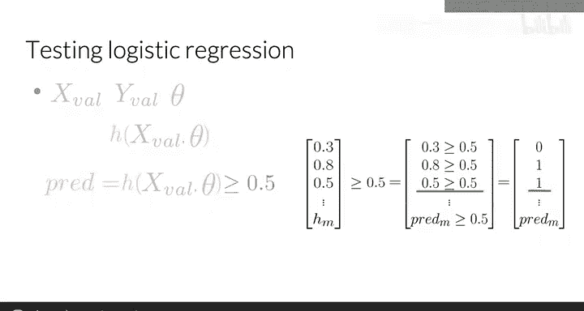

After building the predictions vector， you can compute the accuracy of your model over the validation set。

To do so， you will compare the predictions you have made with the true value for each observation from your validation data。

If the values are equal and your prediction is correct， you'll get a value of 1 and0 otherwise。

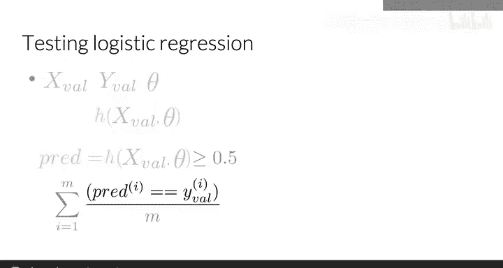

For instance， if your prediction was correct， like in this case。

 where your prediction and your label are both equal to 0。

 your vector will have a value equal to one in the first position。Conversely。

If your second prediction wasn't correct， because your prediction and label disagree。

 your vector will have a value of 0 in the second position。

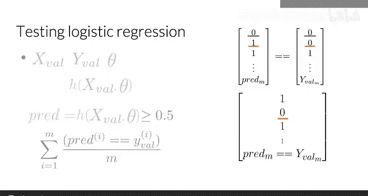

And so on， and so forth。After you have compared the values of every prediction with the true labels of your validation set。

You can get the total times that your predictions were correct by summing up the vector of the comparisons。

Finally， you'll divide that number over the total number m of observations from your validation set。

This metric gives an estimate of the times that your logistic regression will correctly work on unseen data。

So if your accuracy is equal to 0。5， it means that 50% of the time your model is expected to work well。

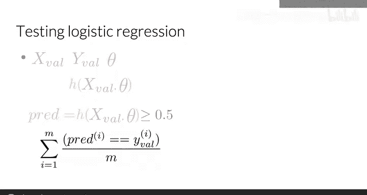

For instance， if your y vow and prediction vectors for five observations look like this。

 you will compare each of their values and determine whether they match or not。

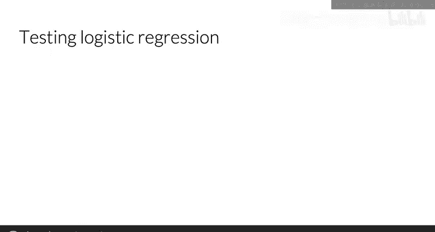

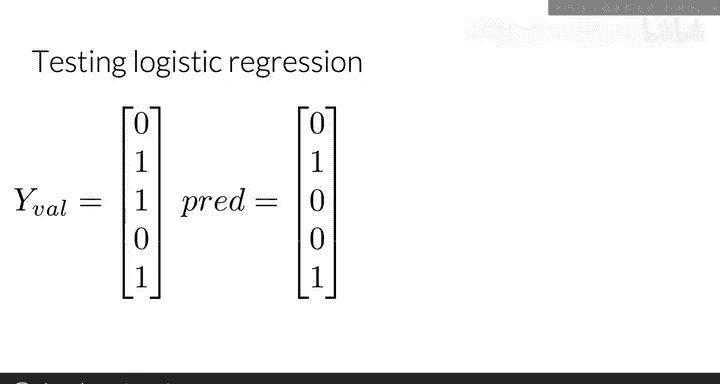

After that， you'll have the following vector。With a single0 in the third position where the prediction and the label disagree。

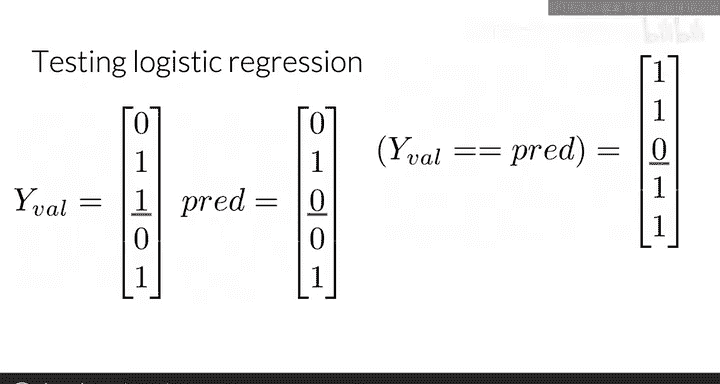

Next， you have to sum the number of times that your predictions were right and divide that number by the total number of observations in your validation set。

For example。You get an accuracy equal to 80%。

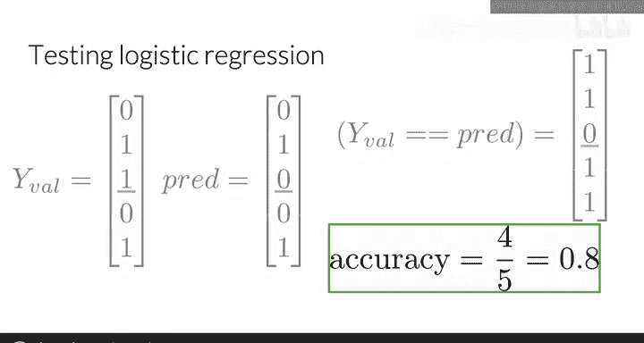

Congratulations on finishing the first week of this specialization。

 You learned many concepts this week。 The first thing you learned is you learned how to preprocess a text。

 You learned how to extract features from that text。

 You learned how to use those extracted features and train a model using those。

 Then you learned how to test your model in this week's programming exercise。

 you're going to get a chance to implement all these concepts that we spoke about。

 feel free to go ahead and do the programming exercise。

 There is also an optional video at the end of this week。

 which covers the intuition behind the cost function for logistic regression。

 If you don't want to watch that video， feel free to go to next week where you will learn about a new classification algorithm known as naive base。

😊。