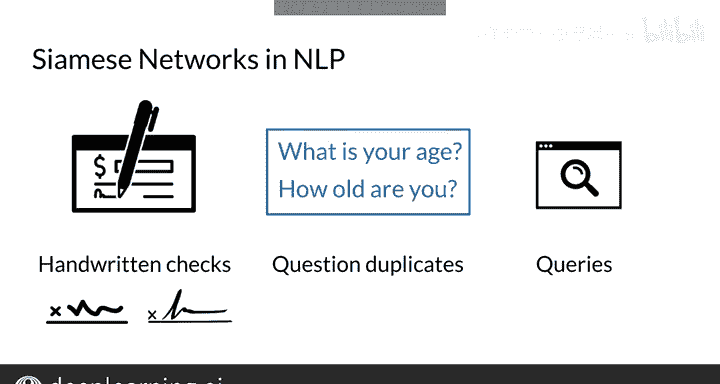

# 吴恩达《自然语言处理｜natural language processing》中英字幕 - P131：24_孪生网络.zh_en - GPT中英字幕课程资源 - BV1Hc5ezDEWQ

Welcome back in this video， you're going to learn about a special type of neural network known as the Siamese network。

 It is a neural network made up of two identical neural networks which are merged at the end。

This type of architecture has many applications in NLP， and in this video。

 you'll see the different examples where you can use it。Consider the following question。

 How old are you。And what is your age。You can see that these questions don't have any words in common。

 However， they both mean the same thing。On the other hand。

 if you are to look at the following questions， where are you from。And where are you going。

 You can see that the first three words are the same。However。

 the last word completely changes the meaning of each question。

This example shows that comparing meaning is not as simple as just comparing words。Coming up。

 you're going to see how you can use Sieses networks to compare the meaning of word sequences and identify question duplicates。

 which is a very important NLP application at the core of platforms like stackck Overflow or Coral。

Before these platforms allow you to post a new question。

 they want to be sure that your question hasn't already been posted by somebody else。Now。

 take this sentence。 I am happy because I am learning and consider it in the context of sentiment analysis and binary classification。

😊，Now， in training a classification algorithm， you discover what features give this statement a positive or negative sentiment。

With Siamese networks， you'll be aiming to identify what makes your input similar and what makes them different。

 Take a look at these two questions。 What is your age and how old are you。

When you build a Siese model， you're trying to identify the difference or the similarity between these two questions。

 You do this by computing a single similarity score。

 representing the relationship between the two questions。

 and based on that score when compared against the threshold。

 you can predict whether these two are the same or different。

Sese networks have many applications in NLP。 You can use them to authenticate hundredwrittens and checks by determining whether two signatures are the same or not。

You can use them to identify question duplicates on platforms like Qra or stack Overflow。

And you can use them in search engine queries to predict whether a new query is similar to the one that was already executed。

 These are just a few examples， but there are many more applications of Siese networks in NLP。

You can use Siese networks and many types of MLLP applications In the next video。

 Ill walk you through the architecture that is used in this type of model。

 and I'll show you how you can use it in a text。I'll see you in the next video。

