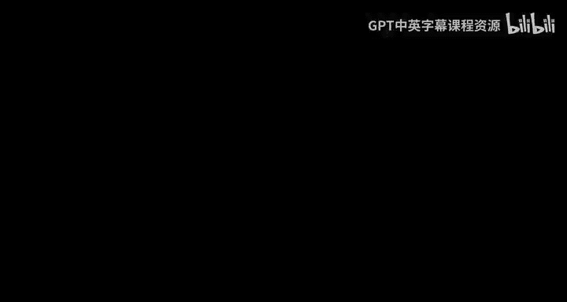
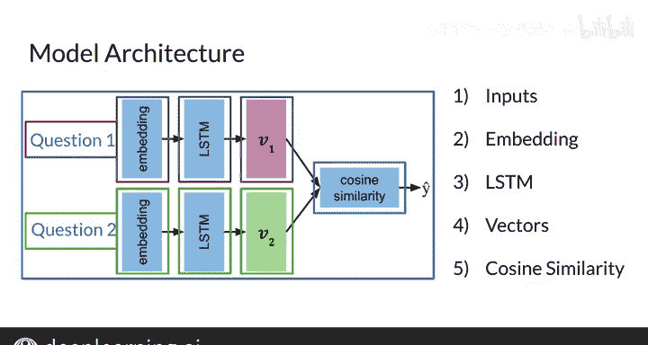

# 吴恩达《自然语言处理｜natural language processing》中英字幕 - P132：25_架构.zh_en - GPT中英字幕课程资源 - BV1Hc5ezDEWQ

Samese networks have a special type of architecture。

 they have two identical sub networksworks which are merged together to produce a final output or a similarity score。

I like to think of these two sub networkss as sister networks。

 which come together to produce a similarity score。This is a model architecture for A SiMs network。

Note that the architecture presented here is just an example。

 not all Si'ese networks will be designed to contain LSTMs。On the left。

 you have two inputs which represent question 1 in question 2。 You'll take each question。

 transform it into an embedding， and then you'll run the embedding through an LSTM layer to model the question' meaning。

Each LSTM outputs a vector， so in this architecture you have two identical subnets。

 one for question 1， and a second for question2。An important note here is that the sub networks share identical parameters。

 that is the learned parameters of each sub network are exactly the same。

 so you actually only need to train one set of weights， not to。Then given the two outputs vectors。

 one corresponding to each question， find their cosine similarity。

Recall that the cosine similarity is a measure of similarity between two vectors。

When two vectors point generally in the same direction。

 the cosine of the angle between them is near one。And for vectors that point in opposite directions。

 the cosine of the angle between them is minus-1。 If that sounds unfamiliar， don't worry。Right now。

 you just need to know that the cosine similarity tells you how similar two vectors are。

 and in this case， it tells you how similar the two questions are。

So the cosine similarity gives the Siese network prediction denoted here by the variable y hat。

 which will be a value between 1 and positive one。 if y hat is less than or equal to some threshold。

 so then you'll say that the input questions are different。And if y hat is greater than tau。

 then you will say that they are the same。 The threshold tau is a parameter that you'll choose based on how often you want to interpret cosine similarity to indicate that two questions are similar or not。

 a higher threshold means that only very similar sentences will be considered similar。

If you think of this process as a series of steps you take to get from your input to your output。

 it would go something like this。 you start with the model architecture for a Siyese network made up of two identical subnet In this case your inputs are questions that you feed into each sub network and each question gets transformed into an embedding and pass through an LSTM layer。

 then you take the outputs of each of the subnet and compare them using cosine similarity to get your Y hat。

After seeing the model architecture， I'll start talking about different cost functions you can use for this type of architecture。

