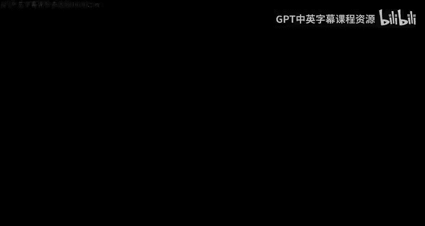
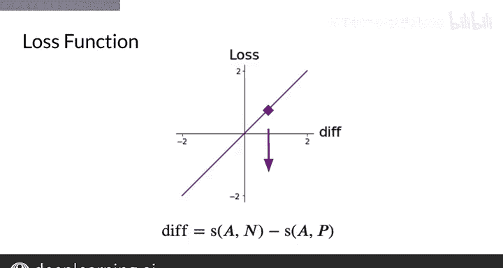

# 吴恩达《自然语言处理｜natural language processing》中英字幕 - P133：26_成本函数.zh_en - GPT中英字幕课程资源 - BV1Hc5ezDEWQ

I am going to show you how the cost function for a SiamMese network works。

This is known as the triplet loss。 So let's dive in。

I will now show you a simple loss function you can use in your Siamese network。 just as a recap。

 This is the overall structure of the Siamese network。

 which enables you to predict whether two questions are similar or different。

 with the outputs of the network， you are able to calculate why hat。

 which is the similarity between the two questions。

So now I'll show you a loss function for a Siese' network。

 I'll start by looking at this first question， which is， how old are you。

 I'll call this first question the anchor， which I am going to use to compare against two other questions。

 relative to the anchor， other questions that have the same meaning as the anchor are called positive questions。

 whereas questions that do not have the same meaning as the anchor are called negative questions。

Not that the meaning of positive and negative in the context of finding question duplicate is referring to whether a question is similar to the anchor or not。

 and not whether it has a positive or negative sentiment。 So the question。

 What is your age is considered a positive question relative to the anchor。

 Because how old are you and what is your age mean the same thing and this other question。

 Where are you from。 is considered a negative question。

 because it does not have the same meaning as the anchor question。

Here is the definition of cosine similarity between two vectors。

That will be the similarity of function S。To train your model you will be comparing the vectors that are output by each sub network using similarity。

 so for this example， you are going to take the similarity between A and B where A refers to the anchor question and P refers to the positive question。

Similarity is bounded between negative 1 and one。 So for vectors that are completely different。

 the similarity is near negative1， and for vectors that are nearly identical。

 their similarity is close to positive 1。So for a well trained model。

 you would like to see a similarity close to one when comparing the anchor and a positive example。

Similarly， when comparing the anchor to the negative example。

 a successful model should yield a similarity close to negative 1。To begin building a loss function。

 you start with the similarity of a and N and subtract the similarity of A and P to calculate the difference。

So what you have here is a loss function that allows you to determine whether your model is roughly doing what you hope it will do。

 namely， finding that the anchor and the positive example are similar and that the anchor and the negative example are different。

As the difference gets bigger or smaller along the x axis。

 the lo gets bigger or smaller along the Y axis。So when minimizing the loss in training， you are。

 in effect， minimizing the difference In the next video， I'll introduce triplets。

