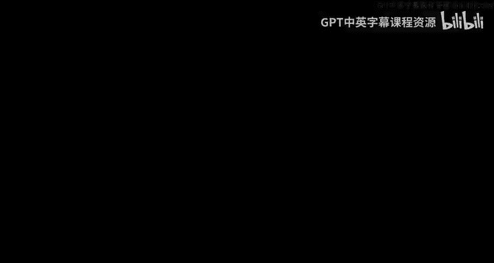
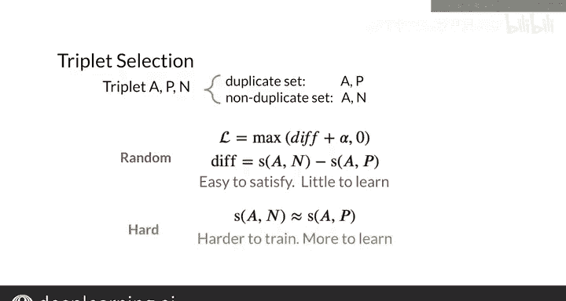

# 吴恩达《自然语言处理｜natural language processing》中英字幕 - P134：27_三元组.zh_en - GPT中英字幕课程资源 - BV1Hc5ezDEWQ

This week， rather than classifying an input using a multiple categories。

 you're going to build a model that will allow you to identify if two inputs are equivalent in this video。

 you will explore triplets and how to use them for training your model。 Let's see how this works。

Here are three questions。Where the first one is， how old are you， and it is the anchor A。

 The second one is a positive example， P。 What is your age and the third one。

 Where are you from is a negative example N。Recall that here。

 positive and negative are related to whether a question has the same meaning as the anchor or not。

These three components give rise to triplets， which are groups of anchors positive and negative examples。

 According， triplet loss is the name for a loss function that uses these components。

The intuition behind the simplest lost function that uses triplets is to minimize the difference between the similarity of A and N and the similarity of A and P。

This is equivalent to maximizing the similarity between the anchor and the positive example while minimizing the similarity between the anchor and their associated negative examples。

 you already know that as the difference gets bigger or smaller along the x axis。

 the loss gets respectively bigger or smaller along the y axis。

 but know that when the diff is less than0， the loss decreases towards negative values。

And for some similarity functions， the simple loss function can even go to negative infinity。However。

 you want your model to tell apart positive from negative examples， and at some point。

 it is not essential for the difference to continue decreasing。

So you could constrain the loss function to take values greater than or equal to0。

 ensuring that learning happens until the difference between similarities is close or equal to0。

With this， the loss function now doesn't take negative values。 However。

 you don't want your model to have a barely acceptable performance。

 You need your model to be confident enough and distinguish between negative and positive values with ease。

 So you need your model to learn until the model achieves a specific value for the difference between similarities。

 That's why you would want to use a margin alpha in this triplet loss。

 It ensures that learning goes on until the difference between the similarities is equal or close to the margin value。

You can think of all these as shifting the loss function a little to the left。

Let's say you chose alpha to be 0。2。 If the difference between similarities is minimal like negative 0。

1。then if you add it to alpha equal to 0。2， the result is still greater than 0。

This sum of the diF plus alpha results in a positive loss that tells the model to learn from that example。

 you can see this visually in the line chart where the loss function is shifted to the left by alpha units。

The diff is along the horizontal axis。 When the difference is less than 0， but small in magnitude。

 the loss is greater than 0。So if the difference is smaller in magnitude than alpha。

 then the loss function is positive。And the model gets the message that this can still improve its performance。

In practice， alpha is hyperparmeter。You will implement the triplet loss with the margin alpha for this week's assignment。

 which follows the simple form。Note that it is a function of the anchor。

 positive and negative example representations derived from your neural network。

 a small detail worth noting in these explanations。

 Ive been using cosine similarity because that's what you'll be using the programming assignment。

 However， you could also use a distance metric or other similarity functions with a appropriate modifications to the loss function。

 but you have to be careful。You must interpret distance metrics as the opposite of similarity functions。

 the lower the distance between the two vectors， the more similar they are。

 recall that one example of a distance metric is the Euclidean distance。

 which you saw in previous specialization courses， selecting triplets。

 A P and N for training involves two steps。 First， select a pair of questions that are known to be duplicates。

To serve as the anchor and positive example from the training set。 Second。

 select a question that is known to be different in meaning from the anchor to form the anchor and the negative pair。

If you were to select triplets randomly， you would be likely to choose anchors， positives。

 and negative examples that would lead to losses close to zero。

And remember that the network will have nothing to learn from those triplets when the loss gets to 0。

So you can train more efficiently if you choose triplets that creates a challenge to the model。

 so instead of selecting random triplets， it will specifically select so called hard triplets。

These are triplets that are more difficult for the model to tell apart the negative and the positive example。

In those， the similarity between anchor and negative is very close too。

 but says still smaller than the similarity between anchor and positive。

When the model encounters a hard triplet， it needs to adjust its weights to yield similarities that line up with the real world labels。

 So by selecting hard triplets， you focus the training process in the problematic cases。

 so the model gets the most information on how to improve its performance。

Here I spoke about how hard triplets are a way to improve the training process。

 I also talked about the margin alpha and the triplet loss function In the following video。

 you'll see how all these concepts come together to help you create a cost function for training your model。

